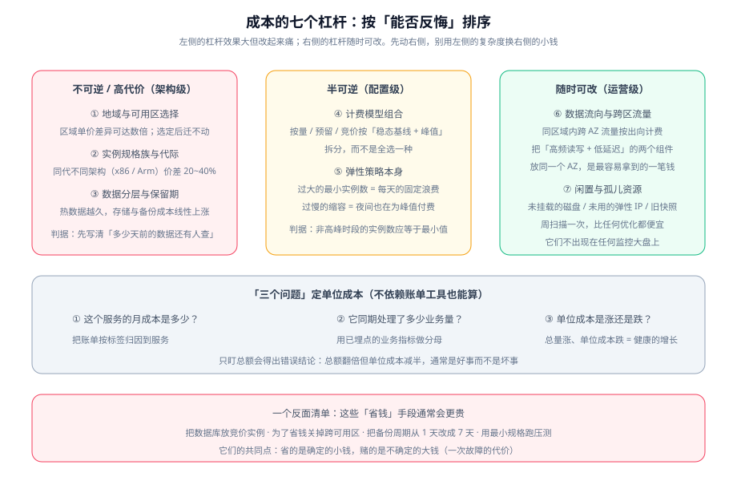

# 成本与规格选型

云成本有一个反直觉的特点：**账单里的大头通常不是你「买贵了」，而是你「决定错了」**。规格族、区域、可用区数量、数据保留期——这些在第一天定下的东西，决定了账单的**形状**；而后面所有「省钱动作」（清理闲置、调阈值）只能在这个形状里做调整。

本页把七个杠杆按「能否反悔」排序，给出计费模型的组合方式与单位成本口径，并附一份**反面清单**：这些「省钱」手段通常会更贵。



::: tip 一句话定位
**先动右侧（可逆）的杠杆，别用左侧（不可逆）的复杂度去换右侧的小钱。** 顺序错了的典型形态是：为了让账单好看，把数据库放上竞价实例，省下两百块，赌上一次全站不可用。
:::

## 七个杠杆：按「能否反悔」排序

| # | 杠杆 | 反悔成本 | 典型幅度 | 判据 |
| --- | --- | --- | --- | --- |
| 1 | **地域选择** | 极高 | 区域间单价差异可达数倍 | 选择前把「单价 + 合规 + 用户延迟」三项一起看 |
| 2 | **实例规格族与代际** | 高（要重建制品） | 同代不同架构可达 20~40% | 只用 arm64 时成本优势明显；前提是 CI 能出 arm64 制品 |
| 3 | **数据分层与保留期** | 高（历史数据不可重采） | 线性 | 先写清「多少天前的数据还有人查」 |
| 4 | **计费模型组合** | 中（预留买错要等到期） | 预留可显著低于按量 | 按「稳态基线 + 波动 + 可中断」三类拆 |
| 5 | **弹性策略本身** | 低 | 取决于最小实例数与缩容速度 | 非高峰时段实例数应等于最小值 |
| 6 | **数据流向与跨区流量** | 低 | 与调用量成正比 | 高频读写 + 低延迟的两个组件放同一可用区 |
| 7 | **闲置与孤儿资源** | 零 | 视历史遗留 | 周扫描一次；**这类资源不出现在任何监控大盘上** |

::: danger 第 3 条为什么属于「高反悔成本」
因为它约束的是**已经发生的过去**。数据保留期写错的两个方向都有代价：

- 留得太短：某天需要查 30 天前的数据，**它已经不存在了，无法补采**；
- 留得太久：热存储成本按天累积，且降采样策略没设计的话，查询也会变慢。

**先写下判据再设参数**：「多少天前的数据还有人查」——答不上来就先按行业常见的 15 / 30 / 90 三档，并配一条自动转冷规则。
:::

## 计费模型的组合：三类容量，三种买法

| 容量类型 | 特征 | 计费模型 | 关键约束 |
| --- | --- | --- | --- |
| **稳态基线** | 7×24 都要有 | 预留 / 包年包月 / 承诺用量 | 买错只能等它到期——**按「最低水位」买，不要按均值买** |
| **日常波动** | 白天多夜里少 | 按量 | 弹性策略决定这部分花多少 |
| **峰值溢出** | 大促、突发 | 竞价 / Spot | 必须处理回收通知、必须无状态 |

::: warning 预留最容易买多的原因
按**均值**买预留（例如「一天平均 12 台」），会在夜间浪费 4 台、白天又补 8 台按量——两头都不划算。

正确基准是**最低水位**（例如夜里 8 台），也就是「无论业务怎么波动，我至少要跑的台数」。**波动部分本来就应该按量付费**——那正是弹性的意义所在。
:::

```shell
# 用一个月的历史数据判断「最低水位」：取每日实例数的最小值的众数
# 假定已导出实例数时间序列为 inst.csv（列：时间, 实例数）
awk -F, 'NR>1 {d=substr($1,1,10); if (!(d in m) || $2 < m[d]) m[d]=$2}
         END { for (d in m) print m[d] }' inst.csv | sort -n | uniq -c | sort -rn | head -5
# 判读：出现次数最多的那个「每日最小值」就是预留的合理基数
```

## 规格选型：三件事决定单价与适配

| 决策点 | 要问的问题 | 常见错误 |
| --- | --- | --- |
| **架构（x86 / arm）** | CI 能否产出 arm64 制品？依赖里有二进制包吗？ | 只算单价优势，没算「CI 与镜像重建」的一次性投入 |
| **代际** | 上一代是否更成熟（大内存、本地盘形态是否被覆盖）？ | 盲目追最新代：大内存与本地盘形态在新代可能还没覆盖 |
| **族系（通用/计算/内存/突发）** | 我的瓶颈是 CPU、内存还是网络？ | 用**突发性能实例**跑 7×24 高负载：CPU 积分耗尽后性能骤降，且**厂商通常不为此提供 SLA 承诺** |

::: info 「突发能力」不能进容量规划
很多实例族的规格表会写「基础/突发带宽」「单核最大睿频」这类指标。它们的共同特征是**依赖物理机整机负载**，因此厂商通常明确标注为突发能力、**不作为 SLA 承诺**。

**判据：容量规划只能按「基础值」算。** 把突发值当稳态值，会在邻居繁忙时莫名其妙地达不到预期。
:::

## 单位成本：不依赖账单工具也能算的三个问题

只盯总额会得出错误结论。**总额翻倍但单位成本减半，通常是好事而不是坏事。** 三个问题足以建立口径：

| 问题 | 数据来源 | 说明 |
| --- | --- | --- |
| ① 这个服务的月成本是多少？ | 账单按**标签**归因到服务 | 标签必须在上线时就打好，事后补成本极高 |
| ② 它同期处理了多少业务量？ | 已有埋点的业务指标（请求数 / 订单数 / 处理字节数） | 分母要是**业务量**，不是「实例数」 |
| ③ 单位成本是涨还是跌？ | ① ÷ ② 的时间序列 | 这是唯一能回答「涨得对不对」的指标 |

::: tip 标签是成本治理的地基，而它只能在上线时打
云上账单的**归因能力完全依赖资源标签**。上线时没打标签，事后要靠 IP、实例名、创建时间去反推——那是一项准确率不稳定且永远做不完的工作。

**最小标签集三个**：`service`（服务名）、`env`（环境）、`owner`（负责人）。三个字段的成本几乎为零，但决定了账单能不能被读懂。
:::

## 反面清单：这些「省钱」手段通常会更贵

| 手段 | 表面省下的 | 真实代价 |
| --- | --- | --- |
| 把数据库放竞价实例 | 可观的单价差 | 一次回收就是数据不一致或主库切换，**且回收通知对数据库基本无用** |
| 为了省钱关掉跨可用区 | 跨区流量费 | 多可用区退化成两套各管一半，单区故障时**一半用户不可用** |
| 把备份周期从 1 天改成 7 天 | 备份存储费 | 最坏情况下丢 7 天数据；**恢复时间点（PITR）能力同时丧失** |
| 用最小规格跑压测 | 压测成本 | 压测结论**不可用于容量规划**——它的作用是发现瓶颈不是测上限 |
| 关掉非高峰的监控告警 | 少量实例费 | 夜间故障无人知晓；**这正是故障成本最高的时候** |
| 把日志保留期砍到 1 天 | 日志存储费 | 排障与审计同时失去证据 |

::: danger 这些手段的共同结构
**省的是确定的小钱，赌的是不确定的大钱。**

判据：**如果这个手段的效果是「降低冗余 / 缩短可追溯窗口 / 减少证据」，就必须先算出「最坏情况下损失什么」，再决定要不要做。** 算不出来就不要做——不是因为保守，而是因为在缺少量化的情况下，「省 200 元、丢 3 小时数据」不是一个可比较的选择。
:::

## 常见错误

| 症状 | 最可能的原因 | 怎么确认 |
| --- | --- | --- |
| 账单月月涨，说不清涨在哪 | 资源没有标签，无法归因 | 抽查 20 个资源的标签完整率 |
| 预留买多了 | 按均值而不是按最低水位买 | 对比夜间实例数与预留数 |
| 夜间成本与白天接近 | 缩容阈值/冷却不当，夜里没缩 | 看 24 小时实例数曲线 |
| 跨区流量费突然变高 | 某个高频调用被改成跨区 | 按源/目的可用区拆分流量账单 |
| 有笔费用找不到对应资源 | 闲置磁盘、未用弹性 IP、旧快照 | 按「未被引用的资源」扫描 |
| 压测结果与实际差很远 | 压测用了最小规格或突发型实例 | 对比压测与生产规格的**基础值** |

## 验证方式

| 验证项 | 操作 | 预期 |
| --- | --- | --- |
| 标签完整 | 抽查资源标签 | `service` / `env` / `owner` 三项齐全率 100% |
| 单位成本口径 | 计算 ① ÷ ② 的时间序列 | 有连续数据，能看出趋势 |
| 预留基数合理 | 对比预留数与夜间最低实例数 | 两者接近（差额由按量补） |
| 夜间确实缩容 | 看 24 小时实例数曲线 | 低谷时段等于最小值 |
| 跨区流量可解释 | 按源/目的 AZ 拆分流量费用 | 每一笔都能对应到调用 |
| 无孤儿资源 | 扫描未挂载磁盘 / 未用 IP / 旧快照 | 清单为空或已处理 |
| 突发值未被当稳态 | 检查容量规划依据 | 全部基于基础值 |

三条核心判据：

1. **标签完整率达 100%**：抽查资源，`service` / `env` / `owner` 齐全——不齐全则账单无法归因，后面所有分析都不成立；
2. **单位成本有趋势**：`成本 ÷ 业务量` 有连续的时间序列，能回答「涨得对不对」；
3. **夜间确实缩容**：24 小时实例数曲线在低谷段等于最小值——否则说明「弹性」没有真正发生，只是买了更多机器。

三条全过，成本部分才有可优化的地基；在此之前做的任何「省钱动作」都是盲调。

## 延伸阅读

1. **[实战：把监控大盘搬上云](../Practice/index.md)**：把七个杠杆用到具体项目上，并给出 R1~R10 验收断言。
2. **[常见问题与最佳实践](../FAQ/index.md)**：分诊表、高频问答与上线自查。
3. **[云原生 · 云成本治理](../../CloudNative/FinOps/index.md)**：账单治理的流程与口径（三阶段闭环、单位成本定义、降本杠杆）。


## 与「容量与成本治理」专题的分工（第 156 天补充）

| 问题 | 本页 | [容量与成本治理](../../CapacityCost/index.md) |
| --- | --- | --- |
| 这一台买多大、买哪种计费 | **本页回答**：七个杠杆、规格三件事、三类容量的三种买法 | 只引用，不重复 |
| 谁负责、多久看一次、越线怎么办 | 不回答 | **那边回答**：四个决策点、月度三步 + 季度一步 |
| 账怎么分到团队 | 只点到「标签是地基」 | **那边回答**：三级归集、未分摊池、K8s 分摊公式 |
| 买承诺买多少 | 给判断原则 | **那边回答**：覆盖率/利用率、盈亏平衡利用率、分批与到期错峰 |

**一句话结论**：本页是**单次决策**的判据，那边是**周期治理**的流程；单次决策做对一次不难，难的是每个月都有人在做。

**这一页特有的坑**：把七个杠杆当成一张「检查清单」逐条打勾，会得到一堆互不相关的动作。杠杆必须**按反悔成本排序后串起来用**——先动可逆的（保留期、规格），再动不可逆的（地域、架构），否则省下的小钱会被后续的迁移成本吃掉。

## 参考资料

- [云原生 · 云成本治理（FinOps）](../../CloudNative/FinOps/index.md)：治理闭环与统一账单口径
- [弹性伸缩](../AutoScaling/index.md)：三类容量拆分在伸缩策略上的落点
- [可用性拓扑](../Availability/index.md)：跨区流量与双份容量
- AWS EC2 定价与计费模型：https://aws.amazon.com/ec2/pricing/
- AWS Savings Plans 与预留实例对比：https://docs.aws.amazon.com/savingsplans/latest/userguide/what-is-savings-plans.html
- 阿里云 ECS 实例规格族（含基础/突发性能标注）：https://help.aliyun.com/zh/ecs/user-guide/general-purpose-instance-families
