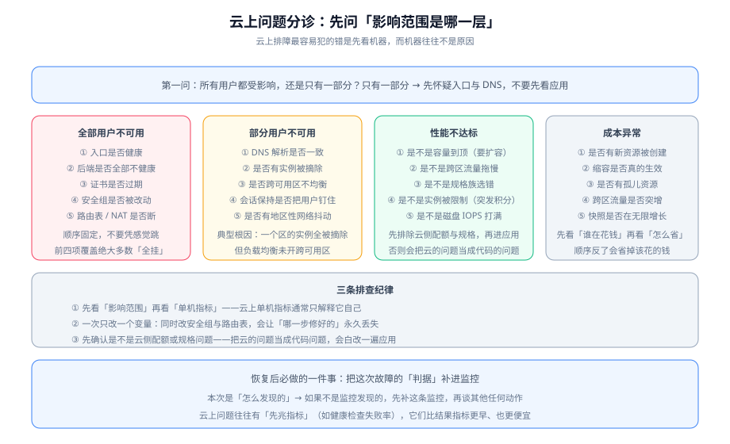

# 常见问题与最佳实践

本页收口整个专题：把高频疑问分类回答、把上线前必须过的自查做成一份可勾选清单，并给出可以直接抄进团队文档的最佳实践与术语表。

::: tip 一句话定位
云上排障的第一步不是看机器，而是**看范围**。本页的分诊表与自查清单都基于同一条判断：**单机指标只解释它自己；能解释「一批用户同时不可用」的，通常是入口、DNS、安全组或可用区。**
:::

## 分诊表：先问影响范围

| 现象 | 先问的第二个问题 | 优先去看 | 先去哪一页 |
| --- | --- | --- | --- |
| 全部用户不可用 | 入口是否健康？后端是否全部不健康？证书是否过期？ | 负载均衡后端组健康状态、证书有效期 | [负载均衡](../LoadBalancing/index.md) |
| 部分用户不可用 | DNS 解析是否一致？是否跨可用区不均衡？ | 解析记录一致性、跨可用区开关 | [可用性拓扑](../Availability/index.md) |
| 只有某个可用区的用户不可用 | 那个可用区的子网还有路由吗？NAT 还在吗？ | 路由表、NAT 网关 | [网络边界](../Network/index.md) |
| 性能不达标但 CPU 不高 | 是不是被限流/突发积分耗尽？磁盘 IOPS 打满？ | 实例规格族与云监控的**基础值**指标 | [成本与规格选型](../Cost/index.md) |
| 扩容了但没效果 | 新实例**注册进负载均衡了吗**？健康了吗？ | 伸缩组活动记录、后端组 | [弹性伸缩](../AutoScaling/index.md) |
| 账单突然上涨 | 是新资源，还是流量，还是快照？ | 按标签拆分账单、扫描孤儿资源 | [成本与规格选型](../Cost/index.md) |
| 夜里没人但成本不降 | 缩容阈值与冷却时间对不对？ | 24 小时实例数曲线 | [弹性伸缩](../AutoScaling/index.md) |
| 内部服务之间时通时不通 | 是不是跨了可用区？安全组变更过吗？ | 安全组引用关系 | [云上安全边界](../Security/index.md) |
| 实例能出网但公网访问不进来 | 这是**期望行为**还是故障？ | 先确认它该不该有公网入口 | [网络边界](../Network/index.md) |
| 从没做过故障演练 | 演练过**可用区级**吗？ | 演练记录 | [可用性拓扑](../Availability/index.md) |
| 「监控系统自己挂了」 | 监控的存储层是不是单点？ | 时序库所在可用区 | [实战](../Practice/index.md) |

文档边界不清时，先读 [与相邻专题的分工](../index.md)，再回到上面这张表。

## 分类问答

### 规划与选型

#### Q1：项目刚起步，需要一上来就做多可用区吗？

**不需要，但「把第二个可用区的子网划出来」需要立刻做。**

这两件事的成本差了一个数量级：划子网**不产生实例费用**，而事后加可用区要重划网段、重建后端、重配负载均衡。所以正确的起步是：

1. 划两个可用区的子网（免费）；
2. 业务先在**一个**可用区跑通；
3. 等到「有真实峰值数据 + 有人值班」时，再把第二个可用区填上。

判据来自 [总览](../Overview/index.md)：**先问「这次改造要挡的是哪种故障」。** 还不知道峰值在哪的时候，多可用区只是在为想象中的故障买单。

#### Q2：2 个可用区还是 3 个可用区？

按「你希望哪种操作不需要业务降级」来选：

| 你的诉求 | 需要的可用区数 | 原因 |
| --- | --- | --- |
| 扛住某个可用区整体故障 | **2** | 一个挂了，另一个还能全量承载 |
| 做滚动维护时**不降级** | **3** | 维护一个区时还剩两个区承载全量 |
| 只是「有一个异地容错」的心理安全 | 1 就够 | 这时该做的是备份，不是多可用区 |

**2 AZ 的隐藏前提是「单区能承载全量」**——如果容量规划里单区只有 50% 余量，那么 2 AZ 只是把全挂改成半挂。取舍表的完整推导见 [可用性拓扑](../Availability/index.md)。

#### Q3：哪些情况下应该先**不要**做云上架构改造？

五类情况，全部指向同一个结论：**先解决不是架构的问题。**

| 情况 | 该先做什么 |
| --- | --- |
| 还没上线、没有真实流量 | 单区跑通业务，同时把两个子网划好 |
| 有单点但不是可用区级单点 | 补超时、重试、降级（下游才是真凶） |
| 团队还没有值班能力 | 先建监控告警——**没人知道的自动切换等于没切** |
| 成本压力大但账单很小 | 先清闲置与孤儿资源 |
| 业务本身是单点（如单体数据库） | 先加只读副本与备份，把「恢复时间」做上来 |

完整判据见 [总览](../Overview/index.md)。

### 网络与入口

#### Q4：私有子网里的实例为什么还能访问外网？

因为**出网与入网是两件独立的事**，方向决定它们由谁控制：

| 方向 | 由什么控制 | 私有子网的典型配置 |
| --- | --- | --- |
| **出网**（实例主动访问外部） | 路由表 + NAT 网关 | **允许**——否则装不了依赖、连不上对象存储 |
| **入网**（外部访问实例） | 子网的公网路由 + 安全组 | **禁止**——路由表里没有指向网关的默认路由 |

所以「私有」指的是**没有被分配公网入口**，不是「不能出去」。判断方法很干脆：从公网 `curl` 它，应该是**超时**（流量到不了）而不是**连接被拒**（到了但没人听）。

#### Q5：安全组和网络 ACL，到底该用哪个？

**默认只用安全组，ACL 只在一种情况下才需要。**

| 维度 | 安全组 | 网络 ACL |
| --- | --- | --- |
| 作用对象 | 实例（网卡） | 子网 |
| 状态 | **有状态**：放行的请求，回包自动放行 | **无状态**：出入向必须分别配 |
| 规则 | 只有允许，没有拒绝 | 既有允许也有拒绝 |
| 典型用途 | 99% 的场景 | 需要一条**显式拒绝**把某个网段整段挡在外面 |

**判据：如果你的需求是「允许谁访问我」，用安全组；如果是「把某个来源整段拉黑」，才需要 ACL。** 同时维护两套规则最容易产生的故障是「安全组放行了，ACL 忘了配回程」。

#### Q6：负载均衡的「跨可用区」开关关掉会怎样？

你的多可用区会**在流量层面退化成两套各管一半**：

- 开启时：A 区的后端挂了，流量转到 B 区，用户无感；
- 关闭时：A 区的后端挂了，**只有请求落到 A 区的那部分用户受影响**，并且这部分请求不会被转走。

这是「看起来有多可用区、实际只有一半」最典型的成因，也是 [分诊表](#分诊表-先问影响范围) 里「部分用户不可用」的第一嫌疑。判据：查后端组详情，确认后端实例来自 **2 个**可用区。

### 弹性与成本

#### Q7：伸缩组扩容了，为什么性能没提升？

按顺序排查这四条，**前三条都是配置问题，不是容量问题**：

1. **新实例有没有注册进负载均衡？** 没注册 = 扩容只是多花了钱；
2. **新实例健康吗？** 健康检查路径配错时，新实例永远停在「不健康」；
3. **扩容来不来得及？** 实例从启动到健康需要时间，突发流量到达的速度可能远快于扩容速度；
4. **指标选对了吗？** 用 CPU 做扩容信号，对「CPU 不高但排队很长」的负载是失灵的。

**最小实例数也要检查**：如果它被设成了接近峰值，那么「扩过容」这个现象根本不会出现——判据是**非高峰时段实例数等于最小值**。

#### Q8：竞价（Spot）实例能用在生产吗？

**能，但只有一类负载能用：无状态且可重放。**

| 可用 | 不可用 |
| --- | --- |
| 无状态 Web/API 服务（多副本） | 数据库主库 |
| 批处理与离线计算 | 消息中间件的主节点 |
| CI 构建节点 | K8s 控制面 |
| 大盘/看板这类可重来的服务 | **任何「重启就丢状态」的有状态中间件** |

两个硬前提：**① 必须处理回收通知**（主流云均提供，AWS 为 2 分钟中断通知）；**② 必须有按量基线兜底**，否则回收瞬间就是全站不可用。判据：手动终止一个 Spot 实例，**请求成功率不应下降**。

#### Q9：跨可用区流量费为什么突然涨？

因为「为了容灾」把**高频读写**改成了跨区。跨区流量按**出向**计费，而高频调用的量级通常远大于低频的复制流量。

| 该跨区 | 不该跨区 |
| --- | --- |
| 数据复制、备份 | 每次请求都要读写的高频调用 |
| 低频的容灾校验 | 应用与它的主库之间 |
| 跨区只读副本的**少量**读 | 应用与缓存之间 |

**判据：把两个「高频 + 低延迟」的组件放在同一个可用区**，容灾交给复制层去做。

### 可用性与安全

#### Q10：可用区挂了，有状态的数据库怎么办？

这是多可用区**真正的难点**，也是本专题反复强调「有状态不进伸缩组」的原因。三条路线：

| 路线 | 做法 | 代价 |
| --- | --- | --- |
| **托管服务** | 用云厂商的多可用区托管数据库 | 成本更高、可控性下降，但**故障切换由厂商兜底** |
| **自建 + 跨区副本** | 主库 + 跨区只读副本，切换需人工或脚本 | 需要设计切换与回切流程，并**演练过** |
| **接受单点** | 明确写下 RTO，靠备份恢复 | 恢复期间服务不可用；**必须写进 SLA 文档** |

**没有任何一条是免费的。** 关键不在于选哪条，而在于**写下来**——不写下来就是事故时才发现。档位定义与切换流程见 [容灾架构](../../BackupDR/DisasterRecovery/index.md) 与 [恢复演练](../../BackupDR/Recovery/index.md)。

#### Q11：为什么云上排障要先看「影响范围」而不是先看机器？

因为云上多了一层**所有请求共用的、你可能刚改过的**东西——入口、DNS、安全组、路由表、证书。这些东西的一个改动会同时影响全部用户，而单机指标（CPU、内存、GC）在这种故障里**通常是正常的**，于是它只会把你引向错误的方向。

排查纪律三条（与上面的分诊图同源）：

1. **先看影响范围，再看单机指标**；
2. **一次只改一个变量**——同时改安全组与路由表，会让「哪一步修好的」永久丢失；
3. **先确认是不是云侧配额或规格问题**，否则会把云的问题当成代码的问题，白改一遍应用。

#### Q12：上了云、有了弹性伸缩，还需要自己做容量规划吗？

**需要，而且更需要。** 弹性只解决「波动」，不解决「基线」：

| 弹性管不了的事 | 谁来管 |
| --- | --- |
| 最小实例数设多少 | 容量规划（它决定了故障时还剩几个） |
| 数据库能扛多少连接 | 容量规划（数据库通常**不能**弹性） |
| 单区能不能承载全量 | 容量规划（2 AZ 的前提） |
| 预留买多少 | 容量规划（最低水位） |

**判据：弹性伸缩的收益上限，由你做的容量规划决定。** 基线估错时，弹性只会让你更快地花掉更多钱。方法见 [Cost 页](../Cost/index.md) 的三类容量拆分与 [容器编排进阶 · 弹性伸缩](../../ContainerOrchestration/Autoscaling/index.md)。

## 上线自查清单（C1~C12）

每条都写成**可机械判定**的形式。**不要凭印象打勾**——查不出来的一律算未通过。

| # | 自查项 | 判据 / 怎么查 | 通过标准 |
| --- | --- | --- | --- |
| **C1** | 网段够大且不重叠 | 列出全部子网的 CIDR 与可用区 | ≥ 4 个子网、2 个可用区、无重叠 |
| **C2** | 私有子网确实私有 | `curl -m 5 -I http://<公网IP>` | **超时**（不是连接被拒） |
| **C3** | 出网路径不是单点 | 停掉一个 NAT 后从另一区实例 `curl` | `200` |
| **C4** | 暴露面清点 | 过滤安全组入向规则中 `0.0.0.0/0` 的条数 | **0** |
| **C5** | 管理端口不暴露 | 检查 22/3389 等管理端口的来源 | 仅跳板机安全组 |
| **C6** | 健康检查校验了依赖 | 看健康端点实现 | 它会探测**下游依赖**，不只返回 `200` |
| **C7** | 跨可用区已开启 | 查负载均衡开关与后端组 | 开关开启 + 后端来自 2 个 AZ |
| **C8** | 摘除时间 ≤ 优雅停机时间 | 对比健康检查 `间隔×失败阈值` 与应用的停机等待 | 摘除**不晚于**停机完成 |
| **C9** | 非高峰时段确实缩容 | 看 24 小时实例数曲线 | 低谷段 = 最小值 |
| **C10** | 有状态负载不在伸缩组里 | 逐一核对伸缩组成员 | 组内全部无状态 |
| **C11** | 成本可归因 | 抽查 20 个资源的标签 | `service`/`env`/`owner` 齐全率 **100%** |
| **C12** | 可用区级演练做过 | 查演练记录 | 有一次**跨可用区**演练，且期间**告警正常发出** |

::: danger C12 是最容易被跳过的一条，也是唯一能证明可用性的一条
其余十一条都是**配置正确性**，只有 C12 是**行为正确性**。配置全对但没演练过，等于「理论可用」。

而 C12 里最关键的判据不是「服务恢复了」，而是 **「演练期间告警正常发出」**——监控系统自己失明时，「演练成功」是一句空话。这一条在自建监控的场景下尤其容易失败，原因见 [实战](../Practice/index.md) 里那笔结不了的账。
:::

## 最佳实践（12 条）

1. **第一天就把「不可逆」的字段填对**：地域、网段、可用区数量、入口层数。其余都可以后面再调。
2. **每个可用区一个子网**——子网不能跨可用区，这是划网段时的硬约束。
3. **私有子网先划出来，哪怕空着**。它不花钱，而事后重建网络很花钱。
4. **能用安全组解决就不要用网络 ACL**。无状态的 ACL 是「回程忘了配」这类故障的主要来源。
5. **入口层先确认层数再谈参数**。有路径/Header 路由需求就必须七层，四层做不了。
6. **健康检查必须校验依赖**，而不是只返回 `200`。
7. **有状态的东西一律不进伸缩组**。这条判据可以直接拿去筛任何一个伸缩组。
8. **摘除时间要早于优雅停机完成时间**，否则会出现「流量还在进来、进程已经退出」。
9. **按「最低水位」买预留，按「波动」买按量，按「可中断」买竞价**。三类容量不要混着买。
10. **上线时就把三个标签打好**：`service` / `env` / `owner`。成本归因能力完全依赖它，事后补的成本极高。
11. **跨区只放复制，不放高频调用**。跨区流量按出向计费，高频调用会把它变成主要成本项。
12. **至少做一次可用区级演练，并确认演练期间告警能发出来**。没有演练的可用性只是纸面可用性。

## 术语表

| 术语 | 含义 | 与本专题的关系 |
| --- | --- | --- |
| **Region（地域）** | 地理位置上的独立区域，资源默认不跨地域通信 | 五件不可逆决定中的第 1 件 |
| **AZ（可用区）** | 地域内相互隔离的物理机房群，通常互相延迟 < 2ms | 决定「能扛哪种故障」的最小单位 |
| **VPC** | 云上逻辑隔离的私有网络，承载子网与路由表 | 第 2 件不可逆决定 |
| **子网（Subnet）** | VPC 内的网段切分，**归属于某一个可用区** | 「一区一子网」这条硬约束的来源 |
| **安全组** | 作用在实例上的**有状态**防火墙 | 默认的访问控制手段 |
| **网络 ACL** | 作用在子网上的**无状态**防火墙 | 只在需要「显式拒绝」时使用 |
| **NAT 网关** | 让私有子网实例单向出网的组件，**本身也是可用区级资源** | 出网单点的常见成因 |
| **对等连接（Peering）** | 两个 VPC 之间的私网直连 | 需要网段不重叠，是「网段先大后小」的原因 |
| **健康检查** | 负载均衡定期探测后端是否可用的机制 | 四个参数必须与优雅停机对齐 |
| **跨可用区开关** | 决定流量能否在可用区之间转移的开关 | 决定「多可用区」是真还是假 |
| **伸缩组（ASG）** | 按指标自动增减实例的编排单位 | 只允许放无状态成员 |
| **冷却时间** | 相邻两次伸缩动作之间的最小间隔 | 防止震荡，也决定扩容来得及来不及 |
| **竞价 / Spot 实例** | 用可被回收换取低价的实例类型 | 只允许无状态、可重放的负载 |
| **突发性能实例** | 靠 CPU 积分累积突发能力的低成本规格 | **突发值不能进容量规划**，厂商通常不作为 SLA 承诺 |
| **预留 / 承诺用量** | 预付换取单价折扣的计费方式 | 按**最低水位**买，不按均值买 |
| **孤儿资源** | 未挂载的磁盘、未使用的弹性 IP、旧快照 | 不出现在任何大盘上，需要主动扫描 |

## 参考资料

- [总览：上云先要决定的五件事](../Overview/index.md)：本页全部分诊项的判据来源
- [实战：把监控大盘搬上云](../Practice/index.md)：R1~R10 断言与那笔「结不了的账」
- [容器编排进阶 · 弹性伸缩](../../ContainerOrchestration/Autoscaling/index.md)：K8s 侧的 HPA/VPA/KEDA 分工
- [备份与容灾 · 容灾架构](../../BackupDR/DisasterRecovery/index.md)：RTO/RPO 档位与切换流程
- [混沌工程](../../ChaosEngineering/index.md)：把 C12 的演练做成可重复的实验
- AWS Well-Architected Framework：https://docs.aws.amazon.com/wellarchitected/latest/framework/welcome.html
- 阿里云 VPC 使用限制（子网与网段规则）：https://help.aliyun.com/zh/vpc/product-overview/limits
