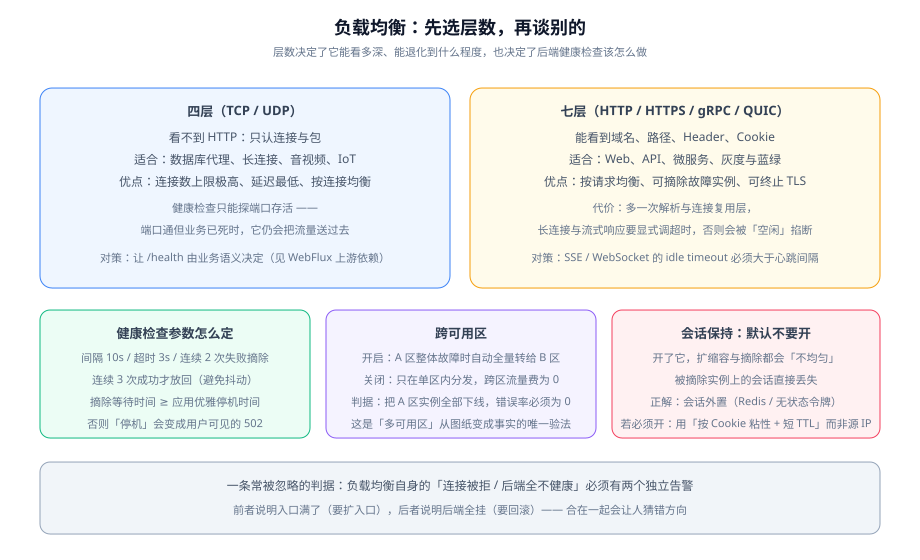

# 负载均衡

负载均衡是云上架构里**第一个会被所有用户直接感知的组件**：它的一次抖动，比后端任何一次崩溃都更像「网站挂了」。而它也是最容易被当成「建个实例、挂几个后端就完事」的组件——本节把真正决定它行为的四个参数写清楚：**层数、健康检查、跨可用区、会话保持**。



::: tip 一句话定位
负载均衡有**两次决策**：第一次是「选几层」（决定了它能看多深），第二次是「怎么判断后端还活着」（决定了故障时用户看到什么）。第二次比第一次更重要，也更容易配错。
:::

## 先选层数：四层与七层的分界

| | 四层（TCP / UDP） | 七层（HTTP / HTTPS / gRPC / QUIC） |
| --- | --- | --- |
| 能看到什么 | 连接与数据包 | 域名、路径、Header、Cookie、方法 |
| 均衡粒度 | **连接** | **请求** |
| 连接数上限 | 极高（可到亿级并发） | 高（单实例可到百万级 QPS） |
| 延迟 | 最低 | 多一层解析与复用，略高 |
| 健康检查能力 | **探端口存活** | 可探 HTTP 状态码与响应体 |
| 路由能力 | 无（只按连接分发） | 按域名 / 路径 / Header 分流，可灰度、可蓝绿 |
| TLS | 可卸载（TCPSSL） | 通常在此终止并管理证书 |
| 典型场景 | 数据库代理、长连接、音视频、IoT、需要极致并发 | Web、API、微服务、灰度发布 |

::: danger 四层健康检查的致命盲区
四层的健康检查通常只是「**端口能不能连上**」。所以当应用**端口在监听但业务已死**（线程池打满、依赖全挂、只返回 500）时，四层入口会**继续把流量送过去**——这是四层最典型的事故形态。

三种处置方式：

1. **让端口随业务存活**：依赖不可用时主动关闭监听（激进，但有效）；
2. **在四层之上再放一层七层**（两级入口，最常见）；
3. **改用七层入口**，让健康检查探到业务语义。

选哪种取决于「你能不能接受一个『能连上但不能用』的后端」。**如果不能，就不要只用四层。**
:::

## 健康检查：四个参数，一个对齐

健康检查的参数据定了「故障时用户看到什么」，所以它必须与**应用的优雅停机时间**对齐：

| 参数 | 典型值 | 它决定了什么 |
| --- | --- | --- |
| 检查间隔 | 10s | 故障被发现的**最坏延迟** ≈ 间隔 × 失败阈值 |
| 检查超时 | 3s | 判定一次失败的上限；**应小于间隔**，否则会叠加 |
| 连续失败阈值 | 2 次 | 避免单次抖动触发摘除 |
| 连续成功阈值 | 3 次 | 避免刚恢复就被打满（「放回」要比「摘除」更保守） |
| **摘除等待（deregistration delay）** | 30~60s | 从「判定不健康」到「真正断开连接」的缓冲 |

::: danger 摘除等待必须 ≥ 应用的优雅停机时间
如果应用需要 45 秒处理完在途请求，而摘除等待只有 10 秒，那么**负载均衡会在第 10 秒把连接切断**——用户看到 502，而你会以为「应用优雅停机做得好好的」。

反过来的顺序也要对：**先让健康检查失败，再开始优雅停机**。正确顺序是：

1. 应用收到停机信号 → **先把健康端点的返回改为失败**（不是直接退出）；
2. 入口在 `间隔 × 失败阈值` 内摘除它；
3. 应用继续处理在途请求，等待 `摘除等待` 时长；
4. 进程退出。

跳过第 1 步（直接退出）会让入口**在摘除之前**就把请求送过去，这是最常见的 502 来源。
:::

## 跨可用区：一个开关，决定「多可用区」是真是假

| 设置 | 行为 | 代价 |
| --- | --- | --- |
| **开启跨可用区** | 每个后端都可能收到来自任何可用区入口节点的流量；某个可用区整体不可用时，流量自动全部转给其余可用区 | 产生**跨可用区数据传输费** |
| **关闭** | 只在同一可用区内分发，跨区流量费用为 0 | **单区故障时，该区后端的流量不会转移**——多可用区退化成「两套各管一半」 |

::: warning 「我们做了多可用区」这句话，只有在这个开关打开、且演练过之后才成立
这两种配置在**正常情况下表现完全一样**（都正常工作、延迟差异不大），只有在故障时才分道扬镳。

**唯一能验证它的办法是演练**：把 A 区的后端实例全部置为不健康（或直接停掉 A 区的实例），然后**持续向入口发请求，观察错误率**。

- 错误率为 0 → 跨可用区确实生效；
- 出现错误 → 要么开关没开，要么后端组只绑了 A 区的子网。

这个演练**不需要停机窗口**（多后端场景下用户无感），因此应该定期做，而不是等到真出事。
:::

## 会话保持：默认不要开

会话保持（sticky session）让同一个用户固定落到同一个后端。它看起来「更安全」，实际上**与弹性伸缩相冲**：

| 后果 | 说明 |
| --- | --- |
| 扩缩容不均匀 | 新实例分不到存量会话，老实例缩不下去 |
| 摘除即丢会话 | 被摘除实例上的用户**直接掉线**，而不是被转移到其他后端 |
| 故障影响面扩大 | 一个后端挂掉 = 它承载的那批用户全部受影响 |
| 反向代理层的连接复用变差 | 长连接被钉死，扩容压力集中 |

**正解是把会话外置**：会话数据放共享存储（如缓存），服务本身无状态；或使用无状态令牌（JWT 类），把状态放在客户端但保证可校验。

如果业务确实必须开（例如未改造的老系统），三条约束：**用 Cookie 粘性而不是源 IP 粘性**（源 IP 在 NAT 后大量用户会共用）、**设置较短的 TTL**、**对摘除做灰度**。

## TLS 终止位置：三选一

| 方案 | 证书放哪 | 优点 | 代价 |
| --- | --- | --- | --- |
| **入口终止**（最常见） | 负载均衡 | 证书集中管理、后端零改造、可统一重定向与安全响应头 | 入口到后端之间是明文——**必须保证这段是私网** |
| 后端终止 | 每个应用实例 | 端到端加密 | 证书分发与轮换要在 N 个实例上做 |
| 透传（不终止） | 应用 | 同上 | 入口看不到请求内容，七层路由能力丧失 |

::: tip 选入口终止的两个前提
1. **入口到后端的链路是私网**（后端在私有子网、安全组只允许来自入口安全组）；
2. **证书自动续期已开启**。

第 2 条经常被忽略：「证书过期」是云上**最没有技术含量却最频繁**的全站不可用原因，而它几乎总是因为「当初手动传了一次证书，没人记得它到期」。
:::

## 长连接与流式响应：必须显式调大的一个值

七层入口为了复用连接，会对**空闲连接**做超时回收。这个默认值通常在几十秒量级，而以下场景的空闲期远长于它：

| 场景 | 空闲期 | 后果 |
| --- | --- | --- |
| SSE（服务端推送） | 只在有事件时发送，可能数分钟 | 连接被入口单方面关闭，前端表现为「突然不刷新了」 |
| WebSocket | 心跳间隔决定 | 同上，且重连风暴可能叠加 |
| 长轮询 | 一次请求最长可达分钟级 | 请求在入口处超时，后端仍在处理 |

**判据：入口的空闲超时必须大于「应用心跳间隔 × 2」。**

```shell
# 验证 SSE 在入口处不会被空闲超时掐断（以 60 秒为观察窗口）
curl -N -m 60 https://<你的域名>/api/stream
# 期望：60 秒后由 curl 自己超时退出（-m 60），而不是中途被服务端断开
# 若在中途收到连接关闭，先调大入口的 idle timeout，再排查应用
```

::: info 为什么这条要写在「架构」而不是「应用配置」里
因为它**不是应用能自己解决的问题**：应用侧可以把心跳调成 5 秒，但那是用「更多的无用流量」换「连接不被回收」。正确顺序是先把入口的超时改到合理值（例如 300 秒），再让心跳保持一个较大的间隔（例如 30~60 秒）。
:::

## 常见配置错误

| 症状 | 最可能的原因 | 怎么确认 |
| --- | --- | --- |
| 发布期间偶发 502 | 应用直接退出，未先让健康检查失败 | 看停机时刻与摘除时刻的先后 |
| 某个后端一直收不到流量 | 它在另一个可用区，且入口**未开跨可用区** | 关掉跨区开关对照观察 |
| 扩容后新实例「没流量」 | 会话保持开启，存量会话钉在老实例上 | 查粘性配置 |
| 流量分配严重不均 | 权重设置不同，或健康检查抖动导致实例被反复摘放 | 查后端组权重与健康状态历史 |
| 偶发连接重置 | 入口空闲超时 < 应用心跳间隔 | 对照超时与心跳两个值 |
| 证书告警 | 证书未开启自动续期 | 查证书到期时间与续期任务 |

## 验证方式

| 验证项 | 命令 / 操作 | 预期 |
| --- | --- | --- |
| 层数选择正确 | 检查入口协议与后端协议 | 与「是否需要内容路由」的结论一致 |
| 摘除时间符合预期 | 手动停一个后端服务，持续健康检查 | 在 `间隔 × 阈值` 内变为不健康 |
| **摘除不产生错误** | 停服务的同时持续请求入口 | **错误率 0** |
| 放回时间符合预期 | 恢复服务，观察健康状态 | 在 `间隔 × 成功阈值` 内恢复 |
| **跨可用区真的生效** | 停掉 A 区全部后端，持续请求 | 错误率 0 |
| 长连接不被掐断 | `curl -N -m 60 <流式接口>` | 60 秒内不被服务端断开 |
| 证书不会过期 | 查证书到期时间与自动续期状态 | 自动续期开启且剩余有效期 > 30 天 |
| 入口自身有告警 | 查监控告警规则 | 「连接被拒」与「后端全不健康」**各自有独立告警** |

::: warning 最后一条容易被忽略
「连接被拒」说明**入口自身容量不够**（要扩入口），「后端全不健康」说明**后端全挂**（要回滚或排查）。这两件事的处置方向完全相反，**必须分成两个告警**。合成一个「入口异常」，值班的人只能猜。
:::

## 当日做了什么

1. 把「选几层」讲成一张八行对照表，并**单独警示四层健康检查的致命盲区**（端口在监听但业务已死），给出三种处置方式与选择依据。
2. 给出健康检查的**四个参数 + 一个对齐值**（摘除等待），并指出它必须 ≥ 应用的优雅停机时间；同时给出**停机顺序的四步**：先让健康端点失败 → 等入口摘除 → 处理在途请求 → 退出。
3. 把**跨可用区开关**从「一个选项」提升为「多可用区是真是假」的决定项，说明两种配置在正常情况下表现一致、只有故障时才分道扬镳，因此**唯一验证方式是演练**。
4. 说明**会话保持与弹性伸缩相冲**的四个后果，给出「会话外置」的正解，以及不得不开时的三条约束（Cookie 粘性而非源 IP、短 TTL、灰度摘除）。
5. 对比 **TLS 终止的三个位置**，给出「入口终止」的两个前提（入口到后端是私网、证书自动续期开启），并点明证书过期是「最没技术含量却最频繁」的全站不可用原因。
6. 把**长连接与流式响应**的超时问题写成架构项而不是应用配置项，给出判据「入口空闲超时 > 心跳间隔 × 2」与可直接执行的 `curl -N -m 60` 验证。
7. 汇总**六类常见配置错误**，并强调入口必须把「连接被拒」与「后端全不健康」拆成两个独立告警。

## 如何验证

三条核心判据：

1. **摘除不产生错误**：手动停掉一个后端的同时持续请求入口，错误率必须是 0；
2. **跨可用区真的生效**：停掉一整个可用区的后端，错误率仍必须是 0；
3. **长连接不被入口掐断**：`curl -N -m 60` 在 60 秒内不应收到服务端关闭。

三条都能通过，「入口」这一层就算立住了，可以进入 [弹性伸缩](../AutoScaling/index.md)。

## 下一步

1. **[弹性伸缩](../AutoScaling/index.md)**：把新实例「注册进后端组」的时机讲清楚——**健康检查通过才算就绪**。
2. **[可用性拓扑](../Availability/index.md)**：把跨可用区开关纳入可用区级演练的设计。
3. **[成本与规格选型](../Cost/index.md)**：入口是少数成本随流量同步上涨的组件，需要单独设预算告警。
4. **[云上安全边界](../Security/index.md)**：TLS 终止位置与私网可达性需要在安全清单里复核。

## 参考资料

- [Nginx](../../Nginx/index.md)：自建反向代理的七层规则语法与限流、缓存能力
- [可用性拓扑](../Availability/index.md)：跨可用区与多地域的失败域设计
- 阿里云 SLB 产品家族介绍（ALB / NLB / CLB 能力对比）：https://help.aliyun.com/zh/slb/product-overview/slb-overview
- AWS Application Load Balancer 用户指南（含目标组与健康检查）：https://docs.aws.amazon.com/elasticloadbalancing/latest/application/introduction.html
- AWS 负载均衡器取消注册延迟说明：https://docs.aws.amazon.com/elasticloadbalancing/latest/application/target-group-deregistration-delay.html

## 与「边缘计算与 CDN」专题的分工

负载均衡与 CDN 都叫「调度」，但选的东西不一样：**负载均衡选哪台机器，CDN 选哪个城市。**

| 维度 | 本页（负载均衡） | [边缘计算与 CDN](../../EdgeCDN/index.md) |
| --- | --- | --- |
| 调度粒度 | 实例级（健康检查、权重、会话保持） | 地域级（就近接入、Anycast、地理调度） |
| 判据来源 | 主动健康检查、连接数、响应时间 | 网络拓扑、运营商、节点健康状态 |
| 调度失败时 | 剔除异常实例，请求仍在你的集群内 | 退到更远的节点，甚至直接回源 |
| 典型误用 | 把跨可用区开关当成容灾 | 把「节点多」当成性能——关键是那个节点**有没有你要的内容** |

两者是串联关系：边缘把你带到**离用户近的入口**，负载均衡再把你带到**集群里的一台机器**。跨可用区开关与跨城调度是两件事，只做前者会得到「跨城仍是一次长途回源」，只做后者会得到「用户进了近的节点，之后又被甩到远的机房」。
