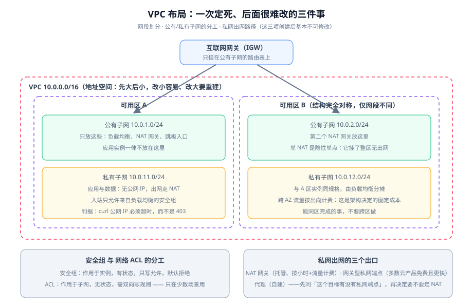

# VPC 与网络边界

云上网络与自建机房的网络有一处根本差别：**云上没有「插网线」这件事**。所有连通性都是**声明式的资源**——路由表里的条目、安全组里的规则、端点（Endpoint）的配置。它带来一个好处（网络可以像代码一样审阅）和一个坏处（**不通的时候看不到任何物理现象，只能查配置**）。

本页把 VPC 里最常见的四类资源（子网、路由表、安全组、端点）与它们的分工讲清楚，并给出「一个请求从公网进来、从私网出去」的完整路径。



## 一个请求的完整路径

理解 VPC 最快的办法是**跟着一个请求走一遍**，并在每一步问「这里会不会被拦」：

| 步 | 发生什么 | 由谁决定 | 这一步最常出的问题 |
| --- | --- | --- | --- |
| 1 | 客户端把域名解析到入口地址 | 公网 DNS / 云解析 | 解析到了**上一代**入口地址（改造后未改解析） |
| 2 | 请求到达负载均衡的公网地址 | 入口资源的网络类型 | 入口没有公网地址，或带宽被打满 |
| 3 | 负载均衡转发到某个后端 | 监听规则 + 后端组 + 健康检查 | 后端**全部不健康**，入口返回 5xx |
| 4 | 后端所在子网的**网络 ACL** 放行 | 子网 ACL（无状态，双向） | 出向规则没写，**入站通、响应出不去** |
| 5 | 后端实例的**安全组**放行 | 实例安全组（有状态，只写允许） | 规则引用的是「上一版」的安全组 ID |
| 6 | 应用监听端口并处理 | 应用配置 | 只监听了 `127.0.0.1`，负载均衡连不上 |
| 7 | 应用要访问外部依赖 | 路由表 → NAT / 私网端点 | 私网端点漏配，流量绕 NAT 出去（慢且计费） |

::: tip 排查纪律
上表第 4、5 步是**顺序关系，不是并列关系**：ACL 先放行，安全组才可能生效。所以「安全组明明开了为什么不通」的答案经常在第 4 步。

判断方法：**看流量有没有到达实例**。云上多数计数型指标（连接数、包数）能区分「没到」和「到了被拒」，这两个结论指向完全不同的下一步。
:::

## 网段规划：先大后小，且留出三类预留

网段规划的目标不是「省地址」，而是**为将来的三种连通留口子**：

| 预留 | 用途 | 建议 |
| --- | --- | --- |
| **子网位** | 每个可用区、每类用途各一个子网 | 至少预留 4~8 个子网位（2 AZ × 公有/私有，将来可能加 AZ 或加分层的私有子网） |
| **IDC / 其他 VPC 的对等位** | 与公司内网或其他 VPC 打通 | **对方的网段不能与你重叠**——这是最不可挽回的一类冲突 |
| **服务预留段** | 云平台自身保留的地址 | 不要用云厂商文档标注为保留的段 |

一条可直接照用的切分（以 `10.16.0.0/16` 为例）：

```text
10.16.0.0/16          VPC（65536 个地址）
├─ 10.16.0.0/20       预留：将来第三个可用区
├─ 10.16.16.0/20      预留：将来新增分层（如数据层独立子网）
├─ 10.16.32.0/20      预留：与 IDC / 其他 VPC 的对等段
├─ 10.16.48.0/24      AZ-A 公有子网
├─ 10.16.49.0/24      AZ-A 私有子网
├─ 10.16.50.0/24      AZ-B 公有子网
└─ 10.16.51.0/24      AZ-B 私有子网
```

::: danger 三个会让网段规划作废的做法
1. **用 `/24` 建 VPC，再想拆子网。** `/24` 只有 256 个地址，扣掉云平台保留项后，能划的子网极少；且**VPC 扩容受限**（部分平台支持追加辅助网段，但工程上应视为「不能改」）。
2. **先用「公司内网同段」图省事。** 一旦与 IDC 网段重叠，**对等连接永远建不起来**，而迁移已上线业务的地址是项目级工作量。
3. **只按当前台数算。** 弹性伸缩的语义就是「实例数会变」；按当前 5 台算，会在第一次大促前被迫重划。**按峰值 × 2 估**。

判据一句话：**这个段十年后还够用吗？** 不够就换更大的。
:::

## 公有子网与私有子网：一句话判据

公有子网与私有子网**不是两种不同技术**，而是**同一个东西 + 路由表里有没有指向互联网网关（IGW）的默认路由**。

| | 公有子网 | 私有子网 |
| --- | --- | --- |
| 路由表 | 有 `0.0.0.0/0 → IGW` | 有 `0.0.0.0/0 → NAT 网关`（或没有默认路由） |
| 实例是否有公网地址 | 可以有（取决于是否分配） | **不应有** |
| 放什么 | 负载均衡、NAT 网关、跳板入口 | 应用实例、数据库、缓存、队列消费者 |
| 一句话判据 | 「**它需要被公网直接访问吗**」 | 不需要的，一律私有 |
| 验证 | — | `curl -m 5 http://<公网IP>` 必须**超时**而不是拒绝 |

::: warning 「超时而不是拒绝」是一条有信息量的判据
如果从公网访问私有实例会得到 `403` / `404` / `Connection refused`，说明**它其实有公网入口**（流量已经到了），只是应用拒绝了。

`403` 与「超时」在值班时是两个完全不同的信号：前者是「暴露了但被拦」，后者才是「根本没有暴露」。
:::

## 安全组与网络 ACL 的分工

这是云上最容易被搞混的一对。它们**不是同一件事的两种写法**：

| | 安全组（Security Group） | 网络 ACL（Network ACL） |
| --- | --- | --- |
| 作用对象 | **实例 / 弹性网卡** | **子网** |
| 状态 | **有状态**（响应流量自动放行） | **无状态**（入与出各写各的） |
| 默认 | 默认**拒绝**所有入站，需显式允许 | 默认允许，需显式拒绝 |
| 规则类型 | **只写允许**（没有拒绝规则） | 允许与拒绝都写，按序号匹配 |
| 典型用法 | **日常唯一的访问控制手段** | 只在需要「整段子网级别的硬隔离」时用 |
| 引用方式 | 可以**引用另一个安全组**（推荐） | 只能写网段 |

::: danger 用安全组引用而不是写网段
「负载均衡 → 应用」这条链路，正确写法是**应用的安全组只允许「来自负载均衡安全组」的入站**，而不是写「允许 `10.16.48.0/24`」。

差别在于：**前者跟着负载均衡走，后者会随子网变化而失效**。写网段还有一个隐性风险——同一个子网里如果混进了不该进的东西，它自动获得了访问应用的权限。

同理，数据库的安全组应**只允许「来自应用安全组」**，不允许任何网段。
:::

## 私网出口：三个选择，优先选便宜且快的那个

私有子网的实例要访问外部服务，有三条路。**多数人的第一反应是 NAT，而它常常不是最优解**：

| 方案 | 走不走公网 | 计费 | 什么时候选它 |
| --- | --- | --- | --- |
| **私网端点 / 网关型端点** | 不走，走云内骨干 | 多数云产品的端点**免费**（对象存储、密钥服务等），少数按小时计费 | **访问云产品时的默认选择**——更快、更省、路径更短 |
| **NAT 网关** | 走，且做地址转换 | 按小时 + 按流量计费 | 访问**公网第三方服务**（如外部 API、公开镜像源） |
| 自建代理（实例/Nginx） | 走 | 实例费 + 你自己的运维 | 需要按域名/内容做审计或改写时 |

::: info 一条省钱判据
**先问「这个目标有没有私网端点」，再决定要不要走 NAT。** 对象存储、容器镜像仓库、密钥管理、日志服务这些高频目标通常都有端点。

漏配端点的代价是双份的：**延迟更高**（绕出去再回来），以及**账单更高**（NAT 按处理流量计费，而端点多半免费）。
:::

## 跨 VPC 与混合云：对等连接的前提

当环境不止一个 VPC（比如「生产」与「共享服务」分开），连通方式有三种：

| 方式 | 适用 | 注意 |
| --- | --- | --- |
| **对等连接（Peering）** | 少数几个 VPC 两两互通 | **不支持传递**：A-B、B-C 通了，A 与 C 仍不通；网段不能重叠 |
| 中转网关 / 云企业网（Transit） | 多个 VPC + IDC 的星型汇聚 | 成本更高但可扩展，是规模上去后的必然选择 |
| 私网负载均衡 + 端点服务 | 只暴露一个服务，而非整张网 | 最安全：**只暴露需要暴露的那个端口** |

::: tip 「两两对等」的复杂度是 O(n²)
三个 VPC 需要 3 条对等连接，六个需要 15 条。**当 VPC 数超过 3 个，就该考虑中转方案**，否则每新增一个网络环境都要动所有既有环境的路由表——那是一项每次都会出错的工作。
:::

## 私网 DNS：让内部域名解析到私网地址

云上通常提供**私有解析区**：把某个内部域名（例如 `db.internal`）托管在私有区里，只在 VPC 内可解析。

两个必须验证的点：

1. **内部域名解析结果必须是私网地址**（否则流量会跑公网，产生费用并暴露）；
2. **解析不能依赖外部 DNS 的可用性**——如果内部服务名依赖公网 DNS，那么公网 DNS 抖动会导致内部服务互相找不到。

```shell
# 在私有子网的实例内执行
nslookup db.internal
# 期望：返回 10.16.x.x 这类私网地址，而不是任何公网地址

# 验证内部解析路径没有走公网 DNS
dig +short db.internal
# 若返回公网地址，说明私有解析区没生效或域名拼错
```

## 常见配置错误

| 症状 | 最可能的原因 | 怎么确认 |
| --- | --- | --- |
| 私有实例访问云产品超时，但访问公网正常 | 漏配私网端点，且路由表没有到该云产品的路径 | 对比「有端点」与「无端点」两个子网的实测耗时 |
| 入站正常，响应超时 | **ACL 无状态**，出向规则没放行 | 检查子网 ACL 的**出向**规则 |
| 安全组改了没生效 | 改的是另一个安全组，或实例挂了多个安全组（**并集生效**） | 列出实例挂载的全部安全组 |
| 两个 VPC 通了三个不通 | 对等连接**不传递** | 画出连接图，检查是否缺一条直接连接 |
| 连接偶发失败 | 安全组引用了**弹性 IP 而非负载均衡**，或后端跨 AZ 而入口未开跨 AZ | 对照 [负载均衡](../LoadBalancing/index.md) 的跨可用区设置 |
| 单 AZ 出网全断 | **NAT 网关只部署在一个可用区** | 检查每个可用区是否都有独立的 NAT 出口 |

## 验证方式

| 验证项 | 命令 / 操作 | 预期 |
| --- | --- | --- |
| 子网跨可用区 | 列出子网的 AZ 与网段 | ≥ 2 个可用区，网段不重叠 |
| 私有性成立 | 从公网 `curl -m 5 http://<公网IP>` | **超时** |
| 出网可用 | 实例内 `curl -s -o /dev/null -w '%{http_code}' https://example.com` | `200` |
| 私网端点生效 | 实例内请求云产品接口，对比耗时 | 端点路径明显更快 |
| 内部解析正确 | `dig +short <内部域名>` | 私网地址 |
| ACL 双向正确 | 检查子网 ACL 入/出规则 | 出向有对应放行 |
| 安全组最小化 | 列出规则来源 | 来源为**安全组 ID** 而非网段 |
| 单 AZ 依赖已消除 | 逐 AZ 检查 NAT / 出口 | 每个承载业务的 AZ 都有独立出口 |

## 当日做了什么

1. 把「一个请求从公网进、从私网出」拆成**七步路径**，并逐步给出「由谁决定」与「这一步最常出的问题」，其中特别点明第 4 步（ACL）与第 5 步（安全组）是**顺序关系而非并列**。
2. 给出**网段规划的三类预留**（子网位、对等位、服务保留段）与一段可直接照用的切分示例，并写明判据「**这个段十年后还够用吗**」。
3. 给出公有/私有子网的**一句话判据**（路由表里有没有到 IGW 的默认路由），并强调验证要用「**超时而不是拒绝**」。
4. 把**安全组与网络 ACL** 的分工做成七行对照表，写明安全组「有状态、只写允许、可引用另一个安全组」，并给出「数据库只允许来自应用安全组」的正确写法。
5. 对比**私网出口的三个选择**，给出省钱判据「先问有没有私网端点，再决定走不走 NAT」——漏配端点的代价是延迟与账单双份。
6. 说明**对等连接不传递**与「两两对等的复杂度是 O(n²)」，给出「超过 3 个 VPC 就该考虑中转方案」的分界。
7. 给出**私网 DNS 的两条必须验证项**（解析结果是私网地址、不依赖公网 DNS 可用性）与可直接执行的 `nslookup` / `dig` 命令。
8. 汇总**六类常见配置错误**的症状、最可能原因与确认方法，其中「入站正常响应超时」直指 ACL 的无状态特性。

## 如何验证

本页验证的核心是三条：

1. **私有性**：从公网访问私有子网实例**必须超时**——得到任何 HTTP 状态码都说明它其实暴露了；
2. **出网路径正确**：访问云产品时**优先命中私网端点**（耗时与计费都明显更低），只有访问公网第三方时才走 NAT；
3. **访问控制是「跟着身份走」而不是「跟着网段走」**：安全组规则的来源应为**安全组 ID**，检查一遍是否存在来源为网段的规则，存在就要逐个解释为什么。

三条全过，网络边界部分即告完成，可以进入 [负载均衡](../LoadBalancing/index.md)。

## 下一步

1. **[负载均衡](../LoadBalancing/index.md)**：把入口定下来（四层还是七层），并把健康检查参数与优雅停机时间对齐。
2. **[弹性伸缩](../AutoScaling/index.md)**：确定实例该注册进哪个后端组、以及摘除与注册的顺序。
3. **[可用性拓扑](../Availability/index.md)**：把「两个可用区」升级成完整的故障域设计。
4. **[云上安全边界](../Security/index.md)**：把网络边界与账号权限边界合起来看。

## 参考资料

- [网络基础 · 网络分层](../../Network/Layering/index.md)：协议层面的分层定位方法
- [网络基础 · DNS](../../Network/Dns/index.md)：解析链路与排查
- [Nginx](../../Nginx/index.md)：自建反向代理与托管负载均衡的职责对比
- 阿里云 VPC 产品文档：https://help.aliyun.com/zh/vpc/
- AWS VPC 用户指南（子网、路由表、安全组）：https://docs.aws.amazon.com/vpc/latest/userguide/what-is-amazon-vpc.html
- AWS 私有链接（PrivateLink）与 VPC 端点：https://docs.aws.amazon.com/vpc/latest/privatelink/what-is-privatelink.html
