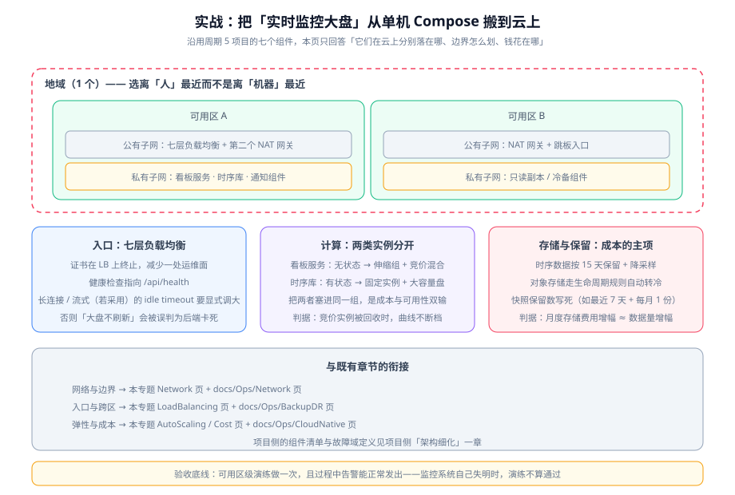

# 实战：把监控大盘搬上云

前面七页给的都是判断：网段怎么划、入口选几层、什么该弹性、2 AZ 值不值、钱花在哪。本页把这套判断**压到一个具体对象上**——周期 5 的「实时监控大盘」项目——逐条回答：它的七个组件在云上分别落在哪、哪几个能弹性、哪几个是单点、以及每条判断该怎么验证。



::: tip 一句话定位
本页不是「云上部署教程」，而是**一次落位推演**：把已经定稿的七个组件与四个接口边界，逐个问到「它在云上需要一个什么形状的资源」。**结论会暴露出一处结不了的账**——监控系统自己的存储层仍是单点，这正是本页最值得读的部分。
:::

## 先划清本页与项目章节的边界

项目侧的章节已经写完了需求、选型、架构细化、指标模型、校验门禁、采集配置、规则设计与接口契约。本页**不重复任何一条**，只做它们没做的那件事：

| 问题 | 项目章节（`project/Complete/MonitoringDashboard`） | 本页 |
| --- | --- | --- |
| 要做什么、用什么做 | [需求拆分与技术选型](/project/Complete/MonitoringDashboard/Requirements/index.md)：US-01~US-10、四项「明确不做」、技术选型表 | 不涉及 |
| 结构是什么 | [架构细化](/project/Complete/MonitoringDashboard/Architecture/index.md)：七个组件、四个接口边界、失败模式矩阵 | **只回答这些组件在云上的落位形状** |
| 数据长什么样 | [指标模型与保留策略](/project/Complete/MonitoringDashboard/MetricModel/index.md)：四层时序模型、两张治理表、raw 15d + 聚合 90d | 把「15 天保留」翻译成**存储成本与快照保留数的判据** |
| 哪些约束不能破 | [接口契约](/project/Complete/MonitoringDashboard/Contracts/index.md)：四份契约、每份含可执行校验命令 | 本页的 R1~R10 **校验的是契约有没有被云上配置破坏**（例如健康检查路径写错就打破了「边界一」） |
| 怎么跑起来 | 单机 `docker compose up -d`（第 4 周验收项） | 换成「资源编排层」的形态，并给出代价 |

::: warning 一个必须写死的前提
项目第 1 周定稿的部署形态是**单机 Docker Compose**（见需求章节的非功能需求：「一条命令起全部组件」，`docker compose ps` 全部 `Up`）。**那是一个刻意的简化，不是本页的结论。**

本页做的是**落位推演**：假设这套 stack 要承载真实生产流量、要能扛单机故障，那么每个组件应该落在什么资源上。**两者不冲突，但绝不能混着讲**——把推演出来的多可用区拓扑说成「项目已经做到的」，就是最常见的一类夸大。
:::

## 七个组件在云上的落位

落位的判据只有两条：**① 它有状态吗？② 它的负载会波动吗？** 有状态 → 不能进伸缩组；负载波动 → 必须能弹性。两条一交叉，七个组件的去处就唯一了。

| # | 组件 | 项目内形态 | 云上落位 | 有状态 | 可弹性 | 落位理由 |
| --- | --- | --- | --- | --- | --- | --- |
| 1 | 被监控目标（指标暴露，自研） | 业务服务内的一个端点 | **伸缩组内的实例**（私有子网） | 否 | **是** | 它本身就是被弹性的对象；指标端点必须随实例一起伸缩，否则扩容出来的新实例没数据 |
| 2 | 采集器（现成） | 单机容器 | **固定实例**（或托管采集服务） | 半（有本地 WAL） | 否 | 拉模型 15s 一轮，负载与目标数成正比而非与用户流量成正比；**它扩容只会把同一批目标重复抓一遍** |
| 3 | 时序存储（现成） | 单机容器 + 数据卷 | **固定实例 + 独立数据云盘** | **是** | 否 | 有状态且单实例，扩容无法水平切分历史数据；数据盘独立是为了让实例可重建而不丢数据 |
| 4 | 查询与规则（现成） | 与存储同机 | **同机** | 否，但依赖存储 | 否 | 规则评估要读本地时序库，跨机只会给查询加一跳网络延迟 |
| 5 | 告警路由（现成） | 单机容器 | **同机或最小规格独立实例** | 半（静默状态） | 否 | 静默状态是有意义的（不能重启就丢），但吞吐极低；独立部署的唯一理由是**让它比监控本体更晚挂** |
| 6 | 可视化（现成） | 单机容器 | **无状态 → 可进伸缩组**（通常不必） | 否 | 是 | 无状态但吞吐低；单实例 + 健康检查已足够，**加副本只是加运维面** |
| 7 | 看板数据服务（自研） | 单机容器 | **伸缩组 + 混合计费**（私有子网，挂在负载均衡后） | 否 | **是** | 它是唯一「无状态 + 负载随用户访问波动」的组件，也是本页唯一值得做弹性的自研件 |

::: info 一句话记住这张表
**能弹性的只有第 1 与第 7 行。** 第 2~6 行全是「现成组件里带状态的那一半」，把它们塞进伸缩组会得到「扩出来的副本读不到历史数据」——这正是 [弹性伸缩](../AutoScaling/index.md) 里「有状态负载不进伸缩组」那条判据的具体落点。
:::

## 第一步：区域与网段

**区域**按 [总览](../Overview/index.md) 的判据选：离真实用户最近，同时核对目标区域在售规格族是否齐。监控系统的用户是**运维与开发**，不是 C 端用户——所以「最近」指的是**公司办公网/办公地**，而不是业务用户所在地。这是本页第一个反直觉点：**一个有全球用户的业务，它的监控系统可能只需要一个区域。**

**网段**按 [网络边界](../Network/index.md) 的「先大后小」划，两个可用区各一组子网：

| 子网 | 可用区 | 放什么 | 为什么在这里 |
| --- | --- | --- | --- |
| `public-a` | A | 七层负载均衡、NAT 网关 | 只有入口与出网口需要公网能力 |
| `public-b` | B | NAT 网关（第二个） | **NAT 网关也是可用区级的**：只有一个 NAT 在 A 区，A 区一挂，B 区的实例全部失去出网能力 |
| `private-a` | A | 看板数据服务、时序库、通知组件 | 无公网入口，出网走 NAT |
| `private-b` | B | 只读副本 / 冷备组件、看板服务副本 | 为可用区级故障留出落点 |

::: danger 两个最常见的网段错误
1. **只划一个私有子网**。这样「多可用区」在物理上不可能——子网不能跨可用区。空着的第二个子网不花钱（见总览页的验证方式），**重建网络很花钱**。
2. **只建一个 NAT 网关**。NAT 网关与子网同属一个可用区；单 NAT 让「多可用区」只在入向成立，**出向仍然单点**。判据：把 A 区的 NAT 手动删掉，B 区实例的出网应该仍然通。
:::

## 第二步：入口

按 [负载均衡](../LoadBalancing/index.md) 的三条判断，本项目落位如下：

| 判断 | 本项目的结论 | 理由 |
| --- | --- | --- |
| 四层还是七层 | **七层** | 看板服务提供的是 HTTP API 与静态资源，需要按路径路由与健康检查路径 |
| 健康检查路径 | 指向**自研看板服务的健康端点**，不是 LB 默认路径 | 默认路径通常返回 `200` 而不代表「能查数据」——健康检查必须校验**依赖是否可用**（[接口契约](/project/Complete/MonitoringDashboard/Contracts/index.md) 里的一条） |
| 跨可用区开关 | **开启** | 这是「多可用区」是真是假的那个开关：关了就会在流量层面把可用区绑死 |
| 会话保持 | **不开** | 看板服务是无状态的；开了会让扩容出来的新实例收不到流量 |
| TLS 终止位置 | **在 LB 终止** | 少一处证书运维面；代价是 LB 到后端这一段是明文，因此后端**必须只在私有子网可达** |

::: warning 一个容易漏的参数
如果大盘的自动刷新采用**长连接或流式响应**（这是监控类前端常见的一类实现，本项目第 4 周可选），那么**入口的空闲超时必须显式调大**。默认值通常按「一次请求很快结束」设计，长连接会被入口在几十秒后断开——**症状是大盘「不刷新」，而链路、CPU、错误率全都很正常**，很容易被误判成后端卡死。判据：真机挂 10 分钟，用 `time curl -N <流式端点>` 观察是否在固定秒数被切断。
:::

## 第三步：计算与弹性

按 [弹性伸缩](../AutoScaling/index.md)，本项目的计算层要**刻意分成两类**：

| 类别 | 成员 | 形态 | 计费 | 判据 |
| --- | --- | --- | --- | --- |
| 无状态、负载波动 | 看板数据服务、被监控目标 | 伸缩组（**最小 2，分布在两个 AZ**） | 稳态基线买预留，波动按量，峰值叠加竞价 | 缩容到最小值时，**仍然每 AZ 至少留 1 个** |
| 有状态、负载恒定 | 采集器、时序存储、查询与规则、告警路由 | 固定实例 + 独立数据盘 | 按量或长期承诺 | 重启实例后数据仍在，且采集断点不超过一个抓取间隔 |

::: danger 把两类塞进同一个伸缩组，是成本与可用性双输
- **可用性上**：有状态成员被缩容时，它承载的**历史数据随之不可用**；
- **成本上**：为了让有状态成员安全，你得把最小实例数抬到有状态成员的数量，于是无状态成员也被迫常驻。

**判据：伸缩组里只允许放「实例挂了重来一个就好」的成员。** 这句话可以直接拿去筛任何一个伸缩组。
:::

关于**竞价实例**：只允许给「看板数据服务」用，且必须处理回收通知。判据在下面 R7——**手动终止一个竞价实例，大盘曲线不能断档**（因为还有按量的基线实例在接）。时序库放竞价是反面清单里的第一条，见 [成本与规格选型](../Cost/index.md)。

## 第四步：可用性——本页结不了的那笔账

按 [可用性拓扑](../Availability/index.md)，先回答「哪种故障要能扛住」：

| 故障 | 本项目能扛住吗 | 说明 |
| --- | --- | --- |
| 看板服务单实例挂 | **能** | 伸缩组内最小 2 个 + 两个 AZ，LB 摘除后其他实例接住（R4/R5） |
| 被监控目标单实例挂 | **能** | 它自己在伸缩组里，且监控系统关注的就是「目标少了」这件事 |
| 整个可用区挂 | **部分** | 看板服务与入口能扛；**但时序存储是单实例，它在哪个可用区挂，监控就在那段时间失明** |
| 区域挂 | **不能** | 单区域部署；跨地域需要第二套存储与查询（见 [容灾架构](../../BackupDR/DisasterRecovery/index.md)） |

::: danger 这是监控系统的结构性矛盾，必须写在文档里
**一个监控系统，最容易在「它最该工作的时候」失明。** 因为一次可用区级故障会同时造成两件事：① 大量真实告警；② 监控系统的存储层可能就在那个可用区里。

所以本页给两个诚实选项，而不是一个漂亮结论：

1. **接受它，但把它写进 SLA**：明确「监控存储的 RTO 是 X 分钟，这段时间内的告警依赖业务自身的日志与告警通道」。**写下来就是工程决策，不写下来就是事故时才发现。**
2. **把存储层换成跨 AZ 托管的时序服务**：代价是失去单机版的可控性与「一条命令起全部」的简易性（需求章节的一项非功能需求）。**这是一次范围变更，不是一次配置调整。**

**判据：无论选哪个，`Availability` 页要求的「可用区级演练」必须做一次。** 演练中若**告警无法发出**，则演练不算通过——监控系统自己失明时，「演练成功」是一句空话。
:::

## 第五步：安全边界

按 [云上安全边界](../Security/index.md) 的三层边界，本项目落地动作很少但每条都可验证：

| 边界 | 动作 | 判据 |
| --- | --- | --- |
| 身份 | 给监控系统一个独立角色，只授予「读指标 + 写快照桶」；**不使用主账号密钥** | 角色权限里没有 `*` 通配的写动作；密钥不出现在配置文件与镜像里（[接口契约](/project/Complete/MonitoringDashboard/Contracts/index.md) 的「密钥进密钥管理」三层划分） |
| 网络 | 看板服务端口**只允许来自负载均衡所在安全组**；管理端口只允许来自跳板机安全组 | 按源为 `0.0.0.0/0` 的入向规则数为 **0**（R9） |
| 数据 | 快照桶开启静态加密与「禁止公开访问」；数据盘加密 | 桶策略无 `Principal: *` 的读权限；磁盘加密状态为「已开启」 |
| 审计 | 开启云侧操作审计，并把「谁改了安全组 / 谁删了快照」纳入可查范围 | 能回答「昨天 14:00 谁改过安全组」——**这是云上唯一事后还能说话的证据** |

::: tip 监控系统特有的一个暴露面
监控系统天然**知道所有服务的内部拓扑**（目标列表、端口、路径）。因此它的看板如果暴露到公网，等于把内部结构图贴在门口。

**判据：看板入口要么限制来源网段，要么前面加一层认证。** 这一条在 [安全加固](../../SecurityHardening/index.md) 的主机基线里查不到，因为它是**架构层**的暴露面，不是主机层的配置项。
:::

## 第六步：成本

按 [成本与规格选型](../Cost/index.md) 的七个杠杆，本项目逐个对位：

| 杠杆 | 本项目的落点 | 判据 |
| --- | --- | --- |
| 地域 | 按「运维所在」选，不需要全球多区域 | 只有一个区域有资源 |
| 规格族 | 看板服务可用 arm64（纯 JVM/Go 制品）；**时序库先保守用 x86**，避免在有状态件上引入架构迁移风险 | 两类实例的架构与「能否重建制品」一致 |
| **数据保留期** | 沿用 `15 天 raw + 聚合 90 天`（[指标模型](/project/Complete/MonitoringDashboard/MetricModel/index.md)） | 月度存储费用增幅 ≈ 数据量增幅；**答不上「多少天前的数据还有人查」就不要调这个参数** |
| 计费模型 | 时序库买长期承诺；看板服务「基线预留 + 波动按量 + 峰值竞价」 | 预留数 ≈ 夜间最低实例数（用 `Cost` 页的 `awk` 命令算） |
| 弹性策略 | 只对看板服务与被监控目标生效 | 非高峰实例数 = 最小值 = 每 AZ 至少 1 |
| 数据流向 | 采集器与被监控目标**同可用区优先**，减少跨区流量 | 跨区流量费能与调用对应上 |
| 闲置资源 | 周扫描未挂载磁盘、未用弹性 IP、旧快照 | 清扫清单为空或已处理 |

**存储与会话是这类系统成本的两个主项**：时序数据按天线性累积、快照按份数累积。其余组件（看板服务、通知、可视化）都是小数。

::: warning 一条容易做反的省钱动作
「把保留期从 15 天砍到 7 天」看起来是纯线性省钱，实际上它同时砍掉了**「上周的容量趋势」和「告警的误报率回溯」**——而这两件事恰好是监控系统存在的理由。

**判据：调保留期之前，先回答「上一次容量问题，我们回看了几天前的数据」。** 答不出就先别调。
:::

## R1~R10 验收断言

以下是**可执行**的验收清单。每条都写明「怎么测 / 预期什么 / 验证的是哪一页的判断」。

| # | 断言 | 怎么测 | 预期 | 验证的是 |
| --- | --- | --- | --- | --- |
| **R1** | 两个可用区各有子网，网段不重叠 | 列出 VPC 下全部子网的可用区与 CIDR | 至少 4 个子网（2 公 2 私），分属 2 个可用区，CIDR 互不重叠 | [网络边界](../Network/index.md) 的子网规划 |
| **R2** | 私有子网实例无公网入口 | `curl -m 5 -I http://<实例公网IP>` | **超时**（不是 403/401/连接被拒） | 私有性名副其实 |
| **R3** | 私有子网实例能出网，且第二个 NAT 也通 | 分别删掉 A 区 NAT 后从 B 区实例 `curl -s -o /dev/null -w '%{http_code}' https://example.com` | `200` | NAT 网关也是可用区级资源 |
| **R4** | 健康检查真的在拦，且摘除后错误率为 0 | 停掉一个后端实例上的看板服务，持续请求入口 | 在 `间隔 × 失败阈值` 内变为不健康；**期间错误率 0** | [负载均衡](../LoadBalancing/index.md) 健康检查四参数对齐 |
| **R5** | 跨可用区开关为「开启」，后端分布在两个 AZ | 查负载均衡配置与后端组详情 | 开关开启；后端实例来自 **2 个**可用区 | 「多可用区」是真还是假 |
| **R6** | 伸缩组：扩容在「启动时间 + 冷却」内完成 | 对看板服务加压，观察实例数与健康状态变化 | 新实例在预期窗口内变为健康并开始接流量 | [弹性伸缩](../AutoScaling/index.md) 的启动时间口径 |
| **R7** | 竞价实例被回收时曲线不断档 | 手动终止一个竞价实例，持续采样看板接口 | 请求成功率不下降（基线实例接住） | 混合计费的可用性前提 |
| **R8** | 时序库实例重建后数据仍在 | 重启（或重建）时序库实例，查询 15 天前的数据 | 查询仍返回数据 | 「独立数据盘」这条落位理由 |
| **R9** | 暴露面清点：按源 `0.0.0.0/0` 的入向规则为 0 | 导出全部安全组入向规则并过滤 | 计数为 **0**；管理端口仅来自跳板机安全组 | [云上安全边界](../Security/index.md) |
| **R10** | 成本标签齐全，可归因 | 抽查 20 个资源 | `service` / `env` / `owner` 齐全率 **100%** | [成本与规格选型](../Cost/index.md) 的最小标签集 |

::: danger 三个最容易出现的假阳性
1. **「健康检查通过」不等于「服务可用」**：健康端点只返回 `200` 而不校验下游（时序库）时，**时序库挂了、健康检查还是绿的**，入口会把流量继续打进来。R4 必须配合 R8 一起看。
2. **「实例数超过最小值」不等于「弹性生效」**：可能是你已经把最小实例数买成了峰值。**判据是非高峰时段实例数等于最小值**（R6 的负向断言）。
3. **「演练做过了」不等于「可用区级演练做过了」**：只重启一个实例是进程级演练。R5 与 R3 一起才构成一次真正的可用区级验证——**尤其是 R3 的删 NAT**，多数团队从没做过。
:::

## 验证方式

本页的验证分三组，都可以在控制台与实例内完成，**不需要先申请压测资源**：

```shell
# --- 组 1：网络边界（对应 R1~R3）---
# ① 列出子网与可用区（以阿里云为例，AWS 换成 describe-subnets）
aliyun vpc DescribeVSwitches --RegionId <region> \
  | jq -r '.VSwitches.VSwitch[] | "\(.ZoneId)\t\(.CidrBlock)\t\(.VSwitchName)"'
# 判读：应看到 2 个 ZoneId、4 个不重叠的 CIDR

# ② 私有实例无公网入口（在本地执行，预期 timeout）
curl -m 5 -I "http://<私有实例公网IP>" ; echo "exit=$?"
# 判读：exit=28（超时）= 通过；exit=7（连接被拒）说明有公网路由但无监听，需要复查子网

# ③ 出网可用（在私有实例内执行）
curl -s -o /dev/null -w '%{http_code}\n' https://example.com
# 判读：200

# --- 组 2：入口与弹性（对应 R4~R7）---
# ④ 健康检查摘除时间（持续请求，同时停掉一个后端）
while true; do printf '%s %s\n' "$(date +%T)" \
  "$(curl -s -o /dev/null -w '%{http_code}' http://<入口域名>/api/health)"; sleep 1; done
# 判读：停服后错误率应保持 0；若出现 5xx，说明摘除慢于请求到达速度

# ⑤ 24 小时实例数曲线（预期低谷段等于最小值）
# 从云监控导出实例数时间序列后：
awk -F, 'NR>1 {h=substr($1,12,2); if (!(h in m) || $2<m[h]) m[h]=$2} END {for (h in m) print h, m[h]}' inst.csv | sort

# --- 组 3：安全与成本（对应 R9~R10）---
# ⑥ 入向规则暴露面（预期计数为 0）
aliyun ecs DescribeSecurityGroupAttribute --SecurityGroupId <sg> --Direction ingress \
  | jq -r '.Permissions.Permission[] | select(.SourceCidrIp=="0.0.0.0/0") | .IpProtocol + " " + (.PortRange//"")' \
  | wc -l
```

| 组 | 覆盖断言 | 关键判读 |
| --- | --- | --- |
| 组 1 | R1~R3 | **R2 的 `exit=28` 与 `exit=7` 判断完全不同**：超时说明流量根本没到，连接被拒说明路由通了但服务没听——后者要回头看子网分类 |
| 组 2 | R4~R7 | R4 与 R6 一起看才有效：健康检查拦得住（R4）、但扩容来得太慢（R6），等于故障期间容量不足 |
| 组 3 | R9~R10 | R9 的计数必须是 0；**不是 0 就不要往下做成本优化**——先关掉暴露面 |

::: warning 判据不是实测记录
上表是**判据**。项目侧的对应章节已就「本机无容器运行时」这类限制明确标注「未跑 + 原因」，本页同口径执行：**没有条件验证的写「未验证 + 原因」，不要抄期望值。**
:::

## 参考资料

- [架构细化：七个组件与四个接口边界](/project/Complete/MonitoringDashboard/Architecture/index.md)：本页落位表的上游依据
- [接口契约](/project/Complete/MonitoringDashboard/Contracts/index.md)：四份契约与它们的可执行校验命令
- [指标模型与保留策略](/project/Complete/MonitoringDashboard/MetricModel/index.md)：raw 15 天 / 聚合 90 天的来源
- [云上架构 · 网络边界](../Network/index.md) / [负载均衡](../LoadBalancing/index.md) / [弹性伸缩](../AutoScaling/index.md) / [可用性拓扑](../Availability/index.md) / [安全边界](../Security/index.md) / [成本与规格选型](../Cost/index.md)
- [容器编排进阶 · 弹性伸缩](../../ContainerOrchestration/Autoscaling/index.md)：K8s 内部的弹性机制（本项目的第 4 周备选路径）
- [备份与容灾 · 容灾架构](../../BackupDR/DisasterRecovery/index.md) / [恢复演练](../../BackupDR/Recovery/index.md)：跨地域档位与恢复流程
- [混沌工程](../../ChaosEngineering/index.md)：R3/R7 这类「主动制造故障」的实验设计方法
- AWS Well-Architected · Reliability Pillar：https://docs.aws.amazon.com/wellarchitected/latest/reliability-pillar/welcome.html
- 阿里云 NAT 网关与可用区关系说明：https://help.aliyun.com/zh/nat-gateway/
