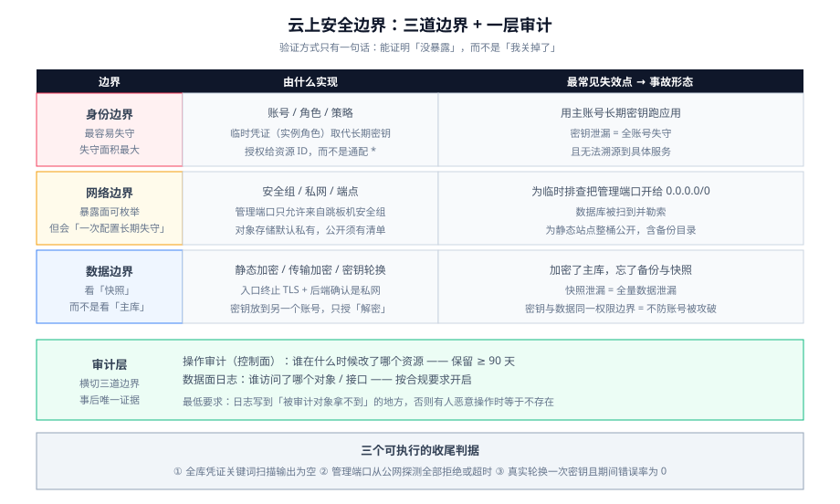

# 云上安全边界

云上的安全模型与自建机房有一个根本差别：**边界不再是机房的门，而是「身份」**。机房时代，进了内网就基本畅通；云上，**每一个 API 调用都要回答「你是谁、你被允许做什么」**。这条差别带来一个好结果（权限可以精确到单个资源、单次操作）和一个坏结果（**默认配置往往是「方便优先」而不是「安全优先」**）。

本页只讲**架构层面的边界**：账号与角色、密钥、公网暴露面、数据加密与审计。主机与集群内部的加固基线不在这里，见 [安全加固](../../SecurityHardening/index.md)。

::: tip 一句话定位
云上事故的绝大多数不是「被攻破」，而是**「本来不该能连上，但它能连上」**。所以本页的验证方式全部围绕一句话：**我要能证明「没暴露」，而不是「我关掉了」**。
:::

## 三层边界与它们的失效点



| 边界 | 由什么实现 | 最常见失效点 | 一次事故的形态 |
| --- | --- | --- | --- |
| **身份边界** | 账号 / 角色 / 策略 | 用主账号的长期密钥跑应用 | 密钥泄漏 = 全账号失守，且无法溯源到具体服务 |
| **网络边界** | 安全组 / 私网 / 端点 | 为了让运维方便，把管理端口开给 `0.0.0.0/0` | 数据库被扫到并勒索 |
| **数据边界** | 静态加密 / 传输加密 / 密钥轮换 | 备份与快照未加密（加密了主库，忘了备份） | 快照泄漏 = 全量数据泄漏 |

::: danger 三层里最容易失守的是第一层，而不是第三层
直觉会认为「数据加密最重要」。但实际问题里，**长期密钥泄漏**导致的失守面积最大——一把主账号密钥可以读出所有对象存储、改所有安全组、删所有快照。

**判据：全环境搜索「是否存在长期密钥被写进配置、环境变量或镜像」。存在就视为已失守，先轮换再谈其他。**
:::

## 身份边界：从「主账号一把梭」到「最小权限 + 临时凭证」

| 做法 | 反模式 | 正确做法 |
| --- | --- | --- |
| 日常操作 | 用主账号 / 根账号登录 | 用子账号 + 角色，主账号只用于少数不可委托操作（如账单、账号设置） |
| 应用访问云资源 | 把 AK/SK 写进配置文件或环境变量 | **用实例角色 / 工作负载身份**，由平台自动发放**短期**凭证并轮换 |
| CI/CD 访问云资源 | 把长期密钥存进流水线变量 | 用流水线的**联合身份**换取临时凭证 |
| 权限范围 | 直接给「管理员权限」 | 按资源与动作逐条列出；**给资源 ARN / 资源 ID 而不是 `*`** |
| 权限管理 | 每个服务一个账号，各自维护 | 用角色复用 + 权限边界（permission boundary）限制上限 |

::: info 为什么「临时凭证」是这一层最关键的机制
长期密钥有三个不可能消除的风险：**会被复制、会被写进日志、不会自己过期**。

临时凭证（实例角色 / 工作负载身份）把这三个风险同时消掉：它由平台发放、有效期以小时计、**应用代码里没有任何可复制的字符串**。代价只有一处：**必须保证实例能访问元数据服务或身份端点**——这也是为什么「为了安全把出网全关掉」有时会先把应用弄挂。
:::

## 密钥与凭证的生命周期

| 阶段 | 要求 | 判据 |
| --- | --- | --- |
| 生成 | 由密钥服务托管，或由平台自动发放 | 代码仓库与镜像中**不存在**密钥字符串 |
| 分发 | 通过密钥管理服务在运行时注入 | 不在镜像层、不在构建日志 |
| 使用 | 应用只持有引用，不落盘 | 进程内存外无副本 |
| 轮换 | 有明确周期且**演练过** | 轮换一次不断服 |
| 吊销 | 泄漏时能在一分钟内失效 | 有一条可执行的吊销流程 |

```shell
# 在代码仓库与构建产物中搜索疑似凭证（这是最低成本的一道门禁）
grep -rnE '(AKIA[0-9A-Z]{16}|LTAI[0-9A-Za-z]{12,}|-----BEGIN [A-Z ]*PRIVATE KEY-----)' \
  --include='*' . | head -20
# 判据：输出为空。有输出则视为已泄漏 —— 先轮换，再改代码。
```

::: warning 「轮换」必须演练，否则它只是一句承诺
密钥轮换最常见的失败方式是：**轮换脚本存在、但从没跑过**。等到真需要轮换（比如某人离职）时，才发现应用读的是写死的旧值、或者某些节点没重启。

判据：**做过一次真实轮换，且过程中服务错误率为 0。** 做不到这一点，说明书里的「支持轮换」应当被划掉。
:::

## 网络边界：先清点暴露面，再谈加固

云上的网络暴露面是可以**枚举**的——这是它比自建机房好的地方。清点顺序固定：

| 顺序 | 要查什么 | 判据 |
| --- | --- | --- |
| 1 | 有多少资源绑定了公网地址 | 每一台都能说清「为什么需要公网」；否则解绑 |
| 2 | 有多少安全组规则来源是 `0.0.0.0/0` | 每一条都要能解释；管理端口（22 / 3306 / 6379）**一条都不该有** |
| 3 | 管理入口是否只有跳板机 | 应用实例不应直接对公网开放 SSH |
| 4 | 云产品访问是否走私网端点 | 走端点比走 NAT 更快且通常免费 |
| 5 | 对象存储桶是否公开 | 默认私有；公开必须是有意的、且有清单 |

::: danger 两个「一次配置、长期失守」的典型
1. **为了临时排查把 `0.0.0.0/0` 加进数据库安全组，然后忘了删。** 云上数据库端口被扫描的频率是小时级的。
2. **对象存储桶为了做静态站点而设成公开，结果把整桶都公开了**（包括不该公开的备份目录）。正确做法是**只把需要的路径通过入口分发给公网**，桶本身保持私有。

两者的共同点：**配置一次之后没有任何机制提醒你它还在。** 所以上表第 2、5 项应当做成**周期性扫描**，而不是「上线时检查一次」。
:::

## 数据边界：加密的三个位置与一个盲区

| 位置 | 做法 | 盲区 |
| --- | --- | --- |
| 传输中 | 入口终止 TLS + 后端私网通信 | 「入口到后端是明文」——只要这段是私网可接受，**但必须确认是私网** |
| 静态 | 云盘 / 数据库 / 对象存储的默认加密 | **快照与备份是否继承加密**——很多平台需要单独开启 |
| 密钥 | 密钥服务托管 + 定期轮换 | 密钥与数据在同一个权限边界内——拿到读数据权限的同时也能读密钥 |

::: info 「同一权限边界」这条要单独对待
如果「读数据」和「读密钥」是同一个角色，那么加密只防「物理介质被拿走」，**不防「账号被攻破」**。

要防后者，需要把密钥放在**另一个账号**里，并只授予「解密」这一个动作——这是成本不低但真正有效的做法，适合对数据敏感度有明确要求的场景。
:::

## 审计：云上唯一「事后还能说话」的证据

云上有两类审计数据，性质不同：

| 类型 | 记什么 | 用途 | 保留建议 |
| --- | --- | --- | --- |
| **操作审计**（控制面） | 谁在什么时候调用了哪个 API、改了哪个资源 | 追责与变更回溯：「这个安全组是谁开的」 | ≥ 90 天，可导出到独立存储 |
| **数据面日志**（访问日志、对象存储日志） | 谁访问了哪个对象 / 接口 | 数据泄漏排查 | 视合规要求；对象存储访问日志量大，建议按需开启 |

::: warning 审计日志必须写到「被审计对象拿不到」的地方
如果操作审计日志存在同一个账号、且由同一个管理员可删，那么它在**有人恶意操作时等于不存在**。

最低要求：**导出到独立账号或独立存储，并限制删除权限**。这一条经常被认为「过度设计」，但它是审计这件事有意义的前提。
:::

## 上线前自查清单

| # | 检查项 | 判据 |
| --- | --- | --- |
| S1 | 无长期密钥入库 | 关键词搜索输出为空 |
| S2 | 应用使用临时凭证 | 代码中无 AK/SK 字符串；实例绑定角色 |
| S3 | 管理端口不对公网开放 | 安全组中 22 / 3306 / 6379 的来源无 `0.0.0.0/0` |
| S4 | 公网地址有清单且逐条解释 | 每台机器的公网需求有记录 |
| S5 | 对象存储默认私有 | 桶策略非公开；公开项在清单里 |
| S6 | 备份与快照已加密 | 抽查最近一次快照的加密状态 |
| S7 | 轮换演练过 | 有一次轮换记录且期间错误率为 0 |
| S8 | 操作审计已导出 | 存在独立存储中的审计记录 |
| S9 | 密钥与数据不在同一权限边界 | 至少「读数据」与「管理密钥」是两组权限 |
| S10 | 有周期扫描 | 第 2、5 项存在自动扫描任务 |

## 验证方式

| 验证项 | 命令 / 操作 | 预期 |
| --- | --- | --- |
| 凭证扫描 | `grep -rnE '(AKIA[0-9A-Z]{16}\|LTAI[0-9A-Za-z]{12,})' .` | 输出为空 |
| 暴露面扫描 | 对全部公网地址做端口探测（仅 22/3306/6379 等管理端口） | 全部**拒绝或超时** |
| 私有性 | 从公网访问应用实例，见 [VPC 与网络边界](../Network/index.md) | 超时 |
| 桶权限 | 查桶策略与访问控制 | 非公开，或公开项有清单 |
| 快照加密 | 查最近一次快照属性 | 已加密 |
| 轮换 | 执行一次密钥轮换 | 服务错误率 0 |
| 审计 | 查操作审计记录 | 近 24 小时有记录，且不可被应用账号删除 |

云上安全验证的正向表述是「**能证明没暴露**」，所以三条核心判据都不看「我配了什么」，只看「外面能不能进来」：

1. **凭证扫描为空**：全库搜索长期密钥关键词无命中；
2. **管理端口从公网不可达**：对全部公网地址做管理端口探测，结果全部为拒绝或超时；
3. **轮换做过一次且不断服**：真实执行一次密钥轮换，服务错误率为 0。

三条全过，身份与网络两层边界即告成立。

## 延伸阅读

1. **[成本与规格选型](../Cost/index.md)**：把「不可逆 vs 可逆」的分界用到计费模型上。
2. **[实战：把监控大盘搬上云](../Practice/index.md)**：在具体项目上把安全清单跑一遍。
3. **[常见问题与最佳实践](../FAQ/index.md)**：分诊表与高频问题。

## 与「对象存储工程」专题的分工（第 173 天补充）

| 问题 | 归本页 | 归[文件与对象存储工程](../../../Backend/ObjectStorage/index.md) |
| --- | --- | --- |
| 云账号、IAM、网络边界、KMS 的账号级治理 | ✅ | — |
| 桶策略、对象锁、公开桶的四种成因 | — | ✅ [访问控制与合规](../../../Backend/ObjectStorage/SecurityAccess/index.md) |
| 「谁有权创建桶」 | ✅ | — |
| 「这个桶现在谁能读」 | — | ✅ [访问控制与合规](../../../Backend/ObjectStorage/SecurityAccess/index.md) |

一句话边界：本页管**身份**，专题管**资源策略**；两者是并集关系，任何一边写宽都会绕过另一边。

::: danger 本页特有的坑：IAM 很严，桶还是公开的
桶策略是唯一**跨账号生效**的授权机制：一条 `Principal: "*"` + `s3:GetObject` 的 `Allow`，让「本账号 IAM 再严」这件事变得无关——因为它允许的是「任何人」。
所以账号级安全评审必须包含一条资源级检查：`get-bucket-policy` 里不存在 `Principal: "*"` 的 `Allow`（`Deny` 语句除外），且四个 Block Public Access 开关全为 `true`。漏掉这一条，账号级的所有努力都可以被一行 JSON 抹平。

## 与「证书与信任链生命周期」专题的分工

| 你想知道 | 去哪 |
| --- | --- |
| TLS 在哪一层终止、证书放哪 | 本页（架构决策） |
| 终止点上的证书怎么配、链怎么验 | → 证书专题的部署页 |
| 「证书过期」为什么是最频繁的全站故障 | → 证书专题的过期治理 |
| 边缘 / LB 的证书续期失败怎么排查 | → 证书专题的自动化页 |

**本页特有的坑（与证书专题的分工）**：入口层终止 TLS 会把「证书」这个运维面收敛到一处，但同时也把**故障半径收敛到一处**——一张证书到期，全部后端一起不可用，而单机指标（CPU、内存、GC）全是正常的。本页回答「证书该放在哪一层」，**「这张证书还剩几天、链上谁先到期」必须交给证书专题的盘点脚本**，不要指望云监控面板的默认指标。

## 参考资料

- [安全加固](../../SecurityHardening/index.md)：主机与集群内部的加固基线与合规项
- [VPC 与网络边界](../Network/index.md)：子网、安全组与私网端点
- [备份与容灾](../../BackupDR/index.md)：备份加密与恢复演练
- AWS Well-Architected · Security Pillar：https://docs.aws.amazon.com/wellarchitected/latest/security-pillar/welcome.html
- AWS IAM 最佳实践：https://docs.aws.amazon.com/IAM/latest/UserGuide/best-practices.html
- 阿里云 RAM 访问控制最佳实践：https://help.aliyun.com/zh/ram/product-overview/security-best-practices
