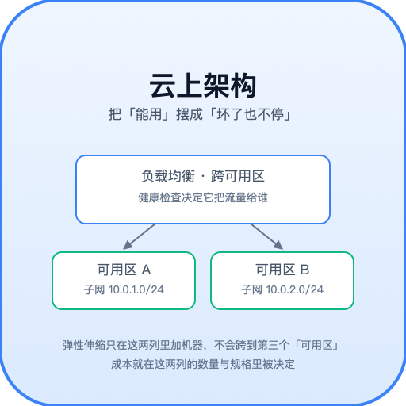
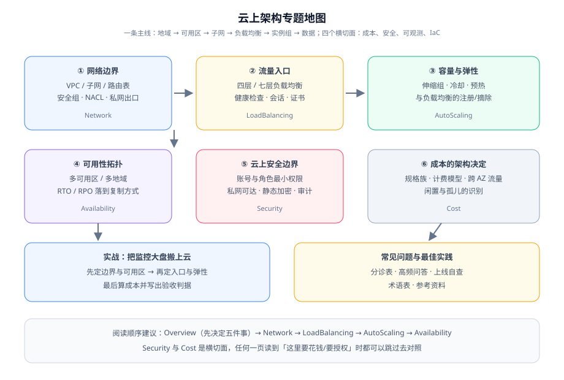

# 云上架构

云上架构要回答的不是「云怎么用」，而是**同一套应用放到云上之后，哪些决定必须在第一天做对**：网段怎么划、可用区放几个、流量从哪进来、机器什么时候加、数据跨不跨区、钱花在哪。这些决定的特点是——**做的时候只是几个表单字段，改的时候要停机**。

本专题讲的是**资源编排层面的架构判断**：VPC、负载均衡、弹性伸缩、可用区、安全边界与成本。它不讲网络协议本身（那是 [网络基础](../Network/index.md) 的职责），也不讲托管服务怎么选型（那是 [云原生](../CloudNative/index.md) 的职责）。

::: tip 一句话理解
云把「买机器」变成了一次点击，代价是**每个点击都在替未来的故障域与账单签字**。所以云上架构的核心动作不是「怎么开」，而是**「开之前先写下判据」**：这个可用区挂了会影响谁？这条跨区流量一个月多少钱？这次扩容量多久才生效？
:::

## 与相邻专题的分工

云、云原生、容器、容灾四个词经常混着用，边界必须写死：

| 专题 | 讲什么 | 与本专题的关系 |
| --- | --- | --- |
| 本专题 | **资源编排层**：VPC 与网络边界、负载均衡、弹性伸缩、可用区拓扑、云上安全边界、成本与规格 | —— |
| [云原生 · 概述与选型](../CloudNative/Overview/index.md) | 托管服务的**五层光谱**（IaaS → BaaS）与选型四维度 | 那边回答「**用什么形态**」，本专题回答「形态定了之后**怎么摆**」 |
| [云原生 · 云成本治理](../CloudNative/FinOps/index.md) | 成本的**治理闭环与口径**（FOCUS、单位成本、降本杠杆、护栏） | 那边管「**账单产生之后怎么治理**」，本专题管「**哪些架构决定会在账单上留下不可逆痕迹**」 |
| [容器编排进阶 · 弹性伸缩](../ContainerOrchestration/Autoscaling/index.md) | **K8s 内部**的 HPA / VPA / KEDA 与集群伸缩 | 那边决定「**要几个副本**」，本专题决定「**有没有机器给这些副本**」——只配 HPA 不配集群供给，会得到一堆 `Pending` |
| [容器编排进阶 · 实战](../ContainerOrchestration/Practice/index.md) | 以 **GitOps 交付**为主线串起弹性闭环 | 那边是交付视角，本专题是**资源与拓扑视角**；两页会在「弹性组怎么和发布错开」处相遇 |
| [备份与容灾 · 容灾架构](../BackupDR/DisasterRecovery/index.md) | 容灾**档位**（冷/温/热/多活）与 RTO / RPO、切换与回切 | 那边决定「**要哪个档位**」，本专题回答「档位落到云上**长什么样**」（子网跨 AZ、负载均衡跨 AZ、复制方式） |
| [网络基础](../Network/index.md) | 网络**协议与分层**（TCP/IP、DNS、抓包排查） | 协议是普适的，VPC 是厂商资源的编排。排障顺序仍是「先用协议分层定位，再落到 VPC 配置」 |
| [Nginx](../Nginx/index.md) | 单机反向代理与七层规则语法 | 自建 Nginx 与托管负载均衡职责重叠但**运维面不同**：一个是你要升级的进程，一个是按量计费的资源 |
| [Terraform](../Terraform/index.md) | IaC 的 state / module / 工作流 | 工具用法归那边；本专题只给**必须落进代码的最小骨架**（网段、子网、安全组、伸缩组） |
| [安全加固](../SecurityHardening/index.md) | 主机与集群的**加固基线**（内核参数、合规项、密钥治理） | 那边是**主机内**，本专题是**账号与网络边界**（角色最小权限、私网可达、静态加密、审计） |
| [监控告警](../Monitoring/index.md) | 指标类型、抓取模型与告警规则设计的方法论 | 本专题只列**云资源该暴露哪些容量与成本水位指标**，方法论不重复 |
| [虚拟机](../VM/index.md) | 单机虚拟化与自建虚机 | 自建 vs 托管：规格族与计费模型是云特有的判断点 |
| [完整项目交付 · 架构设计](/docs/Others/ProjectDelivery/Architecture/index.md) | 可逆 / 不可逆决策的分界与架构图约定 | 本专题整页都在兑现「**不可逆的现在定死，可逆的留活口**」这一条 |

## 专题地图

| 页面 | 内容 | 适合谁读 |
| --- | --- | --- |
| [总览：上云先要决定的五件事](./Overview/index.md) | 五件不可逆决策的清单与判据、什么时候**不该**上云做架构改造 | 所有人，先读 |
| [VPC 与网络边界](./Network/index.md) | 网段规划、公有/私有子网分工、安全组与 ACL、对等连接、私网出口的三个选择 | 新建环境的人，**重点读** |
| [负载均衡](./LoadBalancing/index.md) | 四层与七层的分界、健康检查参数、跨可用区开关、会话保持、TLS 终止位置 | 做入口的人，**重点读** |
| [弹性伸缩](./AutoScaling/index.md) | 指标选择、扩缩容的不对称、冷却与预热、与负载均衡的注册摘除顺序、震荡止血 | 做容量的人，**重点读** |
| [可用性拓扑](./Availability/index.md) | 可用区与地域的失败域、2 AZ 与 3 AZ 的取舍、跨地域的两种复制 | 定 SLA 的人 |
| [云上安全边界](./Security/index.md) | 账号与角色最小权限、私网可达、静态与传输加密、审计与密钥 | 安全与运维 |
| [成本与规格选型](./Cost/index.md) | 七个杠杆按「能否反悔」排序、计费模型组合、单位成本口径、反面清单 | 负责人与开发 |
| [实战：把监控大盘搬上云](./Practice/index.md) | 周期 5 项目的五个组件在云上分别落在哪，含 R1~R10 验收断言 | 想看完整过程的人 |
| [常见问题与最佳实践](./FAQ/index.md) | 分诊表、高频问答、上线自查清单、术语表 | 所有人 |

## 产品与规格事实速览

按 **2026-10** 口径联网核对。云产品**价格与规格变动频繁**，下表只固化「会影响架构判断」的事实，**任何报价请以厂商官方计价页为准**：

| 项 | 当前事实（2026-10） | 对架构的影响 |
| --- | --- | --- |
| AWS 自研 CPU 代际 | **Graviton5**：`M9g/M9gd` GA 2026-06-10、`C9g/C9gd` GA 2026-06-30、`R9g/R9gd` GA 2026-07-01；192 核、3.3 GHz 设计，vCPU:内存 通用型 1:4、计算型 1:2 | 与 x86 同代相比通常有可观的单价优势，但**要求 arm64 制品**；迁移的硬成本在 CI 与镜像 |
| AWS 上一代 | **Graviton4**（`M8g/C8g/R8g/R8gn/X8g/I8g`）仍在售且更成熟，大内存与本地盘形态尚未被 5 代覆盖 | 「最新 ≠ 能用」：`X8g` 级内存比与 `I8g` 级本地盘仍在 4 代 |
| AWS 隔离特性 | **Nitro Isolation Engine** 随 Graviton5 提供（形式化验证的 VM 间隔离） | 合规场景可用它替代部分「专用主机」论证 |
| 阿里云第九代 ECS | `g9i / c9i / r9i`（Intel Xeon Granite Rapids，3.2 GHz 基频、3.6 GHz 全核睿频、3.9 GHz 单核突发），通用型 1:4，`g9i` 覆盖 2 核 8G ~ 192 核 768G 共 12 档 | 单核睿频属**突发能力**，厂商明确「不作为 SLA 承诺」——别把它算进容量规划 |
| 阿里云负载均衡家族 | **ALB**（七层，NFV 架构自动弹性，单实例最大 100 万 QPS，基于 Tengine）、**NLB**（四层，单实例最大 1 亿并发）、**CLB**（物理机架构，单实例 100 万并发 / 5 万 QPS，高级七层路由能力弱，正被 ALB 替代） | 新建系统优先 ALB / NLB；CLB 的价值在「成本敏感 + 流量稳定 + 只需基础转发」 |
| 负载均衡计费 | ALB / NLB **仅按量付费**（实例费或 LCU 费 + 公网流量费）；CLB 支持包年包月 | 入口的成本随请求量变化，**它是少数会在流量翻倍时同步翻倍的组件** |
| 可修改性硬约束 | ALB / CLB 实例**创建后所属 VPC 不可修改** | VPC 与子网规划必须前置到「还没有业务」的时候 |
| 竞价 / Spot 回收机制 | 主流云均提供**回收通知**（AWS 为 2 分钟中断通知，可通过实例元数据与事件总线获取） | 只有**无状态且可重放**的负载才适合；数据库主库与 K8s 控制面不适合 |

::: info 版本组织说明
本专题**不另开版本目录**：云产品的演进以「新规格族 / 新功能开关」形式出现，**不存在破坏性的主版本边界**（旧的规格族与 API 长期保留）。需要按版本组织的是**框架与语言**类主题，仓库里的例子有 [SpringBoot/v2](../../Backend/Java/Frame/SpringBoot/v2/index.md) / [v3](../../Backend/Java/Frame/SpringBoot/v3/index.md) / [v4](../../Backend/Java/Frame/SpringBoot/v4/index.md) 与 [Spring5](../../Backend/Java/Frame/Spring/Spring5/index.md) / [Spring6](../../Backend/Java/Frame/Spring/Spring6/index.md)，**旧版本一律保留并标注状态、不覆盖**。
:::

## 学习路径

1. **先读 [总览](./Overview/index.md)**：它给出五件不可逆决策与「什么情况下先别做架构改造」的反面判据。跳过这一步直接看 VPC，会做出用不上的冗余。
2. **要新建环境，按顺序读 [网络边界](./Network/index.md) → [负载均衡](./LoadBalancing/index.md) → [弹性伸缩](./AutoScaling/index.md)**：这三页是有依赖顺序的——没有网段就没有子网，没有子网就没有可注册的后端。
3. **定 SLA 的读 [可用性拓扑](./Availability/index.md)**，读完必须能回答「我能不能在不通知用户的情况下，随时做一次可用区级演练」。
4. **预算敏感的读 [成本与规格选型](./Cost/index.md)**，但先读 `成本` 页里的**反面清单**再动手省钱。
5. **上线前用 [安全边界](./Security/index.md) 的清单扫一遍**：云上多数事故不是被攻破，而是**把内部端口暴露到了公网**。
6. **要完整走一遍，跟 [实战](./Practice/index.md) 的 R1~R10 断言**，再对照 [常见问题](./FAQ/index.md) 的自查清单。

## 参考资料

- AWS Well-Architected Framework（可靠性与成本两支柱）：https://docs.aws.amazon.com/wellarchitected/latest/framework/welcome.html
- Amazon EC2 按需定价与计费模型说明（On-Demand / Reserved / Savings Plans / Spot）：https://aws.amazon.com/ec2/pricing/
- 阿里云专有网络 VPC 产品文档（子网、路由表、安全组、网络 ACL）：https://help.aliyun.com/zh/vpc/
- 阿里云负载均衡产品家族介绍（ALB / NLB / CLB 功能特性对比）：https://help.aliyun.com/zh/slb/product-overview/slb-overview
- 阿里云 ECS 实例规格族（通用型 g 系列指标）：https://help.aliyun.com/zh/ecs/user-guide/general-purpose-instance-families
- Google Cloud 架构框架（可靠性设计原则）：https://cloud.google.com/architecture/framework

## 与故障应急体系的分工（第 129 天补充）

本专题与 [故障应急体系](../IncidentResponse/index.md) 的关系可以一句话概括：**架构决定故障的影响面有多大，应急决定影响发生时怎么把它收窄**。两者的分工是「事前形状」与「事中动作」：

| 问题 | 归本专题 | 归故障应急体系 |
| --- | --- | --- |
| 故障会波及多少用户？ | **可用区 / 地域拓扑、失败域划分、跨区开关** | —— |
| 出事之后往哪挪？ | 提供**可以挪过去的地方**（另一个可用区、另一套集群） | **谁决定挪、什么时候挪、挪完怎么确认挪对了** |
| 扩容要多久生效？ | 伸缩组的冷启动时间（本专题已量化） | **在容量类事故里，先扩容还是先限流的判断顺序** |
| 演练谁能做？ | 提供**隔离的小流量环境**（金丝雀命名空间、单副本） | **演练怎么设计、安全阀怎么设、判据怎么写** |

**两处最值得记住的接缝**：

1. 本专题反复强调「**一个可用区一个子网**」这类不可逆决定——它的价值在故障发生时才会兑现：**架构上没有第二个可用区，应急就只剩「等它好」这一条路**。
2. 云上演练的物理前提（可隔离的命名空间、可自动到期的实验、可一键摘除的实例）由本专题建设，而**演练的组织方式与判据**归故障应急体系。缺了前者，演练只能停在桌面推演；缺了后者，演练会变成没有产出的表演。

## 与「边缘计算与 CDN」专题的分工

云上架构回答的是「**你自己的机房 / 云账号里怎么摆**」：VPC 划几个网段、负载均衡挂在哪、弹性伸缩按什么指标、跨不跨可用区。它的前提是**这些资源都是你的，你能登上去、能改配置、能看底层指标**。

边缘计算与 CDN 回答的是「**摆到别人的网里之后多出什么**」：入口不再只在你自己的账号里，用户请求在到达你的 VPC 之前，已经先经过了一个你看不见、改不了、只能通过控制台配置的层级。

| 问题 | 归本页 | 归[边缘计算与 CDN](../EdgeCDN/index.md) |
| --- | --- | --- |
| 入口在哪终结 TLS | 在你自己账号里的负载均衡上终结 | 在边缘节点终结，回源再握手一次（两段证书链、两处续期） |
| 弹性伸缩按什么指标 | 你的实例规格与伸缩策略 | 边缘侧没有「实例」概念，只有配额（CPU 预算、请求数上限） |
| 成本怎么算 | 按实例时长、带宽包、存储 | 按流量、请求数、边缘函数 CPU 时间，**维度完全不同** |

::: warning 两页最容易接错的一处
「多可用区」与「多边缘节点」经常被当成同一件事。前者防的是**单个可用区故障**，后者降的是**用户到你的距离**。两者都不做，会同时得到「多可用区是假的」与「多节点是白付钱」两个结论。
:::
