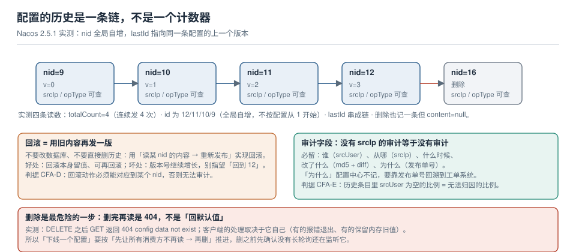

# 变更审计与回滚

配置事故复盘时最费时间的从来不是"怎么修"，而是"改之前是什么"。如果历史里只有一串版本号、没有"谁在什么时候从哪个 IP 改的"，那这条配置就是不可审计的——它只能被修复，不能被解释。

本页讲三件事：历史链到底是什么形状（用实测数据纠正几个常见误解）、审计要留哪些字段、以及**回滚的正确实现为什么是"用旧内容再发一版"**。



本页判据族 `CFA-A` ~ `CFA-H`，共 8 条。

## 一、历史链的真实形状

在 Nacos 2.5.1 上对同一个 `dataId` 连续发布 4 次，然后查历史（`GET /nacos/v1/cs/history?search=accurate&dataId=...&group=...`）：

| 读数 | 实测值 | 含义 |
| --- | --- | --- |
| `totalCount` | **4** | 每次发布一条历史，重发相同内容也算一条 |
| 各条 `id` | **12 / 11 / 10 / 9** | **全局自增**，不按配置从 1 开始 |
| `lastId` | 指向同一条配置的上一条 | 可以沿链往回走，不用自己排序 |
| 单条字段 | `id / lastId / dataId / group / tenant / appName / md5 / content / srcIp / srcUser / opType / publishType / grayName / extInfo / createdTime / lastModifiedTime` | 该有的都有 |

三条必须记住的推论：

1. **"回到第 3 版"这种说法在 Nacos 里不成立**。`id=3` 大概率是另一个配置的历史。回滚必须按 `id`（nid）定位，而不是按"倒数第几版"。
2. **历史是按发布记的，不是按内容记的**。同一个内容发两次，历史里是两条，`md5` 相同。所以「历史条数」不等于「改过几次」。
3. `lastId` 是一条**链**，但这不等于"能直接跳到任意历史版本"——要定位某一版，还是得先查列表拿到 `id`。

::: warning 不同产品的"版本号"语义完全不一样
Apollo 的 `Release` 是"一次发布对应一个 releaseKey"，是**按配置**递增的；Nacos 的 `nid` 是**全局**自增的；Kubernetes 的 ConfigMap 靠 `resourceVersion`，那是 etcd 的全局版本，而且**旧版本不可读回**。把三者的号混着说，回滚脚本一定会写错。
:::

## 二、审计字段：五个必留，一个配置中心不记

| 字段 | 回答什么问题 | 没有它会怎样 |
| --- | --- | --- |
| `srcUser` | **谁**改的 | 只能定位到"某个 token"，而 token 常常是共用的 |
| `srcIp` | 从**哪**改的 | 无法区分"CI 发的"和"人在控制台点的" |
| `createdTime` | **什么时候** | 与监控曲线对不上时间轴 |
| `content` + `md5` | 改了**什么** | 只能看现在的值，不知道改前是什么 |
| `opType` / `publishType` / `grayName` | 是**新增、修改、删除、灰度**中的哪一种 | 把灰度当成正式变更，或反过来 |

**配置中心不记的是"为什么"**。这一项必须由外部系统补上——通常就是一个**发布单号**：

```shell
# 发布时把工单号塞进 extInfo（Nacos 2.x 的 extInfo 是自由字段，用它挂外部 ID）
curl -s -X POST "http://nacos:8848/nacos/v1/cs/configs" \
  -d "dataId=order.yaml" -d "group=DEFAULT_GROUP" \
  -d "content@order.yaml" \
  -d "extInfo={\"ticket\":\"CHG-20261022-017\",\"operator\":\"ci-bot\"}"
```

这样"为什么改"就能顺着 `CHG-20261022-017` 回到工单系统里的评审记录。没有这一步，审计只能回答"改了什么"，回答不了"谁批准的"。

::: danger 共用 token 会让审计失效
`srcUser=nacos` 出现在全部历史里，等价于"没人知道是谁改的"。三条最低要求：

1. CI 用一个专用账号（`srcUser=ci-bot`），人用各自账号；
2. 生产命名空间的写权限只给 CI 账号；
3. 控制台的默认口令必须改掉（Nacos 2.x 默认 `nacos/nacos`，且默认**不开启鉴权**）。
:::

## 三、回滚：用旧内容再发一版

正确实现只有一种：**读某条历史的 `content`，把它当新内容重新发布**。

```shell
# ① 找到要回滚到的版本（列表按 id 倒序，取你要的那条）
curl -s "http://nacos:8848/nacos/v1/cs/history?search=accurate&dataId=order.yaml&group=DEFAULT_GROUP&pageNo=1&pageSize=10" \
  | jq -r '.pageItems[] | "\(.id)\t\(.md5)\t\(.createdTime)"'

# ② 取出那一版的完整内容（nid 用上一步读到的 id）
curl -s "http://nacos:8848/nacos/v1/cs/history?dataId=order.yaml&group=DEFAULT_GROUP&nid=10" \
  | jq -r '.content' > /tmp/order.rollback.yaml

# ③ 当新内容发回去（注意：这会产生一条新历史，回滚本身也被留痕）
curl -s -X POST "http://nacos:8848/nacos/v1/cs/configs" \
  --data-urlencode "dataId=order.yaml" -d "group=DEFAULT_GROUP" \
  --data-urlencode "content@/tmp/order.rollback.yaml" \
  -d "extInfo={\"ticket\":\"CHG-20261022-018\",\"operator\":\"ci-bot\",\"reason\":\"rollback-to-nid-10\"}"
```

为什么不能"改数据库"或"删历史"：前者绕过了所有审计与推送链路（客户端根本收不到通知），后者让"下一次回滚"失去目标。

::: danger 回滚的三个坑
1. **把"回滚"写成"改回我记得的旧值"**：人记得的值通常是错的，而且这一步没有版本依据，事后无法证明你回滚到了哪一版。
2. **回滚后不观察**：回滚本身也是一次变更，同样会触发全量重建。回滚后必须重新走一遍观察窗。
3. **回滚到了一条被删除的版本**：删除也会写历史，但那条历史的 `content` 是 `null`——拿它去回滚会得到一份空配置。
:::

## 四、删除：404，而不是"回默认值"

本机实测的删除语义：

| 动作 | 结果 |
| --- | --- |
| `DELETE /nacos/v1/cs/configs?dataId=del.properties&group=DEFAULT_GROUP` | `200 true` |
| 删除后再 `GET` 同一 `dataId` | **`404 config data not exist`** |
| 删除后的历史 | 多一条记录，`content` 为 `null`，`md5` 为 `null` |
| 历史 `totalCount` | 从 1 变成 2（删除也算一次操作） |

这条语义的关键在于：**客户端拿到 404 之后做什么，完全由客户端决定**。有的框架会 fail-fast 让应用起不来，有的会保留内存里的旧值继续跑，有的会退回代码里的默认值。三种行为都"没报错"，但线上表现完全不同。

所以「下线一个配置」的正确顺序是：

1. 确认所有消费方**已不再读**这个 `dataId`（先改代码、发版、观察）；
2. 确认没有长轮询连接还挂着它（否则它们会收到"配置没了"的通知）；
3. 再删。删除前把最后一版 `content` 归档到工单里——历史里那一版的 `content` 还在，但删除那条没有。

## 五、审计的三个反模式

| 反模式 | 表现 | 后果 |
| --- | --- | --- |
| **只看最终值** | 出了问题先看"现在是什么" | 无法判断"是不是这次改坏的"，只能全量回滚 |
| **审计与发布分离** | 发布走 CI，审计靠人填表 | 表格和实际必然对不上，且没人核对 |
| **保留期过短** | 历史只留 30 天 | 季度审计时无法证明"这个参数三个月没动过" |

第三条尤其容易被忽略：配置的历史体积远小于日志，保留一年是廉价的；而"某参数是否被人动过"这类问题，往往在几个月后才被问起。

## 六、取证：出事后按什么顺序翻

一个可复用的顺序（比"凭印象猜"快得多）：

1. **先看时间轴**：故障开始时间 → 往前推 30 分钟内的所有 `config` 历史条目（跨 `dataId`）；
2. **看 `opType` 与 `srcIp`**：区分"CI 发的"与"人点的"，后者优先怀疑；
3. **看 `md5` 跳变**：连续多条 `md5` 相同说明是重发，不是真变更；
4. **对齐客户端日志**：`dataId` + 新 `md5` 出现的时间，就是"生效时刻"（比发布时刻晚一个缓存窗口 + 轮询周期）；
5. **最后才看内容 diff**：前四步能定位到"哪一条"，这一步回答"错在哪一行"。

::: tip 把顺序写进值班手册
值班时人是慌的，靠"应该先看什么"的记忆会漏。把上面五步贴进 runbook，比写一篇《配置管理最佳实践》有用得多。
:::

## 七、本页判据

| 编号 | 判据 | 看什么现象 | 不满足时改哪里 |
| --- | --- | --- | --- |
| `CFA-A` | 每次发布都产生一条历史 | `totalCount` 与发布次数一致 | 检查是否走了绕过中心的通道 |
| `CFA-B` | 回滚按 nid 定位 | 回滚记录里有明确的 `nid` | 禁止"手填旧值"式回滚 |
| `CFA-C` | 历史条目可读出完整 `content` | 能取到某一版的完整内容 | 检查是否有条目 `content=null`（删除记录） |
| `CFA-D` | 回滚动作可审计 | 回滚本身也有历史与新 `extInfo` | 补 `reason` 字段 |
| `CFA-E` | `srcUser` 无空值且能区分人与机器 | CI 与人工是不同账号 | 拆账号，收生产写权限 |
| `CFA-F` | `extInfo` 里挂了外部工单号 | 每条变更能回溯到评审 | 发布脚本统一注入 |
| `CFA-G` | 删除前已确认无消费方 | 删除前列出了监听者清单 | 按第四节三步走 |
| `CFA-H` | 历史保留期 ≥ 一个审计周期 | 保留 ≥ 90 天（或按合规要求） | 调大清理阈值 |

## 参考资料

- Nacos 文档：*配置历史*（`/v1/cs/history` 的分页与 `nid` 语义）、*回滚*（控制台的"回滚"实际执行的是重新发布）
- Nacos 数据结构：`his_config_info`（`nid` 全局自增、`op_type`、`src_ip`、`src_user`）
- Apollo 文档：*Release 与回滚*（`releaseKey` 与 Nacos `nid` 的语义差异）
- Kubernetes 文档：*ConfigMap*（`resourceVersion` 不是可回滚的版本号）
- 本仓库：[灰度下发](../GrayRollout/index.md)（回滚通道与灰度收敛）、[变更管理](../../ChangeManagement/Overview/index.md)（评审与留痕的流程侧）
