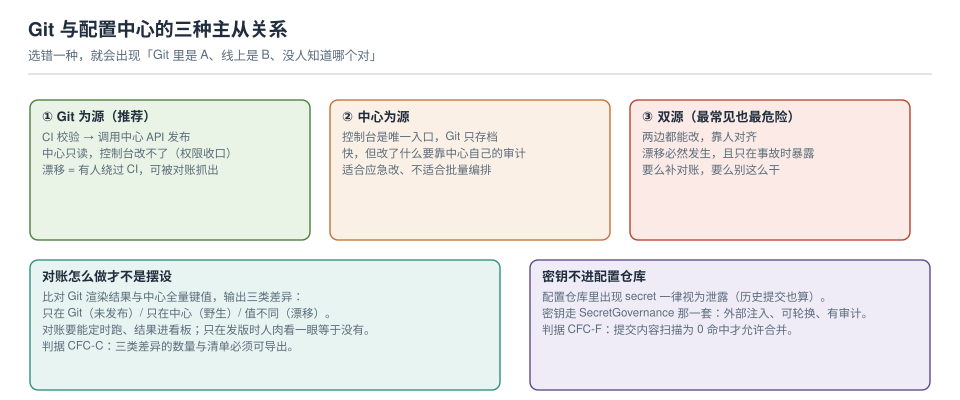

# 配置即代码与漂移对账

把配置放进 Git 这件事，本身不解决任何问题——**只有当"中心里的值"和"Git 里的值"能被机器比对时，它才开始产生价值**。否则你只是多了一个可以修改的地方，漂移反而更容易发生。

本页讲三种主从关系、一套能落地的对账命令、以及四道 CI 门禁。



本页判据族 `CFC-A` ~ `CFC-H`，共 8 条。

## 一、三种主从关系，先选一种

| 模式 | 谁是权威 | 控制台能不能改 | 优点 | 代价 |
| --- | --- | --- | --- | --- |
| **Git 为源** | Git | 不能（权限收口到只读） | 有评审、有 diff、可回滚、可复现 | 应急改变慢（要走一次流水线） |
| **中心为源** | 配置中心 | 能 | 快，改完就生效 | 只有中心自己的历史，跨环境对比困难 |
| **双源** | **没有人** | 能，CI 也能 | 表面上兼顾了两种 | 漂移必然发生，且只在事故时暴露 |

绝大多数团队落在第三种，且没有意识到。判断方法很直接：**问一句"如果有人在控制台改了一个值，明天会被覆盖回去吗？"** 如果答案含糊，就是双源。

::: danger 双源最典型的失效
CI 每天 10:00 全量同步一次配置。运维在 14:00 手动把某接口超时从 3000 调到 5000 应急。第二天 10:00，CI 把它覆盖回 3000，**没有任何人收到通知**，故障在流量高峰复现。

这不是"CI 太激进"，而是"没人定义谁是权威"。要么 Git 为源（应急也必须走流水线，允许加急但不是绕过），要么中心为源（那就别用 CI 全量推）。
:::

## 二、对账：三类差异，一套命令

对账要输出三个互斥的集合：

| 差异类型 | 含义 | 处置 |
| --- | --- | --- |
| **只在 Git** | 仓库里有、中心里没有 | 通常是"忘了发布"，也可能是有意未上线 |
| **只在中心** | 中心里有、仓库里没有 | **野生配置**：可能是手改的、也可能是历史遗留 |
| **值不同** | 两边都有，但 `md5` 不同 | 漂移，要看 diff 决定以谁为准 |

一套不依赖任何 SDK 的做法（两边都导出成 `dataId=md5` 的文本，再 `diff`）：

```shell
# ① 导出中心侧：所有 dataId 的 md5（分页拉全量）
page=1
: > /tmp/center.md5
while : ; do
  body=$(curl -s "http://nacos:8848/nacos/v1/cs/configs?search=accurate&dataId=&group=&pageNo=$page&pageSize=100&tenant=prod")
  echo "$body" | jq -r '.pageItems[] | "\(.dataId)=\(.md5)"' >> /tmp/center.md5
  total=$(echo "$body" | jq -r '.pagesAvailable')
  [ "$page" -ge "$total" ] && break
  page=$((page+1))
done

# ② 导出 Git 侧：对每个文件算 md5（与中心一致的口径：内容原始字节的 md5）
: > /tmp/git.md5
find configs/prod -name "*.yaml" -o -name "*.properties" | while read -r f; do
  echo "$(basename "$f")=$(md5 -q "$f" 2>/dev/null || md5sum "$f" | cut -d' ' -f1)" >> /tmp/git.md5
done

# ③ 三类差异
sort /tmp/center.md5 > /tmp/c.sorted; sort /tmp/git.md5 > /tmp/g.sorted
echo "== 只在 Git（未发布）"; comm -13 /tmp/c.sorted /tmp/g.sorted
echo "== 只在中心（野生）";  comm -23 /tmp/c.sorted /tmp/g.sorted
echo "== md5 不同（漂移）";  join -t= /tmp/c.sorted /tmp/g.sorted | awk -F= '$2!=$3'
```

三个实现细节决定这套东西能不能长期用：

1. **md5 口径必须一致**：中心的 `md5` 是对 `content` 原始字节算的。Git 侧如果文件有 BOM、行尾是 CRLF，算出来就是"永远不同"。**统一 UTF-8 + LF**（`.gitattributes` 里 `* text=auto eol=lf`）。
2. **要能分页拉全量**：只比"我记得的那几个"等于没比。
3. **差异要能进看板**：每天跑一次、把三个集合的数量画成趋势线。数量突然从 2 跳到 40，说明有人在批量手改。

## 三、CI 的四道门禁

| 门禁 | 检查什么 | 失败时 |
| --- | --- | --- |
| **语法** | YAML / properties 能否解析 | 阻断：半截配置是最常见的生产事故 |
| **跨键规则** | 键之间的约束（`timeout < retry_interval`、`min ≤ max`） | 阻断：单键都对、组合就错 |
| **秘密扫描** | 疑似密钥、token、私钥 | 阻断：配置仓库里的密钥视为已泄露 |
| **渲染 diff** | 与上一次发布的产物逐行比 | 提示：变更影响面，供评审判断 |

第三条与第四条经常被省掉，但它们的性价比最高：

- 秘密扫描不通过意味着**必须轮换**，不是"删掉再提交"（历史里还在）。
- 渲染 diff 让评审看到"这次到底改了什么"，而不是看一整个文件的 diff——后者在模板化配置里几乎无法阅读。

```shell
# 跨键校验的极简形态：把规则写成断言，任何一条不成立就退出非 0
python3 - <<'PY'
import yaml, sys
c = yaml.safe_load(open("configs/prod/order.yaml"))
assert c["client"]["timeout_ms"] < c["client"]["retry"]["interval_ms"], "超时必须小于重试间隔"
assert c["pool"]["min"] <= c["pool"]["max"], "min 不能大于 max"
print("cross-key rules OK")
PY
```

## 四、仓库结构：按环境分目录，按服务分文件

```text
configs/
├── prod/
│   ├── order.yaml            # 一个服务一个文件
│   ├── payment.yaml
│   └── shared/mysql.yaml     # 跨服务共享的部分
├── staging/                  # 与 prod 同构，便于 diff
└── .gitattributes            # * text=auto eol=lf
```

两条纪律：

1. **环境目录之间必须同构**：`staging` 里少一个文件，就意味着"这个配置在预发根本没被验证过"。可以用一条检查保证：两边文件名集合相等。
2. **共享配置单独放**：`shared/` 下的改动影响多个服务，评审要求要更高（它不是"某个服务的配置"，是"平台约定"）。

::: warning 别把"环境差异"做成"两份完全不同的文件"
`prod/order.yaml` 与 `staging/order.yaml` 如果各写各的，半年后它们就是两个不相干的文件。正确做法是**同结构、只差值**，并且用一条命令能看出差异只有哪几行：

```shell
diff -u configs/staging/order.yaml configs/prod/order.yaml | grep -E "^[+-][^+-]"
```

差异行数应该是个位数。到了几十行，说明两份文件已经分叉，"预发验证过"这句话就不成立了。
:::

## 五、边界：密钥与基础设施

这两样经常被顺手塞进配置仓库，然后出问题：

| 内容 | 该不该进配置仓库 | 该放哪 |
| --- | --- | --- |
| 普通应用配置（阈值、开关、超时） | ✅ 该进 | 本页讲的这套 |
| **密钥 / token / 私钥** | ❌ 绝不 | [密钥治理](../../SecurityHardening/SecretGovernance/index.md)：外部注入、可轮换、有审计 |
| 云资源定义（VPC、集群、数据库实例） | ❌ 不进应用配置仓库 | [Terraform](../../Terraform/Overview/index.md)：IaC 的 state 与模块是另一套生命周期 |
| K8s 的 ConfigMap 清单 | ⚠️ 看定位 | 若它是"渲染产物"，就该由 CI 生成而不是手写 |

判断标准是**变更节奏与责任人是否相同**：应用配置由服务 owner 改、按小时计；基础设施由平台组改、按周计。混在一个仓库里，权限与评审就没法分开。

## 六、三个反模式

| 反模式 | 表现 | 后果 |
| --- | --- | --- |
| **一键全量推** | CI 每天把整个仓库推一遍 | 手改被静默覆盖，且没人知道自己被覆盖了 |
| **对账只在对不上时跑** | 出事了才比对 | 你比对的是"事故现场"，不是"漂移过程" |
| **把中心当备份** | Git 里没有，只在中心有 | 中心挂了你连"应该是什么"都不知道 |

第二条值得单独说：对账的价值在于**趋势**，不在于某一次的差异清单。数量稳定在个位数是健康；缓慢上升到二十几，说明有人的改法绕过了流程——这时候还没出事，正是修流程的时候。

## 七、本页判据

| 编号 | 判据 | 看什么现象 | 不满足时改哪里 |
| --- | --- | --- | --- |
| `CFC-A` | 主从关系已明确 | 文档里写了"谁是权威" | 选一种，另一侧设只读 |
| `CFC-B` | 环境目录同构 | 文件名集合相等 | 补齐缺失文件 |
| `CFC-C` | 对账输出三类差异 | 有"只在 Git / 只在中心 / 值不同" | 按第二节实现，结果可导出 |
| `CFC-D` | 对账定时跑且有趋势 | 有每日差异数量曲线 | 接进定时任务与看板 |
| `CFC-E` | md5 口径一致 | 行尾与编码统一（UTF-8/LF） | 加 `.gitattributes`，重算一次 |
| `CFC-F` | 配置仓库无密钥 | 秘密扫描 0 命中 | 移出并**轮换** |
| `CFC-G` | 跨键规则进 CI | 有断言脚本且能失败 | 按第三节写 |
| `CFC-H` | 环境间 diff 只有个位数行 | `diff` 结果行数可控 | 分叉了就合并回同结构 |

## 参考资料

- Nacos 文档：*配置管理 API*（`search=accurate` 分页、`pageItems[].md5` 的口径）
- Apollo 文档：*配置发布与回滚*（`Release` 与 Git 的对接方式）
- Argo CD / Flux 文档：*GitOps*（声明式 + 持续对账的思路，本页把它收缩到"应用配置"这一层）
- Google SRE Book：*Configuration Design*（配置的单一来源与变更控制）
- 本仓库：[配置分层与单一来源](../Layering/index.md)（谁赢）、[Terraform](../../Terraform/Overview/index.md)（IaC 的边界）、[密钥治理](../../SecurityHardening/SecretGovernance/index.md)（密钥不进仓库）
