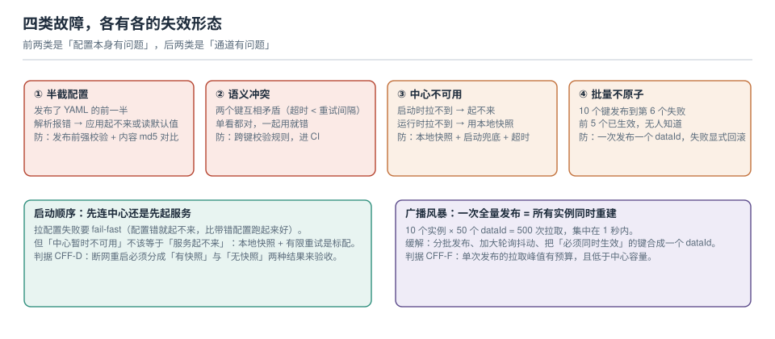

# 故障面：中心不可用、半截配置、批量不原子

配置系统的故障有个共同特点：**它们都不报错**。配置只发出去一半，服务照样启动；两个键互相矛盾，解析照样成功；中心连不上，客户端用本地快照默默跑着——直到某个业务路径第一次走到那段逻辑。

本页把四类故障摊开，并附上一个本机实测出来的、错误信息极具误导性的坑。



本页判据族 `CFF-A` ~ `CFF-H`，共 8 条。

## 一、故障地图：先分类，再对症

| 类别 | 本质 | 首次暴露的时机 | 典型信号 |
| --- | --- | --- | --- |
| **半截配置** | 写进去的东西不完整/不可解析 | 应用启动或首次读该键 | 解析异常、字段为 `null` |
| **语义冲突** | 每个键都对，组合起来矛盾 | 业务路径走到时 | 超时叠加、重试风暴、容量算错 |
| **中心不可用** | 通道断了 | 启动时起不来，运行时行为漂移 | 连接超时、快照兜底日志 |
| **批量不原子** | 一组变更只成功了一部分 | 事后核对时 | "我明明改了 10 个，怎么只生效 6 个" |

前两类是**内容问题**，后两类是**通道问题**。处置方式完全不同：内容问题靠校验与评审，通道问题靠超时、快照与分批。

## 二、半截配置与体积陷阱（实测，错误信息会骗人）

先看一组实测数据（Nacos 2.5.1 / 3.0.3 都复现）：

| 配置正文大小 | HTTP 结果 |
| --- | --- |
| 100 KB | `200 true`，90 ms |
| 1 MB（1,024,000 B） | `200 true`，1,013 ms |
| 1,048,575 B | `200 true` |
| 1,054,500 B | **`400 parameter missing`** |
| 2 MB | **`400 parameter missing`** |

失败时返回的完整消息是：

```json
{"code":10000,"message":"parameter missing","data":"Required parameter 'groupName' type String is not present"}
```

**它说的是"缺少 groupName"，而不是"内容太大"。**真相是：请求体是 `application/x-www-form-urlencoded`，配置正文被 URL 编码后体积约翻倍，撞上了 Tomcat 的 `max-http-form-post-size`（默认 **2 MiB**），于是**整个表单参数解析被跳过**——`dataId`、`groupName` 全部"不存在"，服务端只能报第一个缺失的参数。

而服务端声明的上限是 **10 MiB**：

```shell
# 服务端自己说的上限（3.0.3 实测返回）
curl -s http://nacos:8848/nacos/v3/admin/core/state -H "accessToken: $AT" | jq '.data.maxContent'
# 10485760
```

::: danger 三个必须记住的点
1. **服务端上限 ≠ 你能传上去的上限**，中间隔着一层 Web 容器。看到 `maxContent=10485760` 就以为能传 10 MB，会在第一次发布大配置时踩坑。
2. **"参数缺失"类报错要先怀疑体积**，不要先去检查是不是少写了 `groupName`。判据：把同一份内容裁到 100 KB 再发一次，通了就是体积问题。
3. 大配置本身就该被质疑：**单文件超过几百 KB 的配置，通常是"把数据当配置"**（白名单、地区表、文案表）。这类数据应该走数据库或对象存储，不该塞进配置中心——每次改都要全量推送给所有实例。
:::

除了体积，还有两种"半截"：

- **写了一半的 YAML**：编辑器里粘贴时少了一段，`yaml.safe_load` 报错，但有些框架会**忽略解析失败的配置源并继续启动**（取决于 `spring.cloud.nacos.config.fail-fast`）。于是应用带着默认值跑起来了。
- **代码引用了不存在的键**：`@Value("${app.timeout}")` 在键缺失时直接启动失败（这是好事），但 `@Value("${app.timeout:3000}")` 会静默用 3000——**一个默认值把配置缺失变成了"正常启动"**。

## 三、语义冲突：单键都对，组合就错

这类问题无法靠"值范围校验"发现，只能靠**跨键规则**：

| 冲突 | 后果 | 规则 |
| --- | --- | --- |
| `timeout_ms` > `retry.interval_ms` | 重试还没等到就超时，重试等于没做 | 超时必须小于重试间隔 |
| `pool.min` > `pool.max` | 启动直接抛异常（少数框架会静默纠正） | `min ≤ max` |
| `batch.size` × `concurrency` > 下游 QPS 上限 | 压垮下游 | 乘积不超过下游配额的 80% |
| `cache.ttl` < `refresh.interval` | 缓存永远命中不了新值 | TTL ≥ 刷新间隔 |
| 灰度比例 > 0 但 canary 实例数为 0 | 灰度静默失效 | 发布前校验目标集合非空 |

这些规则的特点是**跨文件、跨团队**：`pool` 在 DBA 的清单里，`timeout` 在服务 owner 的清单里，冲突只有放在一起才看得见。所以它们必须被写成断言，进 CI（实现方式见[配置即代码](../ConfigAsCode/index.md)第三节）。

## 四、中心不可用：启动期与运行期是两件事

| 阶段 | 症状 | 正确的行为 | 常见错误 |
| --- | --- | --- | --- |
| **启动期** | 拉不到配置 | 有本地快照 → 用快照起来并告警；无快照 → **fail-fast 退出** | 用一堆默认值硬起来，带着错配置接流量 |
| **运行期** | 长轮询断开、推送收不到 | 用当前内存值继续跑 + 持续重试 + 告警 | 立刻清空配置或让健康检查失败，自我摘除 |

本机实测的启动耗时给出了超时该设多大：

| 版本 | 从 `docker run` 到接口可服务 | 含义 |
| --- | --- | --- |
| Nacos 2.5.1 | **约 20 s** | 应用启动时的连接超时要大于这个数 |
| Nacos 3.0.3 | **约 25 s** | 同上，且首次启动还要初始化 |

如果客户端连接超时设成 3 s、重试 3 次，总预算 9 s——**在中心自己还没起来的场景里必然失败**。这就是"发布顺序"的经典问题：中心重启时，同时重启的应用会全部起不来。

::: tip 本地快照要验证过才算有
"配置中心挂了能读本地快照"这句话，必须用一次实操证明：停掉中心 → 重启应用 → 应用能起来且读到的是最后一次的值。没做过这一步的团队，通常会在真事故时发现快照目录是空的（快照是在**成功拉取后**才写的，从没成功过的实例没有快照）。
:::

## 五、批量不原子：10 个键改了 6 个

配置中心通常**没有跨 `dataId` 的事务**。10 次 `POST` 就是 10 次独立发布：第 6 次失败时，前 5 次已经生效，并且已经推送给了所有客户端。

三种缓解方式，按可靠性排序：

| 方式 | 做法 | 代价 |
| --- | --- | --- |
| **合并成一个 dataId** | 把必须同时生效的键放一起，一次发布 | 变更放大（改一个键推全量） |
| **两阶段切换** | 先发新键（不生效）→ 切一个"指向新键"的开关 → 删旧键 | 多一次发布，但可回退 |
| **失败即回滚** | 脚本记录已成功的列表，失败时逐个回滚 | 回滚本身也可能失败，需要重试与告警 |

第二种是真正可用的做法：**用一次"指针切换"把多键变更变成单键变更**。它把"要么全成要么全不成"的要求，降级成"要么全成要么指回旧的"。

## 六、广播风暴：一次发布到底有多贵

算例（按语义推算）：

```text
一次发布触发的客户端动作数 = 收到通知的实例数 × 每个实例重建的 bean 数
```

10 个实例 × 50 个 bean = 500 次 bean 重建，集中在通知到达后的几百毫秒内。表现通常是：**发布瞬间 CPU 抖动、P99 抬升、下游连接数短暂上升**。

| 缓解手段 | 效果 | 代价 |
| --- | --- | --- |
| 分批发布（每批 10%~25%） | 把峰值削成平台 | 生效时间变长 |
| 拆细 dataId（只让需要的人收到） | 减少收到通知的实例数 | 文件变多，管理成本上升 |
| 减少 `@RefreshScope` 范围 | 减少每个实例的重建量 | 有些 bean 只能重启生效 |
| 调大轮询周期 | 只影响"多久生效"，不影响峰值 | 生效更慢 |

注意第四行：**调大轮询周期不能削峰**——它只是把同样的唤醒次数摊到更长的时间里，真正削峰的是分批。

## 七、本页判据

| 编号 | 判据 | 看什么现象 | 不满足时改哪里 |
| --- | --- | --- | --- |
| `CFF-A` | 发布前有语法校验 | CI 里 YAML/properties 解析必过 | 加 `yaml.safe_load` 门禁 |
| `CFF-B` | 单配置体积有预算 | 有"超过 X KB 就拆"的规则 | 大表迁出配置中心 |
| `CFF-C` | 体积报错能被识别 | 遇到"参数缺失"先裁小重试 | 写进值班手册 |
| `CFF-D` | 启动期与运行期的兜底策略分开 | 有无快照两种结果都验收过 | 按第四节表格实现 |
| `CFF-E` | 跨键规则进 CI | 有断言脚本，能失败 | 从最贵的三条开始写 |
| `CFF-F` | 批量变更走"指针切换" | 多键变更有一次原子切换点 | 按第五节第二种方式改造 |
| `CFF-G` | 单次发布的重建量有预算 | 有"实例数 × bean 数"的算式 | 按第六节算一遍 |
| `CFF-H` | 客户端超时预算大于中心冷启动 | 超时总预算 > 30 s | 调大连接超时与重试 |

## 参考资料

- Tomcat 文档：*HTTP Connector*（`maxPostSize` / `max-http-form-post-size` 默认值与行为：超限时参数不被解析）
- Spring Boot 文档：*Nacos Config*（`fail-fast`、`configLongPollTimeout`、`configRetryTime`）
- Nacos 文档：*配置管理*（`maxContent` 与实际传输链路的差异）、*客户端容灾*（本地快照目录与失效转移）
- Nacos 运维：`/nacos/v3/admin/core/state`（`maxContent`、`defaultGroupQuota` 等运行参数）
- 本仓库：[配置即代码](../ConfigAsCode/index.md)（跨键规则进 CI）、[读取路径](../RefreshPath/index.md)（重建代价的来源）
