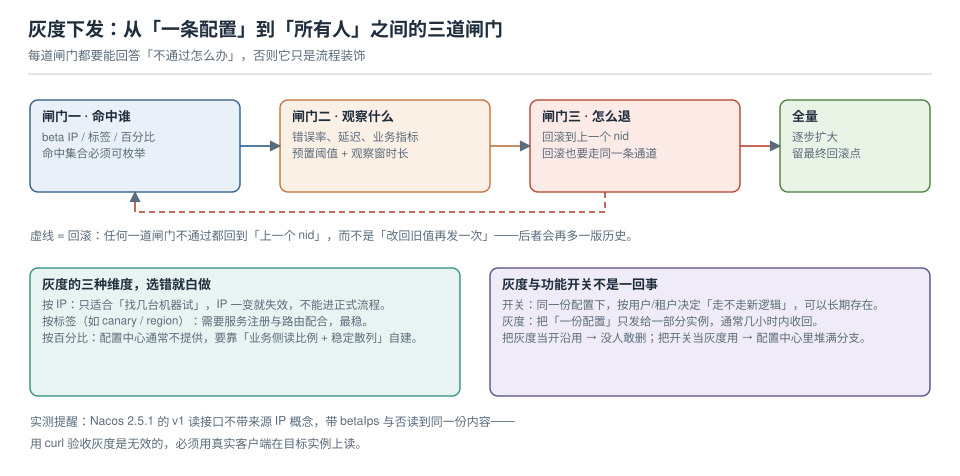

# 灰度下发与批次

灰度这个词被用得太松，以至于很多团队说的"我们灰度了"，实际动作是"在控制台上给两台机器单独改了一次值"——没有命中集合的定义、没有观察指标、没有回滚路径，只有三样都没有的一次手工操作。

本页把灰度拆成三道必须同时具备的闸门，并给出一件反直觉的事：**用 `curl` 是无法验收灰度的**，这一点在本机实测里被证实了。



本页判据族 `CFG-A` ~ `CFG-H`，共 8 条。

## 一、三道闸门：缺一道就不是灰度

| 闸门 | 必须回答的问题 | 没有它会怎样 |
| --- | --- | --- |
| **命中谁** | 哪几个实例 / 哪类流量拿到新配置？集合能不能被列出来？ | 变成"全网同时生效"，只是被叫做灰度 |
| **观察什么** | 看哪些指标、看多久、超过什么阈值算不通过？ | 出问题时只能靠用户投诉决定要不要回滚 |
| **怎么退** | 退回哪个版本、用什么通道、谁有权执行？ | 回滚动作本身变成一次新的、没人评审过的变更 |

三者的共同点是：**都必须能在变更之前写下来**。写不下来的，说明这次变更还没准备好。

::: danger 最常见的假灰度
「先在 A 机器上改，没问题再改 B」——听起来是灰度，但：

1. 命中集合是**机器**而不是**流量特征**：A 机器上跑着 1/10 的流量，但它也是全部定时任务的执行者，出了问题影响面不是 1/10。
2. 观察是**人盯**：没人盯的那 20 分钟就是空窗。
3. 回退是**记得旧值**：如果旧值是 `3000` 而现在是 `1000`，回退时有人会写成 `300`。

把这三条补上（按标签命中、指标 + 时长、按 nid 回滚），它才算灰度。
:::

## 二、三种维度，各有各的前提

| 维度 | 怎么命中 | 前提 | 什么时候用 |
| --- | --- | --- | --- |
| **按实例 IP** | 发布时指定 `betaIps` | 实例 IP 稳定（别在弹性伸缩组里用） | 找几台机器试水，一次性动作 |
| **按标签** | 实例带 `canary` / `region` 标签，客户端按标签取对应 `group` | 需要服务注册、路由或"每实例一份配置"的编排 | **正式流程里的首选** |
| **按百分比** | 业务侧读一个 0~100 的比例值 + 稳定散列（用户 ID / 租户 ID） | 配置中心通常不提供，要自己实现 | 面向流量的灰度，与实例数无关 |

按百分比这条路要特别注意**散列必须稳定**：用 `hash(userId) % 100 < ratio` 是稳定的，用 `random() < ratio` 会让同一个用户在两秒内忽新忽旧——那不是灰度，是抽奖。

::: tip 灰度的最小可用形态
如果暂时没有标签体系，最省事又正确的做法是：**把灰度做成"两份配置 + 一个开关"**——新值单独放一个 `dataId`（如 `order.yaml.canary`），客户端根据一个"我是不是 canary"的本地判定去选读哪一份。代价是多一个 dataId，收益是命中集合完全由部署决定，不依赖配置中心的能力。
:::

## 三、灰度与功能开关不是一回事

这两个概念在会议上经常被互换，但它们解决的是不同的问题，混用会同时得到两边的坏处：

| | 灰度下发 | 功能开关 |
| --- | --- | --- |
| 变更对象 | **配置值**（一份配置只发给一部分实例） | **代码路径**（同一份配置，按用户决定走不走新逻辑） |
| 生命周期 | 小时级，收敛到全量后消失 | 可能长期存在（几个月） |
| 命中维度 | 实例 / 标签 / 百分比 | 用户 / 租户 / 设备 |
| 失败表现 | 部分实例行为不一致 | 部分用户行为不一致 |
| 主要风险 | 版本分叉，忘了收敛 | 开关债堆积，没人敢删 |

判据很简单：**如果这次变更结束后你还想保留这个"分支"，它是开关；如果结束后它会消失，它是灰度。** 开关的完整治理（四行必写、到期日、开关债量化）在[功能开关工程](../../../Tools/ObservabilityDriven/FeatureFlag/index.md)，本页不重复。

## 四、批次与观察窗：把"分批"变成数字

「1% → 5% → 25% → 50% → 100%」这串比例本身没有意义，有意义的是**每一批等多久、看什么**。给一个可用的算法：

```text
每批最少观察时长 = max(该接口的 P99 延迟 × 20, 业务指标的统计周期)
每批通过条件   = 错误率不超过基线的 1.2 倍 且 关键业务指标无显著下降
```

为什么是 `P99 × 20`：一批实例每分钟处理 N 个请求，要积累到"能看出 1% 级别差异"的样本量，至少需要几百个请求；用 P99×20 是个粗糙但可用的下限。真正严谨的做法是按统计功效算样本量，但大多数团队连"基线是多少"都没记录——**先有基线，再谈显著性**。

| 批次 | 目的 | 观察重点 | 典型停留 |
| --- | --- | --- | --- |
| 1 台 / 1% | 证明"能起来、不报错" | 启动日志、健康检查、异常日志条数 | 10~30 min |
| 5% | 证明"没有系统性错误" | 错误率、P99、依赖方报错 | 30~60 min |
| 25% | 证明"容量撑得住" | CPU / 连接数 / 队列深度 | 1~2 h |
| 50%~100% | 收敛 | 与前一批对比无恶化 | 观察一个业务高峰 |

::: warning 观察窗不能跨过"什么都没发生"的时段
凌晨 3 点放量 50%，观察 1 小时"一切正常"，这不构成证据——那 1 小时本来就没有流量。观察窗必须覆盖**至少一个业务高峰**，否则你验证的是"凌晨没问题"。
:::

## 五、回滚通道：回滚也是一次变更

三种回滚方式，差别很大：

| 方式 | 动作 | 优点 | 风险 |
| --- | --- | --- | --- |
| **按 nid 重新发布旧内容** | 读历史 → 用旧内容发一版 | 留痕、可再回滚、与正常流程同一条通道 | 版本号继续增长（别指望"回到 12"） |
| **删除本次新增的键** | 把新加的键删掉 | 干净 | 删完再读是 404，不是"回默认值"（见[审计与回滚](../AuditRollback/index.md)） |
| **在控制台手改** | 直接覆盖 | 最快 | 没有发布单、没有审批，事后无法解释 |

只有第一种能进正式流程。第二种要谨慎：**"删掉配置"和"回到默认值"在服务端不是一回事**，服务端只会告诉你"没有这个配置"，客户端怎么处理完全取决于它自己。

## 六、验收：为什么 `curl` 证明不了灰度

本机实测（Nacos 2.5.1，`betaIps` 发布）：

| 动作 | 结果 |
| --- | --- |
| 先发 `v=base`，再用 `betaIps=10.0.0.9` 发 `v=canary` | 返回 `true` |
| 普通 `GET /nacos/v1/cs/configs?dataId=...` | 读到 **`v=canary`** |
| 带 `&betaIps=10.0.0.9` 的 `GET` | 读到 **`v=canary`** |
| 带 `&betaIps=172.17.0.1` 的 `GET` | 读到 **`v=canary`** |

三行读出来的内容完全一样。结论有两条：

1. **HTTP 读接口不认"来源 IP"**。它只认你显式传的 `betaIps` 参数，而服务端并不会因为"你从 10.0.0.9 来"就给你灰度值。
2. 因此**用 `curl` 验收灰度是无效的**：你在验证"接口能不能读到内容"，而不是"目标实例是不是拿到了灰度值"。

正确的验收姿势：

```shell
# 在目标实例上（不是在你自己的机器上）执行，读的是进程里生效的值
# ① 让应用暴露一个只读的生效配置端点（脱敏）
curl -s http://127.0.0.1:8080/internal/config | jq '.app.timeout'

# ② 在客户端日志里找这次变更的痕迹（含 dataId 与 md5）
grep -F "receive config change" /var/log/app/app.log | tail -3

# ③ 两侧对比：灰度实例应是新值，其余实例仍是旧值
for h in canary-1 normal-1; do
  echo -n "$h: "; ssh $h "curl -s localhost:8080/internal/config | jq -r '.app.timeout'"
done
```

::: danger 灰度的三个必失点
1. **只改了配置中心，没确认客户端收到**：灰度实例其实还挂着旧值，你以为在灰度、其实什么都没发生（这个坑最常见，因为两边都不报错）。
2. **命中集合不可枚举**：用"百分比"但散列不稳定，或者用 IP 但实例重启后 IP 变了，导致同一个实例一会儿新一会儿旧。
3. **忘了收敛**：灰度值留在那里成了"事实标准"，三个月后没人知道 `betaIps` 里那台机器为什么还在。
:::

## 七、本页判据

| 编号 | 判据 | 看什么现象 | 不满足时改哪里 |
| --- | --- | --- | --- |
| `CFG-A` | 命中集合可枚举 | 能列出"哪几台/哪类流量"拿到新值 | 换成标签或固定 IP 列表 |
| `CFG-B` | 观察指标与阈值预置 | 变更前就有"错误率 > X 则回滚" | 补一份观察清单，进发布单 |
| `CFG-C` | 观察窗覆盖业务高峰 | 不是凌晨那 1 小时 | 调整放量时间 |
| `CFG-D` | 回滚走 nid | 回滚有对应的历史版本号 | 禁止"记得旧值手填" |
| `CFG-E` | 灰度验收在目标实例上做 | 验收命令在 canary 实例上执行 | 别用自己的机器 curl 中心 |
| `CFG-F` | 命中维度与场景匹配 | 弹性伸缩组里不用 IP 维度 | 换标签或百分比 |
| `CFG-G` | 灰度结束后收敛 | 没有遗留的 `betaIps` / canary dataId | 收敛步骤写进发布单 |
| `CFG-H` | 与开关的边界清楚 | 长期分支走开关，短期放量走灰度 | 按第三节的判据重新归类 |

## 参考资料

- Nacos 文档：*灰度发布*（`betaIps` 的语义与限制、beta 配置与正式配置的存储关系）
- Apollo 文档：*灰度发布*（按 IP / 按标签的规则集，与 Nacos 的能力差异）
- Google SRE Workbook：*Canarying Releases*（批次、观察窗与回滚的工程化写法）
- 本仓库：[功能开关工程](../../../Tools/ObservabilityDriven/FeatureFlag/index.md)（开关的治理）、[变更审计与回滚](../AuditRollback/index.md)（回滚按 nid 的实现）
