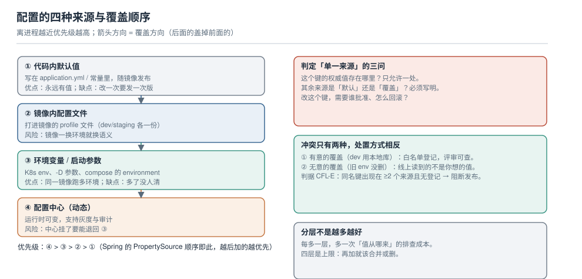

# 配置分层与单一来源

一个线上事故的常见开头是：「这个值我们在 Nacos 里改成 3000 了啊」。然后有人去翻启动脚本，发现环境变量里还留着上一任留下的 `APP_TIMEOUT=1000`，而它的优先级更高。

配置分层的难点不是「有几种来源」，而是**同名键出现两次时谁赢、以及怎么让这件事在发布之前就被发现**。本页给一条四层的覆盖链、两种冲突的处置方式，以及一个必须给定下来的东西：**每个键的权威来源只有一个**。



本页判据族 `CFL-A` ~ `CFL-H`，共 8 条。

## 一、四种来源与覆盖链

按「离进程远近」排序，越近优先级越高：

| 顺序 | 来源 | 典型载体 | 改一次的成本 | 什么时候用它 |
| --- | --- | --- | --- | --- |
| ① | 代码内默认值 | `application.yml`、常量类 | 一次发版 | 让应用在**没有任何外部配置**时也能起来 |
| ② | 镜像内配置文件 | 打进镜像的 `application-prod.yml` | 一次构建 + 推镜像 | 与环境无关的结构性配置（连接池实现、序列化方式） |
| ③ | 环境变量 / 启动参数 | K8s `env`、`-Dkey=value`、compose `environment` | 一次重启 | 与环境强相关且**很少变**的（库地址、区域） |
| ④ | 配置中心 | Nacos / Apollo / Consul | 秒级 | 需要灰度、审计、随时可改的（阈值、开关、限流值） |

Spring 的规则很直白：`PropertySource` 是一个有序列表，**后加的盖掉先加的**，而环境变量与启动参数的 `PropertySource` 默认排在配置文件之后。所以上表 ④ > ③ > ② > ① 不是约定，是机制。

::: danger 三个最容易踩的写法
1. **在 `application.yml` 里用 `${APP_TIMEOUT:3000}` 引用环境变量，同时又把 `app.timeout` 放到配置中心。** 结果：配置中心的值赢了，但读代码的人以为环境变量说了算。要么统一走占位符，要么统一走中心，不要两套并行。
2. **用 profile 表达环境，又用环境变量覆盖同一个键。** `application-prod.yml` 里写了 `app.timeout: 1000`，环境变量里写 `APP_TIMEOUT=3000`，两者都在，改哪个都不确定生效。
3. **配置中心里放"整份文件"，代码里又有一份同结构文件。** 这是双源，必然漂移；见[配置即代码](../ConfigAsCode/index.md)。
:::

## 二、同名键的两种冲突，处置方式相反

| 类型 | 例子 | 判定 | 处置 |
| --- | --- | --- | --- |
| **有意的覆盖** | dev 环境用本地库，prod 用线上库 | 覆盖值在 `README` / 部署清单里有登记 | 白名单化：允许存在，但必须能被 `grep` 到登记项 |
| **无意的覆盖** | 上一任留下的 `APP_TIMEOUT=1000` 没删 | 覆盖值在任何文档里都找不到 | 视为缺陷：发布前阻断 |

两者的区别只有一个：**有没有登记**。所以"单一来源"不是一个道德要求，而是一条**可机检的规则**——同名键出现在 ≥2 个来源且不在白名单里，就是缺陷。

一条可以直接用的检查（不需要连配置中心，只在仓库里跑）：

```shell
# ① 找出同一键在多个文件里出现的次数（YAML 扁平化后比较）
grep -rhoE "^[[:space:]]*[a-z][a-z0-9._-]+:" --include="*.yml" --include="*.yaml" . \
  | sed 's/[: ]//g' | sort | uniq -c | sort -rn | awk '$1>1'

# ② 找出环境变量与配置文件同名的键（Spring 的松散绑定：app.timeout ⇄ APP_TIMEOUT）
grep -rhoE "^[[:space:]]*[a-z][a-z0-9._-]+:" --include="*.yml" . \
  | sed 's/[: ]//g' | tr 'a-z.' 'A-Z_' | sort -u > /tmp/keys_from_yaml
env | cut -d= -f1 | sort -u > /tmp/keys_from_env
comm -12 /tmp/keys_from_yaml /tmp/keys_from_env
```

第二条命令之所以有意义，是因为 Spring 的**松散绑定**让 `app.timeout` 与 `APP_TIMEOUT` 指向同一个属性——很多人以为它们是两个键，于是"只改了一个"。

## 三、粒度：一个 dataId 里该放多少个键

这是分层之后立刻要定的事，而且**两种选择各有代价，没有免费选项**：

| 方案 | 变更放大 | 推送面 | 排查成本 |
| --- | --- | --- | --- |
| 一个服务一个 dataId（几十~上百键） | 改 1 个键 → 整个 dataId 的 md5 都变 → **所有监听者全部重载** | 1 次发布 = 1 次广播，但收到的人全部重建 | 低（文件少） |
| 一个功能一个 dataId | 只影响该功能的监听者 | 1 次发布 = 1 次精准推送 | 中（文件多，要知道哪个键在哪个文件） |
| 一个键一个 dataId | 精准到键 | 变更多时发布次数暴涨 | 高（几百个文件） |

本机实测给出两个支撑数字：

- **发布是「按 dataId 判变更」的**：同一个 dataId 重发相同内容，md5 不变、长轮询不唤醒；但**只加一行注释**，md5 就变了，所有监听者照样被唤醒。也就是说「改一个键」和「改一个注释」在推送面上的代价完全一样。
- **逐条发布的成本**：连续发布 230 个单键配置，耗时 **3.3 s**，平均 **14.3 ms/次**。看起来很快，但如果一次上线要改 200 个键，就变成 200 次发布 + 200 次广播——这正是"一个服务一个 dataId"能省下的东西。

::: tip 建议的切法
按**变更节奏**切，不按代码结构切：经常一起改的键放一起（如限流相关的一组），基本不动的结构配置放另一个（一年改一次）。判据是「一次典型的变更，会不会牵连到不想动的那部分」。
:::

::: warning 别把配额当成设计依据
Nacos 3.0.3 的 `/nacos/v3/admin/core/state` 里写着 `defaultGroupQuota: 200`，看起来"一个 group 只能放 200 个配置"。但本机实测在 2.5.1 上**单 group 连续写 230 个配置全部成功**（开源单机版不做拦截）。所以配额只能当容量预算的参考，**不能用它反推"所以我可以随便拆"**——真正先撞的墙通常是客户端的连接数与轮询开销，不是服务端的行数。
:::

## 四、环境差异怎么表达

三种主流做法，选一种，不要混：

| 做法 | 隔离强度 | 优点 | 代价 |
| --- | --- | --- | --- |
| **命名空间（namespace）** | 强：同 dataId 可在不同 ns 共存 | 一处切换，物理上读不到别人的 | 每个环境一套权限，人多了要维护 |
| **group** | 中：同 ns 内用 group 区分 | 一个 ns 管多个环境，运维简单 | 权限粒度粗，误发到别的 group 很容易 |
| **profile / 文件名后缀** | 弱：靠命名区分 | 与 Spring 无缝 | 同一 ns 里肉眼难分，最容易串 |

本机实测确认了命名空间的隔离是真隔离：同一个 `dataId` 在 `public` 与自定义命名空间 `cfgtest` 里各存一份，用 `tenant=cfgtest` 读到的只有自己那一份，`public` 下读同名 `dataId` 返回 `404 config data not exist`。

::: danger 环境串了是最贵的失误
一次误发到生产命名空间的代价，通常比一次代码事故更高——代码可以回滚代码，配置改了会**立刻**作用在所有实例上，而且很多人不看配置历史。三条硬规则：

1. 生产命名空间**只允许 CI 的机器人账号写**，人只能读。
2. 每个环境一套独立凭证，不要"一个 token 走天下"。
3. 发布前打印目标 `namespaceId` 与 `groupName` 并要求人工确认一次——`namespaceId` 忘了传时，接口默认落到 `public`，这是最容易出事的一种"没报错"。
:::

## 五、把"单一来源"落成一条可执行的规则

抽象地说"每个键只有一个来源"没有意义，要落成四样东西：

1. **键清单（key registry）**：每个键登记「权威来源 / 类型 / 默认值 / 谁能改 / 改了影响什么」。这份清单本身就是最好的文档。
2. **覆盖白名单**：允许"第二来源覆盖"的键，逐条登记原因。
3. **发布前对账**：CI 里跑第一节那两条命令，命中未登记的重复键就失败。
4. **运行时兜底**：应用启动时把最终生效的配置（**脱敏后**）打一条 INFO 日志，含来源标记。出问题时先看这条日志，比翻五个地方快。

::: tip 一条能省掉很多会议的日志
`config resolved: app.timeout=3000 source=nacos(dataId=order.yaml,nid=1087297362428198912) app.retry=3 source=env`——把「值 + 来源 + 版本」打在一行里。它同时解决三个问题：值是什么、从哪来、哪一版。
:::

## 六、本页判据

| 编号 | 判据 | 看什么现象 | 不满足时改哪里 |
| --- | --- | --- | --- |
| `CFL-A` | 每个键登记了权威来源 | 键清单里「来源」列无空值 | 补清单；先补被改过的那些键 |
| `CFL-B` | 四层之外没有第五种来源 | 不存在"运维手动改容器内文件"这类路径 | 收口，或在清单里显式登记为例外 |
| `CFL-C` | 启动日志打印最终生效值与来源 | 日志里能看到 `key=value source=...` | 在配置加载完成后加一条 INFO（脱敏） |
| `CFL-D` | 有意的覆盖进了白名单 | 每个覆盖项都能 `grep` 到登记 | 建白名单文件，评审时检查 |
| `CFL-E` | 无意的覆盖会被阻断 | CI 里跑重复键检查且能失败 | 把第一节那两条命令接进流水线 |
| `CFL-F` | 粒度按变更节奏切 | 一次典型变更不会牵连无关功能 | 拆 dataId，或把"不常变"的挪走 |
| `CFL-G` | 环境隔离方式唯一 | 只用了 namespace / group / profile 中的一种 | 迁移到 namespace，其余两种只作命名 |
| `CFL-H` | 生产命名空间只读给人 | 控制台上人工改生产会失败或需审批 | 收权限，写操作只留给 CI 账号 |

## 参考资料

- Spring Boot 文档：*Externalized Configuration*（`PropertySource` 顺序、松散绑定、`${...}` 占位符）
- 12-Factor App：*III. Config*（把配置存在环境里，而不是代码里）
- Nacos 文档：*命名空间*（`tenant` 参数与隔离语义）、*配置管理*（`dataId` / `group` / `namespace` 三元组）
- 本仓库：[读取路径与生效边界](../RefreshPath/index.md)（分层定完，接下来是"什么时候生效"）、[配置即代码](../ConfigAsCode/index.md)（漂移与对账）
