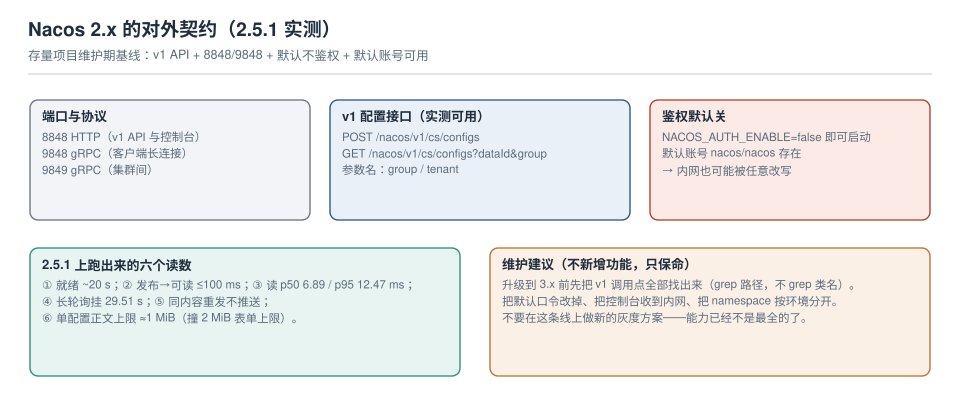

# Nacos 2.x（存量维护 · 仅存量项目）

::: warning 版本状态
本页描述的是 **Nacos 2.x 线**（本机实测 **2.5.1**）。2.x 已不是主线，**新项目不应从这里开始**，请直接看 [Nacos 3.x](../Nacos3/index.md)。

存量项目继续用 2.x 是合理的——升级的收益是"接口更规范 + 默认更安全"，成本是一次全链路回归。本页的定位是：**把 2.x 的对外契约固定下来，让存量系统可维护、让迁移有据可查**。具体的维护截止日期请以官方 release 页为准；本页只保证"这些命令在 2.5.1 上是这个行为"。
:::



本页判据族 `CFN-A` ~ `CFN-H`，共 8 条。

## 一、端口与组件

| 端口 | 用途 | 谁在用 |
| --- | --- | --- |
| **8848** | HTTP：v1 Open API + 控制台 | 脚本、控制台、运维 |
| **9848** | gRPC：客户端长连接（2.x 起客户端默认走 gRPC） | 应用进程 |
| **9849** | gRPC：集群节点之间（服务端到服务端） | 集群内 |
| **7848** | Raft 通信（集群模式） | 集群内 |

standalone 模式下四个端口都在一个 JVM 里。最小启动：

```shell
docker run -d --name nacos2 \
  -p 8848:8848 -p 9848:9848 \
  -e MODE=standalone \
  -e NACOS_AUTH_ENABLE=false \
  nacos/nacos-server:v2.5.1

# 就绪判据：本机实测约 20 s 后返回 OK（不是立刻）
for i in $(seq 1 30); do
  curl -s http://127.0.0.1:8848/nacos/v1/console/health/readiness && break
  sleep 2
done
```

## 二、v1 契约：三条命令覆盖 90% 的日常

```shell
# ① 发布（新增或覆盖，语义相同）
curl -s -X POST "http://127.0.0.1:8848/nacos/v1/cs/configs" \
  -d "dataId=order.yaml" -d "group=DEFAULT_GROUP" \
  --data-urlencode "content@order.yaml" -d "type=yaml"

# ② 读取（show=all 会返回 md5 等元信息，排障时用它）
curl -s "http://127.0.0.1:8848/nacos/v1/cs/configs?dataId=order.yaml&group=DEFAULT_GROUP&show=all" | jq .
# {"id":"1087297362428198912","dataId":"order.yaml","group":"DEFAULT_GROUP","content":"...","md5":"cabdb691...","tenant":"",...}

# ③ 删除
curl -s -X DELETE "http://127.0.0.1:8848/nacos/v1/cs/configs?dataId=order.yaml&group=DEFAULT_GROUP"
```

三个参数名必须记准，它们是 2.x 与 3.x 的分水岭：

| 概念 | 2.x 参数名 | 3.x 参数名 |
| --- | --- | --- |
| 分组 | `group` | `groupName` |
| 命名空间 | `tenant` | `namespaceId` |
| 配置内容 | `content` | `content`（不变） |

`tenant` 为空 = `public` 命名空间。忘记传 `tenant` 的效果是**落到 `public` 里静默成功**，这是 2.x 最容易造成"改到错环境"的一个默认行为。

## 三、鉴权默认是关的

`NACOS_AUTH_ENABLE=false` 就能完整启动，且默认账号 `nacos/nacos` 存在。也就是说：**默认部署的 Nacos 2.x，任何能访问 8848 的人都能读走全部配置、并能改写它们**。

| 检查项 | 命令 | 期望 |
| --- | --- | --- |
| 鉴权是否开启 | `curl -s "http://nacos:8848/nacos/v1/auth/users?pageNo=1&pageSize=1"` | 未开启时**直接返回用户列表**（这本身就是证据） |
| 默认口令是否改过 | 控制台登录 `nacos/nacos` | 应失败 |
| 8848 是否只在内网 | `nc -zv $PUBLIC_IP 8848` | 应不通 |

::: danger 存量项目最常见的三个敞口
1. **8848 暴露在公网**（云上安全组默认放行，或为了"方便调试"开了个端口映射）。
2. **默认口令没改**，且控制台可访问。
3. **一个 token 走天下**：CI、监控、所有人共用一个账号，`srcUser` 永远一样，审计失效。

前两条是安全事故，第三条是"出事后查不出人"。三条都不需要升级到 3.x 才能修——现在就能修。
:::

## 四、六个本机实测读数（2.5.1）

| 读数 | 值 | 用途 |
| --- | --- | --- |
| 冷启动到可服务 | **约 20 s** | 客户端连接超时要大于它 |
| 发布 → 同实例可读 | **≤100 ms**（50 ms 仍读旧值） | 别用"发布后立刻读"做校验 |
| 单次读延迟（回环，100 次） | **p50 6.89 ms / p95 12.47 ms / max 28.59 ms** | 估算"回读校验"的成本 |
| 长轮询无变更 | **挂 29.51 s** 返回空 | 生效延迟的上限 |
| 长轮询中发布 | **3.204 s 返回**（发布后 ~200 ms） | 推送链路是健康的 |
| 单配置正文上限 | **≈1 MiB**（表单 2 MiB 先撞墙） | 大配置必须拆 |

## 五、两个容易误判的边界

**（1）体积**：服务端 `maxContent` 在 3.x 的 `state` 接口里能读到（10 MiB），2.x 没有这个接口，但**同样受 Tomcat 表单上限约束**——实测 1 MiB 附近失败，报 `Required parameter 'dataId' ... is not present`。同一份内容裁到 100 KB 就能发，这是最快的判别方法。

**（2）灰度**：`betaIps` 参数在 2.x 存在，但**HTTP 读接口不认来源 IP**（实测：普通 GET 与带 `betaIps` 的 GET 读到同一份内容）。所以：
- 不能用 `curl` 验收灰度；
- 灰度必须用真实客户端在目标实例上验证；
- 不同小版本对 beta 的存储与读取路径有差异，**升级前必须实测**。

## 六、迁移到 3.x 的准备清单

升级的三类硬变更（详见 [Nacos 3.x](../Nacos3/index.md)）：

| 变更 | 影响面 | 怎么找 |
| --- | --- | --- |
| v1 接口全部 404 | 所有脚本、运维工具、自研 SDK | **grep 路径字符串**（`/nacos/v1/cs/configs`），不要 grep 类名 |
| 参数改名 `group`→`groupName`、`tenant`→`namespaceId` | 所有调用点 | grep `group=` 与 `tenant=` |
| 启动强制 `NACOS_AUTH_TOKEN`、无默认账号 | 部署脚本、CI 账号初始化 | 查 compose/helm 里的环境变量 |

```shell
# 迁移前先盘点（在本仓库/配置仓库里跑，结果应该是 0）
grep -rn "/nacos/v1/cs/configs" --include="*.sh" --include="*.py" --include="*.yaml" . | wc -l
grep -rn "tenant=" --include="*.sh" --include="*.py" . | wc -l
```

::: tip 迁移的推荐顺序
**先在 2.x 上把"能改的都改了"**：换掉默认口令、收掉公网暴露、把脚本里的 v1 路径参数改成可配置的（base path + 参数名常量）。等这些都做完了，升级 3.x 就只剩"改常量 + 初始化管理员"两件事。
:::

## 七、本页判据

| 编号 | 判据 | 看什么现象 | 不满足时改哪里 |
| --- | --- | --- | --- |
| `CFN-A` | 版本已登记 | 文档里写明 2.x 具体小版本 | 补版本号，别写"2.x" |
| `CFN-B` | 鉴权已开启 | 匿名访问用户列表失败 | 开 `NACOS_AUTH_ENABLE` 并改口令 |
| `CFN-C` | 8848 不对公网开放 | 外网 `nc` 不通 | 收安全组 / 只监听内网 |
| `CFN-D` | 命名空间按环境隔离 | 生产用独立 `tenant` | 建 namespace，迁移过去 |
| `CFN-E` | v1 调用点已登记 | 有"用到哪些 v1 接口"的清单 | 用 grep 建清单 |
| `CFN-F` | 单配置体积受控 | 没有 >1 MiB 的配置 | 拆分或外迁 |
| `CFN-G` | 冷启动时间已知 | 连接超时 > 30 s | 调大超时与重试 |
| `CFN-H` | 灰度用真实客户端验收 | 验收在目标实例上执行 | 加 `/internal/config` 只读端点 |

## 参考资料

- Nacos 2.x 文档：*Open API*（`/nacos/v1/cs/configs`）、*部署*（`MODE=standalone`、`NACOS_AUTH_ENABLE`）、*集群*（9848/9849/7848 端口用途）
- Nacos 2.x 源码：`ConfigController`（v1 参数名与 `show=all` 的返回结构）、`ClientLongPolling`（29.5 s 提前返回）
- Tomcat 文档：`maxPostSize`（表单解析上限）
- 本仓库：[Nacos 3.x](../Nacos3/index.md)（升级目标）、[读取路径](../RefreshPath/index.md)（长轮询语义）
