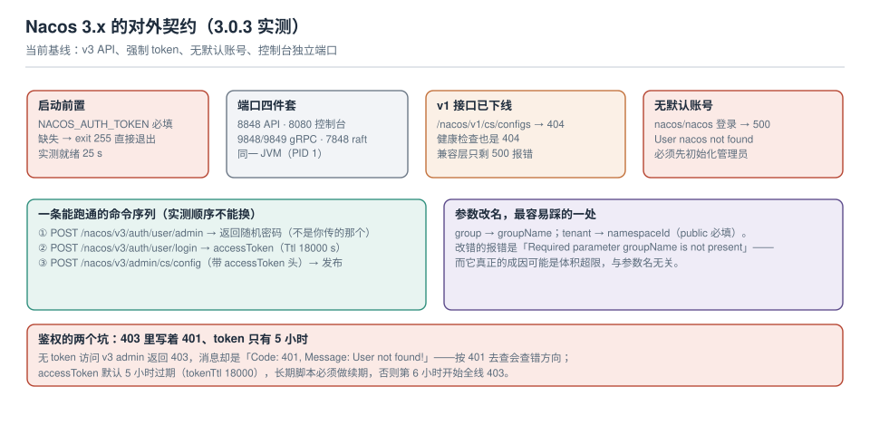

# Nacos 3.x（当前基线）

<p style="text-align:center;"></p>

::: info 版本状态
本页描述 **Nacos 3.x 线**（本机实测 **3.0.3**），是**当前基线与新项目起点**。2.x 的契约在 [Nacos 2.x](../Nacos2/index.md)，那里标注了"存量维护"。两页的关系是**升级前后**，不是两个并列方案。
:::

3.x 不是一个"多几个功能"的版本，它改了三件**会让存量脚本直接失效**的事：v1 接口下线、启动强制令牌、默认账号不存在。本页按"第一次装"的顺序把这三件事走一遍，每条都给实测输出。



本页判据族 `CFT-A` ~ `CFT-H`，共 8 条。

## 一、启动前置：没有 token 就起不来

```shell
# 少了 NACOS_AUTH_TOKEN 会怎样（实测）
docker run -d --name nacos3 -e MODE=standalone nacos/nacos-server:v3.0.3
docker logs nacos3 | tail -2
# env NACOS_AUTH_TOKEN must be set with Base64 String.
# exit 255
```

容器**直接退出**，不是"降级为不鉴权"。正确的启动命令：

```shell
docker run -d --name nacos3 \
  -p 8848:8848 -p 8080:8080 -p 9848:9848 -p 9849:9849 \
  -e MODE=standalone \
  -e NACOS_AUTH_TOKEN="$(openssl rand -base64 32)" \
  -e NACOS_AUTH_IDENTITY_KEY=serverIdentity \
  -e NACOS_AUTH_IDENTITY_VALUE="$(openssl rand -hex 16)" \
  nacos/nacos-server:v3.0.3

# 就绪判据：本机实测约 25 s（比 2.5.1 的 ~20 s 慢，因为多了控制台与鉴权初始化）
```

| 环境变量 | 作用 | 不设的后果 |
| --- | --- | --- |
| `NACOS_AUTH_TOKEN` | 签发/校验 accessToken 的密钥 | **启动失败**（exit 255） |
| `NACOS_AUTH_IDENTITY_KEY` / `_VALUE` | 服务端之间的身份标识 | 集群节点互调会被拒 |
| `MODE=standalone` | 单机模式（内嵌 Derby） | 默认集群模式，缺配置起不来 |

::: danger token 不是"随便填个字符串"
启动脚本只校验"非空"，所以 `NACOS_AUTH_TOKEN=abc` 也能起来——但 token 是 base64 解码后当 HMAC 密钥用的，**太短会在签发/校验时出错**，而错误发生在你第一次登录时，不在启动时。用 `openssl rand -base64 32` 生成，别手打。
:::

## 二、端口四件套 + 一个 JVM

| 端口 | 用途 | 备注 |
| --- | --- | --- |
| **8848** | v3 API（`/nacos/v3/**`） | 应用与脚本都走这里 |
| **8080** | **控制台**（独立端口，3.x 新增） | 2.x 里控制台挂在 8848，路径变了 |
| **9848 / 9849** | gRPC（客户端 / 集群） | 与 2.x 相同 |
| **7848** | Raft（集群） | 与 2.x 相同 |

本机实测容器内四个端口都在 **PID 1 的同一个 JVM** 上监听（`ss -tlnp` 全部指向 `1/java`）。这意味着**控制台与 API 抢同一份堆内存**——把控制台开放给很多人用，会影响配置接口的延迟。

## 三、没有默认账号：第一次必须先初始化管理员

用 `nacos/nacos` 登录 3.0.3 会发生什么（实测）：

```shell
curl -s -X POST "http://127.0.0.1:8848/nacos/v3/auth/user/login" -d "username=nacos&password=nacos"
# {"timestamp":"...","status":500,"error":"Internal Server Error","message":"No message available",...}
```

日志里的真实原因：

```text
Caused by: org.springframework.security.core.userdetails.UsernameNotFoundException: User nacos not found
```

**3.x 不带默认用户**。第一次必须初始化管理员，而初始化接口会**返回一个随机密码**：

```shell
curl -s -X POST "http://127.0.0.1:8848/nacos/v3/auth/user/admin" \
  -H "Content-Type: application/json" -d '{"password":"Nacos@2026"}'
# {"code":0,"message":"success","data":{"username":"nacos","password":"qtV!4$Vi"}}
```

注意 `data.password` 是 **`qtV!4$Vi`**，不是你传的 `Nacos@2026`。这个随机密码**只在这里出现一次**，没记下来就只能重装或走重置流程。

::: danger 初始化只需一次，但会被重复执行
第二次调同一个接口会失败（用户已存在）。CI 里的写法必须是"先查存在性再初始化"，否则每次部署都报错，然后有人把这段注释掉——下一次全新环境部署就跳过初始化，服务起来了但没人能登录。
:::

## 四、登录与令牌：5 小时有效期

```shell
# 用初始化时拿到的随机密码登录
curl -s -X POST "http://127.0.0.1:8848/nacos/v3/auth/user/login" \
  -d "username=nacos" -d "password=qtV!4\$Vi"
# {"accessToken":"eyJhbGciOiJIUzI1NiJ9...","tokenTtl":18000,"globalAdmin":true,"username":"nacos"}
```

`tokenTtl: 18000` = **5 小时**。所有 v3 管理接口都要带 `accessToken` 头：

```shell
AT=$(curl -s -X POST "http://127.0.0.1:8848/nacos/v3/auth/user/login" \
      -d "username=nacos" -d "password=$NACOS_PASS" | jq -r .accessToken)

# 无 token 的后果（实测）
curl -s "http://127.0.0.1:8848/nacos/v3/admin/cs/config?dataId=a&groupName=DEFAULT_GROUP&namespaceId=public"
# {"status":403,"error":"Forbidden","message":"Code: 401, Message: User not found! ...","path":"/nacos/v3/admin/cs/config"}
```

**状态码是 403，消息里写的是 401，还顺便说"用户不存在"**。这三处不一致会把人带到错误的方向（去查用户，而实际是没带 token）。

## 五、v3 契约：参数改名了

```shell
# 发布
curl -s -X POST "http://127.0.0.1:8848/nacos/v3/admin/cs/config" \
  -H "accessToken: $AT" \
  -d "dataId=order.yaml" -d "groupName=DEFAULT_GROUP" -d "namespaceId=public" \
  --data-urlencode "content@order.yaml"
# {"code":0,"message":"success","data":true}

# 读取（返回结构也变了：包在 data 里，字段是 groupName/namespaceId）
curl -s "http://127.0.0.1:8848/nacos/v3/admin/cs/config?dataId=order.yaml&groupName=DEFAULT_GROUP&namespaceId=public" \
  -H "accessToken: $AT" | jq '.data | {dataId, groupName, namespaceId, md5, createUser, createIp}'
```

| 2.x | 3.x | 说明 |
| --- | --- | --- |
| `POST /nacos/v1/cs/configs` | `POST /nacos/v3/admin/cs/config` | 路径 + 前缀都变 |
| `group` | **`groupName`** | 必填 |
| `tenant`（可空 = public） | **`namespaceId`**（必填，`public` 要显式写） | 少了它报"参数缺失" |
| 返回裸文本 `content` | 返回 JSON，内容在 `data.content` | 脚本要改 `jq .data.content` |
| 无鉴权 / 可选 | 必须 `accessToken` | |

`namespaceId` 变成**必填**其实是好事：2.x 里忘记传 `tenant` 会静默落到 `public`，3.x 直接报错——把"改到错环境"变成了"发布失败"。

## 六、v1 接口已经不在

本机实测（3.0.3）的四个路径：

| 路径 | 结果 |
| --- | --- |
| `GET /nacos/v1/cs/configs?...` | **404** |
| `GET /nacos/v1/console/health/readiness` | **404** |
| `POST /nacos/v1/auth/login` | **500**（`Handle API Compatibility failed`） |
| `GET /nacos/v3/admin/core/state` | 200（带 token） |

也就是说：**v1 不是"弃用告警"，是直接 404**。而健康检查路径也变了，这会让 K8s 的 `readinessProbe` 直接失败——容器一直不 ready，但服务其实是好的。

```yaml
# 3.x 的探针要改（用 v3 路径，并接受 401/403 作为"活着"的证据）
readinessProbe:
  httpGet: { path: /nacos/v3/admin/core/state, port: 8848 }
  # 无 token 时返回 403，探针只认 2xx → 需要给探针配一个只读 token，或改 TCP 探针
```

::: warning 探针的两种写法，选一种
1. **TCP 探针**（`tcpSocket: 8848`）：不验证鉴权，够用且简单。
2. **带 token 的 HTTP 探针**：要在探针里注入 token，token 过期会导致容器被重启——**不要这么做**。

推荐第一种。健康检查要回答的是"进程能不能收连接"，不是"鉴权通不通"。
:::

## 七、三个必须知道的坑

| 坑 | 现象 | 处置 |
| --- | --- | --- |
| **403 里写着 401** | 没带 token 时状态码 403、消息 401 | 按"缺 token"处理，别去查用户 |
| **token 只有 5 小时** | 长跑脚本第 6 小时开始全线 403 | 每次调用前检查过期时间，或按需重新登录 |
| **控制台初始化前 500** | `/nacos/` 返回 500 | 先初始化管理员，再开控制台 |

第三条值得展开：控制台在管理员未初始化时**不是"提示你先初始化"，而是 500**。如果部署流水线把"控制台可访问"当成健康判据，会误判为启动失败。

## 八、本页判据

| 编号 | 判据 | 看什么现象 | 不满足时改哪里 |
| --- | --- | --- | --- |
| `CFT-A` | 版本与小版本已登记 | 文档写 3.0.3 而不是"3.x" | 补版本号 |
| `CFT-B` | `NACOS_AUTH_TOKEN` 由密钥管理注入 | 不是明文写在 compose 里 | 换成 Secret / 环境注入 |
| `CFT-C` | token 长度足够 | `openssl rand -base64 32` 生成 | 重新生成并轮换 |
| `CFT-D` | 管理员初始化是幂等的 | 重复执行不报错 / 已存在则跳过 | 加存在性检查 |
| `CFT-E` | 随机密码已入库保存 | 密钥管理里有记录 | 立刻记录，否则只能重装 |
| `CFT-F` | 调用点已迁到 v3 | 无 `/nacos/v1/` 路径残留 | 按第二节清单改 |
| `CFT-G` | 探针不依赖 token | 用 TCP 探针 | 改探针类型 |
| `CFT-H` | token 续期有兜底 | 长跑脚本有重新登录逻辑 | 加过期检查与重登 |

## 参考资料

- Nacos 3.0 升级指南：*v1 API 下线说明*、*控制台端口调整*、*鉴权默认开启与管理员初始化*
- Nacos 文档：*鉴权*（`nacos.core.auth.plugin.nacos.token.secret.key`、`tokenTtl`）、*Open API v3*（`/nacos/v3/admin/cs/config`）
- Nacos 运维：`/nacos/v3/admin/core/state`（`maxContent`、`auth_enabled`、`console_ui_enabled`）
- Kubernetes 文档：*Configure Probes*（`tcpSocket` 与 `httpGet` 的适用场景）
- 本仓库：[Nacos 2.x](../Nacos2/index.md)（升级来源）、[故障面](../FailureModes/index.md)（体积与超时）
