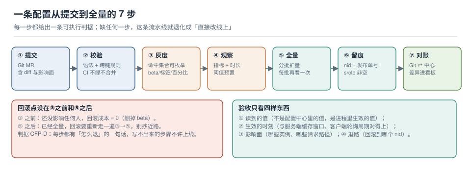

# 实战：一条配置从提交到全量

前面八页是零件，这一页把它们装成一条能跑通的流水线：**把 `order.yaml` 里一个超时值从 3000 改成 5000**，从提 MR 开始，到灰度、观察、全量、留痕、对账，最后做一次回滚演练和一次断网演练。

每一步都给出「命令 + 期望输出 + 判据」，凡本机能跑的都跑过；跑不了的（需要真实 Spring 应用的部分）明确标「按官方文档，需在你的环境验证」。



本页判据族 `CFP-A` ~ `CFP-H`，共 8 条。

## 一、前置：三个假设

这条流水线成立需要三个前提，缺一个就要先补：

| 前提 | 判据 | 没有会怎样 |
| --- | --- | --- |
| 应用暴露只读的生效配置端点 | `GET /internal/config` 返回 `{key: value}` | 无法证明"进程里生效了"，只能看中心 |
| 配置有唯一来源（Git） | Git 为源模式 | 手改与 CI 互相覆盖 |
| 中心可写账号归 CI | `srcUser` 能区分人与机器 | 审计失效 |

第一条的命令（各框架都容易实现，只要读的是运行时对象而不是配置文件）：

```shell
# 期望：返回进程里真实生效的值，而不是配置文件的内容
curl -s http://127.0.0.1:8080/internal/config | jq '{timeout: .app.timeout, pool_max: .pool.max}'
# {"timeout": 3000, "pool_max": 20}
```

## 二、第 ① 步：提交（MR 里必须有三样东西）

```text
configs/
├── staging/order.yaml
└── prod/order.yaml      # 只改这一行：app.client.timeout_ms: 3000 → 5000
```

MR 描述里必须写清三样，缺一样就打回：

1. **影响面**：哪些实例、哪些请求路径会变（不是"改了个超时"，而是"订单详情接口的下游调用会等更久"）。
2. **为什么是 5000**：依据是什么（下游 P99 = 3200 ms，留 1.5 倍余量）。
3. **怎么退**：回滚到哪个 `nid`，谁执行。

::: danger 三种必须打回的 MR
- 只写"优化配置"、没有任何数字依据的；
- 一次改 10 个不相关键的（无法灰度，也无法定位）；
- 同时动了 `staging` 与 `prod` 但两者 diff 超过 20 行的（说明两份文件已经分叉）。
:::

## 三、第 ② 步：校验（CI 四关）

```shell
# 关一：可解析（半截配置在这里被拦住）
python3 -c "import yaml,sys; yaml.safe_load(open('configs/prod/order.yaml')); print('yaml OK')"

# 关二：跨键规则
python3 - <<'PY'
import yaml
c = yaml.safe_load(open("configs/prod/order.yaml"))
assert c["app"]["client"]["timeout_ms"] < c["app"]["client"]["retry"]["interval_ms"], "超时必须小于重试间隔"
assert c["pool"]["min"] <= c["pool"]["max"], "min 不能大于 max"
assert c["app"]["client"]["timeout_ms"] <= 10000, "单次超时不得超过 10 s（否则会拖死线程池）"
print("cross-key OK")
PY

# 关三：秘密扫描（命中即失败，并触发轮换流程）
grep -nEi "(password|secret|token|api[_-]?key)[[:space:]]*[:=][[:space:]]*[^\"' ]{8,}" configs/prod/order.yaml && exit 1 || echo "no secret"

# 关四：与 staging 的差异只应是预期的几行
diff -u configs/staging/order.yaml configs/prod/order.yaml | grep -E "^[+-][^+-]" | head
```

期望输出：`yaml OK` / `cross-key OK` / `no secret` / diff 只有个位数行。

## 四、第 ③ 步：灰度（只发给 canary 实例）

```shell
NACOS=http://nacos.internal:8848
AUTH="-H accessToken:$AT"          # 2.x 不需要；3.x 必须

# ① 记下当前版本的 nid（回滚点）
CUR_NID=$(curl -s "$NACOS/nacos/v1/cs/history?search=accurate&dataId=order.yaml&group=DEFAULT_GROUP&pageNo=1&pageSize=1" \
  | jq -r '.pageItems[0].id')
echo "rollback point: nid=$CUR_NID"

# ② 灰度发布：只给 canary 的两台机器（IP 维度，仅适合一次性试水）
curl -s -X POST "$NACOS/nacos/v1/cs/configs" \
  -d "dataId=order.yaml" -d "group=DEFAULT_GROUP" \
  --data-urlencode "content@configs/prod/order.yaml" \
  -d "betaIps=10.20.3.11,10.20.3.12" \
  -d "extInfo={\"ticket\":\"CHG-20261022-017\",\"operator\":\"ci-bot\",\"rollback_nid\":$CUR_NID}"

# ③ 验收必须在 canary 实例上做（不能在自己机器上 curl 中心）
for h in 10.20.3.11 10.20.3.12; do
  echo -n "$h -> "; ssh "$h" "curl -s localhost:8080/internal/config | jq -r '.app.timeout'"
done
# 期望：5000 / 5000

# ④ 对照组：非 canary 实例应仍是旧值
echo -n "10.20.3.21 -> "; ssh 10.20.3.21 "curl -s localhost:8080/internal/config | jq -r '.app.timeout'"
# 期望：3000
```

第 ④ 步是**整条流水线里唯一能证明"灰度真的只影响了一部分"的动作**。没有对照组，你只是完成了一次发布。

## 五、第 ④ 步：观察（有数字、有时长）

| 观察项 | 阈值 | 采集方式 | 不通过怎么办 |
| --- | --- | --- | --- |
| 错误率 | ≤ 基线的 1.2 倍 | 网关 5xx 比例 | 立即回滚 |
| 订单详情 P99 | ≤ 3500 ms（原 3200 + 余量） | APM | 回滚或缩回 3000 |
| 下游连接数 | 不超过其配额的 70% | 下游侧监控 | 回滚 |
| 日志异常条数 | 无新增异常类型 | 日志检索 | 人工判断 |

停留时长：至少 `max(P99 × 20, 30 min)`，且**必须覆盖一个业务高峰**。凌晨放量 10 分钟"没发现问题"，不构成证据。

## 六、第 ⑤ 步：全量（分批，不是一次推完）

```shell
# 批次：canary → 25% → 100%；每批之间人工/自动确认
# ① 取消 beta（把灰度内容转成正式内容）
curl -s -X POST "$NACOS/nacos/v1/cs/configs" \
  -d "dataId=order.yaml" -d "group=DEFAULT_GROUP" \
  --data-urlencode "content@configs/prod/order.yaml" \
  -d "extInfo={\"ticket\":\"CHG-20261022-017\",\"operator\":\"ci-bot\",\"stage\":\"25%\"}"

# ② 每批之后抽查三个实例，确认生效
for h in 10.20.3.11 10.20.3.21 10.20.3.31; do
  echo -n "$h -> "; ssh "$h" "curl -s localhost:8080/internal/config | jq -r '.app.timeout'"
done
```

::: warning 全量不是"最后一次发布"，是"让所有人读到同一版"
灰度期间的 `betaIps` 意味着**两台机器读的是 beta 内容、其余读正式内容**。全量动作的本质是"把 beta 内容转为正式内容"，同时**清掉 `betaIps`**——留着它，下一次发布还会被它干扰（没人记得那两台机器为什么特殊）。

收敛检查（必须为空）：

```shell
curl -s "$NACOS/nacos/v1/cs/configs?dataId=order.yaml&group=DEFAULT_GROUP&show=all" | jq -r '.betaIps // "none"'
# none
```
:::

## 七、第 ⑥ 步：留痕（把"为什么"挂上去）

```shell
# 查这一轮的所有版本，确认 extInfo 里有工单号
curl -s "$NACOS/nacos/v1/cs/history?search=accurate&dataId=order.yaml&group=DEFAULT_GROUP&pageNo=1&pageSize=5" \
  | jq -r '.pageItems[] | "nid=\(.id) md5=\(.md5) srcUser=\(.srcUser) op=\(.opType) time=\(.createdTime)"'
```

期望：每一行都有非空 `srcUser`（区分 `ci-bot` 与人工账号），且最近的几条能对上 `CHG-20261022-017`。

## 八、第 ⑦ 步：对账（Git ⇄ 中心）

```shell
# 单文件的快速对账：中心 md5 应等于 Git 文件 md5
CENTER_MD5=$(curl -s "$NACOS/nacos/v1/cs/configs?dataId=order.yaml&group=DEFAULT_GROUP&show=all" | jq -r .md5)
GIT_MD5=$(md5 -q configs/prod/order.yaml 2>/dev/null || md5sum configs/prod/order.yaml | cut -d' ' -f1)
echo "center=$CENTER_MD5 git=$GIT_MD5"; [ "$CENTER_MD5" = "$GIT_MD5" ] && echo "in sync" || echo "DRIFT"
```

不一致的两个常见原因（都不是"发布失败"）：

1. **行尾/编码**：Git 里是 CRLF 或带 BOM，中心里是 LF。修 `.gitattributes`，然后重发一次。
2. **有人手改过**：中心的值比 Git 新。这时**不要**直接重推覆盖——先查历史，搞清楚是谁为什么改的（见[审计与回滚](../AuditRollback/index.md)第六节的取证顺序）。

## 九、演练一：回滚（每月一次，5 分钟内完成）

```shell
# ① 找出要回滚到的 nid（本例：CUR_NID）
# ② 取那一版的完整内容
curl -s "$NACOS/nacos/v1/cs/history?dataId=order.yaml&group=DEFAULT_GROUP&nid=$CUR_NID" | jq -r .content > /tmp/rb.yaml
# ③ 作为新版本发布回去
curl -s -X POST "$NACOS/nacos/v1/cs/configs" \
  -d "dataId=order.yaml" -d "group=DEFAULT_GROUP" \
  --data-urlencode "content@/tmp/rb.yaml" \
  -d "extInfo={\"ticket\":\"CHG-20261022-018\",\"reason\":\"rollback-to-nid-$CUR_NID\"}"
# ④ 验收：三个实例都回到 3000，且出现新的一条历史
```

演练的判据不是"回滚成功"，而是**"回滚花了多久、中间有没有人问'旧值是多少'"**。后者出现一次，说明流程里还缺"回滚点提前记录"这一步。

## 十、演练二：断网（区分"有快照"与"无快照"）

```shell
# 场景 A：曾经成功拉取过 → 断网重启应能起来（用本地快照）
docker stop nacos-proxy          # 阻断到中心的网络
systemctl restart order-service
curl -s localhost:8080/internal/config | jq .app.timeout   # 期望：能返回最后已知值
grep -F "fail to fetch config, use snapshot" /var/log/app/app.log | tail -1

# 场景 B：全新实例、无快照 → 断网重启应 fail-fast（起不来，且日志明确）
# 期望：进程退出，日志里是 "config not found and snapshot missing" 之类的明确原因

docker start nacos-proxy
```

::: danger 两种结果都必须是"设计过的"
很多团队只验证了 A（"能起来，太好了"），没验证 B。于是真实事故里出现最坏的一种：**新扩出来的实例带着默认值起来了，接了流量，用默认值跑了 40 分钟**。B 的正确结果是**起不来**——宁可少两台，不要两台用错配置的。
:::

## 十一、验收清单（每次变更照着勾）

| # | 检查 | 命令 / 证据 | 判据 |
| --- | --- | --- | --- |
| 1 | 影响面写清了 | MR 描述 | `CFP-A` |
| 2 | 四关校验全绿 | CI 日志 | `CFP-B` |
| 3 | 回滚点已记录 | `nid=...` 在发布参数里 | `CFP-C` |
| 4 | 灰度有对照组 | canary 5000 / 对照 3000 | `CFP-D` |
| 5 | 观察窗覆盖高峰 | 监控截图 + 时长 | `CFP-E` |
| 6 | beta 已收敛 | `betaIps` 为空 | `CFP-F` |
| 7 | 留痕可回溯 | 历史里有 `extInfo` 工单号 | `CFP-G` |
| 8 | 对账一致 | `in sync` | `CFP-H` |

## 十二、本页判据

| 编号 | 判据 | 看什么现象 | 不满足时改哪里 |
| --- | --- | --- | --- |
| `CFP-A` | MR 写明影响面与依据 | 有"哪些实例/接口"与数字依据 | 打回重写 |
| `CFP-B` | CI 四关齐全 | 解析 / 跨键 / 秘密 / diff | 按第三节补齐 |
| `CFP-C` | 发布前记录回滚点 nid | 发布参数里有 `rollback_nid` | 脚本里先查再发 |
| `CFP-D` | 灰度有对照组 | 非 canary 实例仍是旧值 | 加第 ④ 步抽查 |
| `CFP-E` | 观察窗有阈值与时长 | 有表格与截图 | 预置阈值，别临场定 |
| `CFP-F` | 全量后 beta 已清 | `betaIps` 为空 | 收敛动作进脚本 |
| `CFP-G` | 每次变更挂工单号 | 历史 `extInfo` 非空 | 发布脚本统一注入 |
| `CFP-H` | 变更后对账一致 | md5 相等 | 查行尾/编码或野生修改 |

## 参考资料

- Nacos 文档：*配置管理*（灰度 `betaIps`、历史 `nid`、`show=all` 的 `md5`）
- Spring Boot Actuator 文档：*Custom Endpoint*（实现 `GET /internal/config` 这类只读端点的标准做法）
- Google SRE Workbook：*Canarying Releases* / *Rollback*（观察窗与回滚的定量写法）
- 本仓库：[灰度下发](../GrayRollout/index.md)（三道闸门的原理）、[变更审计与回滚](../AuditRollback/index.md)（回滚命令的细节）、[故障面](../FailureModes/index.md)（断网两种结果的设计）
