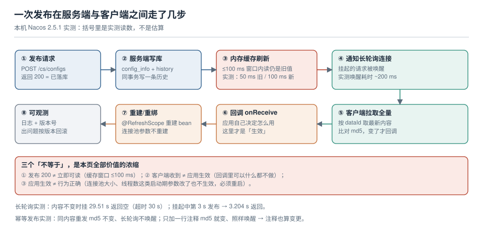

# 读取路径与热更新生效边界

「配置改完了，多久生效？」这个问题有一个标准错误答案：「立刻」。正确答案是三层叠加的结果：

```text
最长生效时间 ≈ 服务端缓存窗口(≤100 ms) + 客户端轮询周期(最长 30 s) + 应用自己重建的耗时(0 ~ 数秒)
```

本页把这条路径上的每一步都用实测数字标出来，然后回答第二个更难的问题：**哪些配置改了也没用，必须重启**。



本页判据族 `CFR-A` ~ `CFR-H`，共 8 条。

## 一、一次发布的完整路径与实测读数

| 步骤 | 发生了什么 | 本机实测（Nacos 2.5.1） |
| --- | --- | --- |
| ① 发布 | `POST /nacos/v1/cs/configs`，写库并返回 200 | 首次 415 ms（含初始化），后续 113 ms |
| ② 写历史 | 同事务写一条 `his_config_info`，`nid` 全局自增 | 与 ① 同批，不可分开 |
| ③ 刷新内存缓存 | 服务端读路径走的是内存缓存，异步刷新 | **≤100 ms 窗口内读到旧值**（见下） |
| ④ 唤醒长轮询 | 挂起的请求立即返回变更的 `dataId` 列表 | 发布后 **~200 ms**（3.204 s − 3.0 s） |
| ⑤ 客户端拉全量 | 按 `dataId` 取最新内容，比 md5 | 与 ④ 合并计，一次往返 |
| ⑥ 回调 | 应用侧 `onReceive` / `Listener` | 取决于应用做了什么 |
| ⑦ 重建 / 重绑 | `@RefreshScope` bean 重建、`@ConfigurationProperties` 重绑 | 取决于 bean 图（见第五节） |
| ⑧ 可观测 | 日志、版本号、指标 | 没有这一步，前三步都可能白做 |

这条路径解释了一个反直觉的现象：**发布接口返回 200 的那一刻，配置还没有对任何人生效**。它只保证"已经落库"。

## 二、服务端缓存窗口：发布后仍有 ~100 ms 读到旧值

同一实例上「发布后立刻读」，用 4 个采样点：

| 发布后时间 | 读到的内容 |
| --- | --- |
| 0 ms | `v=1`（旧值） |
| 20 ms | `v=1` |
| 50 ms | `v=1` |
| **100 ms** | **`v=2`（新值）** |

也就是说存在一个**几十到一百毫秒的窗口**，此时"写已成功、读还是旧值"。这个窗口对单个读请求无害，但会让两类操作出错：

1. **发布后立刻回读校验**的脚本：`POST` 成功 → `GET` 比对 → 报"发布失败"，然后重发一次。结果是多发了一版历史。
2. **发布后立刻触发一次业务计算**：计算读到的还是旧配置，而你以为已经是新的。

::: danger 别用"发布后立刻读"当校验
正确的校验是：发布 → **等到客户端侧确认收到**（长轮询返回 / 客户端日志出现新的 md5）→ 再读。判据是"读到的值与预期一致且 md5 与历史条目一致"，不是"发布接口返回了 true"。
:::

## 三、推送是怎么实现的：长轮询，不是长连接广播

Nacos 客户端与服务端之间不是"服务端主动推送"，而是**客户端挂一个请求在那儿等**：请求带上「我关心的 dataId + 我当前的 md5」，服务端比对：

- md5 全一致 → **挂住**，直到超时（客户端默认 30 s）才返回空。
- 有任一不一致 → **立刻返回**变更的 `dataId` 列表。

本机用 HTTP 接口直接复现了这个语义（`POST /nacos/v1/cs/configs/listener`，头 `Long-Pulling-Timeout: 30000`，body 是 `dataId\x02group\x02md5\x01` 的 URL 编码）：

| 场景 | 返回耗时 | 返回内容 |
| --- | --- | --- |
| 内容未变，超时 30 s | **29.51 s** | 空 |
| 挂起中第 3 s 发布一次 | **3.204 s** | `probe.yaml\x02DEFAULT_GROUP\x01` |
| 内容未变，超时 8 s | 8.01 s | 空 |

三个直接推论：

1. **"配置多久生效"的上限是一个轮询周期**，不是"实时"。要更快只能把周期调短，而周期调短的代价是请求数线性上升（见第六节）。
2. **长轮询的连接数 = 客户端数 × 它关注的 dataId 分组数**。这是配置中心最容易被打爆的地方——不是"发布"打爆的，是"挂着的请求"打爆的。
3. 29.51 s 而不是 30.00 s，说明服务端会**提前一点返回**再让客户端续上，避免所有客户端在同一毫秒一起重连（惊群）。

## 四、变更判定只认 md5，所以"注释也算变更"

同一个 `dataId` 连续两次发布**完全相同的内容**：

| 动作 | md5 | 长轮询是否被唤醒 |
| --- | --- | --- |
| 首次发布 `app.timeout=5000` | `e4fd89a6…` | — |
| 原样再发一次 | `e4fd89a6…`（未变） | **否**（挂满 8 s 超时返回空） |
| 加一行注释 `# touched 2026-10-22` 后再发 | 变了 | **是**（立即唤醒） |

这条语义带来两个实践后果：

- **好处**：重试发布是安全的，不会引起无意义的全量重载。CI 里"发布两次确认幂等"是可行的。
- **坏处**：改注释、调格式、重排键的顺序，都会触发**一次全量重建**。一次"只是加了注释"的提交，在 Spring 侧就是几十个 bean 重建，在流量高峰可能表现为一次毛刺。

::: tip 想清楚"谁需要被唤醒"
如果一个 dataId 里有 200 个键、只有 1 个变了，所有监听者都会重建。想减少重建面，按[分层页](../Layering/index.md)第三节讲的粒度拆开——这是唯一有效的办法，不要在客户端做"我只关心某几个键"的过滤，那是自欺（内容已经全量拉下来了）。
:::

## 五、生效边界：哪些改了真生效，哪些改了没用

这是本页最重要的一张表。判断标准是「这个值在什么时候被读取」：

| 配置项 | 能否热更 | 原因 | 怎么验收 |
| --- | --- | --- | --- |
| 业务阈值、开关、限流值 | ✅ 能 | 每次请求都重新读 | 改值 → 看下一次请求的行为 |
| 日志级别 | ✅ 能（多数框架支持） | 日志框架提供运行时改级别的接口 | 改完立刻打一条，看是否输出 |
| 超时时间（HTTP 客户端） | ⚠️ 部分 | 若客户端每次新建请求对象则可，若在启动时构建了 `HttpClient` 则不可 | 改完构造一次请求，看实际超时 |
| **连接池大小** | ❌ 不能 | 池在启动时创建 `minIdle` 条连接，扩缩容要显式调用 | 改完看池的 `active/idle` 是否变化 |
| **线程池核心数** | ❌ 不能（多数实现） | 队列长度与核心线程在构造时定死 | 改完看 `getCorePoolSize()` |
| 服务端口、监听地址 | ❌ 不能 | 绑定发生在启动 | 只能重启 |
| 序列化方式、Bean 装配分支 | ❌ 不能 | 影响 bean 图结构 | 只能重启 |
| 数据源 URL / 账号 | ⚠️ 看实现 | 连接池已有的连接不会重建 | 看新连接落到哪个库 |

::: danger 最贵的一类"假热更"
**改了、日志显示收到了、但行为没变。**典型是连接池大小与线程池核心数：配置中心里改了，客户端也确实重建了 bean，但池对象是"重建 bean 时被复用"还是"被重新创建"取决于实现。验收方式只有一个：**改完去读运行时的真实值**（池的 `maximumPoolSize`、执行器的 `getCorePoolSize()`），而不是读配置。
:::

## 六、Spring 侧的重建代价：三种写法，三种行为

以下按 Spring 官方文档与 `spring-cloud-commons` 的实现说明，**本机未搭 Spring 工程验证**，请按右列命令自测：

| 写法 | 刷新行为 | 重建代价 | 自测方式 |
| --- | --- | --- | --- |
| `@Value("${app.timeout}")` | 依赖所在 bean 是否被重建；普通 bean **不会**重建，值不变 | 无（但也意味着改不动） | 改值后打日志看是否变化 |
| `@ConfigurationProperties` | 重新绑定（rebind），对象属性被覆盖 | 小（不重建 bean） | 打印 `this` 与字段值 |
| `@RefreshScope` | 销毁并重建该 bean（懒加载，下次使用时重建） | **中到大**：bean 图上的依赖会被牵连 | 在 `@PreDestroy` 里打日志，看是否被销毁 |

三条实践建议：

1. **优先 `@ConfigurationProperties`**：它只重绑字段，不会把整个 bean 图拆了重建。
2. **`@RefreshScope` 只给"确实需要整个重建"的 bean**（例如内部缓存了配置派生对象的服务）。给多了会出现"改一个值，三个单例被销毁"的连锁。
3. **不要给连接池、执行器这类资源持有者加 `@RefreshScope`**：重建 bean 时旧池如果没有正确关闭，就是连接泄漏。

## 七、容量：把"多久生效"换算成"每秒多少请求"

长轮询的开销可以算出来。算例（不是实测值，按语义推算）：

```text
挂起请求数 ≈ 客户端实例数 × 每个实例的监听分组数
每秒新建请求数 ≈ 挂起请求数 / 轮询周期
```

10 个实例、每个 20 个 dataId 分组、周期 30 s → 常驻挂起 **200** 个请求，每秒新建 **≈ 6.7** 个。这个量级很小。但换成 500 个实例、每组 30 个 → 常驻 **15,000** 个挂起连接，每秒新建 **500** 个——这时瓶颈在**服务端的长连接数**，不在 QPS。

::: warning 调小轮询周期是最后手段
把 30 s 调到 5 s，生效延迟从"最多 30 s"变成"最多 5 s"，代价是每秒新建请求数 ×6。在 500 实例的规模上就是每秒 3,000 次建连——通常配置中心先垮，配置才生效。要更快，正确做法是"分批发布 + 接受延迟"，而不是把周期压到 1 s。
:::

## 八、本页判据

| 编号 | 判据 | 看什么现象 | 不满足时改哪里 |
| --- | --- | --- | --- |
| `CFR-A` | 生效延迟有明确上限 | 文档里写了「≤ 轮询周期 + 重建耗时」 | 补这条；别写"实时生效" |
| `CFR-B` | 发布后不用"立刻读"校验 | 校验脚本等客户端确认，而不是 `sleep 1` | 改成等 md5 / 等日志 |
| `CFR-C` | 变更按 dataId 判定 | 改注释也会触发重建这件事被知晓 | 提交规范里加一条：注释变更等同配置变更 |
| `CFR-D` | 可热更项与需重启项已分表 | 有一张"改了要不要重启"的表 | 按第五节建表，逐项验收 |
| `CFR-E` | 热更验收读运行时值 | 验收读的是池/执行器的真实值 | 加一个只读接口暴露关键运行时参数 |
| `CFR-F` | 重建范围可控 | 改一个值不会销毁一串单例 | 把 `@RefreshScope` 收窄到必要 bean |
| `CFR-G` | 资源持有者不被 refresh | 池与执行器上无 `@RefreshScope` | 去掉；改为重启或显式 resize 接口 |
| `CFR-H` | 长轮询容量算过 | 有「实例数 × 分组数」的算式与上限 | 按第七节算一遍，写进容量预算 |

## 参考资料

- Nacos 文档：*配置监听*（长轮询语义、`Long-Pulling-Timeout`）、*客户端配置*（`configLongPollTimeout`、`configRetryTime`）
- Nacos 源码语义：`ClientLongPolling` / `LongPollingService`（提前返回避免惊群）
- Spring Cloud Commons：*Refresh Scope*（`@RefreshScope` 的懒重建语义）、*Configuration Properties*（rebind 与 `@RefreshScope` 的区别）
- Spring Boot 文档：*Externalized Configuration*（`@Value` 的解析时机）
- 本仓库：[配置分层与单一来源](../Layering/index.md)（粒度决定重建面）、[故障面](../FailureModes/index.md)（中心不可用时这条路径怎么断）
