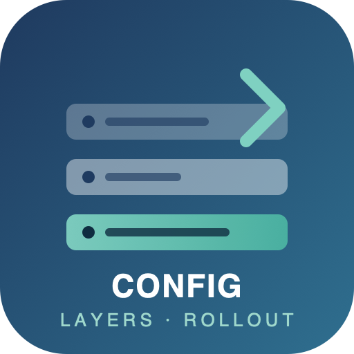
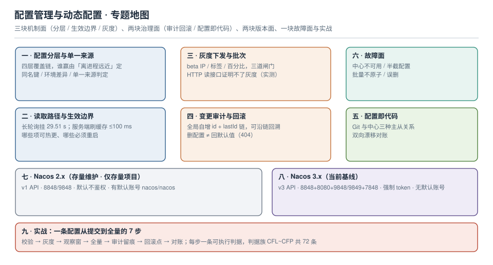

# 配置管理与动态配置

配置是整个系统里**唯一一个改一行字符就能让全站挂掉的发布物**：代码有编译、有测试、有灰度、有回滚；而配置在过去很多团队里是「控制台点一下保存」。本专题不讲「配置中心怎么装」，只讲**它生效的那条路径上会发生什么**——因为所有配置事故都发生在路径上，而不是在功能列表里。

本机实测（Nacos 2.5.1 单机容器，本仓作者机器，脚本不入库）先给三个数，它们是本专题的骨架：

- 发布接口返回 200 之后，**同一实例的读接口在 50 ms 时仍读到旧值、100 ms 时才读到新值**——"发布成功"不等于"立即可读"。
- 客户端长轮询在内容不变时**挂满 29.51 s** 才返回空；挂起期间发布，**3.204 s 返回**（发布后约 200 ms 收到通知）——所以"配置多久生效"的答案是「最长一个轮询周期」，不是「立刻」。
- 服务端声明的单配置上限是 **10 MiB**（`/v3/admin/core/state` 里的 `maxContent=10485760`），但 HTTP 表单实际只能传 **约 1 MiB 配置正文**——超了以后报的错是 `Required parameter 'groupName' is not present`，**一个字都不提体积**。

::: tip 一句话理解
配置管理真正要管的不是"值放在哪里"，而是**"值从哪来、什么时候生效、出问题退回哪一版"**这三件事。三件事里任何一件没有机器可查的证据，这套配置就是不可运营的。
:::

::: info 本专题与相邻专题的分工
- **业务开关（功能开关、实验分组、开关债清理）** → [功能开关工程](../../Tools/ObservabilityDriven/FeatureFlag/index.md)：那页讲"同一份配置下按用户决定走不走新逻辑"，本专题讲"一份配置怎么安全地送到实例上"。两者最容易混的地方（灰度 vs 开关）在本专题的[灰度下发](GrayRollout/index.md)里有一张对照。
- **密钥怎么存、怎么轮换** → [密钥治理](../SecurityHardening/SecretGovernance/index.md)：本专题只说一条红线——**密钥不进程配置仓库**，其余全部交给那页。
- **变更流程（评审、窗口、应急、留痕）** → [变更管理](../ChangeManagement/Overview/index.md)：那页管"什么变更需要谁批"，本页管"批完以后技术上是怎样落地的"。
- **Kubernetes 里的 ConfigMap / Secret 本身** → [ConfigMap 与 Secret](../Kubernetes/ConfigMapSecret/index.md)：那页讲挂载方式与更新延迟，本页只引用它的"不可热更项"结论。
- **基础设施即代码（Terraform 的 state 与模块）** → [Terraform](../Terraform/Overview/index.md)：本页的[配置即代码](ConfigAsCode/index.md)只讲**应用配置**与 Git 的主从关系，不重复 IaC 那套。
- **配置改了以后指标怎么变** → [可观测性工程](../Observability/Overview/index.md)：本页只规定"每次变更必须能对应到一个版本号"，不对接具体看板。
:::

## 目录

- [配置分层与单一来源](Layering/index.md)
- [读取路径与热更新生效边界](RefreshPath/index.md)
- [灰度下发与批次](GrayRollout/index.md)
- [变更审计与回滚](AuditRollback/index.md)
- [配置即代码与漂移对账](ConfigAsCode/index.md)
- [故障面：中心不可用、半截配置、批量不原子](FailureModes/index.md)
- [Nacos 2.x（存量维护 · 仅存量项目）](Nacos2/index.md)
- [Nacos 3.x（当前基线）](Nacos3/index.md)
- [实战：一条配置从提交到全量](Practice/index.md)

## 专题地图

## 判据纪律

沿用全库写法：**每页 8 条，编号形如 `CFL-A`**，逐页前缀唯一，可被 `utils/audit` 下的判据类巡检机械核对。每条判据都要能回答三件事：**看什么现象、判成什么、不满足时改哪里**。

| 页面 | 判据族 | 覆盖的约定 | 条数 |
| --- | --- | --- | --- |
| 配置分层与单一来源 | `CFL-A` ~ `CFL-H` | 四层覆盖链、同名键、环境差异、单一来源判定 | 8 |
| 读取路径与热更新生效边界 | `CFR-A` ~ `CFR-H` | 推拉路径、缓存窗口、可热更与不可热更、重建成本 | 8 |
| 灰度下发与批次 | `CFG-A` ~ `CFG-H` | 命中集合、观察窗、回滚通道、维度选择、与开关的边界 | 8 |
| 变更审计与回滚 | `CFA-A` ~ `CFA-H` | 历史链、审计字段、回滚方式、删除语义 | 8 |
| 配置即代码与漂移对账 | `CFC-A` ~ `CFC-H` | 主从关系、对账输出、密钥隔离、CI 门禁 | 8 |
| 故障面 | `CFF-A` ~ `CFF-H` | 半截配置、语义冲突、中心不可用、批量原子性、广播风暴 | 8 |
| Nacos 2.x | `CFN-A` ~ `CFN-H` | v1 契约、端口、默认鉴权、体积边界、迁移准备 | 8 |
| Nacos 3.x | `CFT-A` ~ `CFT-H` | v3 契约、强制 token、管理员初始化、参数改名、续期 | 8 |
| 实战 | `CFP-A` ~ `CFP-H` | 七步流水线、每步验收、回滚点、影响面 | 8 |

合计 **9 族 72 条**。

## 事实与版本速览（2026-10 核对）

| 项 | 现状 | 对本专题的影响 |
| --- | --- | --- |
| Nacos 2.x | 本机实测 **2.5.1**；2.x 线已不是主线，新项目不应从这里开始 | v1 API（`/nacos/v1/cs/configs`）可用、默认不鉴权、有默认账号 `nacos/nacos`；详见 [Nacos 2.x](Nacos2/index.md) |
| Nacos 3.x | 本机实测 **3.0.3**；当前基线 | **v1 接口全部 404**，只有 `/nacos/v3/**`；**启动必须给 `NACOS_AUTH_TOKEN`**，否则容器 exit 255；**没有默认账号**，要先初始化管理员；详见 [Nacos 3.x](Nacos3/index.md) |
| 单配置体积 | 服务端 `maxContent` = **10,485,760 B**；HTTP 表单实测只能到**约 1 MiB 正文** | 「上限 10 MiB」是服务端的，不是你能传上去的；见[故障面](FailureModes/index.md) |
| 长轮询周期 | 客户端默认 30 s（实测服务端挂 **29.51 s** 返回空） | 「配置多久生效」上限 = 一个轮询周期；见[读取路径](RefreshPath/index.md) |
| 推送触发条件 | 按内容 md5 判定：**同内容重发不推**，**只加一行注释就推** | 注释也算变更，会把所有实例都唤一遍 |
| 历史版本 | 每条发布一条历史，`nid` **全局自增**（不按配置从 1 开始），`lastId` 串成链 | 「回到第 3 版」这种说法在 Nacos 里不成立，回滚要按 nid；见[审计与回滚](AuditRollback/index.md) |
| Kubernetes ConfigMap | kubelet 定期同步（`--sync-frequency` 与 ConfigMap 缓存 TTL 共同决定），挂载为文件时更新有分钟级延迟，`subPath` 挂载**不会更新** | 「配置中心 + ConfigMap 双写」是最常见的双源事故；见[配置即代码](ConfigAsCode/index.md) |
| Spring 侧刷新 | `@RefreshScope` 重建 bean；`@ConfigurationProperties` 重绑定；`@Value` 依赖前者才能变；连接池/线程池大小改了不生效 | 见[读取路径](RefreshPath/index.md) |

::: warning 关于「实测」的诚实标注
本专题的数字分两类，正文逐处标注：

- **本机可复跑**：Nacos **2.5.1** 与 **3.0.3** 单机容器（`docker run`，Derby 内嵌存储）、macOS x64 + Docker Desktop、`curl` / Python `urllib` 直连 HTTP 接口。命令都写在页面里，**脚本本身不入库**。用途是**证明语义与量级**，不是你们生产的绝对值。
- **公开口径**：Spring 的刷新语义、Kubernetes 的 ConfigMap 同步机制、各产品的参数默认值，逐条标来源；凡属推算（容量、QPS 预算）一律写「算例」。

一处必须说清的局限：本机**没有搭 Spring 工程**（只有 JDK 17 与 Maven，Nacos 客户端依赖未验证），因此凡涉及 `@RefreshScope` 重建范围、`@ConfigurationProperties` 绑定时机的结论，一律标「按官方文档」，并给出你自己验证的命令；**没有一条把「文档说会这样」写成「实测如此」**。
:::

## 三条底线

1. **每个键只有一个权威来源**：其余层只能是"默认值"或"显式覆盖"，且覆盖必须登记。做不到这一条，排查"线上读到的为什么是这个值"就永远靠猜。
2. **任何一次变更都必须能对应到一个版本号，并且能退回上一个版本号**：回滚不是"改回旧值再发一次"（那会多出一版历史，且下一次没人知道该退到哪）。
3. **配置通道必须能坏**：中心不可用时应用要能按本地快照起来；读不到配置时要 fail-fast 而不是带着默认值跑；批量发布要么全成要么显式失败，不允许"前 5 个生效、后 5 个没生效、没人知道"。

## 参考资料

- Nacos 官方文档：*配置管理*（发布、监听、历史、灰度）、*Open API*（`/nacos/v1/cs/configs` 与 `/nacos/v3/admin/cs/config` 的参数差异）、*鉴权*（`nacos.core.auth.*` 与 `NACOS_AUTH_TOKEN`）
- Nacos 3.0 升级说明：v1 接口下线、控制台独立端口 8080、管理员初始化流程
- Spring Cloud Alibaba 文档：*Nacos Config*（`spring.cloud.nacos.config.*`、`refresh-enabled`、`shared-configs` / `extension-configs` 的覆盖顺序）
- Kubernetes 文档：*ConfigMaps*（更新传播、`subPath` 不更新的原因）、*kubelet* 的 `--sync-frequency`
- 12-Factor App：*III. Config*（配置存于环境）
- 本仓库相邻专题：[功能开关工程](../../Tools/ObservabilityDriven/FeatureFlag/index.md)、[密钥治理](../SecurityHardening/SecretGovernance/index.md)、[变更管理](../ChangeManagement/Overview/index.md)、[ConfigMap 与 Secret](../Kubernetes/ConfigMapSecret/index.md)
