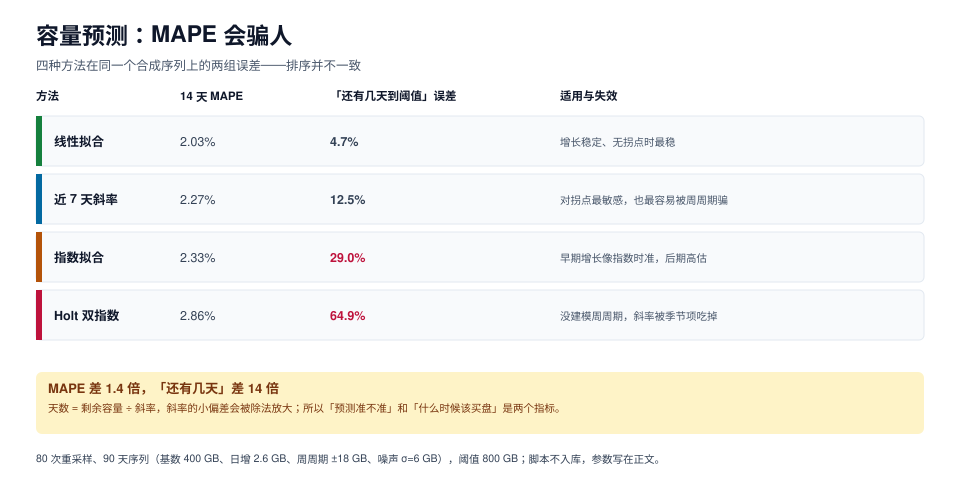

# 容量预测：MAPE 会骗人

「磁盘用了 78%」这句话在运维会上没有任何决策价值。有价值的是「按最近 30 天的增长，还有 154 天到阈值；采购前置期 45 天，所以最晚第 95 天要下单」——它把一个百分比变成了一个日期。

这一页处理四件事：用哪种方法拟合、为什么「预测精度高」不等于「天数算得准」、拐点怎么处理、以及一张容量报表该有哪些列。



本页判据族 `CPF-A` ~ `CPF-H`，共 8 条。定义表见文末「本页判据」一节。

## 一、四种方法的实测对比

合成序列：90 天，基数 400 GB、日增 2.6 GB、周周期 ±18 GB、噪声 σ=6 GB；阈值 800 GB；80 次重采样，前 70 天训练、后 14 天验证。

| 方法 | 14 天 MAPE | MAPE p90 | 「还有几天到阈值」误差 | 计算量 |
| --- | --- | --- | --- | --- |
| **线性最小二乘** | **2.03%** | 2.33% | **4.7%** | 一次遍历 |
| 近 7 天斜率 | 2.27% | 2.57% | 12.5% | 两次均值 |
| 指数拟合 | 2.33% | 2.69% | 29.0% | 取对数后线性 |
| Holt 双指数（未建模周周期） | 2.86% | 3.76% | 64.9% | 递推 |

### 1.1 为什么线性反而最准

因为这个序列的**真实生成过程就是线性的**（日增恒定）。指数拟合会把它解释成「增长率递减的指数」，Holt 的趋势项会被周周期污染。这说明一条重要的事：**方法要匹配生成过程，不是匹配「先进程度」**。

真实容量序列通常是分段线性的：业务上线一次跳一级，之后平稳增长，下一次上线再跳。所以**线性拟合 + 拐点检测**比任何复杂模型都实用。

### 1.2 为什么 MAPE 差 1.4 倍、天数差 14 倍

天数算式是：

```text
剩余天数 = (阈值容量 − 当前容量) ÷ 日增长斜率
```

除法把斜率的相对误差**放大**了。举例：当前 400 GB、阈值 800 GB、真实斜率 2.6 GB/天：

| 预测斜率 | 剩余天数 | 相对误差 |
| --- | --- | --- |
| 2.6（真值） | 153.8 天 | 0% |
| 2.47（−5%） | 161.9 天 | +5.3% |
| 2.34（−10%） | 170.9 天 | +11.1% |
| 3.12（+20%） | 128.2 天 | **−16.7%** |

**斜率的 −5% 会变成天数的 +5.3%，斜率的 +20% 会变成天数的 −16.7%**。而 Holt 在带周周期的序列上，斜率估计的偏差可以到 ±50%，天数就崩了。

所以选方法时，该看的指标是「天数误差」，不是 MAPE。MAPE 衡量的是「曲线贴不贴」，天数衡量的是「决策错不错」。

::: tip 一句话理解
MAPE 回答「我画的线和数据像不像」，天数回答「我什么时候该掏钱」。**采购决策只信后者。**
:::

## 二、拐点：三类必须人工标注的事件

任何拟合方法都假设「过去的规律会延续」。以下三类事件会打破这个假设，必须在报表上**显式标注**，否则模型会把阶跃学成趋势：

| 拐点类型 | 例子 | 对预测的影响 | 处理 |
| --- | --- | --- | --- |
| **业务阶跃** | 新业务上线，日增从 2.6 涨到 8 | 线性拟合把阶跃摊成缓坡，低估后半段 | 只用阶跃后的数据拟合 |
| **策略变更** | 归档策略上线，日增从 2.6 降到 0.4 | 模型继续按 2.6 外推，高估 6 倍 | 从变更日起重新拟合 |
| **保留期调整** | 日志保留从 90 天改 30 天，容量应下降 | 曲线出现「下降」，被当成「增长放缓」 | 单独标注，不作为趋势依据 |

工程做法：在序列上维护一个「事件表」，拟合时按事件切段，只对最后一段做外推，并在报表里写「本次拟合使用的区间是 X~Y，期间无拐点」。

## 三、把天数变成采购日

只有天数还不够，要减掉两个时间：

```text
下单日 = 阈值日 − 采购前置期 − 实施缓冲
```

以本节开头的例子：当前 400 GB、日增 2.6 GB、阈值 800 GB、前置期 45 天、实施缓冲 14 天。

| 项 | 值 | 说明 |
| --- | --- | --- |
| 到阈值天数 | 153.8 天 | (800 − 400) ÷ 2.6 |
| 采购前置期 | 45 天 | 从下单到可用，含审批与到货 |
| 实施缓冲 | 14 天 | 扩盘/迁移/验证的窗口 |
| **最晚下单日** | **第 94.8 天** | 153.8 − 45 − 14 |

再叠上预测误差的保守侧：如果天数误差是 ±10%，保守取 138 天，则最晚下单日变成第 79 天。**误差不是学术问题，它直接吃掉你的准备时间。**

## 四、预测区间：别只报一个数

一个点估计一定会错，所以报表要给区间。做法不复杂：用残差的标准差做放大。

```text
区间 = 预测值 ± z × σ_residual × sqrt(1 + h/n)
```

`h` 是向前预测的步数，`n` 是训练样本数。工程上常用简化版：`± 2 × σ_residual`（约 95%），并**只在方向上用**——容量预测关心的是「会不会更早到」，所以报「乐观天数 / 保守天数」两个数比报一个区间更直观。

| 报表列 | 含义 | 用途 |
| --- | --- | --- |
| 当前容量 | 采集值 | 现状 |
| 日增长（近 30 天） | 拟合斜率 | 趋势 |
| 到阈值天数（点估计） | 算式结果 | 主结论 |
| 到阈值天数（保守） | 点估计 × 0.9 | 排期用这个 |
| 最晚下单日 | 保守天数 − 前置期 − 缓冲 | **决策用这个** |
| 拟合区间与拐点 | 用了哪段数据 | 可信度 |

## 五、WAL 与数据文件要分开算

数据文件的增长是「趋势型」，WAL 的增长是「脉冲型」，两者不能用同一个模型：

| 对象 | 增长形态 | 判据 | 常见事故 |
| --- | --- | --- | --- |
| 数据文件 | 线性、可预测 | 到阈值天数 | 磁盘慢慢满 |
| WAL 目录 | 脉冲（大事务、批量导入、复制槽卡住） | 峰值 / 平均 比值 | 几小时内暴涨几十 GB |
| 临时文件 | 脉冲（大排序、`CREATE INDEX`） | 峰值绝对值 | 一次查询写满盘 |

WAL 的判据不该是「到阈值天数」，而该是「**最坏情况下 24 小时的 WAL 峰值 × 保留窗口是否超过可用空间**」。一个复制槽卡住时，WAL 会一直堆到磁盘满——这时任何趋势预测都来不及。

做法是定期采样 `pg_ls_waldir()`，用「段数 × 段大小」估总量，用 `modification` 过滤出最近一小时的增量：

```sql
-- 当前 WAL 总量（段大小由 wal_segment_size 决定，默认 16MB）
select count(*) as segments,
       pg_size_pretty(count(*) * pg_size_bytes(current_setting('wal_segment_size'))) as wal_total
from pg_ls_waldir();

-- 最近一小时的 WAL 增量（脉冲读数）
select pg_size_pretty(count(*) * pg_size_bytes(current_setting('wal_segment_size'))) as wal_last_hour
from pg_ls_waldir()
where modification > now() - interval '1 hour';
```

两次采样的差值才是速率。**不要用 `pg_current_wal_lsn()` 的差值算速率**——它是逻辑位置，经过 `wal_keep_size` 与归档后与「占用空间」不是一回事，而且 `pg_wal` 目录里还留着未归档的段。

## 六、一条可复跑的最小实现

```python
# 线性拟合 + 天数换算：够用、可解释、无依赖
import statistics

def fit_slope(xs, ys):
    n = len(xs)
    mx, my = statistics.mean(xs), statistics.mean(ys)
    num = sum((x - mx) * (y - my) for x, y in zip(xs, ys))
    den = sum((x - mx) ** 2 for x in xs)
    return num / den, my - (num / den) * mx

def days_to_limit(values, limit, headroom=0.9):
    xs = list(range(len(values)))
    slope, intercept = fit_slope(xs, values)
    if slope <= 0:
        return None, slope
    now = intercept + slope * (len(values) - 1)
    return (limit - now) / (slope / headroom), slope
```

注意 `headroom` 的作用：把斜率放大 10%（除以 0.9 等于乘 1.11），得到的其实是**保守天数**。这一个参数就把「预测误差」折进了排期，比在报表里写「误差 ±10%」有用得多。

## 本页判据

| 编号 | 判据 | 看什么现象 | 不满足时改哪里 |
| --- | --- | --- | --- |
| `CPF-A` | 报天数不报百分比 | 报表有「到阈值天数」列 | 补算式：剩余容量 ÷ 斜率 |
| `CPF-B` | 方法匹配生成过程 | 增长平稳时用线性，不硬上复杂模型 | 先画图看形态，再选方法 |
| `CPF-C` | 用天数误差选方法 | 有「历史回测的天数误差」 | 回测最近 30/60/90 天，比较天数而非 MAPE |
| `CPF-D` | 拐点有事件表 | 序列上有变更标注，拟合只用最后一段 | 建事件表，拟合按事件切段 |
| `CPF-E` | 报保守天数 | 报表同时有点估计与保守估计 | 斜率放大 10%，或减去 2σ |
| `CPF-F` | 换算成下单日 | 有「最晚下单日」= 天数 − 前置期 − 缓冲 | 补前置期与缓冲两个参数 |
| `CPF-G` | WAL 单独建模 | WAL 用峰值判据，不用趋势 | 采 WAL 每小时增量，算 24 h 峰值 |
| `CPF-H` | 预测可回测 | 能拿历史数据复现「当时会预测多少」 | 存每次预测的快照，留作回测 |

## 参考资料

- PostgreSQL 18 · 磁盘空间监控（`pg_ls_waldir` / `pg_database_size`）：<https://www.postgresql.org/docs/18/functions-admin.html>
- PostgreSQL 18 · WAL 配置与保留：<https://www.postgresql.org/docs/18/wal-configuration.html>
- Google SRE Workbook · 容量规划：<https://sre.google/workbook/implementing-slos/>
- 相邻专题：[容量与成本治理](../../CapacityCost/index.md)、[性能与容量工程](../../PerformanceEngineering/index.md)、[巡检口径](../Inspection/index.md)
