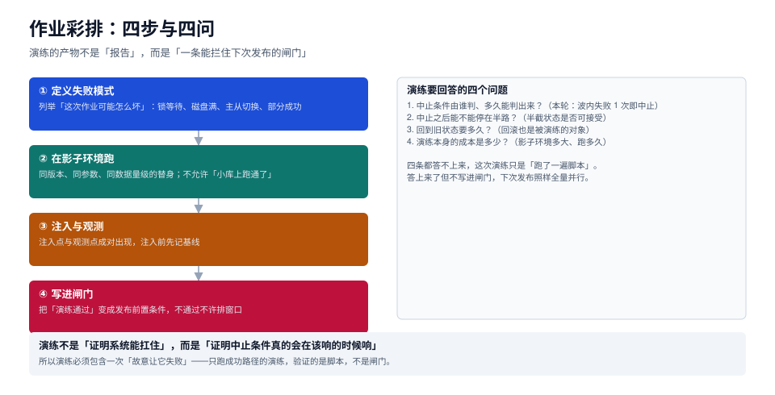

# 作业彩排：把中止条件演练出来

大多数「演练」演练的是系统：注入一次主从切换，看看服务能不能扛住。那是[混沌工程](../../ChaosEngineering/index.md)的事。这里要演练的是**作业**：这次要下发的变更，如果第 3 台失败，脚本会不会停？停了之后状态怎么读？读出来之后谁来决定继续还是回滚？

一句话：**演练的产物不是一份报告，而是一条能拦住下次发布的前置条件**。



本页判据族 `DRL-A` ~ `DRL-H`，共 8 条。定义表见文末「本页判据」一节。

## 一、为什么「演练过了」经常不算数

三种常见的无效演练：

| 形态 | 做了什么 | 为什么无效 |
| --- | --- | --- |
| **只跑成功路径** | 在测试库上把变更执行一遍，全绿 | 验证的是「脚本语法对不对」，不是「闸门灵不灵」 |
| **在小库上跑** | 10 万行的库上跑通过就上线 | 锁等待、回填耗时、磁盘占用都随数据量非线性变化 |
| **没有观测点** | 跑了但没记录「什么时候该停」 | 事后无法判断中止条件是「没触发」还是「没实现」 |

三者共同的缺陷：**没有一次「故意让它失败」**。不故意失败，就永远不知道中止条件是否真的会在该响的时候响。

::: tip 一句话理解
演练要证明的不是「我们能成功」，而是「我们失败时能停下来，并且知道停在哪」。
:::

## 二、六类失败模式：先列全，再挑三个演练

| 类别 | 具体形态 | 在彩排里怎么造 | 期望的作业行为 |
| --- | --- | --- | --- |
| **锁等待** | DDL 等一个未提交事务 | 开一个事务改同一张表但不提交 | 在 `lock_timeout` 内报错退出，不无限等 |
| **磁盘不足** | 回填把临时空间写满 | 用 `fallocate` 占满剩余空间 | 报错可识别，且不留下半截数据 |
| **网络分区** | 一台实例连不上 | 防火墙 drop 或改端口 | 归入 F1，退避重试后转人工 |
| **部分成功** | 第 N 台失败 | 让第 N 台的账号无权限 | **中止后续**，不前滚 |
| **依赖缺失** | 扩展未装、目录不存在 | 在影子库上不装扩展 | 归入 F3，提示「先装扩展」 |
| **权限不足** | `ALTER SYSTEM` 被拒 | 用只读账号执行 | 归入 F2，明确报出缺哪个权限 |

不必每次都演六个。**挑「本次变更最可能遇到的两个 + 后果最严重的一个」**，三个就够。

## 三、影子环境：四个「同」

彩排结论能不能迁移到生产，取决于影子环境与生产的相似度。四个维度按重要性排序：

| 维度 | 要求 | 不满足的后果 |
| --- | --- | --- |
| **同版本** | 主版本 + 补丁版本一致 | 参数名、行为、默认值都可能不同 |
| **同参数** | 关键参数一致（`work_mem`、`lock_timeout`、`max_connections`） | 锁等待时间、内存行为完全不同 |
| **同数据量级** | 至少同一数量级（10 万 vs 1000 万差两个数量级） | 回填耗时、索引构建时间严重低估 |
| **同拓扑** | 主从数量与复制方式一致 | 复制延迟类问题演不出来 |

最容易被牺牲的是第三条（数据量级）。工程上有个折中：**按比例缩小但保持「索引深度」不变**——索引从 3 层变 2 层，行为就变了，所以行数不能低于「让索引维持在相同层数」的量级。

## 四、注入点与观测点必须成对

```yaml
# 彩排计划：每个注入点都配一个观测点与一个期望
drill: work_mem-rollout-2026-10
shadow:
  version: "18.6"
  instances: 4                 # 1 主 3 从
  rows: 2000000                # 让索引保持 3 层
injections:
  - id: I1
    at: wave-2/instance-2
    how: revoke-alter-system   # 撤掉该实例的 ALTER SYSTEM 权限
    observe:
      - job_exit_code          # 期望非 0
      - wave3_started          # 期望 false（中止生效）
      - receipt_status         # 期望 failed_*，且后续台为 pending
    expect: "第 3 波不启动，第 2 波已成功的台保持 applied"
  - id: I2
    at: wave-2
    how: hold-lock-10s         # 另开事务持锁 10 秒
    observe:
      - statement_duration     # 期望 ≈ lock_timeout（3 s）
      - error_message          # 期望含 "canceling statement due to lock timeout"
    expect: "3 秒内失败退出，不无限等待"
  - id: I3
    at: wave-1
    how: fill-disk-95          # 占满 95% 空间
    observe:
      - job_exit_code
      - temp_files_left        # 期望 0
    expect: "报错可识别为磁盘类，且不留临时文件"
```

三条纪律：

1. **每个注入点必须有一个「期望的作业行为」**，不能只写「注入 X」。
2. **观测项要是机器可读的**（退出码、回执状态、波次是否启动），不是「看日志感觉不对」。
3. **注入要可撤销**：`fill-disk-95` 之后必须能立刻释放，否则影子环境会被自己搞坏。

## 五、四问：彩排要回答什么

跑完三个注入，必须能回答这四个问题，答不上来就说明彩排没做完：

| 问题 | 判定依据 | 本轮示例结论 |
| --- | --- | --- |
| 中止条件由谁判、多久判出来？ | 注入到退出的时间差 | 波内失败 1 次即判，I1 用时 0.8 s |
| 中止之后能停在半路吗？ | 半截状态是否可读 | 可以：回执里 `applied` 与 `pending` 并存 |
| 回到旧状态要多久？ | 反向作业的实测耗时 | 12 台回滚 ≈ 0.2 s 执行（按本机 9 ms/台折算）+ 一次全量复核 |
| 彩排本身成本多少？ | 影子环境规格 + 跑一次的时间 | 4 台 × 20 分钟，可纳入每周固定窗口 |

第三问最容易被跳过，但它决定了「出事时敢不敢回滚」。如果回滚要 40 分钟，而事故窗口只有 20 分钟，那这次变更实际上没有回滚能力。

## 六、把结论写进闸门

彩排的最后一步不是写报告，是**改流水线**：

```yaml
# 发布前置条件（与具体 CI 无关的声明式写法）
preconditions:
  - id: drill-passed
    rule: "最近 7 天内存在 drill_id 覆盖本次变更类别的通过记录"
    blocks: ["prod-rollout"]
  - id: abort-implemented
    rule: "runner 在波内失败时 break，且 wave3_started 观测项存在"
    blocks: ["prod-rollout"]
  - id: rollback-timed
    rule: "存在反向作业的实测耗时，且 < 事故窗口"
    blocks: ["prod-rollout"]
```

三条都是**机器可判**的：有没有记录、代码里有没有 `break`、有没有耗时数据。这比「评审会上确认过」可靠得多。

::: warning 彩排记录要能被检索
记录至少要含：`drill_id`、变更类别、影子环境规格、注入清单、四问的答案、结论（通过 / 有条件通过 / 不通过）、有效期。没有有效期的彩排记录，半年后会被当成「永久有效」引用。
:::

## 七、频率：跟着变更走，不跟着日历走

| 变更类型 | 彩排要求 |
| --- | --- |
| 参数类（可热更） | 同类变更每季度一次，或首次上线必做 |
| 结构类（DDL / 回填） | **每次必做**，因数据量变化大 |
| 数据类（清理 / 修复） | 每次必做，因判据 SQL 容易写错 |
| 运维类（切主 / 重启） | 每次必做，且要在低峰窗口 |

结构类与数据类之所以「每次必做」，是因为它们的耗时与正确性都强依赖当次数据；参数类相对稳定，可以用「同类变更」的代表性彩排覆盖。

## 本页判据

| 编号 | 判据 | 看什么现象 | 不满足时改哪里 |
| --- | --- | --- | --- |
| `DRL-A` | 彩排含失败注入 | 计划里有至少一个「故意让它失败」的注入点 | 补一个最可能遇到的失败 |
| `DRL-B` | 注入点配观测点 | 每个注入都有机器可读的观测项与期望值 | 补观测项，去掉「看日志」类描述 |
| `DRL-C` | 影子环境四个同 | 版本、参数、量级、拓扑与生产一致 | 至少保证版本与量级，量级用「索引层数不变」兜底 |
| `DRL-D` | 中止可量化 | 有「注入到退出」的实测时长 | 记录时间差，超过预期就改闸门 |
| `DRL-E` | 半截状态可读 | 中止后回执里能区分已改 / 未改 | 加 `pending` 态 |
| `DRL-F` | 回滚有时长 | 有反向作业的实测耗时 | 跑一次反向作业，记录耗时 |
| `DRL-G` | 结论进闸门 | 流水线里有「彩排通过」的机器判据 | 加前置条件，绑定变更类别 |
| `DRL-H` | 记录带有效期 | 彩排记录有 `expires` | 补有效期，过期自动失效 |

## 参考资料

- PostgreSQL 18 · 锁与 `lock_timeout`：<https://www.postgresql.org/docs/18/runtime-config-client.html>
- PostgreSQL 18 · `pg_stat_progress_*` 视图（观察长作业进度）：<https://www.postgresql.org/docs/18/progress-reporting.html>
- Google SRE Workbook · 发布工程与渐进式交付：<https://sre.google/workbook/canarying-releases/>
- 相邻专题：[混沌工程](../../ChaosEngineering/index.md)、[分波次](../Waves/index.md)、[变更管理与发布工程](../../ChangeManagement/index.md)
