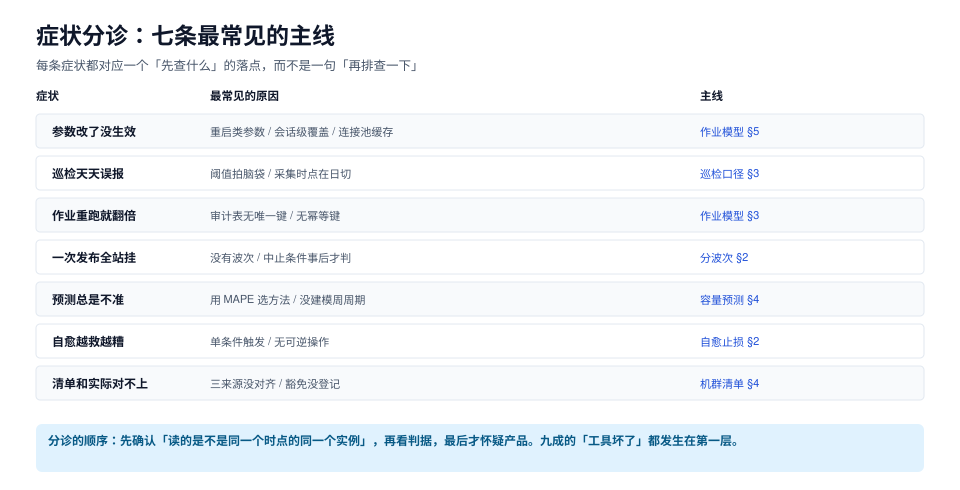

# 常见问题与症状分诊

这一页按「症状 → 先查什么 → 落点」组织。每条症状都对应一个可执行的检查动作，而不是「再排查一下」。



本页判据族 `DBQ-A` ~ `DBQ-H`，共 8 条。定义表见文末「本页判据」一节。

## 一、十类症状分诊

### 1.1 参数改了没生效

| 检查顺序 | 动作 | 结论 |
| --- | --- | --- |
| ① | `select name, setting, pending_restart, source from pg_settings where name='...'` | `pending_restart=true` → 需要重启 |
| ② | 看 `source` | `session` → 有人在会话里 `SET`；`configuration file` → 被配置文件覆盖 |
| ③ | 用**新连接**再读一次 | 新连接读到旧值 → 说明配置文件或 auto.conf 是旧值 |
| ④ | `select * from pg_file_settings where error is not null` | 有错行 → 那份配置根本没加载 |

最常见的原因是第 ② 条：连接池初始化时 `SET work_mem=4MB`，此后所有请求都读这条连接的值。

### 1.2 巡检天天误报

| 检查顺序 | 动作 |
| --- | --- |
| ① | 把这条判据一周的触发时间打出来，看是否集中在某几个小时 |
| ② | 集中的话 → 采集时点撞上备份窗口或日切，改分时段阈值 |
| ③ | 分散的话 → 阈值拍得太紧，看去趋势后的残差分布再定 |
| ④ | 触发时间无规律且数值贴阈值 → 采样间隔抖动，差分型判据要归一成速率 |

### 1.3 作业重跑后审计表翻倍

| 检查顺序 | 动作 |
| --- | --- |
| ① | 审计表有没有 `idem_key` 唯一约束 |
| ② | 有约束但还翻倍 → 键里塞了时间戳或随机数 |
| ③ | 键里含「目标值」吗？目标值变了应算新变更，不该算重跑 |

### 1.4 一次发布挂了一半实例

| 检查顺序 | 动作 |
| --- | --- |
| ① | 这次发布分了几波？一波 24 台就是「一次挂 24 台」的设计 |
| ② | 中止条件是「波内判定」还是「全量跑完再判」 |
| ③ | runner 里失败是 `break` 还是 `continue` |

### 1.5 预测总是不准

| 检查顺序 | 动作 |
| --- | --- |
| ① | 用的是 MAPE 还是天数误差？看错指标会选错方法 |
| ② | 序列有没有拐点（业务上线、归档策略、保留期变更） |
| ③ | 周周期建模了吗？没建模时 Holt 的斜率会被季节项吃掉 |

### 1.6 自愈越救越糟

| 检查顺序 | 动作 |
| --- | --- |
| ① | 这个动作有「反向操作」吗？没有就不该自动做 |
| ② | 触发是单条件还是双条件？单条件在尖峰和高位平台上都会误动 |
| ③ | 采集失败时会不会被判成「指标为 0」→ 去修一个没坏的系统 |

### 1.7 清单和实际对不上

| 检查顺序 | 动作 |
| --- | --- |
| ① | 读的是 `pg_settings.setting` 还是配置文件字面量 |
| ② | 单位换算了吗（`16384` × 8kB = 128MB） |
| ③ | 例外登记了吗？没登记的例外会被当成漂移，天天报 |

### 1.8 复制的 WAL 一直涨

| 检查顺序 | 动作 |
| --- | --- |
| ① | `select slot_name, active, restart_lsn from pg_replication_slots` |
| ② | 有非活跃槽 → 立即确认是否还需要（这是磁盘满的头号原因） |
| ③ | 槽都活跃但还涨 → 从库消费慢，看延迟与网络 |

### 1.9 变更窗口总是不够

| 检查顺序 | 动作 |
| --- | --- |
| ① | 算一遍 `ceil(N/k) × (k × t_exec + t_observe)`，看时间花在哪 |
| ② | 观察窗占大头 → 加自动化判定提前结束，别砍波次换时间 |
| ③ | 还是不够 → 拆到多个窗口，一次只承担一个主库的风险 |

### 1.10 演练都过了，真变更还是出事

| 检查顺序 | 动作 |
| --- | --- |
| ① | 演练里有几处「故意失败」的注入点？零处等于没演练 |
| ② | 影子环境的数据量级与生产差几个数量级 |
| ③ | 演练结论有没有写进流水线前置条件 |

## 二、十二问

**Q1：清单该用什么格式？**
YAML 或表格都行，判据是「脚本能直接读、人也能 diff」。关键是必须有例外字段与 `verified_at`。

**Q2：一台实例要采多少指标？**
先看「有几个判据需要它」，再看「这条判据值不值得一次采集」。本机实测采集占巡检耗时 99.92%，所以每加一个采集点都要有明确用途。

**Q3：幂等键里要不要放时间？**
不要。带时间的键等于没有键，每次都追加一条。要区分「第几次执行」，用 `updated_at` 或独立的自增序号。

**Q4：作业失败了应该回滚还是续跑？**
默认续跑。回滚本身是 N 次操作，会把失败面放大一倍；只有「半截状态不可接受」时才回滚（比如收缩阶段的删列）。

**Q5：波次设成几台？**
先定「最坏能接受几台」，那就是波次大小。再用总时长校验窗口够不够。

**Q6：观察窗多长？**
至少覆盖一次业务峰值，同时给上限（如 30 分钟）。用 p99 或错误率判定，不用均值。

**Q7：`pg_settings.setting` 和 `current_setting()` 有什么区别？**
前者是「当前会话所在实例的生效值」（不带单位，需要 `unit` 换算），后者是「当前会话的值」（带单位）。复核要用新连接读，否则读到的是会话值。

**Q8：MySQL 怎么看「谁改的参数」？**
`performance_schema.variables_info` 的 `variable_source` / `set_time` / `set_user` 三个字段。

**Q9：容量预测用线性够吗？**
对「稳定增长 + 偶发阶跃」的序列够了，而且天数误差比 Holt 小一个量级（4.7% vs 64.9%）。复杂模型要先证明它更好，再上。

**Q10：自愈可以做到什么程度？**
只做「有明确反向操作」的动作。终止空闲事务可以，删归档、切主、扩盘、批量 kill 不行。

**Q11：巡检应该多久跑一次？**
按判据的最短「可容忍发现延迟」定：磁盘类 5 分钟，连接类 1 分钟，备份类 1 小时（但要跨过备份窗口）。

**Q12：这套东西要不要平台化？**
先有清单 + 对账 + 三段式作业，再谈平台。跳过前两步直接上平台，通常得到一个「能点按钮但不知道改了什么」的系统。

## 三、五条常见的错误建议

| 错误建议 | 为什么错 | 更好的说法 |
| --- | --- | --- |
| 「先全量推，出问题再回滚」 | 全量推没有中止点，回滚也是全量 | 先单台，再小波次，最后主库 |
| 「阈值调宽一点就不吵了」 | 调宽只是把报警推迟到更晚 | 先分时段，再去趋势，最后才调阈值 |
| 「把异常实例加白名单」 | 白名单会永久沉淀，半年后没人知道为什么 | 用带到期时间的豁免 |
| 「自动化了就不用值班了」 | 自动化只覆盖「已定义的情况」 | 自动化降低的是重复劳动，不是判断责任 |
| 「多采点指标总没坏处」 | 采集占巡检成本 99.92%，还带来误报与维护负担 | 每个采集点都要有判据认领 |

## 四、上线自查（14 项）

```text
清单
 1. 清单机器可读，含 verified_at
 2. 例外有 overrides + reason，且绑定单键单实例
 3. 下线实例已从清单移除

作业
 4. 三段式齐全，复核用新连接
 5. 回执表有幂等键唯一约束，已 applied 不被覆盖
 6. 失败分五类，pending_restart 不算失败
 7. 一台失败即中止（break 而非 continue）

发布
 8. 波次显式声明，最坏受损台数已写进发布单
 9. 首波为单台低流量副本
10. 观察窗有 min/max，判据用 p99 不用均值
11. 主库单独成波，且有复制延迟前置条件

运行
12. 每条判据标注类型与采集时点
13. 告警按归口合并，周告警量有预算
14. 自愈有双条件闸门 + 熔断，不可逆动作在第三档
```

十四条里，**第 7、9、11、14 条是「出事了能不能停下来」的四条**。其余十条决定「平时顺不顺」，这四条决定「出事时惨不惨」。

## 本页判据

| 编号 | 判据 | 看什么现象 | 不满足时改哪里 |
| --- | --- | --- | --- |
| `DBQ-A` | 症状有检查顺序 | 分诊表给出「第一步查什么」 | 按本页十类补顺序，别只写结论 |
| `DBQ-B` | 先确认采集口径 | 分诊第一步是「读的是不是同一时点同一实例」 | 把口径检查前置 |
| `DBQ-C` | 区分「没生效」与「没采到」 | 有 `unknown` 态，不把缺失当 0 | 补缺失态处理 |
| `DBQ-D` | 阈值最后才调 | 治理顺序是分时段 → 去趋势 → 调阈值 | 改流程，别一上来就放宽 |
| `DBQ-E` | 豁免有到期 | 白名单被替换成带 `expires` 的豁免 | 迁白名单，加到期 |
| `DBQ-F` | 上线自查覆盖四条「能停」项 | 自查清单含中止、首波、主库、自愈四问 | 补四条，逐条验证 |
| `DBQ-G` | 错误建议有对照 | 文档写出「不要怎么做」及原因 | 补反例，比只给正例有效 |
| `DBQ-H` | 每条症状有落点 | 分诊表最后一列指向具体页面或章节 | 补落点，别停在「再排查」 |

## 参考资料

- PostgreSQL 18 · 配置排查（`pg_file_settings` / `pg_settings`）：<https://www.postgresql.org/docs/18/view-pg-file-settings.html>
- PostgreSQL 18 · 复制槽管理：<https://www.postgresql.org/docs/18/view-pg-replication-slots.html>
- MySQL 8.4 · `performance_schema.variables_info`：<https://dev.mysql.com/doc/refman/8.4/en/performance-schema-variables-info-table.html>
- 相邻专题：[总览](../Overview/index.md)、[机群清单](../Inventory/index.md)、[巡检口径](../Inspection/index.md)
