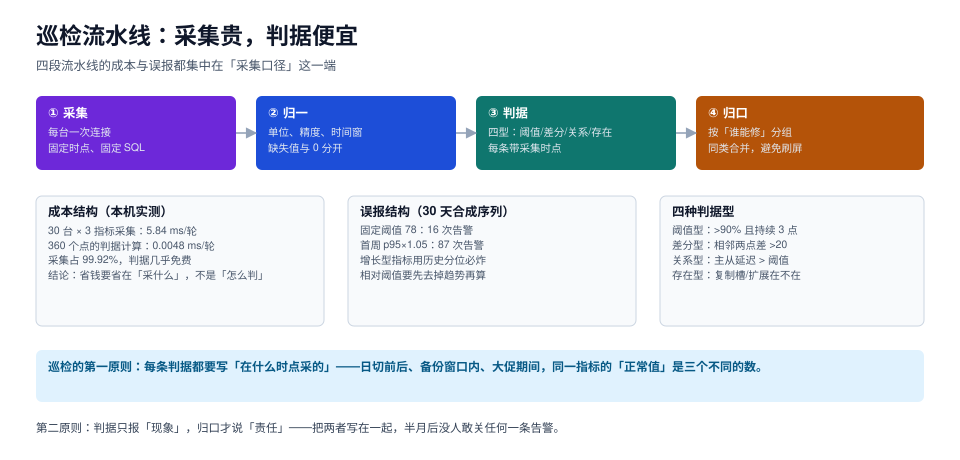

# 巡检口径：采集贵、判据便宜

巡检系统的失败通常不是「查得不够多」，而是**查得太多、判得太糙**：三百条告警每天响，值班的人扫一眼就关掉；真正的那一条淹没在里面，等到有人认真看时，已经过了处置窗口。

这一页处理三件事：判据有哪几种形态、采集时点为什么决定了「正常值」、以及成本与误报到底花在哪里。



本页判据族 `INS-A` ~ `INS-H`，共 8 条。定义表见文末「本页判据」一节。

## 一、四型判据：先分类，再写 SQL

| 类型 | 形态 | 例子 | 误报来源 |
| --- | --- | --- | --- |
| **阈值型** | 单点与固定值比 | 连接数占比 > 85% | 阈值拍脑袋；业务有周期 |
| **差分型** | 相邻两点或同比比 | 5 分钟内新增死元组 > 10 万 | 采样间隔不稳 |
| **关系型** | 两个量之间比 | 主从延迟 > 10 s 且持续 3 点 | 两边采集时点不同步 |
| **存在型** | 有没有 | 复制槽不存在、扩展未装、备份文件缺失 | 权限不足导致「查不到」被当成「不存在」 |

四型的写法完全不同。把关系型判据写成阈值型（比如「延迟 > 10 s」而不看「主库 LSN 是否在推进」），会在主库空闲时误报——因为空闲时延迟大不代表从库落后。

::: tip 一句话理解
阈值型回答「现在高不高」，差分型回答「变化快不快」，关系型回答「两边对不对得上」，存在型回答「东西还在不在」。**四型不是风格，是四种问题。**
:::

## 二、采集时点：同一个指标有三个「正常值」

下面这条曲线在一天里的形状，决定了「阈值 85%」这个判据会在什么时候误报：

| 时点 | 连接数占比（典型） | 说明 |
| --- | --- | --- |
| 凌晨 03:00（备份窗口） | 70%~90% | 备份 + autovacuum 抢连接 |
| 上午 10:00（业务高峰） | 60%~80% | 应用连接池打满，但这是设计的 |
| 日切前后 5 分钟 | 95%+ | 批量任务集中启动 |

如果用一条固定阈值覆盖三个时点，必然在其中两个时段误报。三种处理：

1. **分时段阈值**：备份窗口单独一套（如 95%），业务时段另一套（如 85%）；
2. **跳过窗口**：备份窗口内不判连接数（但要判「备份是否完成」）；
3. **看相对变化**：与「昨天同一时刻」比，而不是与一个绝对值比。

::: danger 采集时点的三个陷阱

1. **采集与被采集不同步**：查「主从延迟」时，主库的 LSN 和从库的 `replay_lsn` 若不是同一时刻读的，会算出一个不存在的延迟。要么在一个事务里读两边（做不到），要么读「从库视角的延迟」（`pg_last_wal_receive_lsn()` 与 `pg_last_wal_replay_lsn()` 之差），它天然是同一时刻。
2. **`now()` 与时钟**：跨实例比较时间戳时，主机时钟偏差会直接变成「延迟」。用 `clock_timestamp()` 记录采集时刻，并保证 NTP 同步。
3. **统计视图有延迟**：`pg_stat_activity` 的 `state_change` 是语句结束时间，不是开始时间；`pg_stat_statements` 有 `pg_stat_statements.max` 条数上限，超出会淘汰。

:::

## 三、成本：99.92% 花在采集

本机实测（30 台 × 3 指标）：

| 环节 | 单轮耗时 | 占比 | 说明 |
| --- | --- | --- | --- |
| 采集 | 5.84 ms | **99.92%** | 30 次建连 + 90 次查询 |
| 判据计算 | 0.0048 ms | 0.08% | 90 个点的比较与聚合 |

这个比例带来三个直接推论：

1. **优化判据没有意义**。把 90 个比较改成 3 个聚合，省下的是 0.003 ms。
2. **省成本只能省采集**：减少采集点、合并查询、拉长间隔、复用连接。
3. **新增一条判据的真实成本 = 一次采集的成本**。如果它需要新增一个采集点，成本是本轮采集的 1/90；如果它需要新增一次连接，成本接近 1/30——都远高于「判据本身」。

所以设计巡检时，正确的顺序是：**先列采集点，再在采集点上写判据**。反过来（先想判据，再去补采集）会让采集次数随判据数量线性增长。

```sql
-- 一次采集拿到六条判据需要的全部输入（PG 18）
select
  (select count(*) from pg_stat_activity)                             as conn_total,
  current_setting('max_connections')::int                             as conn_max,
  (select count(*) from pg_stat_activity where state = 'idle in transaction') as idle_xact,
  (select coalesce(max(extract(epoch from now() - xact_start)), 0)
     from pg_stat_activity where xact_start is not null)              as longest_xact_s,
  (select count(*) from pg_locks where not granted)                   as waiting_locks,
  (select count(*) from pg_replication_slots where not active)        as inactive_slots;
```

**一条 SQL、一次往返、六个判据的输入**。这比「六条独立 SQL」快 6 倍，也不会出现「六个读数来自六个不同时刻」的问题。

## 四、误报：固定阈值反而是好的

30 天合成序列（基数 60、日增 0.35、日周期 ±8、噪声 σ=1.8），同一份数据两种判据：

| 判据 | 30 天告警次数 | 问题 |
| --- | --- | --- |
| 固定阈值 78 | **16 次** | 前 20 天基本不响，后 10 天因为趋势上涨开始响——**趋势被当成异常** |
| 首周 p95 × 1.05 | **87 次** | 阈值定死在第一周的水平，序列一涨就全线越界 |

两个都不是好判据，但失败方式不同：固定阈值的问题是「没跟上趋势」，相对阈值的问题是「把趋势当异常」。

正确做法是**先去趋势，再判残差**：

```text
判据值 = 当前值 − 同期的趋势预测值
告警条件 = |残差| > 3 × 残差的滚动标准差
```

这样「日增 0.35」这种稳定增长不会被报警，而「某天突然多涨了 20」会。

### 4.1 归零类异常：绝对值比差分更可靠

注入一次「实例失联」（指标从 ~70 跌到 0.5）：

| 判据 | 在 11 个采样点里命中 |
| --- | --- |
| 绝对值 `< 20` | **6 次**（失联期间每个点都命中） |
| 差分「比上一点跌 > 20」 | **1 次**（只有跳变那一下命中） |

结论：**持续性故障用绝对值判，瞬时跳变用差分判**。用差分判持续故障，只会在开始那一刻报一次，之后静默——而持续故障恰恰需要持续提醒。

## 五、归一化：三个必须处理的脏数据

| 脏数据 | 现象 | 处理 |
| --- | --- | --- |
| **单位不一致** | `pg_settings.setting` 是 `16384`，`current_setting` 是 `16MB` | 统一换算成字节，或统一用文本形式比较 |
| **缺失 vs 0** | 查不到 → `null`，代码里 `coalesce` 成 0 → 判成「归零故障」 | 缺失要单独一态，不能与 0 混 |
| **采样间隔抖动** | 计划 60 s，实际 45~95 s | 差分型判据必须按「每秒」归一（`delta / interval`） |

第三条最隐蔽：一个「5 分钟内新增死元组 > 10 万」的判据，在间隔变成 95 s 时会漏报，因为差值不到 10 万；在间隔变成 45 s 时又会漏报另一半。**差分型判据一律换算成速率**。

## 六、归口：按「谁能修」分组，不按「哪个库」分组

告警列表按实例分组，会让同一个人收到 30 条一模一样的告警；按「谁能修」分组，才能合并：

| 归口 | 包含的判据 | 处置人 |
| --- | --- | --- |
| 容量 | 磁盘使用率、到阈值天数、WAL 目录大小 | 平台组 |
| 连接 | 连接数占比、idle in transaction、等待锁 | 应用组 + DBA |
| 复制 | 延迟、非活跃复制槽、WAL 堆积 | DBA |
| 备份 | 最近成功备份时间、备份文件可读性 | DBA |
| 结构 | 扩展缺失、版本漂移、索引失效 | DBA |

一个归口一条通知，通知里带「本组共 N 项，最严重的是哪一项」。这样 30 台的问题会变成 5 条消息，而不是 30 条。

## 七、一份可用的巡检清单

八条覆盖「最常见且能自动判」的场景，每条都标注了类型与时点：

| # | 判据 | 类型 | 采集时点 | 阈值建议 |
| --- | --- | --- | --- | --- |
| 1 | 连接数占比 | 阈值 | 全时段，备份窗口单独阈值 | 业务 85%，备份 95% |
| 2 | `idle in transaction` 会话数 | 阈值 | 全时段 | > 0 且持续 5 min |
| 3 | 最长事务时长 | 阈值 | 全时段 | > 30 min |
| 4 | 等待锁会话数 | 阈值 | 全时段 | > 3 且持续 2 min |
| 5 | 复制延迟 | 关系 | 全时段 | > 10 s 且持续 3 点 |
| 6 | 非活跃复制槽 | 存在 | 每日 | 存在即报（WAL 会无限堆积） |
| 7 | 最近成功备份距今 | 差分 | 每日 | > 26 h |
| 8 | 扩展与版本漂移 | 存在 | 每日 | 与清单不一致即报 |

第 6 条是本清单里最「贵」的一条：**非活跃复制槽会让 WAL 无限堆积，直到磁盘满**。它的判据只有「存在 / 不存在」，但因为后果严重，值得单独归口。

## 本页判据

| 编号 | 判据 | 看什么现象 | 不满足时改哪里 |
| --- | --- | --- | --- |
| `INS-A` | 判据标明类型 | 每条判据写明是阈值 / 差分 / 关系 / 存在 | 补类型，写不清类型的判据先别上 |
| `INS-B` | 标注采集时点 | 每条判据能回答「在什么时点采的」 | 补时点；分时段阈值或跳过窗口 |
| `INS-C` | 差分归一成速率 | 差分型判据除以实际间隔 | 改成「每秒增量」 |
| `INS-D` | 缺失不等于 0 | 采集失败有独立状态 | 去掉 `coalesce(...,0)`，加 `unknown` 态 |
| `INS-E` | 先列采集点 | 一个采集点服务多条判据 | 合并查询，一条 SQL 出多个输入 |
| `INS-F` | 趋势与异常分开 | 稳定增长不报警，突增报警 | 去趋势后判残差，或与昨日同期比 |
| `INS-G` | 按归口分组 | 通知按「谁能修」合并 | 建归口表，同类合并一条通知 |
| `INS-H` | 有告警预算 | 每周告警条数有上限，超了要治理 | 统计周告警量，逐条关停或调阈值 |

## 参考资料

- PostgreSQL 18 · 监控统计视图总览：<https://www.postgresql.org/docs/18/monitoring-stats.html>
- PostgreSQL 18 · `pg_stat_activity` 与 `pg_locks`：<https://www.postgresql.org/docs/18/monitoring-stats.html#MONITORING-PG-STAT-ACTIVITY-VIEW>
- PostgreSQL 18 · 复制槽与 WAL 保留：<https://www.postgresql.org/docs/18/warm-standby.html#STREAMING-REPLICATION-SLOTS>
- Google SRE Workbook · 告警与 SLO：<https://sre.google/workbook/alerting-on-slos/>
- 相邻专题：[监控告警](../../Monitoring/index.md)、[容量预测](../CapacityForecast/index.md)、[自愈止损](../SelfHealing/index.md)
