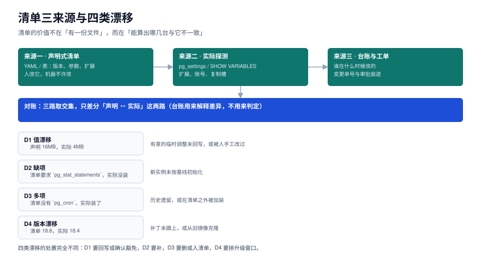

# 机群清单：三来源、四类漂移与对账

自动化真正开始的地方不是「写第一个 playbook」，而是**能回答「这 30 台库现在各是什么样」**。这个问题在没有清单的团队里，答案通常散在三处：一份半年前的 wiki、几个人的记忆、以及某个人的 `~/.pgpass` 旁边的手写笔记。三处都对不上时，自动化只会把不确定放大 30 倍。

这一页给清单的字段设计、三路来源、四类漂移的判定，以及一条「只差分两路」的对账流程。



本页判据族 `FLT-A` ~ `FLT-H`，共 8 条。定义表见文末「本页判据」一节。

## 一、为什么清单必须是「机器读的那一份」

人工维护的清单有三种典型死法：

| 死法 | 表现 | 后果 |
| --- | --- | --- |
| **双份并存** | wiki 一份、playbook 里 `group_vars` 一份 | 两份不一致时，没人知道该信哪份，最后信「上次跑通的那份」 |
| **只记「应该」不记「例外」** | 清单写着 `work_mem=16MB`，某台因为跑报表被临时调到 64MB | 作业一跑就把报表库打回 16MB，第二天报表超时 |
| **没有时间戳** | 不知道这条记录是三个月前还是昨天核对的 | 无法判断「不一致」是新漂移还是清单过期 |

机器读的清单解决前两个，时间戳解决第三个。最小可用形态就是一份 YAML 加一个 `verified_at` 字段：

```yaml
# 清单片段：只放「会被作业读」的字段
defaults:
  pg_version: "18.6"
  params:
    work_mem: "16MB"
    lock_timeout: "3000"
    idle_in_transaction_session_timeout: "300000"
  extensions: [pg_stat_statements, pgcrypto]
instances:
  - name: ord-pg-01
    role: primary
    host: 10.20.0.11
    cluster: orders
    verified_at: "2026-10-23"
  - name: ord-pg-02
    role: replica
    host: 10.20.0.12
    cluster: orders
    verified_at: "2026-10-23"
    overrides:
      work_mem: "64MB"       # 报表专用副本，已评审
      override_reason: "CHG-2261 报表库调优，2027-01-31 前复核"
```

`overrides` 是清单能不能活下来的关键。**没有例外机制的清单，一定会被绕过**——因为现实里总有「这台不能动」的机器，而一个不允许例外的系统，最终会被人用「手工改 + 不说」来绕过。

## 二、三路来源，各回答一半问题

| 来源 | 能回答 | 不能回答 | 采集方式 |
| --- | --- | --- | --- |
| **声明式清单** | 应该是什么 | 实际是什么 | 读 YAML / 表格 |
| **实际探测** | 实际是什么 | 为什么不一样 | `pg_settings` / `SHOW VARIABLES` |
| **台账与工单** | 谁在什么时候改的 | 现在还在不在 | 变更单、审计日志 |

对账只在**前两路**之间做差集，第三路用来**解释**差异。这条分工很重要：如果把「有没有工单」也算进判定，你会得到大量「值不一致但没有工单 → 报警」的噪音，而真正的动作其实是「先把值改回去，再补单」。

### 2.1 实际探测要读「生效值」，不是配置文件

PostgreSQL 的 `postgresql.conf`、`postgresql.auto.conf`、环境变量、命令行参数、以及会话里的 `SET`，都能决定一个参数的当前值。唯一可信的是 `pg_settings`：

```sql
-- 一次读出「生效值 + 是否待重启 + 来源」
select name,
       setting,
       unit,
       pending_restart,
       source,
       sourcefile,
       sourceline
from pg_settings
where name in ('work_mem', 'lock_timeout', 'max_connections',
               'shared_buffers', 'idle_in_transaction_session_timeout')
order by name;
```

三个字段的用途各不相同：

- `setting` 是**生效值**，与清单比的是它；
- `pending_restart` 为真表示「配置改了但进程还没重启」，这是自动化最容易漏掉的一类「假成功」；
- `source` / `sourcefile` / `sourceline` 用来回答「为什么是这个值」——`source=configuration file` 说明来自配置文件，`source=session` 说明有人在会话里 `SET` 过。

::: danger 三个容易读错的地方

1. **`reset_val` 不是「默认值」**，它是「`RESET` 之后回到的值」。有人在 `postgresql.auto.conf` 里设过，`reset_val` 也会变。
2. **单位不统一**：`work_mem` 的 `setting` 是 `16384`，`unit` 是 `8kB`，实际是 128MB。直接和 `16MB` 比较必然不一致。写法是先 `setting::bigint * pg_size_bytes(unit)`。
3. **`SHOW work_mem` 受会话影响**：在一个被别人 `SET` 过的连接里执行，读到的是那个连接的值。采集必须每次新建连接，或用 `RESET ALL` 后的会话。

:::

MySQL 侧对应的是 `performance_schema.variables_info`，它比 `SHOW VARIABLES` 多两个字段，正好补上「谁改的」：

```sql
-- MySQL 8.4：值 + 来源 + 设置时间
select variable_name, variable_value, variable_source, set_time, set_user
from performance_schema.variables_info
where variable_name in ('innodb_buffer_pool_size', 'max_connections', 'long_query_time');
```

`variable_source` 的取值（`COMMAND_LINE` / `PERSISTED` / `GLOBAL` / `COMPILED` / `DEFAULT`）比 PG 的 `source` 更细，能直接区分「写在 `mysqld-auto.cnf` 里」和「运行时 `SET GLOBAL`」。

## 三、四类漂移，四种处置

| 类别 | 定义 | 例子 | 处置 |
| --- | --- | --- | --- |
| **D1 值漂移** | 清单与实际都有，值不同 | 清单 16MB，实际 4MB | 回写清单（如果新值更好）或改回（如果无审批） |
| **D2 缺项** | 清单要求，实际没有 | 清单要求 `pg_stat_statements`，实际未装 | 补装，通常需要重启并改 `shared_preload_libraries` |
| **D3 多项** | 清单没有，实际存在 | 实际装了 `pg_cron`，清单没写 | 删除，或登记进清单（要写清为什么） |
| **D4 版本漂移** | 大版本或补丁版本不一致 | 清单 18.6，实际 18.4 | 排升级窗口，见[数据库大版本升级](../../DatabaseUpgrade/index.md) |

四类的处置路径完全不同，所以**日报必须先分类再计数**。给一个「漂移 37 项」的总数没有意义——D1 可能是 30 项历史欠账（一天能清完），D4 可能是 1 台（要排一个月）。

### 3.1 D4 版本漂移的特殊性

补丁版本（18.4 → 18.6）在参数层面通常是兼容的，但**扩展的二进制接口可能不兼容**。所以版本漂移的判定不能只看 `server_version`，还要看扩展：

```sql
-- 版本 + 扩展版本一起读，两者都可能漂
select version() as server,
       extname, extversion
from pg_extension
order by extname;
```

::: warning 版本差异要行内标注，不要另开一套文档
本专题不按版本建目录（理由写在[目录页](../index.md)）。凡是「某个版本才有的行为」，直接在正文里标注，例如：

- `pg_terminate_backend(pid, timeout)` 的 `timeout` 参数 **PG 14 起**才有；之前的版本只能先 `pg_cancel_backend` 再等。
- `pg_stat_statements` 的语句标识在 **PG 14 起**由 `compute_query_id` 统一生成（`pg_stat_activity.query_id` 与 `pg_stat_statements.query_id` 同源）；更早版本只有扩展自己的 `queryid`，**重启或升级后可能变化**，用旧值做长期对比会得到错误结论。
- `CHECK` 约束在 **MySQL 8.0.16 起**才真正生效；5.7 上写了等于没写（解析但忽略）。
- `INSTANT ADD COLUMN` 在 **MySQL 8.0.12**、`INSTANT DROP COLUMN` 在 **8.0.29** 才有。

旧版本的写法保留在上面，**不删不改**——存量项目还要靠它。
:::

## 四、对账：把差集跑成一条命令

对账的核心是一次「逐项比对 + 三态输出」。三态比两态（一致 / 不一致）多一态，价值在于能区分「缺失」和「多余」：

```shell
# 逐台拉生效值，输出「实例|参数|实际值」，与清单比
for h in $(yq -r '.instances[].host' ops/inventory.yaml); do
  psql -h "$h" -U readonly -Atc \
    "select current_setting('work_mem'), current_setting('lock_timeout')" \
    | awk -v h="$h" -F'|' '{printf "%s|work_mem|%s\n%s|lock_timeout|%s\n", h,$1,h,$2}'
done | sort > /tmp/actual.txt

yq -r '.instances[] | .host as $h | .params | to_entries[] | "\($h)|\(.key)|\(.value)"' \
  ops/inventory.yaml | sort > /tmp/expected.txt

# 三态差集
comm -3 /tmp/expected.txt /tmp/actual.txt
```

`comm -3` 的输出分两列：左列是「只在期望里」（D2 缺项），右列是「只在实际里」（D3 多项）。同一项值不同时，两行都会出现——所以脚本还要再做一次「按 key 聚合」：

```text
# 聚合后的输出形态（示例）
D1  ord-pg-03  work_mem      期望 16MB   实际 8MB
D2  ord-pg-07  extension    期望 pg_stat_statements   实际 无
D3  ord-pg-09  extension    期望 无     实际 pg_cron
D4  ord-pg-11  server_version 期望 18.6   实际 18.4
```

::: tip 单位换算是这类脚本最常见的错源
`psql -Atc "select current_setting('work_mem')"` 返回的是 `16MB`（带单位），而 `pg_settings.setting` 返回 `16384`（不带单位）。**同一个参数在两条路径下格式不同**。要么统一用 `current_setting`（人读友好），要么统一用 `pg_settings.setting` + `unit` 换算（机器友好），不要混用。
:::

## 五、豁免：让「不一致」有合法出口

真实机群里总有一些「就是不该一致」的项。处理方式不是把它们从清单里删掉（那就失去了记录），而是登记豁免，并且**带到期时间**：

```yaml
exemptions:
  - instance: ord-pg-02
    key: params.work_mem
    expected: "64MB"
    reason: "CHG-2261 报表库调优"
    expires: "2027-01-31"
    owner: dba-report
```

三条纪律：

1. **豁免必须绑定单台实例 + 单个键**，不允许「整台豁免」（那等于把一台机器移出管理）。
2. **必须有到期时间**。没有到期的豁免会永久沉淀，半年后没人记得为什么。
3. **豁免到期后自动变成 D1 漂移**，由巡检报出来，而不是静默失效。

## 六、清单的更新节奏

清单不是「定稿文件」，它的更新频率决定了自动化能不能跟上现实：

| 触发 | 谁改 | 多久内 |
| --- | --- | --- |
| 新增实例 | 交付方（建库时同步） | 当天 |
| 参数调整（有工单） | 变更执行人 | 变更当天 |
| 参数调整（临时排障） | 排障人 | 24 小时内回写或加豁免 |
| 大版本升级 | 升级负责人 | 升级验收当天 |
| 实例下线 | 交付方 | 下线当天 |

最后一行最容易被忽略：**下线实例还留在清单里，巡检会一直报「连不上」**，然后运维学会忽略那条告警——这是告警疲劳的经典起点。

## 本页判据

| 编号 | 判据 | 看什么现象 | 不满足时改哪里 |
| --- | --- | --- | --- |
| `FLT-A` | 清单机器可读 | 清单是 YAML/表格，能被脚本直接读，不需要人抄 | 从 wiki 迁出，先只迁「作业会读的字段」 |
| `FLT-B` | 有例外机制 | 存在 `overrides` 与 `override_reason`，而不是把例外机器移出清单 | 加例外字段，绑定单键单实例 |
| `FLT-C` | 读的是生效值 | 对账读 `pg_settings.setting` 或 `current_setting`，不读 conf 文件字面量 | 改采集 SQL，注意单位换算 |
| `FLT-D` | 区分「待重启」 | 能报出 `pending_restart=true` 的项 | 采集时多读一列，作业复核把这一列算进去 |
| `FLT-E` | 四类漂移分开计 | 日报按 D1/D2/D3/D4 分项，不只有一个总数 | 把差集按「值不同 / 缺失 / 多余 / 版本」聚合 |
| `FLT-F` | 豁免带到期 | 每条豁免都有 `expires` 与 `owner` | 补两个字段，过期的转成 D1 |
| `FLT-G` | 台账能解释差异 | 每条 D1 都能关联到变更单号或豁免 | 补台账关联，允许「未知」但要有计数 |
| `FLT-H` | 下线实例出清单 | 清单里没有已下线的实例 | 下线流程里加一步「删清单条目」 |

## 参考资料

- PostgreSQL 18 · 参数与 `pg_settings` 视图：<https://www.postgresql.org/docs/18/view-pg-settings.html>
- PostgreSQL 18 · `pg_extension` 与扩展管理：<https://www.postgresql.org/docs/18/view-pg-extension.html>
- MySQL 8.4 · `performance_schema.variables_info`：<https://dev.mysql.com/doc/refman/8.4/en/performance-schema-variables-info-table.html>
- MySQL 8.4 · 服务器系统变量（含 `SET PERSIST`）：<https://dev.mysql.com/doc/refman/8.4/en/server-system-variables.html>
- 相邻专题：[数据库参数与内核调优](../../../DB/ParameterTuning/index.md)、[配置管理与动态配置](../../ConfigManagement/index.md)
