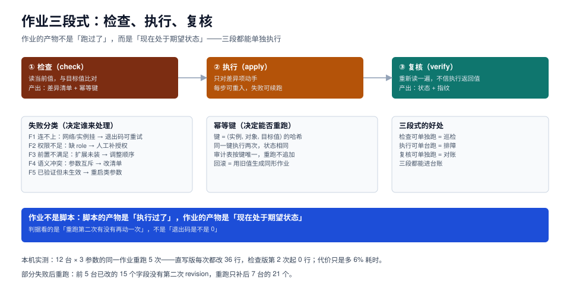

# 作业模型：检查、执行、复核三段式

一个作业最容易骗人的地方，是它的返回值：`UPDATE 1`、`changed: true`、退出码 0——三种「成功」的写法，都可以在**什么都没生效**的情况下出现。参数需要重启才生效时是这样，`SET` 只影响当前会话时是这样，被别处的配置覆盖时也是这样。

所以作业必须写成三段：**检查（读当前值）→ 执行（只对差异动手）→ 复核（重新读一遍）**。三段都能单独跑，也都能单独验收。



本页判据族 `JOB-A` ~ `JOB-H`，共 8 条。定义表见文末「本页判据」一节。

## 一、为什么不能信「执行成功」

下面三种情况，执行步骤都会报成功，但状态没变：

| 情况 | 执行返回 | 实际状态 | 只有谁能发现 |
| --- | --- | --- | --- |
| `shared_buffers` 改了但没重启 | `ALTER SYSTEM` 成功 | 旧值仍生效，`pending_restart=true` | 复核（读 `pg_settings`） |
| 会话里 `SET work_mem` 成功 | `SET` 成功 | 连接一归还，下一个请求读到旧值 | 复核（新连接读） |
| 参数被 `postgresql.auto.conf` 覆盖 | `ALTER SYSTEM` 成功 | 生效值是 auto.conf 的值 | 复核 + 读 `source` |

三种情况的共同点：**执行步骤看到的是「命令被接受」，不是「状态已改变」**。数据库接受一条命令和这条命令产生持久效果，中间隔着事务提交、检查点、进程重启、连接池复用。

::: tip 一句话理解
执行步骤负责「发出意图」，复核步骤负责「确认事实」。把两者合成一步，就等于让「我说了」代替「它成了」。
:::

## 二、三段各自的输入输出

| 段 | 输入 | 输出 | 可否单独运行 | 典型用途 |
| --- | --- | --- | --- | --- |
| 检查 | 清单里的目标值 + 实例连接 | 差异清单（空 = 已一致） | 可以 | 日常巡检、变更前预检 |
| 执行 | 差异清单 | 每项的处置结果（改了 / 跳过 / 失败） | 可以（单台） | 排障、补执行 |
| 复核 | 目标值 + 实例连接 | 状态 + 指纹（一致 / 不一致 / 待重启） | 可以 | 变更后验收、对账 |

「复核可单独跑」这条最有用：**它让「事后对账」和「变更验收」变成同一段代码**。不需要为验收另写一套检查。

## 三、幂等键：让重跑变成安全动作

幂等的定义很朴素：**同一条作业执行两次，第二次不产生任何变更**。做到这一点只需要一个键和一个唯一约束。

### 3.1 键怎么定

```text
幂等键 = sha256( 实例标识 + 对象类型 + 对象名 + 目标值 + 作业版本 )
```

五个字段都有理由：

| 字段 | 为什么必须在键里 |
| --- | --- |
| 实例标识 | 同一参数在不同实例上是不同的事 |
| 对象类型 | `work_mem` 参数与名为 `work_mem` 的扩展是两回事 |
| 对象名 | 同一实例上有多个对象 |
| 目标值 | 目标值变了就是一次**新**变更，不是重跑 |
| 作业版本 | 脚本逻辑变了，旧回执不能证明新逻辑跑过 |

**不要把「时间」放进键里**。带时间戳的键等于没有键——每次都不同，每次都追加一条记录。

### 3.2 审计表的形态

```sql
-- 作业回执表：幂等键唯一，重跑只更新状态不改历史
create table ops_job_receipt (
  idem_key      text primary key,
  instance      text not null,
  object_type   text not null,
  object_name   text not null,
  target_value  text not null,
  job_version   text not null,
  before_value  text,
  after_value   text,
  status        text not null check (status in ('applied','skipped','failed','pending_restart')),
  job_id        text not null,
  operator      text not null,
  updated_at    timestamptz not null default now()
);

-- 重跑只更新状态与时间，不插入新行
insert into ops_job_receipt (idem_key, instance, object_type, object_name,
                             target_value, job_version, before_value, after_value,
                             status, job_id, operator)
values ($1,$2,$3,$4,$5,$6,$7,$8,$9,$10,$11)
on conflict (idem_key) do update
  set after_value = excluded.after_value,
      status      = excluded.status,
      updated_at  = now()
  where ops_job_receipt.status <> 'applied';
```

`where ops_job_receipt.status <> 'applied'` 这一句是关键：**已完成的回执不允许被重跑覆盖**。没有它，一次「误重跑」会把 `before_value` 抹成当前值，事后就无法回答「原来是多少」。

### 3.3 本机实测：直写 vs 检查

12 台模拟实例、3 个参数、同一作业连跑 5 次：

| 实现 | 第 1 次 | 第 2 次 | 第 3 次 | 第 4 次 | 第 5 次 | 累计改动 |
| --- | --- | --- | --- | --- | --- | --- |
| 直写 | 36 行 | 36 行 | 36 行 | 36 行 | 36 行 | **180 行** |
| 检查后执行 | 36 行 | 0 行 | 0 行 | 0 行 | 0 行 | **36 行** |

单次耗时 8.577 ms → 9.095 ms，**只多 6%**。这 6% 买到的是：审计表不膨胀、`revision` 不被误增、`INSERT` 类操作不会重复追加。

## 四、半截失败：可续跑比可回滚更重要

真实作业的失败几乎都不是「全成功」或「全失败」，而是**停在第 7 台**。这时有两个选择：回滚前 6 台，或从第 7 台续跑。**绝大多数场景应该选续跑**，理由是回滚本身也是 N 次操作，会把失败面再放大一倍。

续跑的前提是每台的状态可读：

```python
# 作业 runner 骨架：状态先行，失败不吞
import hashlib, json

def idem_key(inst, otype, oname, target, ver):
    raw = f"{inst}|{otype}|{oname}|{target}|{ver}".encode()
    return hashlib.sha256(raw).hexdigest()

def run(job, instances, dry_run=True):
    report = []
    for inst in instances:
        key = idem_key(inst["name"], "param", job["name"], job["target"], job["version"])
        before = read_value(inst, job["name"])          # ① 检查
        if before == job["target"]:
            report.append({"instance": inst["name"], "status": "skipped", "key": key})
            continue                                    # 幂等：值相同就跳过
        if dry_run:
            report.append({"instance": inst["name"], "status": "would_change",
                           "before": before, "key": key})
            continue
        try:
            apply_value(inst, job["name"], job["target"])   # ② 执行
        except Retryable as e:                              # F1：可重试
            report.append({"instance": inst["name"], "status": "failed_retryable",
                           "error": str(e), "key": key})
            break                                           # 停下，不继续下一台
        after = read_value(inst, job["name"])               # ③ 复核
        status = "applied" if after == job["target"] else "pending_restart"
        report.append({"instance": inst["name"], "status": status,
                       "before": before, "after": after, "key": key})
    return report
```

三个设计点值得注意：

1. **`break` 而不是 `continue`**：一台失败就停，避免「带着未知原因继续改下一台」。这是波次机制的代码形态。
2. **`dry_run` 走的是同一段检查逻辑**：所以「预检」和「执行」不会出现两套判定。
3. **`status` 有四态**（`applied` / `skipped` / `pending_restart` / `failed_*`）：`pending_restart` 是独立状态，不能混进 `applied`——否则下次巡检会认为「已经对了」。

本机实测的部分失败场景：第 6 台失败后中止，前 5 台共 15 个字段被改（`revision` 合计 15）；直接重跑，最终 `revision` 合计 36（15 + 后 7 台 × 3），**前 5 台没有第二次 revision**。这就是幂等键在真实重跑里的表现。

## 五、失败分类：决定「谁来修」

失败不是一个状态，而是五类，处理人和处理方式都不同：

| 类别 | 典型错误 | 可重试 | 谁来处理 | 处置 |
| --- | --- | --- | --- | --- |
| **F1 连不上** | `connection refused`、超时 | 是（退避重试） | 平台/网络 | 重试 3 次后转人工 |
| **F2 权限不足** | `permission denied for ...` | 否 | DBA | 补授权，重跑 |
| **F3 前置不满足** | 扩展未装、目录不存在 | 否（但可编排） | 作业作者 | 调整作业顺序，加依赖 |
| **F4 语义冲突** | 参数互斥、超上限 | 否 | 清单 owner | 改清单，不是改作业 |
| **F5 需重启才生效** | `pending_restart=true` | 不适用 | 值班 | 排重启窗口，不算失败 |

把 F5 从「失败」里摘出来非常重要：**很多团队把 `pending_restart` 当成失败，于是每次改 `shared_buffers` 都会让作业变红**，然后大家学会忽略红色作业。

## 六、三种执行载体，幂等性不同

| 载体 | 幂等性 | 适合 | 坑 |
| --- | --- | --- | --- |
| **专用模块**（如 `community.postgresql.postgresql_set`） | 内建（值相同返回 `changed: false`） | 参数、扩展、库表 | 模块版本与数据库版本的兼容矩阵要核 |
| **`psql` + SQL** | 取决于 SQL 写法（`ALTER SYSTEM` 天然幂等，`INSERT` 不是） | 需要精确控制的场景 | 会话级 `SET` 不持久 |
| **自研 runner** | 自己保证 | 跨库、需要复杂编排 | 容易漏掉「复核」这一段 |

一个对比例的写法：

```yaml
# Ansible：模块内建幂等，changed 只在值不同时为 true
- name: 下发 work_mem
  community.postgresql.postgresql_set:
    name: work_mem
    value: "{{ item.work_mem }}"
  loop: "{{ instances }}"
  register: r

- name: 复核（不信上一步的返回值）
  community.postgresql.postgresql_query:
    query: "select setting || unit as v from pg_settings where name='work_mem'"
  loop: "{{ instances }}"
```

注意第二段：**即使模块声称幂等，复核仍然要单独做一遍**。模块的幂等保证的是「它不会重复下发」，不保证「下发后真的生效」（F5 就是典型反例）。

::: danger 三个常见写法错误

1. **`shell` 模块里跑 `psql -c "ALTER SYSTEM ..."` 却不写 `changed_when`**：每次都是 `changed: true`，作业永远是「有变更」，波次中止条件就失去意义。
2. **在同一个会话里 `SET` 后立刻 `SHOW`**：读到的当然是自己设的值。复核必须用新连接。
3. **用 `psql -f migrate.sql` 跑结构变更**：脚本里若有 `CREATE INDEX CONCURRENTLY`，它会和事务冲突而失败，且失败后留下无效索引。

:::

## 七、回执：作业的产物是一行可查的记录

一次作业跑完，至少要能回答五个问题：

| 问题 | 字段 |
| --- | --- |
| 谁跑的 | `operator`（人）或 `job_id`（调度器） |
| 什么时候 | `updated_at` |
| 改了什么 | `object_type` + `object_name` + `before_value` → `after_value` |
| 依据什么 | `target_value` + `job_version` + 关联的变更单号 |
| 现在什么状态 | `status` |

缺任何一项，「事后追查」就会退化成「翻聊天记录」。

## 本页判据

| 编号 | 判据 | 看什么现象 | 不满足时改哪里 |
| --- | --- | --- | --- |
| `JOB-A` | 三段齐全 | 作业有独立的检查、执行、复核三段 | 把复核从执行里拆出来 |
| `JOB-B` | 复核读的是新连接 | 复核不复用执行时的会话 | 复核段新建连接，或 `RESET ALL` |
| `JOB-C` | 有幂等键 | 回执表有 `idem_key` 且为主键 | 按五字段算 sha256，加唯一约束 |
| `JOB-D` | 重跑不改历史 | 已 `applied` 的回执不被重跑覆盖 | `on conflict` 加 `where status <> 'applied'` |
| `JOB-E` | 失败分五类 | 错误码能映射到 F1~F5，F5 不算失败 | 建错误码映射表，`pending_restart` 单独成态 |
| `JOB-F` | 一台失败就停 | runner 里是 `break` 而不是 `continue` | 改成中止，让波次机制接管 |
| `JOB-G` | 支持预检 | 存在只读模式，输出「会改哪些」 | 加 `dry_run`，走同一段检查逻辑 |
| `JOB-H` | 回执可追 | 回执含操作人、时间、前后值、依据 | 补五个字段，缺一不可 |

## 参考资料

- PostgreSQL 18 · `ALTER SYSTEM` 与 `pg_reload_conf()`：<https://www.postgresql.org/docs/18/sql-altersystem.html>
- PostgreSQL 18 · `INSERT ... ON CONFLICT`：<https://www.postgresql.org/docs/18/sql-insert.html>
- Ansible · `community.postgresql.postgresql_set`：<https://docs.ansible.com/ansible/latest/collections/community/postgresql/postgresql_set_module.html>
- Ansible · 幂等性与 `changed_when`：<https://docs.ansible.com/ansible/latest/playbook_guide/playbooks_intro.html>
- 相邻专题：[机群清单](../Inventory/index.md)、[分波次](../Waves/index.md)、[Ansible 自动化运维](../../Ansible/index.md)
