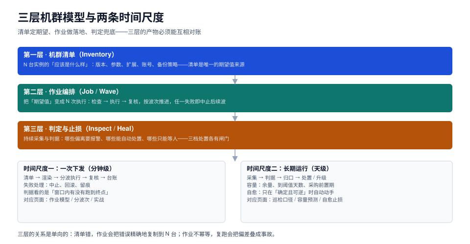

# 总览：四类作业、三层机群与五个必失点

数据库运维自动化被讲成「写 playbook」已经很多年了，但真正让机群出事的从来不是「剧本写不出来」，而是**剧本没有期望值、没有幂等、没有中止点**：清单上写着 16MB，实际有 3 台是 8MB、1 台是 2MB；变更一次推到 24 台，坏版本下去时没有一台能拦住它；第二天早上磁盘满了，因为没人算过「还剩几天」。

这一页给四类作业的边界、三层机群模型、五个必失点，再用一张「症状 → 主线」的表把后面九页串起来。



本页判据族 `DBO-A` ~ `DBO-H`，共 8 条。定义表见文末「本页判据」一节。

## 一、四类作业：先分清你在做哪一类

机群上的自动化请求看起来都一样（「把 X 改成 Y」），但四类作业的**验收方式完全不同**。分不清类别，就会拿「跑完了」当「成功了」。

| 类别 | 典型动作 | 期望值从哪来 | 验收方式 | 失败特征 |
| --- | --- | --- | --- | --- |
| **配置类** | 改参数、装扩展、调账号权限 | 声明式清单 | 复核读回值 == 期望值 | 参数需要重启才生效，`pending_restart` 为真 |
| **结构类** | 建表、加列、建索引、回填 | 迁移脚本（有序、带版本号） | 结构指纹 == 目标版本 | 半途失败留下中间态，重跑不一定能续 |
| **数据类** | 归档、清理、修复、重算 | 判据 SQL（什么算「该处理」） | 处理前后的差集为空 | 幂等性最难，容易越跑越多 |
| **运维类** | 重启、切主、扩盘、备份 | 运行时状态机 | 状态迁移合法 + 服务可用 | 不可逆，回滚代价高 |

**四类的共同点只有一条：都需要一个「期望值」**。没有期望值，作业只能报「执行了」，不能报「正确了」。

::: tip 一句话理解
配置类的期望值是一份清单，结构类的期望值是一个版本号，数据类的期望值是一条判据，运维类的期望值是一个状态机。**说不出期望值是什么，就说明这次作业还没设计完。**
:::

## 二、三层机群模型：清单、作业、判定

三层是单向依赖的，自下而上不能反过来：

```text
第三层  判定与止损   巡检判据 → 归口 → 三档处置（报警 / 自动 + 通知 / 只报不动）
           ↑
第二层  作业编排     检查 → 执行 → 复核，按波次推进，波内失败即中止
           ↑
第一层  机群清单     版本、参数、扩展、账号、备份策略（唯一的期望值来源）
```

### 2.1 为什么「清单」必须独立成层

因为**清单错了，作业会把错误精确地复制到 N 台**。本机实测（12 台模拟实例、3 个参数）：清单要求 `work_mem=16MB`，实际有 3 台是 8MB、1 台是 2MB，作业渲染出 **4 处差异**；如果清单本身写错成 8MB，作业会把另外 8 台也从 16MB 改成 8MB，而且**每一步都「成功」**——复核也过，因为复核比的是清单。

这是三层模型里最反直觉的一点：**复核只能证明「与清单一致」，不能证明「清单是对的」**。清单的正确性只能靠人评审 + 与实际负载的压测读数来保证。

### 2.2 为什么「判定」不能塞进作业里

作业是「一次性的、有终点的」，判定是「持续的、没有终点的」。把判定写成作业的最后一步，会出现两个问题：

1. **频率错配**：作业一天跑一次，而磁盘从 89% 到 91% 可能只用了 40 分钟。
2. **责任错配**：作业失败了要重跑，判定「失败」了要找人或找策略——把两者混在一个退出码里，值班的人分不清「是这次没跑成」还是「系统真的坏了」。

## 三、五个必失点

### 3.1 必失点一：把「执行过了」当成「处于期望状态」

本机实测（12 台 × 3 参数，同一作业连跑 5 次）：

| 实现 | 每次改动行数 | 5 次后 `revision` 合计 | 审计行数 | 单次耗时 |
| --- | --- | --- | --- | --- |
| 直写（`UPDATE` 后无条件写审计） | 36 / 36 / 36 / 36 / 36 | 180 | 180 | 8.577 ms |
| 检查后执行（值相同则跳过） | 36 / 0 / 0 / 0 / 0 | 36 | 36 | 9.095 ms |

直写版看起来「也把值改对了」，但代价在别处：

- 审计表被无意义的重复记录淹没，事后查「谁改的」要先去重；
- 任何基于 `revision` 的乐观锁都会误判「有人改过」，把正常请求打回 409；
- 如果作业里夹了一个「追加」类操作（比如往 `pg_hba.conf` 追加一行），重跑 5 次就是 5 行重复。

**多花 6% 的耗时买「可重跑」，是这套东西里最划算的一笔交易。**

### 3.2 必失点二：把「全量并行」当成「效率高」

24 台仿真的结果（4000 次蒙特卡洛，坏版本概率 25%、坏版本下每台受损概率 80%）：

| 策略 | 最坏受损 | 平均受损 | 全量跑完率 |
| --- | --- | --- | --- |
| 全量并行（24 台一波） | **24 台** | 4.83 台 | 100% |
| 波次 12 | 12 台 | 2.51 台 | 74.0% |
| 波次 6 | 6 台 | 1.20 台 | 74.8% |
| 波次 3 | 3 台 | 0.62 台 | 74.8% |
| 逐台（24 波） | **1 台** | 0.25 台 | 74.6% |

两个读数值得记住：

- **最坏受损 = 波次大小**，这是恒等式，不是统计规律。想让「最坏只坏一台」，只能逐台。
- **小波次并不会让「跑完率」变低**（74.6%~74.8% 几乎不动）。真正决定跑完率的是「版本好不好」，波次只决定「炸多大」。所以「小步走会更容易失败」是个错觉——它只是失败了更容易停。

全量并行还有一个隐藏问题：**它没有中止点**。24 台同时下发时，「中止」这个动作只能在中止之后才生效，因为判定失败的信号要在跑完之后才回来。

### 3.3 必失点三：把巡检当成「多查几条 SQL 不花钱」

本机实测（30 台 × 3 指标）：

| 环节 | 单轮耗时 | 占比 |
| --- | --- | --- |
| 采集（30 次连接 + 90 次查询） | 5.84 ms | 99.92% |
| 判据计算（90 个点的比较） | 0.0048 ms | 0.08% |

结论很直接：**巡检的成本全在「采什么」，不在「怎么判」**。所以省成本要省在采集端——拉长间隔、减少连接数、把多条判据合并成一次查询；而不是把判据写得「更聪明」。反过来，如果一条判据需要新增一次采集，它的成本是「所有判据的平均成本」的几千倍。

### 3.4 必失点四：用 MAPE 选预测方法

同一个 90 天合成序列（基数 400 GB、日增 2.6 GB、周周期 ±18 GB、噪声 σ=6 GB、阈值 800 GB），四种方法：

| 方法 | 14 天 MAPE | 「还有几天到阈值」误差 |
| --- | --- | --- |
| 线性拟合 | **2.03%** | **4.7%** |
| 近 7 天斜率 | 2.27% | 12.5% |
| 指数拟合 | 2.33% | 29.0% |
| Holt 双指数（未建模周周期） | 2.86% | 64.9% |

MAPE 只差 1.4 倍，但「还有几天」差 14 倍。原因是**天数 = 剩余容量 ÷ 斜率**，除法把斜率的小偏差放大；再叠上周周期，Holt 学出来的趋势项会被季节项吃掉。

采购决策看的是「天数」，不是「MAPE」。**指标选错，方法就选反。**

### 3.5 必失点五：把「响应快」当成「自愈好」

5000 次仿真（故障真实发生率 50%、常态下指标有偶发尖峰）：

| 触发条件 | 误动作率 | 检出率 |
| --- | --- | --- |
| 单条件：任一采样 > 95% | 5.64% | 50.3% |
| 双条件：连续 3 点 > 95% 且斜率 > 0 | **0.00%** | 44.0% |

单条件每 18 次就会多动一次不该动的。在数据库上，「多动一次」的期望损失远大于「少救一次」——因为误动作通常发生在**系统正在自我恢复**的时候（比如一次大批量导入让连接数短暂冲高）。

宁可少救 6 个百分点，不可多动 5 个百分点。

## 四、从症状到主线

| 你观察到的现象 | 大概率是哪一层的问题 | 去哪一页 |
| --- | --- | --- |
| 参数改了，重启后又是旧值 | 清单被别的来源覆盖 / 有人手工改了 `postgresql.auto.conf` | [机群清单](../Inventory/index.md) |
| 作业重跑后审计表翻倍 | 缺幂等键与唯一约束 | [作业模型](../JobModel/index.md) |
| 一次变更挂了一半实例 | 没有波次或波次过大 | [分波次](../Waves/index.md) |
| 告警天天响，关了又怕漏 | 阈值拍脑袋 / 采集时点在日切 | [巡检口径](../Inspection/index.md) |
| 磁盘总是在半夜满 | 只报「当前使用率」，没报「到阈值天数」 | [容量预测](../CapacityForecast/index.md) |
| 自动清理把备份删了 | 单条件触发 + 不可逆动作 | [自愈止损](../SelfHealing/index.md) |
| 演练都过了，真变更还是出事 | 演练只跑成功路径，没验中止条件 | [作业彩排](../Drills/index.md) |

## 五、一条可执行的落地顺序

不要一次上全套。按这个顺序，每一步都能独立产生价值：

1. **先做清单**（1~3 天）：把所有实例的版本、参数、扩展、账号拉一遍，落成一份 YAML。这一步不写任何自动化，只读。
2. **再做对账**（3~5 天）：把「清单 vs 实际」的差集跑成日报。此时你会先修掉一批「以为是 16MB 其实是 8MB」的历史欠账。
3. **然后做作业**（1~2 周）：按三段式写第一个作业，先只读（`--check`），再逐台执行，最后按波次。
4. **补判定**（持续）：把已经稳定下来的作业的复核步骤，改造成周期性巡检。
5. **最后才是自愈**（谨慎）：只对第一档（确定、可逆、影响面已知）开放自动处置。

顺序不能反。直接上自愈的团队，通常在三周内会把「自动处理」全部关掉——因为误动作比手工慢一点更伤信任。

## 本页判据

| 编号 | 判据 | 看什么现象 | 不满足时改哪里 |
| --- | --- | --- | --- |
| `DBO-A` | 作业能归入四类之一 | 每个作业都标明「配置 / 结构 / 数据 / 运维」 | 无法归类的先拆开，混合类作业不允许上线 |
| `DBO-B` | 期望值有唯一来源 | 作业的目标值来自清单，而不是脚本里的字面量 | 把目标值移进清单，脚本只做渲染 |
| `DBO-C` | 三层没有互相越界 | 判定逻辑不在作业里，期望值不在判定里 | 把「是否该处理」上移成判据，作业只执行 |
| `DBO-D` | 作业可重跑 | 连跑两次，第二次变更行数为 0 | 加检查段与幂等键，见[作业模型](../JobModel/index.md) |
| `DBO-E` | 发布有中止点 | 中止条件能在波次内部判定 | 拆波次，见[分波次](../Waves/index.md) |
| `DBO-F` | 巡检成本有账 | 能说出「一轮巡检采多少点、耗多少毫秒」 | 统计采集点数，合并同类查询 |
| `DBO-G` | 容量报的是天数 | 有「到阈值还剩几天」的读数，不只有使用率 | 见[容量预测](../CapacityForecast/index.md) |
| `DBO-H` | 自愈只做可逆动作 | 自动处置清单里没有删数据、切主、扩盘 | 把不可逆动作降到第三档，见[自愈止损](../SelfHealing/index.md) |

## 参考资料

- PostgreSQL 18 · 服务器配置（`pg_settings` 与 `ALTER SYSTEM`）：<https://www.postgresql.org/docs/18/config-setting.html>
- PostgreSQL 18 · 监控数据库活动（`pg_stat_activity`）：<https://www.postgresql.org/docs/18/monitoring-stats.html>
- MySQL 8.4 · `performance_schema.variables_info`：<https://dev.mysql.com/doc/refman/8.4/en/performance-schema-variables-info-table.html>
- Google SRE Book · 自动化演进（Automation at Google）：<https://sre.google/sre-book/automation-at-google/>
- 相邻专题：[数据库参数与内核调优](../../../DB/ParameterTuning/index.md)、[变更管理与发布工程](../../ChangeManagement/index.md)
