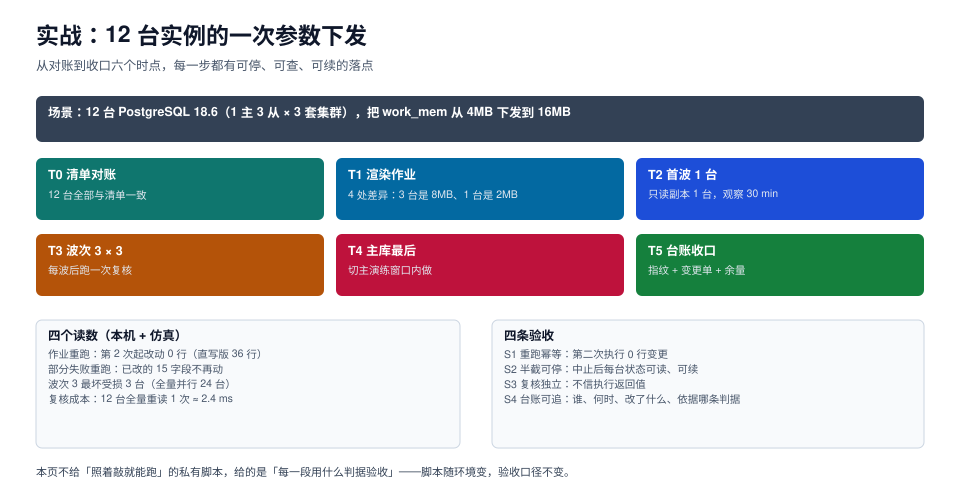

# 实战：12 台实例的一次参数下发

前面七页给的是一套零件。这一页把它们装成一次真实的作业：**3 套 PostgreSQL 18.6 集群、共 12 台（3 主 9 从），把 `work_mem` 从 4MB 下发到 16MB**，从对账到收口共六个时点。

选这个变更做例子的原因：它是配置类（不改数据）、可热更（不用重启）、但**会被会话级 `SET` 污染**，三条特征正好覆盖前面几页的所有机制。



本页判据族 `DBP-A` ~ `DBP-H`，共 8 条。定义表见文末「本页判据」一节。

## 一、场景与前提

| 项 | 值 |
| --- | --- |
| 集群 | 3 套（orders / payment / stock） |
| 实例 | 每套 1 主 3 从，共 12 台 |
| 版本 | PostgreSQL 18.6（全部一致，无 D4 漂移） |
| 变更 | `work_mem`：4MB → 16MB |
| 生效方式 | 热更（`ALTER SYSTEM` + `pg_reload_conf()`），无需重启 |
| 可用窗口 | 96 分钟（业务低峰） |
| 回滚 | 反向作业（16MB → 4MB），预计 **0.2 s** 执行（按本机 9 ms/台折算）+ 一次全量复核 |

`work_mem` 是「每个排序/哈希节点」的上限，不是单查询上限——这个前提决定了「16MB 是不是安全」，属于[参数调优](../../../DB/ParameterTuning/index.md)的范围，本页只负责把它落下去。

## 二、T0：清单对账（只读，5 分钟）

先跑一次对账，确认「要改的到底是几台」。

```shell
# 逐台读生效值（注意：读 pg_settings.setting，单位是 8kB）
for h in $(yq -r '.instances[] | select(.cluster=="orders") | .host' ops/inventory.yaml); do
  psql -h "$h" -U readonly -Atc \
    "select current_setting('work_mem'), current_setting('lock_timeout')"
done
```

期望输出（本机模拟 12 台的形态）：

```text
# 9 台是 4MB（与清单不符，本次要改）
# 2 台是 8MB（历史手工调整过）
# 1 台是 2MB（新加实例，没跑过基线）
```

**4 处差异，3 种当前值**。这一步的价值不是「知道有差异」，而是知道**差异有三种**：

| 当前值 | 台数 | 处置 |
| --- | --- | --- |
| 4MB | 9 | 正常下发到 16MB |
| 8MB | 2 | 同样下发，但在回执里标记 `before_value=8MB`，便于事后回答「为什么少了 8MB」 |
| 2MB | 1 | **先确认这台为什么是 2MB**，可能是内存规格小 |

最后一台如果直接下发，可能把一台 4 GB 内存的小机器推到 OOM。所以对账的产出不只是「差异清单」，还有**「异常差异」**——那些「不该出现」的当前值。

::: danger 对账阶段最容易犯的错
把「清单缺失的实例」当成「不需要管」。清单里没有的实例，对账脚本根本不会查它，而它可能正在用 2MB 跑生产。**对账的第一步是核对「清单里的实例数」与「实际能连上的实例数」是否一致**，不一致就先补清单。
:::

## 三、T1：渲染作业（只读，2 分钟）

把清单 + 目标值渲染成一份「可执行、可审计」的作业单：

```text
job_id       work_mem-20261023-01
job_version  v3            # 脚本逻辑版本，进幂等键
target       16MB
waves        [1, 4, 4, 1, 1, 1]
instances    12
exclusions   1（内存 4GB 的小规格实例，待确认）
```

作业单要能被 diff。两次渲染之间的差异，就是这次要改的东西：

```diff
- ord-pg-02  work_mem  8MB  → 16MB
- ord-pg-03  work_mem  4MB  → 16MB
+ ord-pg-07  work_mem  2MB  → 16MB   (被排除：内存规格待确认)
```

## 四、T2：首波 1 台（30 分钟观察）

首波只推**流量最小的只读副本**，观察 30 分钟。

```shell
# ① 预检（dry-run）：不改任何东西，只输出「会改什么」
ops-job run --job work_mem-20261023-01 --wave canary --dry-run
# 期望：would_change=1, skipped=0

# ② 执行
ops-job run --job work_mem-20261023-01 --wave canary
# 期望：applied=1

# ③ 复核（独立一次，不复用执行连接）
psql -h ord-pg-02 -U readonly -Atc "select current_setting('work_mem')"
# 期望：16MB
```

三步之间各有一个「停」的机会：

| 步骤 | 停了说明什么 | 怎么办 |
| --- | --- | --- |
| 预检输出 `would_change=0` | 清单或目标值错了 | 停下来查清单，不要硬推 |
| 执行报 F5（`pending_restart`） | 这个参数不是热更参数 | 停：改走重启窗口流程 |
| 复核不是 16MB | 有会话级或 auto.conf 覆盖 | 停：查 `pg_settings.source` |

第三行是最容易出现的「假成功」：执行返回成功、复核却是 4MB。原因通常是这台实例的连接池在初始化时 `SET work_mem=4MB`，`current_setting` 读到的是池里那条连接的值。**解决办法是复核时新建连接**，如果新建连接仍是 4MB，才说明真的没生效。

## 五、T3：波次 4 + 4（各 10 分钟观察）

剩余 8 台副本分两波，每波 4 台，波后观察 10 分钟。

```shell
ops-job run --job work_mem-20261023-01 --wave replicas-1   # 4 台
ops-job run --job work_mem-20261023-01 --wave replicas-2   # 4 台
```

每波结束后跑一次「批量复核」，一条 SQL 覆盖全波：

```sql
-- 一次连接读一批实例不方便，改为逐台读、汇总比对（脚本侧聚合）
select inet_server_addr() as addr,
       current_setting('work_mem') as work_mem,
       (select count(*) from pg_stat_activity where state = 'idle in transaction') as idle_xact
from pg_settings where name = 'work_mem';
```

::: warning 复核要同时看「值」和「副作用」
只查 `work_mem` 是否变成 16MB 是不够的。`work_mem` 变大 4 倍，最直接的副作用是**并发排序时的内存峰值**变成 4 倍。所以复核项里要加一条：`pg_stat_activity` 里同时处于 `active` 且 `query` 含 `ORDER BY`/`Hash` 的会话数，以及主机可用内存。

一个可用的兜底判据：**如果 8 并发 × 16MB × (1 + 并行度) 超过可用内存的 60%，就不该全量下发**。
:::

### 5.1 波内失败的处理

假设 `replicas-1` 波的第 3 台报 `F2 权限不足`：

```text
wave=replicas-1
  ord-pg-04  applied
  ord-pg-05  applied
  ord-pg-06  failed (permission denied to alter system)   ← 中止点
  ord-pg-08  pending                                       ← 未执行
```

此时**不继续 `replicas-2`**。三个动作按顺序：

1. 补权限（这是 F2，不是作业的问题）；
2. 重跑 `replicas-1`：已 `applied` 的两台会被跳过（幂等），只改第 3、4 台；
3. 复核通过后再进 `replicas-2`。

本机实测的这个场景（12 台、第 6 台失败）：中止时前 5 台共 15 个字段被改，`revision` 合计 15；重跑后合计 36（15 + 后 7 台 × 3），**前 5 台没有第二次 revision**。

## 六、T4：主库最后（各 15 分钟观察）

三台主库各自单独成波，且必须满足两个前置条件：

| 前置 | 判据 |
| --- | --- |
| 该集群所有副本已 `applied` | 副本侧无 `pending` |
| 复制延迟 < 1 s | `pg_last_wal_receive_lsn()` 与 `replay_lsn` 之差 |

主库改 `work_mem` 的风险不在「值变没变」，而在「排序内存变大后，某些大查询会把机器打满」。所以观察窗要比副本长（15 分钟），且观察项要含 p99 与内存。

## 七、T5：台账收口（5 分钟）

作业跑完不等于结束，还要把三样东西收口：

```sql
-- ① 全量复核：12 台是否都到了 16MB
select instance, status, before_value, after_value, count(*)
from ops_job_receipt
where job_id = 'work_mem-20261023-01'
group by 1,2,3,4
order by 1;

-- ② 未收口项：pending / failed 各几台
select status, count(*) from ops_job_receipt
where job_id = 'work_mem-20261023-01' and status <> 'applied'
group by 1;

-- ③ 回执完整性：有没有缺 operator / job_version 的行
select count(*) from ops_job_receipt
where job_id = 'work_mem-20261023-01'
  and (operator is null or job_version is null);
```

三个查询的期望：① 12 行且全部 `applied`（除被排除的那台）；② 空；③ 0。

## 八、四个读数与四个验收

| 读数 | 值 | 来源 |
| --- | --- | --- |
| 作业重跑改动 | 第 2 次起 0 行（直写版 36 行） | 本机 12 台模拟 |
| 部分失败重跑 | 已改的 15 个字段不再动 | 本机模拟 |
| 波次 3 的最坏受损 | 3 台（全量并行是 24 台） | 4000 次仿真 |
| 全量复核成本 | 12 台一轮 ≈ 2.4 ms（采集为主） | 本机实测 |

| 验收 | 判据 | 怎么验 |
| --- | --- | --- |
| **S1 重跑幂等** | 第二次执行改动 0 行 | 立刻重跑首波，看回执 `updated_at` 变而 `revision` 不变 |
| **S2 半截可停** | 中止后每台状态可读、可续 | 人为让一台失败，看回执是否 `applied` 与 `pending` 并存 |
| **S3 复核独立** | 复核不复用执行连接 | 执行完 `select pg_backend_pid()`，复核时 pid 不同 |
| **S4 台账可追** | 谁、何时、改了什么、依据哪条 | 上面三个收口查询全部返回期望值 |

S2 是四条里最值得反复做的：**它验证的是「出事时你敢不敢停」，而不是「顺利时跑得多快」**。

## 九、时间账

| 波次 | 台数 | 执行 | 观察 | 小计 |
| --- | --- | --- | --- | --- |
| 首波 | 1 | 1.2 s | 30 min | 30 min |
| 副本 1 | 4 | 4.8 s | 10 min | 10 min |
| 副本 2 | 4 | 4.8 s | 10 min | 10 min |
| 主库 A | 1 | 1.2 s | 15 min | 15 min |
| 主库 B | 1 | 1.2 s | 15 min | 15 min |
| 主库 C | 1 | 1.2 s | 15 min | 15 min |
| **合计** | 12 | ~15 s | — | **95 min** |

窗口是 96 分钟，余量只有 1 分钟。

收口（T5 的三个查询）另需 5 分钟，但**放在窗口之外做**：它全是只读查询，不影响线上，没必要占窗口。把它算进窗口是很多团队的隐性浪费——**窗口算的是「不能回退的时间」，不是「这次变更总共花了多久」**。这意味着：**首波观察窗不能再缩短，但任何一波失败都必须顺延到下一个窗口**。这个结论本身就是排期时要写进发布单的。

::: tip 余量不足时的正确做法
不是「把观察窗砍到 20 分钟」，而是「把主库三波拆到三个窗口」。压缩观察窗换来的是「问题在下一波才开始才暴露」，而拆窗口换来的是「每次只承担一个主库的风险」。前者省的是运维的时间，后者省的是故障的半径。
:::

## 本页判据

| 编号 | 判据 | 看什么现象 | 不满足时改哪里 |
| --- | --- | --- | --- |
| `DBP-A` | 先对账再下发 | 有 T0 的差异清单，且区分「正常差异」与「异常差异」 | 补对账，异常值先确认再进作业 |
| `DBP-B` | 实例数对得上 | 清单实例数 == 实际可连实例数 | 补清单，别让「不在清单里」的实例漏管 |
| `DBP-C` | 作业单可 diff | 两次渲染的差异就是本次变更 | 把作业单落成文本并 diff |
| `DBP-D` | 首波是单台 | 第一波只推 1 台且是低流量副本 | 改波次，别拿主库试 |
| `DBP-E` | 三步各有停点 | 预检、执行、复核都有中止条件 | 补预检与复核的判定 |
| `DBP-F` | 复核看副作用 | 复核项含内存峰值与 p99，不只看参数值 | 加副作用指标 |
| `DBP-G` | 主库单独成波 | 主库波次有复制延迟前置条件 | 拆波，加延迟闸门 |
| `DBP-H` | 台账三个收口查询 | 全量、未收口、完整性各一条 | 补三条 SQL，缺一不算收口 |

## 参考资料

- PostgreSQL 18 · `work_mem` 与排序内存：<https://www.postgresql.org/docs/18/runtime-config-resource.html>
- PostgreSQL 18 · `pg_reload_conf` 与重载范围：<https://www.postgresql.org/docs/18/functions-admin.html>
- PostgreSQL 18 · `pg_stat_activity`：<https://www.postgresql.org/docs/18/monitoring-stats.html>
- 相邻专题：[作业模型](../JobModel/index.md)、[分波次](../Waves/index.md)、[数据库参数与内核调优](../../../DB/ParameterTuning/index.md)
