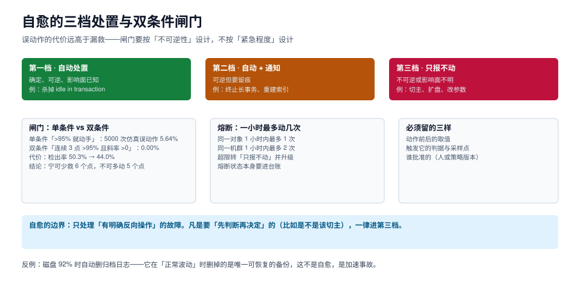

# 自愈止损：双条件闸门与三档处置

自愈是这套东西里最容易过度设计的一环。写一个「磁盘超过 90% 就删最旧的归档」的脚本只要十分钟，而它可能在某个凌晨把唯一还能恢复的备份删掉——那不是自愈，是加速事故。

这一页给一条准入标准（**有没有明确的反向操作**）、一个闸门（双条件）、一层熔断（一小时最多动几次），以及一份「哪些动作永远不许自动做」的清单。



本页判据族 `SLF-A` ~ `SLF-H`，共 8 条。定义表见文末「本页判据」一节。

## 一、三档处置：按「不可逆性」分，不按「紧急程度」分

| 档位 | 准入条件 | 例子 | 通知 |
| --- | --- | --- | --- |
| **第一档 · 自动处置** | 确定、可逆、影响面已知 | 终止空闲事务（超过阈值的 `idle in transaction`）；清理自己产生的临时文件 | 事后汇总 |
| **第二档 · 自动 + 通知** | 可逆但要留痕 | 终止长查询；重建失效索引；清理过期的复制槽 | 动作同时发 |
| **第三档 · 只报不动** | 不可逆，或影响面不明 | 切主、扩盘、改参数、删归档、批量 kill | 立即告警，等人 |

::: danger 为什么「紧急」不能作为分档依据
「磁盘快满了，很急」是一个**状态描述**，不是一个**动作结论**。同一条「磁盘 92%」可以导出四个动作：删归档（不可逆）、扩盘（不可逆且要钱）、调保留期（改配置）、只报警（安全）。

按紧急程度分档，会把这四个动作并列成「都很急，都可以自动做」；按不可逆性分档，只有「只报警」自动执行，其余三个等人——而 92% 到 100% 通常还有几小时，够人做决定。
:::

### 1.1 可逆性分级表

| 动作 | 反向操作 | 档位 | 备注 |
| --- | --- | --- | --- |
| 终止空闲事务 | 无需（事务本来就没在干活） | 一 | 业务会收到连接中断，需应用侧重试 |
| 终止长查询 | 重跑查询 | 二 | 要避开批量窗口 |
| 重建索引（`REINDEX CONCURRENTLY`） | 无（重建本身不改数据） | 二 | 有额外 IO 峰值 |
| 清理非活跃复制槽 | 重建槽（但 WAL 已丢） | 三 | **不可逆**：重建后从库要全量重同步 |
| 删归档 WAL | 从备份恢复（若有） | 三 | 唯一副本被删即不可恢复 |
| 切主 | 切回（但已产生分歧写入） | 三 | 影响面取决于拓扑 |
| 扩盘 | 缩容（通常不允许） | 三 | 花钱 + 不可逆 |
| 改参数 | 改回（重启类参数要再重启） | 三 | 生效时机不确定 |

**「反向操作」这一列是空白的，就不许自动做。** 这条判据比任何阈值都可靠。

## 二、双条件闸门：5.64% 与 0.00%

5000 次仿真（真实故障发生率 50%；常态下指标有偶发尖峰，均值 88、σ=3；故障后指标持续在 96 附近、σ=1）：

| 触发条件 | 误动作率 | 检出率 |
| --- | --- | --- |
| 单条件：任一采样 > 95 | **5.64%** | 50.3% |
| 双条件：连续 3 点 > 95 **且** 斜率 > 0 | **0.00%** | 44.0% |

两个读数：

1. **单条件每 18 次就会多动一次**。在 30 台机群、每天 288 个采样点的规模下，这意味着每天都有几次误动作。
2. **双条件把误动作打到 0，代价是检出率少 6.3 个百分点**。这 6.3% 是「故障刚发生、还没形成趋势」的那一段——它没有被漏掉，只是**晚 2~3 个采样点**才被检出，而 2~3 个采样点（按 1 分钟一次）是 2~3 分钟。

对数据库来说，晚 3 分钟动手通常没关系（磁盘不会 3 分钟满），但早 3 分钟误动一次，代价可能是一次没必要的连接中断。

### 2.1 双条件的两个分量各自防什么

| 分量 | 防的问题 |
| --- | --- |
| **连续 3 点超阈** | 防单点尖峰（一次大批量导入会让连接数瞬间冲高） |
| **斜率 > 0** | 防「高位平台」（指标长期在 96 附近就是它的正常值） |

少任何一个都会退化：只有「连续 3 点」，在高位平台上会一直触发；只有「斜率 > 0」，在缓慢上升的正常增长上会误判。

## 三、熔断：一小时最多动几次

闸门解决「该不该动」，熔断解决「动了几次之后必须停」。

| 维度 | 限制 | 超限动作 |
| --- | --- | --- |
| 同一对象 | 1 小时内最多 1 次 | 转第三档，发告警 |
| 同一机群 | 1 小时内最多 2 次 | 转第三档，升级到值班主管 |
| 同一天同一判据 | 最多 3 次 | 判据本身进「待治理」清单 |

最后一行是治理入口：**如果一条自愈规则一天触发了 3 次，说明判据或阈值有问题，不是系统有问题**。把它挡在熔断上，比让它每天救 3 次更有价值——因为第 3 次之后，通常第 4 次就是误动作。

```text
熔断状态本身也要进台账：
  (rule_id, object, window_start, action_count, last_action_at, circuit_state)
circuit_state ∈ {closed, open, half_open}
```

`half_open` 这个态在运维里常被省略，但它对应一个真实场景：熔断打开后，隔一小时放行一次试探，成功则关闭，失败则继续打开。没有它，熔断就只能靠人手动复位。

## 四、误动作的三个来源

| 来源 | 表现 | 处置 |
| --- | --- | --- |
| **单点尖峰** | 一次性大批量导入 | 连续 N 点确认 |
| **周期高位** | 每天备份窗口都「超标」 | 分时段阈值，或窗口内不判 |
| **采集故障** | 采集超时 → 指标为 0 → 判成「服务挂了」 | 采集失败单独一态，**不触发任何动作** |

第三条最危险：**采集失败被当成「指标异常」时，自愈会去「修复」一个根本没坏的系统**。所以自愈的第一道判断永远是「这个读数是采到的，还是没采到」。

```python
# 闸门 + 熔断 + 三档的最小实现
def decide(samples, rule, ledger):
    if any(s is None for s in samples[-3:]):
        return "unknown", "采集缺失，不动作"        # 采集故障不触发
    if ledger.count(rule.id, window="1h") >= rule.max_per_hour:
        return "escalate", "熔断打开，转第三档"
    if not all(s > rule.threshold for s in samples[-3:]):
        return "none", "未连续超阈"
    if samples[-1] - samples[-3] <= 0:
        return "none", "无上升趋势，视为高位平台"
    if rule.reversible and rule.blast_radius == "known":
        return "auto", "第一档：自动处置"
    if rule.reversible:
        return "auto_notify", "第二档：自动并通知"
    return "alert_only", "第三档：只报不动"
```

这段代码的顺序就是纪律：**先判采集、再判熔断、再判闸门、最后才判可逆性**。顺序错了，就会出现「采不到数据 → 触发自愈」这类最荒谬的事故。

## 五、一个完整的自愈闭环

以「终止超过 30 分钟的 `idle in transaction`」为例，五步缺一不可：

```sql
-- ① 判定：找出目标会话（只读，不改）
select pid, usename, application_name, state,
       extract(epoch from now() - state_change) as idle_s
from pg_stat_activity
where state = 'idle in transaction'
  and now() - state_change > interval '30 minutes'
order by idle_s desc;

-- ② 动作前留痕
insert into ops_heal_log (rule_id, pid, usename, idle_s, action, decided_at)
values ('slf-idle-xact', 12345, 'app', 2100, 'terminate', now());

-- ③ 执行（PG 14 起可带 timeout，等待 grace 后终止）
select pg_terminate_backend(12345, 5000);

-- ④ 复核：会话是否真的没了
select count(*) from pg_stat_activity where pid = 12345;

-- ⑤ 回执：结果写回（成功/失败/已自行结束）
update ops_heal_log set result = 'terminated', verified_at = now()
where rule_id = 'slf-idle-xact' and pid = 12345 and result is null;
```

第 ④ 步不能省。`pg_terminate_backend` 返回 `true` 只表示「信号发出去了」，会话可能因为 `wait_event` 卡在不可中断状态而仍然存活。

### 5.1 这个动作为什么是第一档

- **确定**：`idle in transaction` 超过 30 分钟，一定是应用没提交也没回滚，没有正常业务会这样；
- **可逆**：终止一个空闲事务不丢已提交数据，应用侧重连即可；
- **影响面已知**：只影响那一个连接。

三条都满足才进第一档。少一条，就该降档。

## 六、四个永远不该自动做的动作

| 动作 | 为什么不能自动 |
| --- | --- |
| 删归档 / 删备份 | 它是「最后的恢复手段」，删掉不可逆；而磁盘满通常还有几小时缓冲 |
| 切主 | 切换会改变写入方向，旧主上未同步的数据会成为分歧；处置顺序（先降级读、再切）需要人判断 |
| 扩盘 / 改规格 | 涉及成本与云厂商配额，且通常不可逆 |
| 批量 kill 会话 | 一次杀几十个连接会把应用打崩，比让它慢更有害 |

这四条的共同点不是「危险」，而是**「做错了没有回头路」**。凡是没有回头路的动作，自动化的收益都必须用「人能及时赶到」来换——而人能赶到的前提，正是自愈没有把告警通道淹没。

## 本页判据

| 编号 | 判据 | 看什么现象 | 不满足时改哪里 |
| --- | --- | --- | --- |
| `SLF-A` | 按可逆性分档 | 每个自动动作都写了「反向操作」 | 反向操作为空的降到第三档 |
| `SLF-B` | 双条件触发 | 触发需要「连续 N 点 + 趋势」 | 加趋势分量，防高位平台误判 |
| `SLF-C` | 采集失败不动作 | 缺失值走 `unknown` 分支 | 先判 `null`，再判阈值 |
| `SLF-D` | 有熔断 | 同一对象 1 小时最多 1 次 | 加计数窗口与 `circuit_state` |
| `SLF-E` | 动作前留痕 | 先写日志再执行 | 调整代码顺序，日志先行 |
| `SLF-F` | 动作后复核 | 复核动作真的生效（不只是返回值） | 补一次读回，见 `pg_terminate_backend` 的例子 |
| `SLF-G` | 不可逆动作不自动 | 自动清单里没有删备份、切主、扩盘、批量 kill | 移到第三档 |
| `SLF-H` | 高频触发要治理 | 一条规则一天触发 > 3 次要进治理清单 | 统计触发次数，修判据而不是加白名单 |

## 参考资料

- PostgreSQL 18 · `pg_terminate_backend` 与 `pg_cancel_backend`：<https://www.postgresql.org/docs/18/functions-admin.html>
- PostgreSQL 18 · `pg_stat_activity` 的 `state` 与 `state_change`：<https://www.postgresql.org/docs/18/monitoring-stats.html>
- Google SRE Book · 自动化与「人在回路」：<https://sre.google/sre-book/automation-at-google/>
- 相邻专题：[巡检口径](../Inspection/index.md)、[故障应急体系](../../IncidentResponse/index.md)、[混沌工程](../../ChaosEngineering/index.md)
