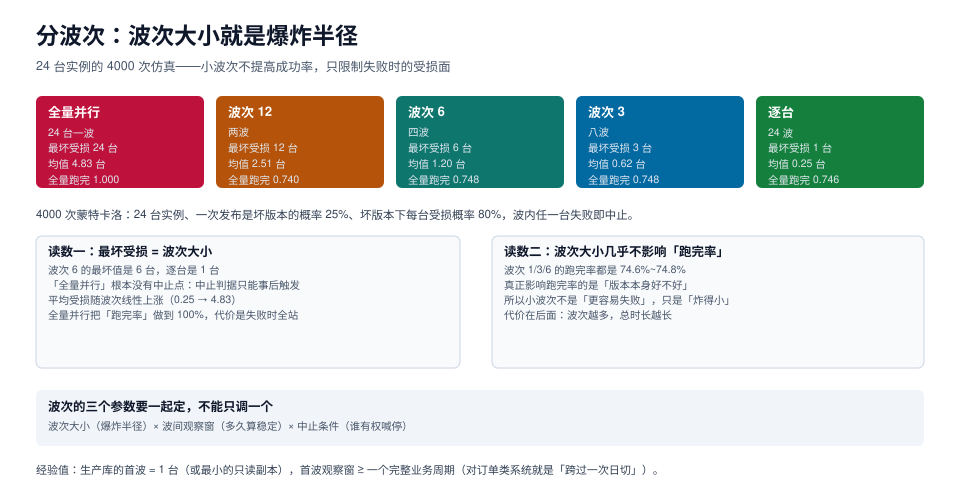

# 分波次：波次大小就是爆炸半径

发布出事时，团队最先问的两个问题是「影响多少台」和「能不能停」。这两个问题的答案其实是同一个数：**波次大小**。24 台一波，就是 24 台一起承担同一个版本的风险；逐台推，最坏也只有一台。

但波次不是越小越好——波次越小，总时长越长，而时长本身也是一种风险（长时间处于「半新半旧」状态）。这一页把波次、观察窗、中止条件三个参数放在一起算账。



本页判据族 `WAV-A` ~ `WAV-H`，共 8 条。定义表见文末「本页判据」一节。

## 一、全量并行的根本问题：没有中止点

「中止」这个动作要在**还有东西可以中止**的时候才有意义。24 台同时下发时：

```text
t=0     24 台同时收到变更指令
t=3s    第 1 台报错
t=3s    另外 23 台已经在执行——中止只能阻止「还没开始的」，而它们都开始了
```

所以全量并行的中止，实际效果是「事后止损」而不是「事中止损」。仿真里这一条表现得很直接：全量并行的「跑完率」是 **100%**——不是因为它更可靠，而是因为**它没有检查点在检查**。

## 二、4000 次仿真的读数

模型：24 台实例；一次发布是坏版本的概率 25%；坏版本下每台受损概率 80%；**波内任一台失败即中止后续波**。

| 策略 | 最坏受损 | 平均受损 | 全量跑完率 | 平均改动台数 |
| --- | --- | --- | --- | --- |
| 全量并行（24 台一波） | **24 台** | 4.83 台 | 100% | 24.0 |
| 波次 12（两波） | 12 台 | 2.51 台 | 74.0% | 20.9 |
| 波次 6（四波） | 6 台 | 1.20 台 | 74.8% | 19.5 |
| 波次 3（八波） | 3 台 | 0.62 台 | 74.8% | 18.7 |
| 逐台（24 波） | **1 台** | 0.25 台 | 74.6% | 18.2 |

### 2.1 三条结论

**结论一：最坏受损 = 波次大小，这是恒等式。** 不是统计规律，不需要仿真——只要「批内并行、批间串行、批内失败即停」，最坏情况就是一批全坏。所以「我们最坏能接受几台」这个问题，直接翻译成「波次设成几」。

**结论二：小波次不降低成功率。** 波次 1/3/6 的跑完率都是 74.6%~74.8%，差别在噪声内。决定成功率的是「版本本身有没有问题」，波次只决定「炸多大」。所以「小步走更容易失败」是错觉。

**结论三：小波次的代价是总时长。**

## 三、总时长账：波次越小，窗口越长

设每台执行 3 秒、每波后观察 5 分钟（观察窗要足够长，见下一节）：

| 波次 | 波数 | 执行耗时 | 观察耗时 | 总时长 |
| --- | --- | --- | --- | --- |
| 24（全量） | 1 | 72 s | 300 s | **6.2 min** |
| 12 | 2 | 72 s | 600 s | 11.2 min |
| 6 | 4 | 72 s | 1200 s | 21.2 min |
| 3 | 8 | 72 s | 2400 s | 41.2 min |
| 1（逐台） | 24 | 72 s | 7200 s | **121.2 min** |

算式是 `ceil(N/k) × (k × t_exec + t_observe)`。注意观察窗是**按波次累加**的，它才是大头——逐台的 121 分钟里，120 分钟都在等观察窗。

::: tip 波次大小的实用取法
先定「最坏能接受几台」（这是业务问题，不是技术问题），再反推波次；然后用总时长去校验窗口够不够。如果算出来窗口不够，正确做法是**缩小观察窗 + 增加自动化判定**，而不是放大波次——放大波次是在用「更坏的最坏情况」换时间。
:::

## 四、观察窗：多久才算「稳定」

观察窗太短，问题会在下一波开始后才暴露；太长，窗口不够用。三个可用的判定：

| 判据 | 适用 | 缺点 |
| --- | --- | --- |
| **固定时长**（如 5 min） | 简单、可预测 | 与业务周期无关，可能错过日切 |
| **跨过一次业务峰值** | 订单类系统 | 窗口可能很长（一天一次） |
| **关键指标回到基线带**（如 p99 ≤ 基线 × 1.2） | 最准 | 需要基线，且基线本身要可信 |

工程上通常组合使用：**固定时长兜底 + 关键指标判定提前结束**。即「至少 5 分钟，且 p99 回到基线带才继续；最多等 30 分钟，超时按失败处理」。

::: danger 观察窗的两个常见错误

1. **用平均值判定**。平均值对「少量请求变慢」几乎不敏感，而发布事故的早期形态正是「少量请求变慢」。用 p99 或错误率，不用均值。
2. **观察窗内不记录基线**。没有变更前的基线，就看不出「现在这个 p99 是好还是坏」。基线要在首波之前采，且采够一个完整周期。

:::

## 五、波次怎么切：三个维度

同样的波次大小，切法不同，爆炸半径的实际影响也不同。

### 5.1 按拓扑切：先副本，后主库

```text
第 1 波：只读副本 1 台（流量最小）
第 2 波：其余只读副本（每次 1/3）
第 3 波：主库（单独一波，且必须在业务低峰）
```

主库必须单独成波，理由是它的失败代价与副本不同：副本挂了只影响读，主库挂了会触发切换，而切换本身是另一个风险事件。

### 5.2 按业务切：先低峰集群，后高峰集群

多集群场景下，「同一时刻只动一个集群」比「每个集群里动一台」更安全——因为前者把「跨集群的共性故障」隔离了。

### 5.3 按依赖切：先被依赖的，后被依赖的

如果变更涉及「参数 + 扩展」两件事，扩展必须先装（`shared_preload_libraries` 需要重启），参数后调。顺序错了，参数会在「扩展还没生效」的窗口里被验证，得到假的通过。

## 六、中止条件：谁判、判什么、判完做什么

中止条件要写成机器可判定的形式，不能是「情况不对就停」。

| 要素 | 差的写法 | 好的写法 |
| --- | --- | --- |
| 判据 | 「出现异常就停」 | 「本波内失败台数 ≥ 1，或 p99 > 基线 × 1.5 持续 3 分钟」 |
| 判定者 | 「值班判断」 | 脚本判定 + 人可覆盖（人只能「提前停」，不能「继续跑」） |
| 终止动作 | 「回滚」 | 「停止后续波；已改的台保持现状；进入复核并输出半截报告」 |
| 恢复前提 | 「修好再继续」 | 「连续两波复核一致，且指标回到基线带」 |

第四行最容易被忽略：**中止之后怎么恢复，要和中止条件一起定义**。否则中止就变成了「卡住」，而卡住的系统最后一定会被人用「全部回滚」草率处理。

```yaml
# 波次策略的声明式写法（与具体工具无关）
waves:
  - name: canary
    size: 1
    target: role=replica
    observe: {min: 5m, max: 30m, metric: p99, tolerance: 1.2}
    abort_if: ["failed_in_wave >= 1", "p99_ratio > 1.5 for 3m"]
  - name: replicas
    size: 3
    target: role=replica
    observe: {min: 5m, max: 30m, metric: p99, tolerance: 1.2}
    abort_if: ["failed_in_wave >= 1", "p99_ratio > 1.5 for 3m"]
  - name: primary
    size: 1
    target: role=primary
    require: business_offpeak
    observe: {min: 15m, max: 60m, metric: p99, tolerance: 1.2}
    abort_if: ["failed_in_wave >= 1", "replication_lag > 10s"]
```

注意最后一个 `abort_if`：主库波次额外加了复制延迟。**中止条件是「本波特有的风险」的集合**，不是全篇复制粘贴同一套。

## 七、半截状态：中止之后系统长什么样

中止时一定处于「部分已改」状态。这个状态必须能被描述，否则没人敢继续：

| 状态 | 描述 | 可接受性 |
| --- | --- | --- |
| 参数已改、已生效（新值） | 该台行为与旧版本不同 | 通常可接受，参数类变更多为向后兼容 |
| 参数已改、待重启 | 已写配置但未生效 | 可接受，但要登记 `pending_restart` |
| 结构已改（加列） | 新旧代码都能读 | 可接受（扩展-收缩模式的前提） |
| 结构已改（删列） | 旧代码会报错 | **不可接受**，删列必须放在收缩阶段最后 |

最后一行解释了为什么结构变更要分「扩展」「收缩」两个阶段：**只有扩展阶段的半截状态是可接受的**。

## 本页判据

| 编号 | 判据 | 看什么现象 | 不满足时改哪里 |
| --- | --- | --- | --- |
| `WAV-A` | 有显式波次 | 发布计划里写了每波的台数与目标 | 把「全量」拆成至少两波 |
| `WAV-B` | 最坏受损已知 | 能说出「这次最坏会影响几台」 | 最坏值 = 最大波次，写进发布单 |
| `WAV-C` | 波内有失败即停 | 中止条件能在批内判定，不等全量跑完 | 改 runner：失败 `break`，不继续下一台 |
| `WAV-D` | 观察窗有下限和上限 | 有 `min` 与 `max`，不是「看情况」 | 补两个值，`min` 至少覆盖一次业务峰值 |
| `WAV-E` | 用分位不用均值 | 观察指标是 p99 或错误率 | 换指标，均值对早期劣化不敏感 |
| `WAV-F` | 主库单独成波 | 主库不与副本同波 | 拆出主库波，并加 `business_offpeak` 前置 |
| `WAV-G` | 中止后能恢复 | 有「半截状态」描述与恢复前提 | 补半截报告与「连续两波一致」的恢复条件 |
| `WAV-H` | 波次与窗口匹配 | 算出的总时长在可用窗口内 | 缩观察窗或加自动化判定，别放大波次 |

## 参考资料

- Google SRE Workbook · Canarying Releases：<https://sre.google/workbook/canarying-releases/>
- PostgreSQL 18 · 复制与延迟监控：<https://www.postgresql.org/docs/18/monitoring-stats.html>
- Ansible · 串行与批次执行（`serial` / `max_fail_percentage`）：<https://docs.ansible.com/ansible/latest/playbook_guide/playbooks_delegation.html>
- 相邻专题：[作业模型](../JobModel/index.md)、[变更管理与发布工程](../../ChangeManagement/index.md)、[作业彩排](../Drills/index.md)
