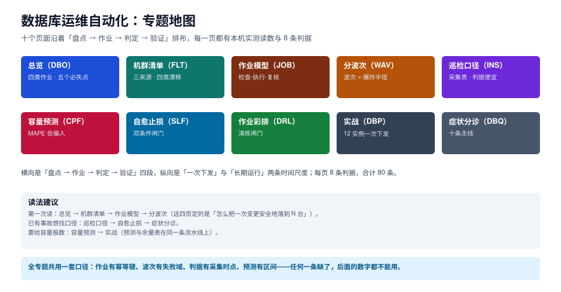

# 数据库运维自动化

当机群里只有三台库时，运维是「登录上去看看」；到了三十台、三个版本、两套主从拓扑时，运维就变成了**一件必须被编排、被记录、被复算的工程**：哪几台和清单不一致、这次变更按什么顺序落、落到一半失败停在哪、明天早上磁盘还够几天。

本专题面向要把「一堆库」管成「一套系统」的人：不回答 Ansible 的模块怎么调（那是[Ansible 自动化运维](../Ansible/index.md)的事），也不回答变更该谁审批（那是[变更管理](../ChangeManagement/index.md)的事），而是回答**台账怎么建、作业怎么写才敢重跑、波次怎么切才炸得小、判据怎么定才不天天误报、容量怎么算才敢报数、自愈到什么程度就该停手**。

::: tip 一句话理解
数据库运维自动化不是「把手工命令写成脚本」，而是**让每一次改动都有期望值、有幂等键、有爆炸半径、有回执**——四样缺一样，自动化就只是把事故做得更快。
:::

::: info 本专题与相邻专题的分工
- **Ansible / Terraform 的工具用法** → [Ansible 自动化运维](../Ansible/index.md)、[Terraform](../Terraform/index.md)：那里讲 inventory 文件怎么写、playbook 怎么组织、模块参数怎么填；本专题从「谁写清单、什么算一致、作业怎么验收」接手，工具只作为载体出现。
- **变更流程与审批** → [变更管理与发布工程](../ChangeManagement/index.md)：分级、窗口、冻结期、审批留痕归那边；本专题只处理「流程批完之后，怎么把它安全地落到 N 台」。
- **容器与编排** → [Kubernetes](../Kubernetes/index.md)、[容器编排进阶](../ContainerOrchestration/index.md)：Operator 怎么把「期望状态」做成控制器属于平台侧，本专题讲的是「没有 Operator 的存量机群怎么办」。
- **备份与容灾** → [备份与容灾](../BackupDR/index.md)：备份策略与恢复目标归那边；本专题只把「备份是否成功」当成一条巡检判据。
- **监控与告警** → [监控告警](../Monitoring/index.md)、[可观测性深入](../Observability/index.md)：指标怎么采、告警怎么路由归那边；本专题处理「巡检判据的口径」与「采集成本」。
- **故障应急** → [故障应急体系](../IncidentResponse/index.md)：定级、指挥、止损顺序归那边；本专题的[自愈](SelfHealing/index.md)只讨论「机器在没有人介入时，允许自动做什么」。
- **混沌工程与演练日** → [混沌工程](../ChaosEngineering/index.md)：面向系统的故障注入实验归那边；本专题的[作业彩排](Drills/index.md)面向「一次具体变更的中止条件」。
- **参数该给多少** → [数据库参数与内核调优](../../DB/ParameterTuning/index.md)：调参单、预算算式、压测口径在那边；本专题把参数当成「要被下发的对象」，不重新论证取值。
- **改表与回填** → [在线 Schema 演进](../../DB/SchemaEvolution/index.md)：DDL 的锁与重写归那边；本专题处理「这条 DDL 怎么在 12 台上按顺序执行完」。
- **大版本升级** → [数据库大版本升级与切换](../DatabaseUpgrade/index.md)：升级路径、停写窗口、切换动作在那边；本专题只把「版本漂移」当成一类清单差异。
- **项目侧的一次真实下发** → [EventOrderHub 上线验收](../../../project/Complete/EventOrderHub/LaunchAcceptance/index.md)：项目页给出验收清单，本专题给出这些清单项背后的作业与判据。
:::

## 目录

- [总览：四类作业、三层机群与五个必失点](Overview/index.md)
- [机群清单：三来源、四类漂移与对账](Inventory/index.md)
- [作业模型：检查、执行、复核三段式](JobModel/index.md)
- [分波次：波次大小就是爆炸半径](Waves/index.md)
- [巡检口径：采集贵、判据便宜](Inspection/index.md)
- [容量预测：MAPE 会骗人](CapacityForecast/index.md)
- [自愈止损：双条件闸门与三档处置](SelfHealing/index.md)
- [作业彩排：把中止条件演练出来](Drills/index.md)
- [实战：12 台实例的一次参数下发](Practice/index.md)
- [常见问题与症状分诊](FAQ/index.md)

## 专题地图

## 判据纪律

沿用全库写法：**每页 8 条，编号形如 `DBO-A`**，逐页前缀唯一，可被 `utils/audit` 下的判据类巡检机械核对。每条判据回答三件事：**看什么现象、判成什么、不满足时改哪里**。

| 页 | 判据族 | 这一族管什么 | 条数 |
| --- | --- | --- | --- |
| 总览 | `DBO-A` ~ `DBO-H` | 四类作业、三层模型、必失点 | 8 |
| 机群清单 | `FLT-A` ~ `FLT-H` | 三来源、四类漂移、对账口径 | 8 |
| 作业模型 | `JOB-A` ~ `JOB-H` | 三段式、幂等键、失败分类 | 8 |
| 分波次 | `WAV-A` ~ `WAV-H` | 波次大小、观察窗、中止条件 | 8 |
| 巡检口径 | `INS-A` ~ `INS-H` | 采集时点、判据四型、误报 | 8 |
| 容量预测 | `CPF-A` ~ `CPF-H` | 拟合方法、误差、采购前置期 | 8 |
| 自愈止损 | `SLF-A` ~ `SLF-H` | 三档处置、双条件、熔断 | 8 |
| 作业彩排 | `DRL-A` ~ `DRL-H` | 失败模式、影子环境、闸门 | 8 |
| 实战 | `DBP-A` ~ `DBP-H` | 对账、渲染、分波、收口 | 8 |
| 常见问题 | `DBQ-A` ~ `DBQ-H` | 症状分诊、误判、错误建议 | 8 |

合计 **10 族 80 条**。

## 事实与版本速览

下表只放**会影响判据**的事实，全部在 **2026-10-23** 本机核对或实测（PostgreSQL 18.6 容器 + MySQL 8.4.11 容器 + Python 3.13.12 标准库）；核对不到的一律标注来源，不抄二手文章。

| 事实 | 口径（本次核对） |
| --- | --- |
| 参数现值的唯一可信来源 | PostgreSQL 读 `pg_settings.setting`（不是 `postgresql.conf` 里的字面值）；MySQL 读 `performance_schema.variables_info`，它能同时给出 `VARIABLE_SOURCE`（`COMMAND_LINE` / `PERSISTED` / `GLOBAL`）与 `SET_TIME` |
| `pending_restart` 是「改了但还没生效」的机器可读信号 | 只有 `postmaster` 级参数会置真，例如 `shared_buffers`、`max_connections`；会话级参数改完立刻可见 |
| `lock_timeout` 默认 0 | 等于「永不超时」，改表的 DDL 会无限等锁；`lock_wait_timeout`（MySQL）默认 **31,536,000 秒**，等于一年 |
| `ALTER SYSTEM` 与 `SET` 的作用域不同 | `ALTER SYSTEM` 写 `postgresql.auto.conf` 且要 `pg_reload_conf()`；`SET` 只影响当前会话，连接池归还后可能污染下一个请求 |
| autovacuum 触发阈值 = `50 + 0.2 × 行数` | 10 万行表要 20,050 个死元组才触发，1000 万行表要 2,000,050 个——大表基本等于「永不自动触发」 |
| 采集成本远大于判据计算 | 30 台 × 3 指标一轮采集 **5.84 ms**，360 个点的判据计算 **0.0048 ms**，采集占 **99.92%** |
| 作业重跑的实际代价 | 12 台 × 3 参数：直写版每次改 **36 行**，检查版第 2 次起改 **0 行**，耗时只多 **6%**（8.577 → 9.095 ms） |
| 波次决定最坏受损面 | 24 台仿真的最坏受损 = 波次大小（1 / 3 / 6 / 12 / 24 台），平均受损 0.25 / 0.62 / 1.20 / 2.51 / 4.83 台 |
| 「预测准」和「什么时候买盘」是两个指标 | 同一序列上线性拟合 MAPE **2.03%**、Holt **2.86%**（差 1.4 倍），但「还有几天到阈值」的误差是 **4.7%** 与 **64.9%**（差 14 倍） |
| 双条件闸门把误动作打到 0 | 5000 次仿真：单条件误动作 **5.64%**、检出 50.3%；双条件误动作 **0.00%**、检出 44.0% |

::: warning 关于版本目录：本专题不建 `PG17/` `PG18/` 这类目录
三条理由，写在这里以免后来者以为是漏了：

1. **本专题的对象是「作业」，不是「产品」**。同一套「检查-执行-复核 + 分波次」在 PostgreSQL 15/16/17/18 与 MySQL 8.0/8.4 上都成立，变的只是几个命令名与参数默认值——这类差异用行内标注（「PG 18 起 `io_method` 才有」）比开工两个目录便宜得多。
2. **版本并存的性质不同**。`Spring5/Spring6` 是两套**不兼容的工程契约**（注解、依赖注入容器、构建插件全变），而 `pg_settings` 的读取方式从 PG 9.x 到 18 没变过；把稳定的东西按版本切碎，只会让 90% 的正文在两处重复维护。
3. **已有的版本差异已各有归属**：参数取值归[数据库参数与内核调优](../../DB/ParameterTuning/index.md)、大版本升级路径归[数据库大版本升级与切换](../DatabaseUpgrade/index.md)、产品层不兼容（Nacos 2.x/3.x 那种 v1 全部 404）才建目录。

**不建版本目录 ≠ 不标版本**：本专题每一处涉及版本差异的地方都在正文里行内标注，旧版本的写法保留在页内、不删除也不覆盖，例如「`pg_stat_statements` 在 PG 13 之前要手工建扩展」「`pg_terminate_backend` 的 `timeout` 参数 PG 14 起才有」。这条约定与[配置管理](../../Ops/ConfigManagement/index.md)的 `Nacos2/`+`Nacos3/` 双目录做法**不冲突**——那是产品契约断代，这是同一契约下的默认值演进。
:::

## 三条底线

::: danger 三条不可让步的底线

1. **没有幂等键的作业不许上生产**。判据很简单：同一条作业连跑两次，第二次的「变更行数」必须是 0。做不到这一点，任何失败重试都在制造偏差，而不是修复。
2. **没有中止条件的发布不许排窗口**。中止条件必须能在**波次内部**判定，而不是等全量跑完再回看——全量并行时「中止」这个动作在物理上不存在。
3. **不可逆的动作不许进自愈**。删归档、切主、扩盘、改参数，一律「只报不动」。自愈的准入标准是「有明确反向操作」，不是「看起来很急」。

:::

三条底线的共同点：**它们保护的都是「第二次执行」**。第一次执行出问题，人还能兜住；第二次、第三次执行出问题，通常已经没人盯着了。
