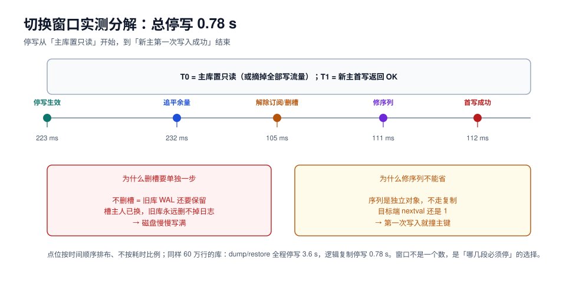

# 切换窗口与回滚：0.78 秒里做了什么

切换是整场升级唯一必须停写的部分。它的目标不是「快」，而是**顺序正确、每步可验、随时能停**——快只是做对之后的副产品。

本页把切换拆成六个动作，给出实测耗时分解、四个顺序陷阱、以及一张「走到哪一步就不能回头」的表。



## 一、六个动作，顺序不能变

| # | 动作 | 目的 | 实测耗时 | 做错的后果 |
| --- | --- | --- | --- | --- |
| 1 | 停写 | 让源库不再产生新事务 | 223 ms（含 reload） | 漏掉最后一批事务 |
| 2 | 确认追平 | 目标端 `received_lsn` = 源端 `pg_current_wal_lsn()` | 232 ms | 带着延迟切换 |
| 3 | 解除订阅、删槽 | 断开复制、释放源库 WAL 保留 | 105 ms | 旧库磁盘被 WAL 写满 |
| 4 | 修序列 | 每个序列 `setval(max+1)` | 111 ms | 第一次写入撞主键 |
| 5 | 切连接串、放开写 | 应用连到新库 | 112 ms（首写） | 双写 / 全站 500 |
| 6 | 验证 | 四道闸门 | 见 [验证](../Verify/index.md) | 带病上线 |

合计 **0.78 s**（60 万行库）。注意这个数字里**不含**验证与观察——那两段业务已经恢复，只是团队还在岗。

## 二、停写怎么实现，代价差很多

| 手段 | 生效速度 | 影响面 | 备注 |
| --- | --- | --- | --- |
| 应用侧摘掉写流量（网关/开关） | 秒级 | 精确，只影响写 | 最推荐；要求应用有写开关 |
| 源库置只读（`default_transaction_read_only`） | 毫秒级 | **只对新会话生效** | 存量连接仍可写 |
| `ALTER DATABASE ... SET default_transaction_read_only` | 毫秒级 | 同上 | 同上 |
| `REVOKE INSERT/UPDATE/DELETE` | 需重连 | 精确 | 权限缓存可能导致延迟生效 |
| `LOCK TABLE ... IN ACCESS EXCLUSIVE MODE` | 立即 | 粗暴，会阻塞读 | 只在兜底时用 |

::: danger `default_transaction_read_only` 拦不住已经连着的连接
本机实测的 223 ms 只覆盖了「改参数 + `pg_reload_conf()`」这一步。真实停写还要处理**存量连接**：它们在自己的会话里仍然是可写的。

正确做法是两步：

```sql
-- 1. 改默认值，阻止新会话写入
alter system set default_transaction_read_only = on;
select pg_reload_conf();

-- 2. 主动结束残留的写会话（先看清楚再杀）
select pid, usename, state, query from pg_stat_activity
where state <> 'idle' and query ilike '%insert%' or query ilike '%update%';

select pg_terminate_backend(pid) from pg_stat_activity
where state = 'active' and pid <> pg_backend_pid();
```

只做第 1 步就宣布「已停写」，是切换期丢数据的头号原因。
:::

## 三、为什么顺序不能反：四个陷阱

::: danger 四个顺序陷阱
1. **先切流量、后停写** → 应用已经连到新库，源库还在被别的路径写（定时任务、报表、另一个服务），形成**双写**，两个库同时前进，之后无法对账。
2. **先删槽、后确认追平** → 删槽那一刻起，源库的新变更**再也不会传到目标端**，而你可能还没确认最后一批已经应用。必须先看 `received_lsn` 相等，再删。
3. **修序列放在放开写之后** → 应用的第一笔写入就拿到 `id = 1`，直接撞主键。序列必须在**放开写之前**修完，且要检查每一个序列。
4. **验证放在放开写之后才想** → 验证脚本没准备、连接串没准备、回退脚本没准备，此时业务已经在写新库，「发现问题想回退」就变成了「丢数据还是丢数据」的选择题。
:::

## 四、切换前必须准备好的四样东西

| 准备物 | 内容 | 为什么必须提前 |
| --- | --- | --- |
| **切换脚本** | 上面六个动作，逐条可粘贴执行 | 窗口里没时间现写 SQL |
| **验证脚本** | 四道闸门的 SQL（行数、校验和、序列、业务不变量） | 验证要在放开写之前跑完 |
| **回退脚本** | 改回连接串 + 旧库恢复可写 | 回退窗口只有几分钟 |
| **观察清单** | 延迟、槽积压、连接数、5xx、慢查询五个面板 | 没有观测就等于蒙眼 |

脚本要**在本机演练里原样跑过一遍**（见 [演练与时间估算](../Rehearsal/index.md)），包括每一条 SQL 的输出格式。

## 五、连接串切换：三个容易漏的细节

| 细节 | 症状 | 处置 |
| --- | --- | --- |
| DNS TTL | 「切完了」但一半流量还连旧库 | 提前把 TTL 降到 30~60 s，切换后观察 ≥ 1 个 TTL |
| 连接池存量连接 | 旧连接不断、新连接进新库，出现「有的请求看不到新数据」 | 切换后**主动重启连接池**，不要等它自然过期 |
| 会话级设置 | `search_path`、`timezone`、`statement_timeout` 在新库上没生效 | 会话参数走连接串或启动参数，不靠手工 `SET` |

```shell
# 切换后确认「还有没有连在旧库上的应用连接」——这一条比看监控更快
psql -h old-db -U postgres -c "select count(*), application_name from pg_stat_activity
where backend_type = 'client backend' group by 2;"
# 期望：除了你自己的会话，应用连接数为 0
```

::: tip 切读可以分批，切写不能
读流量可以「先切 10% → 观察 → 全切」，写流量必须**一次性原子切换**。原因是：读切一半只是数据新旧不一致（可容忍几秒），写切一半就是双写（不可修复）。
:::

## 六、回滚：走到哪一步就不能回头

| 已完成动作 | 能回退吗 | 回退代价 |
| --- | --- | --- |
| 停写、未切流量 | ✅ | 放开写即可，零损失 |
| 删了槽、未切流量 | ✅ | 旧库仍完整；重建订阅要重做一次全量 |
| 切了流量、新库**尚无写入** | ✅ | 改回连接串，几乎零损失 |
| 切了流量、新库**已有写入** | ⚠️ | 要么丢这些写入，要么反向同步回旧库 |
| 旧库已被回收/降级 | ❌ | 只能从备份恢复（RTO 见演练读数） |

反过来，还有一组「不可回滚点」是**数据库自身**的：

- MySQL 8.4 原地升级：新版本第一次成功启动后，**无法再启动 8.0**；
- PostgreSQL `pg_upgrade --link`：文件已被新版本接管，旧集群起不来；
- 任何「新库已被业务写入」的时刻：回退都意味着数据取舍。

## 七、回滚决策树

```text
发现问题
├─ 还在停写区间内？
│   ├─ 是 → 直接放开旧库写（零损失），记录原因，另约窗口
│   └─ 否 → 继续
├─ 新库已有业务写入？
│   ├─ 否 → 改回连接串，旧库放开写（损失：切换期间的少量失败请求）
│   └─ 是 → 判断：这些写入能否重放？
│       ├─ 能（幂等、可补录）→ 回退 + 补录
│       └─ 不能 → 不回退，转向「在新库上修」
└─ 无论哪条分支：先降级而非停服，先保写再查原因
```

::: warning 「回退」不是默认选项
很多团队把回退当安全气囊，但升级事故里更常见的选择是**「在新库上修」**——因为回退意味着丢失切换后的写入，而这个损失往往比修 bug 更大。所以回退判据要提前写成**可观测的条件**（例如「写入错误率 > 5% 持续 5 分钟」），而不是「感觉不对」。
:::

## 八、本页判据

| 编号 | 判据 | 看什么现象 | 不满足时改哪里 |
| --- | --- | --- | --- |
| `UGT-A` | 六个动作有脚本，且演练里跑过 | 脚本文件 + 演练记录 | 补齐并演练 |
| `UGT-B` | 停写覆盖了**存量连接** | `pg_stat_activity` 里无活跃写会话 | 加 `pg_terminate_backend` 步骤 |
| `UGT-C` | 删槽在「确认追平」之后 | 操作顺序记录 | 顺序错了必改 |
| `UGT-D` | 修序列在「放开写」之前 | 顺序记录 + 序列读数 | 调顺序 |
| `UGT-E` | 切换后连接池被主动重启 | 连接池重启记录 | 不能等自然过期 |
| `UGT-F` | DNS TTL 提前降低并观察 ≥ 1 个 TTL | TTL 记录 | 提前改；切换后观察 |
| `UGT-G` | 回退判据是可观测条件 | 升级单有阈值 | 写「错误率 > x% 持续 y 分钟」 |
| `UGT-H` | 写流量一次性切换，读流量可分批 | 切换方案 | 写不允许分批 |

## 参考资料

- PostgreSQL 18 Documentation: `default_transaction_read_only`、`pg_stat_activity`、`pg_terminate_backend`
- PostgreSQL 18 Documentation: *Logical Replication*（`ALTER SUBSCRIPTION ... SET (slot_name = NONE)`）
- MySQL 8.4 Reference Manual: 复制切换（`SOURCE_AUTO_POSITION`、`super_read_only`）
- 本仓库：[多活架构的流量切换](../../MultiActive/TrafficSwitch/index.md)（切机房的三段时间，与切库的顺序约束）
