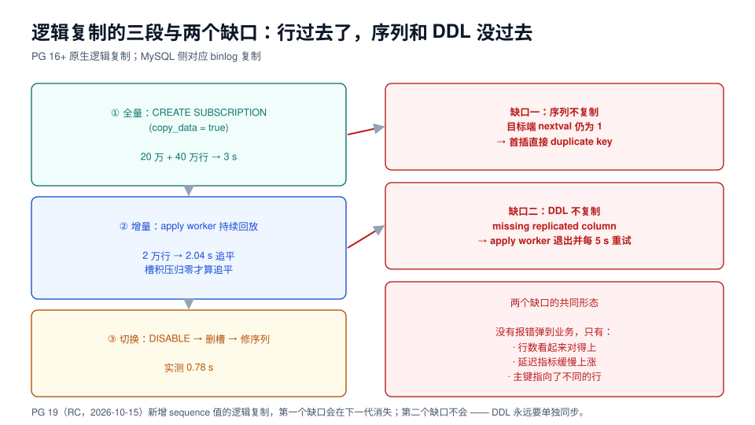

# 逻辑复制迁移：行过去了，序列没过去

逻辑复制是「秒级切换窗口」的唯一实现方式：源库继续服务，目标库持续追平，切换时只停几秒。它的代价是**只搬行**——凡是「不是行」的东西，都要单独处理。

本页把这条通道拆成三段，并用本机实测讲清两个缺口的具体形态：一个让第一次写入就撞主键，一个让复制悄悄停住。



## 一、逻辑复制到底搬什么

| 对象 | 会复制吗 | 说明 |
| --- | --- | --- |
| 表数据（INSERT / UPDATE / DELETE） | ✓ | 按行复制，需要表有主键或 `REPLICA IDENTITY` |
| 表结构（DDL） | ✗ | 目标端表结构要**自己建**，且要与源端逐列一致 |
| 序列（`nextval`） | ✗ | PG 18 及以前完全不复制（PG 19 起支持） |
| 大对象（`pg_largeobject`） | ✗ | 需要单独导出导入 |
| 权限、角色、扩展 | ✗ | 单独脚本 |
| 统计信息 | ✗ | 恢复后自己 `ANALYZE` |
| TRUNCATE | ✓（PG 11+，需显式开启） | 默认发布不包含 `truncate` |

这张表决定了迁移的完整工作量：**逻辑复制只解决了「表数据」这一行，其余七行都要另做。**

## 二、第一段：全量与初次同步

```sql
-- 源库：发布（只发需要的表，不要 FOR ALL TABLES）
create publication upg_pub for table orders, order_items;

-- 目标库：结构与源库一致（用 pg_dump --schema-only 导出后导入最稳）
-- pg_dump -s -n public shop | psql -h new -d shop

-- 目标库：订阅，copy_data = true 表示先做一次全量
create subscription upg_sub
  connection 'host=old-db port=5432 dbname=shop user=repl password=***'
  publication upg_pub
  with (copy_data = true);
```

::: danger `CREATE SUBSCRIPTION` 不能在事务块里执行
本机实测：把建订阅和别的语句拼在一条 `psql -c "..."` 里，会直接报

```text
ERROR:  CREATE SUBSCRIPTION ... WITH (create_slot = true) cannot run inside a transaction block
```

原因是它要在**源库**上创建复制槽——一个跨库的副作用操作。脚本里必须**单独一条语句、单独一个连接**执行。
:::

实测初次同步：60 万行（20 万 + 40 万）用了 **3 秒**，约 20 万行/秒。这个速度对几千万行以内的库都够用——**全量不是瓶颈，追平才是**。

::: tip 跨大版本也走同一条通道
另起一个 **17.11** 实例做同样的实验（目标端 18.6）：`copy_data = true` 后 5 行全部到达，源端再插 1 行、目标端 2 秒内变成 6 行。**跨大版本的逻辑复制是官方支持的迁移方式**，因为传的是行而不是页。

但要注意目标端表结构是**自己建的**——这次实验里手工建表时没写 `bigserial`，于是目标端连 `x1_id_seq` 这个对象都不存在，`select last_value from x1_id_seq` 直接报 `relation does not exist`。这正是下一节要讲的缺口：**序列不是「值没同步」，而是「对象没同步」**。
:::

## 三、第二段：追平，以及「追平」到底是什么意思

源库持续写入 2 万行，目标端从落后到追平用了 **2.04 秒**（含 0.5 s 轮询开销），复制槽积压归零。

「追平」有三个层次，验收时必须说清是哪一层：

| 层次 | 判据 | 是否足够 |
| --- | --- | --- |
| 行数相等 | `count(*)` 两边一致 | ❌ 下面会看到反例 |
| 延迟归零 | 槽积压 `pg_wal_lsn_diff(...) = 0` | ⚠️ 只能说明「发出来的都应用了」 |
| 位置一致 | `pg_stat_subscription.received_lsn` 与源库 `pg_current_wal_lsn()` 相等 | ✅ 切换前的最低要求 |

```sql
-- 目标端：订阅状态（pid 为 NULL = apply worker 没在跑）
select subname, pid, received_lsn, latest_end_lsn
from pg_stat_subscription;

-- 源端：槽积压字节（> 0 就是在追，长期不降就是断了）
select slot_name, active,
       pg_wal_lsn_diff(pg_current_wal_lsn(), confirmed_flush_lsn)::bigint as lag_bytes
from pg_replication_slots;
```

## 四、缺口一：序列不复制

这是最致命、也最好修的一个。目标端把 60 万行都收下了，但**序列对象是自己建的**，`nextval` 还是 1：

```sql
-- 目标端：同步完成后，序列根本没动
select last_value, is_called from orders_id_seq;
-- 1 | f          ← 而表里已经有 220000 行

-- 目标端：第一次写入
insert into orders(order_no,user_id,status,amount) values ('NO900000001',1,'CREATED',1.00);
-- ERROR:  duplicate key value violates unique constraint "orders_pkey"
```

修法只有一条，但**必须在放开写之前执行，且对每一个序列都要执行**：

```sql
-- 目标端：把每个序列推到「max(id) + 1」，is_called = false 表示「下一个值就是它」
select setval('orders_id_seq', (select coalesce(max(id),0)+1 from orders), false);
-- 实测 111 ms（2 个序列）
```

::: danger 序列没修，不只是「第一次写入失败」这么简单
如果目标端在切换前**已经接受过本地写入**（例如切了一部分只读流量、或有人在目标库跑过测试数据），它会占用一些 id。之后源端复制过来的行带着**同样的 id**，会在 apply 阶段撞主键——此时错误发生在复制进程里，而不在你的应用里，形态是：

```text
ERROR:  duplicate key value violates unique constraint "orders_pkey"
LOG:    background worker "logical replication apply worker" exited with exit code 1
```

worker 退出后每 5 秒重试一次，**永远失败、永远追不上**，而且补列、补数据都救不了它——因为冲突是数据层的。唯一的处置是找出冲突行、删掉目标端的本地行、或跳过这个事务（见第七节）。
:::

## 五、缺口二：DDL 不复制

源端加一列，目标端不会跟着加。之后源端任何一条写入新列的语句，都会让复制停住。本机实测的完整形态：

```text
-- 源库
alter table orders add column coupon_code text;
insert into orders(order_no,user_id,status,amount,coupon_code) values ('NO777777777',2,'CREATED',2.00,'C10');

-- 目标库日志（apply worker 每 5 秒重试，重复报同一条）
ERROR:  logical replication target relation "public.orders" is missing replicated column: "coupon_code"
LOG:    background worker "logical replication apply worker" (PID 1239) exited with exit code 1
```

此时的观测读数非常安静：

| 观测项 | 读数 | 会告警吗 |
| --- | --- | --- |
| `pg_stat_subscription.pid` | `NULL` | 通常不告警 |
| `pg_replication_slots.active` | `false` | 通常不告警 |
| 槽积压 `lag_bytes` | 只有新写入才增长（无写入时不变） | 阈值型告警可能一直不触发 |
| 目标端 `count(*)` | 停在断链前那个数 | 没人盯这个 |

**补列之后能不能自愈？** 本机两次实验给出了两个不同答案，差别很重要：

| 场景 | 补列后 | 结论 |
| --- | --- | --- |
| 干净场景（目标端没有本地写入、没有主键冲突） | **3 秒内自动追平**（`pid` 恢复、源/目标各 3 行） | apply worker 会从同一个 LSN 重试，结构补齐即自愈 |
| 叠加了序列分叉（目标端已占用同 id） | **永远不追平** | 结构已经不是根因了，冲突在数据层 |

::: tip 断链处置的正确顺序
1. 先看日志确认**根因是结构还是数据**（`missing replicated column` vs `duplicate key`）；
2. 结构问题：在目标端补齐 DDL（只补列、不删列），等 worker 自愈；
3. 数据问题：定位冲突行，删掉目标端的本地行（或反查它是不是业务真实数据）；
4. 两种情况都**不要**在源端做「反向 DDL」来迁就目标端——那会把问题带进生产。
:::

## 六、复制槽：一个会吃磁盘的隐形账单

复制槽的作用是「记住目标端已经消费到哪」，代价是**源库从此不能删掉这段 WAL**。目标端停多久，WAL 就积多久。

| 参数 | 默认 | 该设成什么 | 为什么 |
| --- | --- | --- | --- |
| `max_slot_wal_keep_size` | `-1`（无上限） | `库体积 × 1~2` | 防止一个坏掉的槽把磁盘写满 |
| `wal_sender_timeout` | `60s` | 按网络状况调 | 太短会把慢网络误判为断连 |
| `max_replication_slots` | 10 | ≥ 现有槽 + 迁移槽 + 余量 | 不够会直接建不出来 |

```sql
-- 切完之后必须清理旧槽，否则旧库永远删不掉这段 WAL
select pg_drop_replication_slot('upg_sub');
```

::: danger 忘记删槽的两种后果
1. **旧库磁盘慢慢写满**（切换后旧库还在，槽还在，WAL 一直保留）；
2. **新库上残留 `slot_name`**：`DROP SUBSCRIPTION` 时如果源库已不可达，会报错并卡住——正确做法是先 `ALTER SUBSCRIPTION ... SET (slot_name = NONE)` 再 `DROP SUBSCRIPTION`。
:::

## 七、断链了想跳过怎么办

有时确实需要「跳过这条坏事务」继续追。PostgreSQL 提供 `pg_replication_origin_advance`，但它是**危险操作**：

```sql
-- 目标端：把复制原点推到指定 LSN，跳过中间所有变更
select pg_replication_origin_advance('pg_<subid>', '0/1A2B3C4D');
```

跳过的那些行**永远不会再到目标库**，而且没人知道跳了多少。只有在「确认这些行不重要、且已记录跳过范围」时才用，并且必须写进升级单。

## 八、本页判据

| 编号 | 判据 | 看什么现象 | 不满足时改哪里 |
| --- | --- | --- | --- |
| `UGL-A` | 发布只包含需要的表，不是 `FOR ALL TABLES` | `pg_publication_tables` | 收敛表清单，减少无关 WAL |
| `UGL-B` | 目标端表结构与源端逐列一致 | `information_schema.columns` 对比 | 用 `pg_dump -s` 建结构，禁止手写 |
| `UGL-C` | 序列在放开写之前全部 `setval` 过 | 每个序列的 `last_value` ≥ 表内 `max(id)` | 按第四节 SQL 批量执行 |
| `UGL-D` | 切换前 `pid` 非 NULL 且积压 = 0 | `pg_stat_subscription` / `pg_replication_slots` | 先查日志定位断链原因 |
| `UGL-E` | 有「复制断了」的告警，而不是靠人发现 | 监控里 `pid` 为空 / `active=false` 有告警 | 补告警；这两项默认无人看 |
| `UGL-F` | 复制期间源库禁止 DDL | 冻结点写进升级单 | 建立发布/订阅前就冻结 |
| `UGL-G` | `max_slot_wal_keep_size` 设了上限 | `show max_slot_wal_keep_size` | 按库体积设，别留 `-1` |
| `UGL-H` | 切换后旧槽已删除 | `pg_replication_slots` 为空 | `pg_drop_replication_slot` 或 `slot_name = NONE` |

## 参考资料

- PostgreSQL 18 Documentation: *Logical Replication*（publication / subscription / `copy_data` / 复制槽）
- PostgreSQL 18 Documentation: `pg_stat_subscription`、`pg_replication_slots`、`max_slot_wal_keep_size`
- PostgreSQL 19 Release Notes: *logical replication of sequence values*
- MySQL 对应能力：`binlog_format=ROW` 的复制、`CHANGE REPLICATION SOURCE TO`（8.4 起的术语）
- 本仓库：[CDC 与变更捕获](../../../DB/CDC/index.md)（把复制流用于数据集成时的建模）
