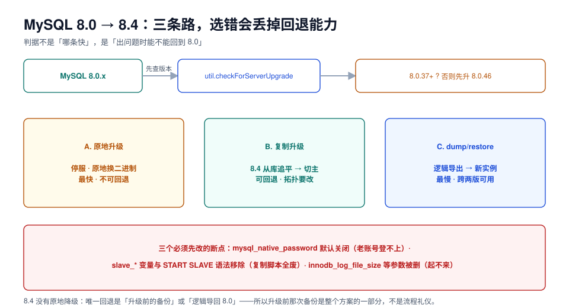

# MySQL 8.0 → 8.4：三条路与三个断点

MySQL 这一侧的特殊之处在于：**8.4 没有原地降级**。同样的停写窗口，走原地升级就没有退路，走复制升级就还有退路——这个差别比「快多少」重要得多。

本页把三条路径的前置条件、三个必改断点、以及升级后的验证项写清楚。



## 一、先做一件不花钱的事：跑官方检查器

MySQL Shell 的 `util.checkForServerUpgrade` 是唯一官方给出的「升级前体检」，它读服务器 + 配置文件，输出 error / warning / notice。

```shell
mysqlsh -- util checkForServerUpgrade root@db1:3306 \
  --target-version=8.4.11 \
  --config-path=/etc/mysql/my.cnf \
  --output-format=JSON > db1-upgrade-check.json

# 只把 error 挑出来看，先清零
jq -r '.serverVersion, (.checks[] | select(.level=="Error") | "\(.id): \(.description)")' db1-upgrade-check.json
```

它自动检查的项目里，最值得关注的是：保留字被当作标识符、被移除的函数与变量、认证插件、`utf8mb3` 使用、零日期（`0000-00-00`）、以及 `FLOAT/DOUBLE` 上的 `AUTO_INCREMENT`（**这一项会让升级直接失败**）。

::: danger error 一条都不能留
`checkForServerUpgrade` 的 error 分类意味着「升级会失败或数据会坏」。常见的三类：`utf8mb3` 列（8.4 仍可用但已废弃，部分场景要求转 `utf8mb4`）、零日期、`FLOAT` 自增。**warning 可以带着上，但要在升级单里逐条写「接受理由」。**
:::

## 二、三条路径，按「能不能回退」选

| 路径 | 停写 | 回退能力 | 适用 |
| --- | --- | --- | --- |
| **A. 原地升级** | 全程（换二进制 + 启动升级） | ❌ 无原地降级，只能恢复备份 | 数据量大、窗口窄、已有可靠备份 |
| **B. 复制升级** | 只有切换瞬间 | ✅ 旧主库原样保留，切回即回退 | 要求可回退、拓扑允许加一个 8.4 从库 |
| **C. dump / restore** | 导出 + 导入全程 | ✅ 旧库不动 | 数据量小、跨两版（5.7 → 8.4）、结构要顺带整理 |

### 路径 A：原地升级

```shell
# 1. 停业务写入，确认没有长事务
mysql -e "select count(*) from information_schema.innodb_trx;"

# 2. 干净关机（不要 kill -9，否则崩溃恢复会拖长窗口）
mysqladmin -uroot -p shutdown

# 3. 换二进制（包管理器升级，数据目录不动）
#    Debian/Ubuntu：apt install mysql-server-8.4
#    RHEL：dnf module switch-to mysql:8.4

# 4. 启动：服务端自动完成数据字典升级（8.4 已移除 mysql_upgrade 客户端）
systemctl start mysqld

# 5. 立刻看错误日志里的升级段落，确认 "Upgrade of MySQL succeeded"
tail -200 /var/log/mysql/error.log | grep -iE "upgrade|error"
```

::: warning 原地升级的不可回滚点是「启动完成」
从新版本第一次成功启动开始，数据字典与内部文件格式就已被改写。此时**不能再启动 8.0**。所以原地升级的备份必须是**关机后的物理备份**或**升级前的逻辑备份**，并且恢复演练过。
:::

### 路径 B：复制升级（推荐给要求可回退的场景）

顺序是固定的：**先升从库，再切主，最后升旧主**。

```sql
-- 1. 在 8.4 新实例上建复制（8.4 的术语已改，脚本要一起改）
CHANGE REPLICATION SOURCE TO
  SOURCE_HOST='8.0-primary', SOURCE_PORT=3306,
  SOURCE_USER='repl', SOURCE_PASSWORD='***',
  SOURCE_AUTO_POSITION=1;          -- GTID 模式
START REPLICA;
SHOW REPLICA STATUS\G               -- 关注 Seconds_Behind_Source

-- 2. 确认追平后，把写入切到 8.4 实例（应用侧改连接串）
-- 3. 旧主库降为只读，作为回退点保留一个发布周期
SET GLOBAL super_read_only = ON;
```

### 路径 C：dump / restore

```shell
# 用 8.4 的客户端工具导出（避免旧客户端漏掉新对象类型）
mysqldump --single-transaction --set-gtid-purged=OFF \
  --routines --triggers --events --hex-blob \
  -h old-host -u root -p shop > shop.sql

mysql -h new-host -u root -p shop < shop.sql
```

`--single-transaction` 保证 InnoDB 表的一致性快照；`--routines --triggers --events` 三个开关一个都不能省，否则「表在、存储过程和定时任务没了」。

## 三、三个断点：不改就一定出事

### 断点一：认证插件

8.4 里 `mysql_native_password` **默认关闭**，`default_authentication_plugin` 变量被移除（改由 `authentication_policy` 表达）。老账号会直接登不上：

```sql
-- 升级前：列出所有非 caching_sha2_password 的账号
select user, host, plugin from mysql.user where plugin <> 'caching_sha2_password';

-- 迁到 caching_sha2_password（要求驱动支持，主流驱动 8.0+ 都支持）
ALTER USER 'app'@'%' IDENTIFIED WITH caching_sha2_password BY '***';
```

::: tip 8.4 的一个兼容动作
如果升级时检测到已有账号在用 `mysql_native_password`，8.4 会**自动启用**该插件（为了不让升级当场炸）。但它在 9.0 已被移除——所以这只是缓冲期，不是长期方案。检查器会把这类账号列出来提醒你。
:::

### 断点二：复制术语与变量

| 8.0 写法 | 8.4 写法 | 不改的后果 |
| --- | --- | --- |
| `START SLAVE` | `START REPLICA` | 语法错误 |
| `SHOW SLAVE STATUS` | `SHOW REPLICA STATUS` | 语法错误；监控脚本采不到数 |
| `CHANGE MASTER TO` | `CHANGE REPLICATION SOURCE TO` | 语法错误 |
| `slave_parallel_workers` | `replica_parallel_workers` | 启动失败（unknown variable） |
| `expire_logs_days` | `binlog_expire_logs_seconds` | 启动失败 |
| `WAIT_UNTIL_SQL_THREAD_AFTER_GTIDS()` | `WAIT_FOR_EXECUTED_GTID_SET()` | 函数不存在 |

第三条最容易漏：**监控系统、备份脚本、运维手册里的命令**都要跟着改。升级前用 `grep` 把整个运维仓库扫一遍：

```shell
grep -rnE 'START SLAVE|SHOW SLAVE STATUS|CHANGE MASTER TO|slave_[a-z_]+|expire_logs_days' \
  ./ops ./scripts ./monitoring 2>/dev/null
```

### 断点三：被移除的启动参数

| 被移除 | 替代 |
| --- | --- |
| `innodb_log_file_size` + `innodb_log_files_in_group` | `innodb_redo_log_capacity`（总容量，一个数） |
| `query_cache_*` | 无（8.0 起已删除，8.4 连变量都不认） |
| `default_authentication_plugin` | `authentication_policy` |
| `slave_*` 系列 | `replica_*` |

::: danger 参数没删，服务起不来
MySQL 遇到未知启动参数**直接启动失败**（不像某些软件只警告）。窗口里发现这一点，意味着「停写时间 + 查参数 + 改配置 + 重启」，而且此时已经没法回退。**这一项必须在闸门四（参数与认证）一次性清干净。**
:::

## 四、升级之后：四个必须验的点

| 项 | 命令 | 预期 |
| --- | --- | --- |
| 数据字典升级完成 | `select * from mysql.upgrade_history;`（8.4 起提供升级历史） | 有一条本次升级记录 |
| 表完整性 | `mysqlcheck -u root -p --all-databases --check-upgrade` | 全部 OK |
| 复制状态 | `SHOW REPLICA STATUS\G` | `Seconds_Behind_Source = 0`，无 `Last_Error` |
| 账号可登录 | 用**应用驱动**连一次，不只用 CLI | 连接成功、权限正确 |

```sql
-- 8.4 的判断：确认版本与关键参数已按新语义生效
select @@version, @@innodb_redo_log_capacity, @@authentication_policy;
```

## 五、本页判据

| 编号 | 判据 | 看什么现象 | 不满足时改哪里 |
| --- | --- | --- | --- |
| `UGM-A` | `checkForServerUpgrade` 跑过且 error = 0 | JSON 输出 | 逐条清 error，warning 写接受理由 |
| `UGM-B` | 源版本 ≥ 8.0.37（否则先补到 8.0.46） | `select version()` | 先做一次 8.0 内小版本升级 |
| `UGM-C` | 非 `caching_sha2_password` 账号已迁移 | `mysql.user` 查询为空 | 逐个 `ALTER USER`；先确认驱动支持 |
| `UGM-D` | 运维脚本里没有 `SLAVE` 系语法 | `grep` 输出为空 | 改脚本、改监控、改手册 |
| `UGM-E` | 被移除的启动参数已清理 | `grep` 配置文件为空 | 换 `innodb_redo_log_capacity` 等替代项 |
| `UGM-F` | 路径选择写明了回退能力 | 升级单 | 原地升级必须写「无原地降级」+ 备份恢复 RTO |
| `UGM-G` | 复制升级时先升从库、后切主 | 操作顺序记录 | 顺序反了就没有回退点 |
| `UGM-H` | 升级后 `mysqlcheck --check-upgrade` 全绿 | 命令输出 | 有错表先修再放开业务 |

## 参考资料

- MySQL 8.4 Reference Manual: *What Is New in MySQL 8.4*、*Upgrading MySQL*、*Changes in MySQL 8.4*
- MySQL 8.4 Reference Manual: *Native Pluggable Authentication*（`mysql_native_password` 默认关闭）
- MySQL Shell: `util.checkForServerUpgrade`
- Percona: *A Comprehensive Plan for Migration from MySQL 8.0 to MySQL 8.4*（复制升级的切换顺序）
- 本仓库：[MySQL 8.4 的在线 DDL 能力](../../../DB/SchemaEvolution/MySQL84/index.md)（升级后能用的新算法）
