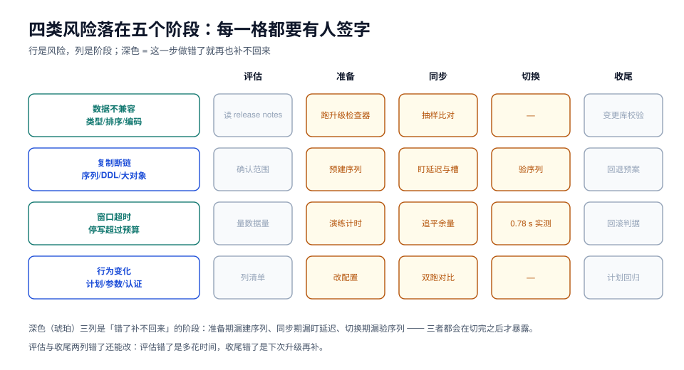

# 总览：四类风险与五个阶段

数据库大版本升级最常见的失败不是「新版本有 bug」，而是**「以为只是在换一个二进制」**。二进制换掉之后，数据页格式、系统表结构、复制协议、认证插件、统计信息全都在另一套规则下工作，而业务代码一行没改。

本页给出一张风险地图和一个五阶段流程，后面的每一章都落在这张图的某一格上。



## 一、先把「升级」拆成三个动作

「升级数据库」这句话里其实藏着三个独立动作，它们的风险和手段完全不同：

| 动作 | 本质 | 停写要求 | 失败后果 |
| --- | --- | --- | --- |
| **换二进制** | 同一份数据目录，用新版本的程序打开 | 必须停写（新版本不认识旧格式） | 起不来 / 起得来但数据不可读 |
| **搬数据** | 把行从旧实例搬到新实例 | 只有最后一段要停 | 搬漏、搬重、搬错顺序 |
| **切流量** | 让应用连到新实例 | 几秒 | 连到旧库 = 双写；连不上 = 全站 500 |

这三件事混在一起谈，就会得出「升级要停 4 小时」这种结论。拆开之后，真正的时间账是：**换二进制或搬数据的大部分时间可以在业务运行时完成，只有切流量那几秒必须停。**

## 二、两条路径，两个数量级的差别

同一份数据（20 万订单 + 40 万明细，87 MB），本机实测两种走法的停写窗口：

| 路径 | 全程停写 | 拆解 | 随数据量增长 |
| --- | --- | --- | --- |
| `pg_dump` + `pg_restore` | **3.6 s** | dump 1.35 s + restore 2.23 s | 线性，≈ 24 MB/s |
| 逻辑复制 + 切换 | **0.78 s** | 停写 223 ms + 追平 232 ms + 删槽 105 ms + 修序列 111 ms + 首写 112 ms | 近似常数 |

换算到 870 GB（放大 10,000 倍）：

- dump/restore 的 3.6 s 会变成 **约 10 小时**，且这 10 小时全程不能写；
- 逻辑复制的 0.78 s **仍然是秒级**——变长的只是前面「全量 + 追平」那两段，而它们不需要停写。

::: tip 这条对比的真正含义
不是「逻辑复制更先进」，而是**「只有切换那一段必须停写」这个事实**。反过来说：如果一次升级的数据量很小（几十 GB 以内）、窗口又宽裕，dump/restore 是更简单、更不容易出错的选择——它没有序列缺口、没有 DDL 缺口、没有复制槽要清理。
:::

## 三、四类风险，每一类都有专属的失败形态

| 风险 | 典型现象 | 什么时候暴露 | 本章对应页 |
| --- | --- | --- | --- |
| **数据不兼容** | 类型、排序规则（collation）、字符集、保留字、被删函数 | 升级脚本执行到一半报错 | [支持矩阵](../SupportMatrix/index.md) / [MySQL 路径](../MySQL80To84/index.md) |
| **复制断链** | 行数看着对、延迟慢慢涨、主键指向不同行 | 切换之后才被业务发现 | [逻辑复制迁移](../LogicalMigration/index.md) |
| **窗口超时** | 停写超过预算，只能中途放弃或带病上线 | 窗口进行中 | [演练与估算](../Rehearsal/index.md) |
| **行为变化** | 同一条 SQL 计划变差、参数默认值变了、认证方式变了 | 上线后一到两周 | [切换后验证](../Verify/index.md) |

四类里最危险的是**复制断链**：它不报错、不阻塞、不影响构建，只让两个库慢慢变成两个不同的世界。

本机实测过它的两种形态：

1. **序列不复制**。目标端 `nextval` 仍然是 1，而表里已经有 22 万行——第一次写入直接 `duplicate key value violates unique constraint`。
2. **DDL 不复制**。源端 `ALTER TABLE ... ADD COLUMN` 之后写入，目标端报 `logical replication target relation "public.orders" is missing replicated column: "coupon_code"`，apply worker 退出，每 5 秒重试一次，永远追不上。

更隐蔽的是二者的叠加：目标端因为序列是 1，本地插入占用了 `id = 220001`；源端复制过来的那一行也是 `220001`，但它是**另一个订单**。两个库的 `count(*)` 都是 220001，内容已经分叉。

```sql
-- 源库：id > 220000 的行
select id, order_no from orders where id > 220000;
-- 220001 | NO777777777

-- 目标库：同一个 id 区间
select id, order_no from orders where id > 220000;
-- 220001 | NO900000002
-- 220002 | NO900000009
```

::: danger 行数相等不是一致性证据
上面这一对读数，`select count(*)` 两边完全一致（都是 220001），而 `id = 220001` 指向两个不同的订单。**任何只比行数的验收都会放过这种事故。** 验证要按 [切换后验证](../Verify/index.md) 的四道闸门逐级加严。
:::

## 四、五个阶段：每个阶段只有一件事不能错

| 阶段 | 这一阶段要产出什么 | 唯一不能错的事 | 错了会怎样 |
| --- | --- | --- | --- |
| ① 评估 | 一份「能不能升、升到哪个版本」的结论 | 路径可达性（能不能跳版） | 做到一半发现要先过一站 |
| ② 准备 | 检查清单全绿 + 一次可恢复的备份 | 备份**恢复演练**过 | 回退时才发现备份不能用 |
| ③ 同步 | 目标库追平到秒级延迟 | 序列、DDL、大对象单独同步 | 切换后才发现数据不对 |
| ④ 切换 | 停写窗口内完成切库 | 顺序：先停写，再删槽 | 双写 / 丢最后一批事务 |
| ⑤ 收尾 | 验证全绿 + 旧库只读保留 | 旧库**不要立刻删** | 无法回退、无法对账 |

五个阶段里，只有 ④ 需要停写。① ② ③ ⑤ 都可以在业务运行时做——这也是为什么「升级要停多久」的答案通常比预期小一个数量级。

## 五、升级单必须回答的十个问题

一份能拿去评审的升级单，至少要有这十行。缺任何一行，评审就该打回：

1. **源版本 → 目标版本**，含具体小版本号（`8.0.46 → 8.4.11`、`17.6 → 18.6`）。
2. **路径**：原地 / 复制 / dump-restore，以及为什么不是另外两条。
3. **停写窗口预算**：分段列出（停写多久、追平多久、验证多久），并给出实测依据。
4. **回退点**：回到哪个状态、用什么手段、需要多久、**哪些操作之后就回不去了**。
5. **不跟着复制的东西**：序列、DDL、大对象、统计信息、权限、扩展、作业调度，逐项写怎么处理。
6. **兼容性清单**：被删的参数、改名的方法、认证插件、保留字、默认值变化。
7. **验证判据**：行数、校验和、序列、计划回归、业务不变量，各自的预期值与命令。
8. **观测项**：切换期间盯哪几个指标（延迟、槽积压、连接数、5xx），阈值多少。
9. **责任人**：谁执行、谁验证、谁有权喊停。
10. **冻结点**：从哪一刻起禁止任何 DDL 与配置变更。

## 六、三个最常见的误判

::: danger 三个「想当然」
1. **「小版本升级而已，滚动重启就行」**。小版本（如 18.5 → 18.6）确实是滚动重启，但**大版本不是**：数据页格式变了，不存在「新旧混跑」的中间态（MySQL 的原地升级也不允许降级）。
2. **「有备份就能回退」**。备份只保证「能回到备份点」，不保证「能回到升级前那一刻」。回退的真实成本是 **RTO + 丢数据量**，而这两项必须提前算出来写进升级单。
3. **「复制追平了就可以切」**。追平只说明**已经发出来的 WAL 被应用了**，不说明序列对、不说明 DDL 一致、不说明统计信息够用。三者要各自验。
:::

## 七、本页判据

| 编号 | 判据 | 看什么现象 | 不满足时改哪里 |
| --- | --- | --- | --- |
| `UGO-A` | 升级单写明了源与目标的**完整版本号** | 升级单第一行 | 补小版本号；只写「8.0 → 8.4」不算 |
| `UGO-B` | 三个动作（换二进制 / 搬数据 / 切流量）分别写清了停写要求 | 升级单有分段表 | 按第一节的三行表补 |
| `UGO-C` | 停写窗口有**实测依据**，不是估算 | 附演练读数 | 做一次 [演练](../Rehearsal/index.md) |
| `UGO-D` | 「不跟着复制的东西」逐项列出 | 升级单第 5 项 | 至少列序列、DDL、大对象、统计信息 |
| `UGO-E` | 回退点写明了「哪些操作之后回不去」 | 有明确的不可回滚点 | 补；典型是「新库写入之后」 |
| `UGO-F` | 验证判据不止行数 | 验证节有 ≥ 4 类判据 | 按 [验证](../Verify/index.md) 四道闸门补 |
| `UGO-G` | 切换期间有观测项与阈值 | 监控面板 / 告警清单 | 补延迟、槽积压、连接数、5xx 四项 |
| `UGO-H` | 有明确的冻结点与喊停权 | 升级单写了时间点与人 | 补；没有喊停权的窗口不是窗口 |

## 参考资料

- PostgreSQL 18 Documentation: *Upgrading a PostgreSQL Cluster*、`pg_upgrade`、*Logical Replication*
- PostgreSQL 19 Release Notes（RC1，2026-10-15）：sequence 值的逻辑复制、`REPACK`、`WAIT`
- MySQL 8.4 Reference Manual: *What Is New in MySQL 8.4*、*Upgrading MySQL*、`util.checkForServerUpgrade`
- MySQL 8.0 Release Notes: 8.0.46（末版）与 EOL 公告
- 本仓库相邻专题：[备份与容灾](../../BackupDR/index.md)、[Schema 演进](../../../DB/SchemaEvolution/index.md)、[变更管理](../../ChangeManagement/index.md)
