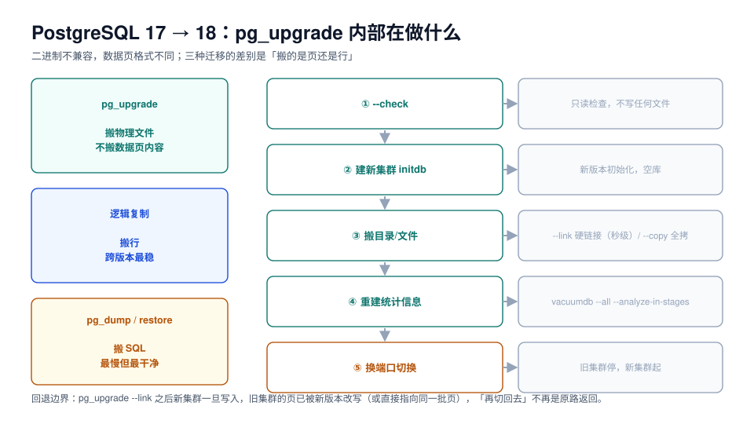

# PostgreSQL 17 → 18：pg_upgrade 在搬什么

PostgreSQL 没有「原地升级」这个选项——新大版本读不了旧版本的数据页。所谓 `pg_upgrade`，本质是**建一个新集群，把表文件按新版本的方式接管过去**，而不是把数据重写一遍。

理解这一点，就能理解它的三个性质：为什么快、为什么必须停写、为什么 `--link` 之后就回不去了。



## 一、页格式不兼容，所以只能「搬」

| 方式 | 搬的粒度 | 停机 | 磁盘 | 可回退 |
| --- | --- | --- | --- | --- |
| `pg_upgrade --link` | 文件（硬链接） | 全程 | 几乎不额外占 | ❌ 新集群跑起来后旧集群不可用 |
| `pg_upgrade --copy` | 文件（真拷） | 全程 | ≈ 库体积 ×2 | ✅ 旧集群完整保留 |
| 逻辑复制 | 行 | 只有切换瞬间 | 中（WAL 积压） | ✅ 旧库继续服务 |
| `pg_dump` / `pg_restore` | SQL | 导出 + 导入 | ≈ 库体积 | ✅ 旧库不动 |

::: tip 选哪条，看两件事
- **窗口够不够**：`--link` 通常几分钟（与数据量弱相关、与文件数强相关）；dump/restore 与数据量线性。
- **要不要回退**：要回退就 `--copy` 或逻辑复制，`--link` 等于把退路烧掉。
:::

## 二、pg_upgrade 的五个步骤

```shell
# 0. 前置：两个版本的二进制同时在场（旧版本包不能卸）
/usr/lib/postgresql/17/bin/postgres --version
/usr/lib/postgresql/18/bin/postgres --version

# 1. 只读检查（不写任何文件，可反复跑）
/usr/lib/postgresql/18/bin/pg_upgrade \
  --old-bindir=/usr/lib/postgresql/17/bin \
  --new-bindir=/usr/lib/postgresql/18/bin \
  --old-datadir=/var/lib/postgresql/17/main \
  --new-datadir=/var/lib/postgresql/18/main \
  --check

# 2. 旧集群停库（pg_upgrade 需要独占文件，不停会报错）
pg_ctlcluster 17 main stop

# 3. 新集群初始化（locale / encoding 必须与旧集群一致）
/usr/lib/postgresql/18/bin/initdb -D /var/lib/postgresql/18/main \
  --locale=C.UTF-8 --encoding=UTF8

# 4. 正式升级（--link 秒级；不要 --copy 加 --link 混用）
/usr/lib/postgresql/18/bin/pg_upgrade \
  --old-bindir=/usr/lib/postgresql/17/bin \
  --new-bindir=/usr/lib/postgresql/18/bin \
  --old-datadir=/var/lib/postgresql/17/main \
  --new-datadir=/var/lib/postgresql/18/main \
  --link

# 5. 起新集群 + 重建统计信息（这一步不能省）
pg_ctlcluster 18 main start
/usr/lib/postgresql/18/bin/vacuumdb --all --analyze-in-stages
```

`--analyze-in-stages` 会分三轮 `ANALYZE`（先低采样、再提高），目的是让新库**尽快有一份能用的统计信息**。跳过这一步，上线后第一批查询会因为「没有统计信息」走出最差的计划，而这个现象会被误判成「新版本性能退化」。

::: danger pg_upgrade 不迁统计信息
统计信息存在 `pg_statistic` 里，`pg_upgrade` 会把它一起搬过去——但**搬过去的是旧版本收集的、采样口径可能已经失效的数据**。PostgreSQL 官方明确建议升级后重新 `ANALYZE`。这不是「优化项」，是升级步骤的一部分。
:::

## 三、四个会卡住 pg_upgrade 的点

| 卡点 | 报错形态 | 处置 |
| --- | --- | --- |
| 扩展没有新版本二进制 | `could not access file "$libdir/xxx"` | 先在新版本上 `CREATE EXTENSION` 能成功，才升级 |
| 旧集群有 `btree_gist` 的 `inet`/`cidr` 索引 | PG 19 起 `--check` 直接拒绝 | 提前换成 GiST/btree |
| 新旧集群 locale / encoding 不一致 | `--check` 报 mismatch | `initdb` 时显式指定，与旧集群一致 |
| 旧集群还有逻辑复制槽 | `--check` 警告，升级后槽丢失 | 升级前删掉或登记重建 |

```sql
-- 升级前：把这些扩展在新版本上预演一遍
select extname, extversion from pg_extension order by 1;
-- 然后在新版本的空实例上：create extension <name>; 能成功才算过
```

::: warning 「扩展能装」要单独验
`pg_upgrade` 只搬目录，不搬扩展的二进制文件。PostGIS、pg_partman、pg_cron 这类带 `.so` 的扩展，必须为目标版本重新安装。**验证方法**：在新版本的空实例上 `create extension` 一次，成功才继续。
:::

## 四、升级之后：先验这五项，再放业务

| 项 | 命令 | 预期 |
| --- | --- | --- |
| 版本 | `select version();` | `PostgreSQL 18.6` |
| 数据库列表与属主 | `\l` | 与旧库一致 |
| 扩展 | `select extname, extversion from pg_extension;` | 全部存在且版本匹配 |
| 表数 / 行数抽样 | 对象清点 SQL（见 [升级前检查](../Precheck/index.md)） | 与升级前一致 |
| 统计信息 | `select relname, last_analyze from pg_stat_user_tables limit 10;` | 非空 |

```sql
-- 升级后立刻确认：没有 invalid 索引（pg_upgrade 会重建，失败会留下 invalid）
select indexrelid::regclass, indrelid::regclass
from pg_index where not indisvalid;
-- 期望 0 行
```

## 五、PG 18 带来的、与升级有关的三个变化

| 变化 | 与升级的关系 |
| --- | --- |
| 异步 I/O（`io_method`：`sync` / `worker` / `io_uring`） | 升级后可调；`worker` 是兼容性最好的起点，`io_uring` 要先确认内核 |
| 虚拟生成列（virtual generated columns） | 旧库里的 stored 生成列行为不变；新建表才用得上 |
| `uuidv7()` 内置 | 可以替掉应用层的 UUID 生成，但**不要**在升级窗口里顺手改主键生成方式 |
| md5 认证被标记为废弃 | 升级是迁到 SCRAM 的好时机，但要在窗口前改完并验证 |

::: tip 升级窗口里只做升级
第 4 项和「顺手把主键换成 uuidv7」放在同一个窗口，是典型的事故配方：出问题时无法判断是版本问题还是改动问题。**窗口里只允许「为了升级必须做」的改动**，其余排到下一个发布。
:::

## 六、回退边界

| 走到哪一步 | 还能回退吗 | 怎么回 |
| --- | --- | --- |
| `--check` 通过、还没停库 | ✅ | 什么都不用做 |
| 已 `initdb`、还没 `pg_upgrade` | ✅ | 删掉新集群，旧集群原样 |
| `pg_upgrade --copy` 完成、新集群**未写入** | ✅ | 旧集群直接起 |
| `pg_upgrade --copy` 完成、新集群**已写入** | ⚠️ | 旧集群能起，但**升级后写入的数据不在里面** |
| `pg_upgrade --link` 完成 | ❌ | 文件已被新版本接管，旧集群起不来 |

这张表直接决定了升级单里那句「可回退」的准确写法。

## 七、本页判据

| 编号 | 判据 | 看什么现象 | 不满足时改哪里 |
| --- | --- | --- | --- |
| `UGP-A` | 新旧两套二进制都在 | 两个 `postgres --version` 都能跑 | 旧版本包别卸；容器镜像要留 |
| `UGP-B` | `--check` 跑过且 0 error | 命令输出 | 按第三节逐条处置 |
| `UGP-C` | `initdb` 的 locale / encoding 与旧集群一致 | `pg_database` 的 `datcollate` / `encoding` | 重建新集群 |
| `UGP-D` | 选择了 `--link` 还是 `--copy`，并写明回退边界 | 升级单 | 按第六节表格写清 |
| `UGP-E` | 扩展在新版本上可 `CREATE EXTENSION` | 空实例验证记录 | 先解决扩展，再做升级 |
| `UGP-F` | 升级后跑了 `vacuumdb --analyze-in-stages` | 命令记录 | 补跑；不跑等于没升级完 |
| `UGP-G` | `pg_index` 里没有 invalid 索引 | 查询返回 0 行 | 重建失败索引 |
| `UGP-H` | 窗口内没有夹带非升级改动 | 变更清单 | 把「顺手改」移到下个发布 |

## 参考资料

- PostgreSQL 18 Documentation: `pg_upgrade`、*Upgrading a PostgreSQL Cluster*、`vacuumdb --analyze-in-stages`
- PostgreSQL 18 Release Notes：异步 I/O、虚拟生成列、`uuidv7()`
- PostgreSQL 19 Release Notes：`btree_gist` inet/cidr 索引的升级限制
- 本仓库：[PostgreSQL 备份与恢复](../../../DB/Relational/PostgreSQL/BackupRestore/index.md)（升级前的备份与 PITR）
