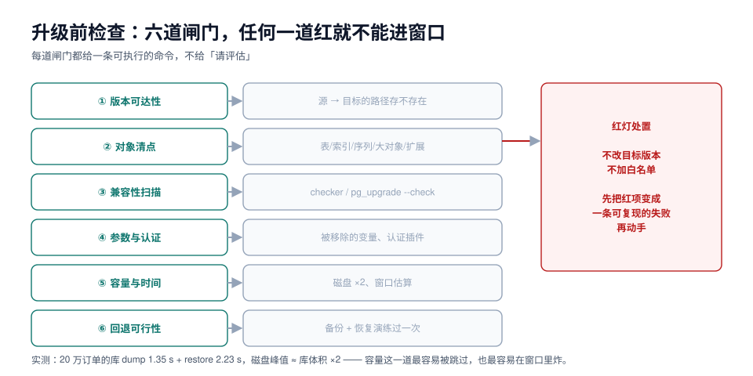

# 升级前检查：六道闸门

升级前检查最容易退化成一句「请评估兼容性」。检查的价值不在于「做了」，而在于**每一项都能给出一个可执行的命令和一个是/否的结论**——红的就是红的，不能靠「应该没问题」放行。

本页给六道闸门，每道闸门配一条命令、一个判据、一个红灯时的处置动作。



## 一、闸门一：版本可达性

先把 [支持矩阵](SupportMatrix/index.md) 的结论落成一行字，写进升级单：

```text
MySQL 8.0.46 → 8.4.11：原地升级可用（≥ 8.0.37），有备份可回退，无原地降级。
PostgreSQL 17.6 → 18.6：pg_upgrade --link 可用（同一文件系统），保留 17 二进制。
```

写不出这一行，说明路径还没定，后面的检查都没有意义。

## 二、闸门二：对象清点

升级最容易踩的坑不是「表太大」，而是**「有个东西你忘了它存在」**：扩展、外部表、事件触发器、物化视图、自定义排序规则、定时任务、复制槽。

PostgreSQL 侧一条查询把该清的清完：

```sql
-- PostgreSQL：升级前对象清单（逐项核对，不要只看总数）
select 'tables' as kind, count(*) from pg_class c join pg_namespace n on n.oid=c.relnamespace
  where c.relkind='r' and n.nspname not in ('pg_catalog','information_schema')
union all select 'matviews', count(*) from pg_class c join pg_namespace n on n.oid=c.relnamespace
  where c.relkind='m' and n.nspname not in ('pg_catalog','information_schema')
union all select 'indexes', count(*) from pg_indexes where schemaname not in ('pg_catalog','information_schema')
union all select 'sequences', count(*) from information_schema.sequences
union all select 'large_objects', count(*) from pg_largeobject_metadata
union all select 'extensions', count(*) from pg_extension
union all select 'foreign_tables', count(*) from information_schema.foreign_tables
union all select 'event_triggers', count(*) from pg_event_trigger
union all select 'custom_collations', count(*) from pg_collation where collname !~ '^(C|POSIX|ucs_basic|default)$'
union all select 'publications', count(*) from pg_publication
union all select 'replication_slots', count(*) from pg_replication_slots
union all select 'roles', count(*) from pg_roles where rolname not like 'pg\_%';
```

MySQL 侧同构：

```sql
-- MySQL：对象清单（含容易忘的 routine / trigger / event）
select 'tables' as kind, count(*) from information_schema.tables where table_schema not in ('mysql','sys','information_schema','performance_schema')
union all select 'views', count(*) from information_schema.views where table_schema not in ('mysql','sys')
union all select 'routines', count(*) from information_schema.routines where routine_schema not in ('mysql','sys')
union all select 'triggers', count(*) from information_schema.triggers where trigger_schema not in ('mysql','sys')
union all select 'events', count(*) from information_schema.events
union all select 'partitions', count(*) from information_schema.partitions where table_schema not in ('mysql','sys')
union all select 'accounts', count(*) from mysql.user;
```

::: danger 三类最容易被漏掉的对象
1. **扩展/插件**（`pg_extension`、MySQL 的 `INSTALL PLUGIN`）：扩展的二进制要按目标版本重新编译或安装。升级后忘了装，函数一调用就报 `could not access file`。
2. **逻辑复制槽**：旧库上残留的槽会一直保留 WAL。升级前不清，旧库磁盘会慢慢写满——这是「升级完一周后旧库磁盘告警」的常见根因。
3. **定时任务**（`pg_cron`、MySQL `EVENT`）：它们不在数据里，也不在任何「表」的统计里，升级后忘了迁，业务表现为「每天该跑的账没跑」。
:::

## 三、闸门三：兼容性扫描

两家的官方工具都必须跑，且**要用「目标版本的工具」跑**：

```shell
# PostgreSQL：只读检查，不写任何文件；必须在两个版本的二进制都装好后执行
/usr/lib/postgresql/18/bin/pg_upgrade \
  --old-bindir=/usr/lib/postgresql/17/bin \
  --new-bindir=/usr/lib/postgresql/18/bin \
  --old-datadir=/var/lib/postgresql/17/main \
  --new-datadir=/var/lib/postgresql/18/main \
  --check

# MySQL：用 MySQL Shell（版本不低于目标版本）连到源库做检查
mysqlsh -- util checkForServerUpgrade root@db1:3306 \
  --target-version=8.4.11 \
  --config-path=/etc/mysql/my.cnf \
  --output-format=JSON > db1-upgrade-check.json
```

`--check` 的输出里有三类，处置完全不同：

| 输出类型 | 含义 | 处置 |
| --- | --- | --- |
| **error** | 不解决就无法升级 | 必须清零才能进窗口 |
| **warning** | 能升，但升级后会出问题 | 要么改掉，要么在升级单里写明「接受」及理由 |
| **notice** | 提示信息 | 记录，不阻塞 |

::: warning `--check` 通过 ≠ 升级会顺利
`pg_upgrade --check` 检查的是**结构兼容性**（数据类型、索引 opclass、目录布局），它不知道你的应用会不会因为 `standard_conforming_strings` 变严格而挂、也不知道某个扩展在新版本上有没有 ABI 变化。**工具管结构，人管行为。**
:::

## 四、闸门四：参数与认证

这一类改动不会在扫描里报「error」，但会让服务**起不来或连不上**。

| 数据库 | 会被移除 / 改默认的东西 | 症状 |
| --- | --- | --- |
| MySQL 8.4 | `innodb_log_file_size`、`innodb_log_files_in_group`（并入 `innodb_redo_log_capacity`） | **启动失败**，报 unknown variable |
| MySQL 8.4 | `slave_*` 系列变量、`START SLAVE` / `SHOW SLAVE STATUS` / `CHANGE MASTER TO` | 复制脚本、监控采集全废 |
| MySQL 8.4 | `default_authentication_plugin` 移除，改为 `authentication_policy` | 配置报错；老账号认证失败 |
| MySQL 8.4 | `mysql_native_password` 默认关闭（有老账号时会自动打开） | 新账号建不出来；驱动连不上 |
| MySQL 8.4 | 新保留字 `MANUAL`、`PARALLEL`、`QUALIFY`、`TABLESAMPLE` | 未加引号的列名/表名报语法错 |
| PostgreSQL 19 | `standard_conforming_strings` 强制 on；`escape_string_warning` 移除 | 旧 dump 导入失败；反斜杠语义变化 |
| PostgreSQL 19 | `inet`/`cidr` 默认 opclass 改为 GiST；`btree_gist` 版本被 `pg_upgrade` 拒绝 | 升级前必须先换索引 |

先查一遍自己的配置里有没有这些键：

```shell
# 在源库服务器上扫一遍配置文件，比在窗口里被 unknown variable 拦住便宜得多
grep -nE 'innodb_log_file_size|innodb_log_files_in_group|^slave_|default_authentication_plugin' /etc/mysql/my.cnf || echo "clean"
```

认证这一项单独验一次，**用应用实际使用的驱动连**，不要只用命令行客户端：

```sql
-- MySQL 8.4：列出所有非 caching_sha2_password 的账号（升级前必须为空或已豁免）
select user, host, plugin from mysql.user where plugin <> 'caching_sha2_password';
```

## 五、闸门五：容量与时间

升级期间有两处会额外吃磁盘，两处都不在「数据库体积」这个数字里：

| 开销 | 估算方式 | 实测参照 |
| --- | --- | --- |
| 目标实例的数据副本 | ≈ 库体积（`pg_upgrade --copy` 时是 1:1；`--link` 几乎为 0） | 87 MB 库 → 目标 90 MB |
| 逻辑复制的 WAL 积压 | 写入速率 × 最长允许延迟 | 未追平期间槽会一直保留 WAL |
| dump 文件 | 压缩后约为库体积的 **5%~15%** | 87 MB 库 → `-Fc` 6.4 MiB（7.4%） |
| 旧库保留期 | 切换后旧库至少留一个发布周期 | 旧库仍占全部磁盘 |

时间估算留到 [演练与时间估算](Rehearsal/index.md)，这里只做一件事：**确认目标实例的磁盘 ≥ 源库体积 × 2（走 `--copy` 或 dump/restore）**。

## 六、闸门六：回退可行性

这一道最容易被写成「已有备份」。**「有备份」和「能回退」之间隔着一次恢复演练。**

回退能力三个要素，缺一不可：

1. **备份存在且可读**：不是「备份任务成功」，而是「能列出一份具体的备份文件，并知道它对应哪个时间点」。
2. **恢复演练过**：在非生产环境完整恢复过一次，记录了耗时。
3. **回退判定条件**：什么现象出现才回退（不是「感觉不对」）。

本机实测的恢复成本：

```text
pg_dump -Fc 87 MB 库        1.35 s   → 6.4 MiB 文件
pg_restore 到空库           2.23 s   → 200000 / 400000 行
```

这个数字看着很小，但它**不含**：文件从备份存储拉回来的时间、实例创建时间、权限与扩展重装时间、以及应用重新连接的时间。真实 RTO 通常是这个数字的 10 倍以上。

::: tip 回退演练要演练「回退之后」
回退不是把库恢复回来就结束了。旧版本恢复之后，**切换期间新写入的数据怎么办**？两条常见处置：

- 接受丢失：写进升级单，让业务方确认；
- 反向同步：用逻辑复制把新库的增量写回旧库（成本高，只有强一致要求的场景才做）。

演练时把这一条走一遍，比演练恢复本身更有价值。
:::

## 七、检查结果怎么写

一张三列的表，比一份散文有用：

| 闸门 | 结论 | 证据 |
| --- | --- | --- |
| 版本可达性 | 绿 | `8.0.46 → 8.4.11`，≥ 8.0.37 |
| 对象清点 | 黄 | 有 2 个 `pg_cron` 作业需手工迁移 |
| 兼容性扫描 | 绿 | `pg_upgrade --check` 0 error / 1 warning（已接受） |
| 参数与认证 | 红 | 3 个账号用 `mysql_native_password` |
| 容量与时间 | 绿 | 目标磁盘 400 GB / 源 87 MB |
| 回退可行性 | 黄 | 备份可用，恢复演练排期在窗口前 3 天 |

红灯清零、黄灯写处置人和时间，才能进窗口。

## 八、本页判据

| 编号 | 判据 | 看什么现象 | 不满足时改哪里 |
| --- | --- | --- | --- |
| `UGC-A` | 路径结论写成了一行字 | 升级单首段 | 按第一节格式补 |
| `UGC-B` | 对象清点是查询输出，不是记忆 | 有 SQL 与结果截图 | 跑第二节的清单查询 |
| `UGC-C` | 扩展/插件在目标版本有对应版本 | 扩展清单 + 目标版本号 | 逐个确认；无对应版本的找替代 |
| `UGC-D` | 复制槽在升级前被清理或登记 | `pg_replication_slots` 输出 | 未用的槽删掉；在用的写进迁移步骤 |
| `UGC-E` | 官方检查工具跑过，且 error = 0 | `--check` / `checkForServerUpgrade` 输出 | 清 error；warning 逐条写接受理由 |
| `UGC-F` | 被移除的参数在配置文件中已清理 | `grep` 输出为空 | 按目标版本参数表改 |
| `UGC-G` | 认证方式已确认（非默认插件账号 = 0 或有豁免） | `mysql.user` 查询 | 迁到 `caching_sha2_password` / SCRAM |
| `UGC-H` | 备份恢复**演练过**并记录了 RTO | 演练记录含耗时 | 在窗口前至少 3 天做一次 |

## 参考资料

- PostgreSQL: `pg_upgrade --check`、*Upgrading a PostgreSQL Cluster*
- MySQL Shell: `util.checkForServerUpgrade` 输出分级说明
- MySQL 8.4 Reference Manual: *Features Removed in MySQL 8.4*、*Server Options Removed*
- PostgreSQL 19 Release Notes: *Migration to Version 19* 的 incompatible changes
- 本仓库：[备份与容灾](../../BackupDR/index.md)（备份策略与恢复演练的组织方式）
