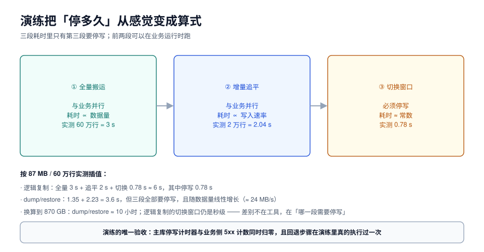

# 演练与时间估算：把「停多久」算出来

「大概停两小时」这种估算是升级事故的第一推动力：它既没有算式也没有实测，评审时无法质疑，执行时无法验证，超时后只能带病上线。

本页给一个三段式估算模型、一份演练要记录的读数清单，以及本机实测出来的换算系数。



## 一、任何升级路径都只有三段

不管选哪条通道，耗时都能拆成三段，区别只在于**哪几段需要停写**：

| 段 | 在干什么 | 与什么成正比 | 需要停写吗 |
| --- | --- | --- | --- |
| ① 全量搬运 | 把存量数据搬到目标 | 数据量 | dump/restore 需要；逻辑复制不需要 |
| ② 增量追平 | 把搬运期间产生的新数据追上去 | 写入速率 × 搬运时长 | 不需要（切换前最后一段例外） |
| ③ 切换 | 停写、确认追平、切流量、放开 | 近似常数（对象数量） | **必须** |

所以「升级要停多久」的正确答案是：**③ 的时长 + ② 的尾巴**，而不是 ① + ② + ③。

## 二、本机实测的三段读数

环境：20 万订单 + 40 万明细，库体积 87 MB，单机同盘。

| 段 | 路径 | 实测 | 换算系数 |
| --- | --- | --- | --- |
| ① 全量 | `pg_dump -Fc` | 1.35 s（产出 6.4 MiB） | ≈ 64 MB/s（压缩后 4.7 MB/s） |
| ① 全量 | `pg_restore` | 2.23 s | ≈ 39 MB/s |
| ① 全量 | 逻辑复制初次同步 | 3 s（60 万行） | ≈ 20 万行/s |
| ② 增量 | 2 万行追平 | 2.04 s | ≈ 1 万行/s（含 0.5 s 轮询开销） |
| ③ 切换 | 停写 → 新主首写成功 | **0.78 s** | 近似常数 |
| ③ 切换 | 其中：停写生效 223 ms / 追平 232 ms / 删槽 105 ms / 修序列 111 ms / 首写 112 ms | — | — |

::: warning 这些数字不能直接外推到生产
它们来自**单机、同盘、空载、无并发写入**的环境。生产里的差异主要来自四处：

1. **磁盘与网络**：跨机器、跨可用区时，dump 文件的传输往往是瓶颈（本机没有传输时间）；
2. **索引数量**：`pg_restore` 的时间大头是建索引，索引越多越慢，而行数估算完全反映不出这一点；
3. **并发写入**：逻辑复制的追平速度与源端写入速率直接竞争，写得多就追得慢；
4. **对象数量**：切换段的 0.78 s 里「修序列」是 111 ms（2 个序列），200 个序列会显著变长——这一段与**对象数**成正比，与数据量无关。
:::

按系数外推（仅作量级参考，必须用生产规模重测）：

| 数据量 | dump/restore 全程停写 | 逻辑复制（停写段） |
| --- | --- | --- |
| 87 MB（实测） | 3.6 s | 0.78 s |
| 87 GB | ≈ 1 小时 | 秒级（对象数相关） |
| 870 GB | ≈ 10 小时 | 秒级 |

## 三、演练必须记录的八个数

演练的目的不是「跑一遍看看」，而是**产出八个可以写进升级单的数字**。少一个，估算就还是感觉。

| 编号 | 读数 | 怎么取 | 为什么必须要 |
| --- | --- | --- | --- |
| R1 | 全量搬运耗时 | 计时器包住 dump/restore 或 `CREATE SUBSCRIPTION` | 段① 的基准 |
| R2 | 目标库体积 | 目标实例 `pg_database_size` | 容量与磁盘规划 |
| R3 | 索引重建耗时 | 单独计时（`pg_restore` 加 `--section=post-data`） | 常被漏掉的大头 |
| R4 | 增量追平速率 | 停写前 5 分钟的延迟曲线斜率 | 段② 的尾巴有多长 |
| R5 | 停写生效耗时 | 从「执行置只读」到「最后一个写事务结束」 | 段③ 的第一块 |
| R6 | 切换动作总耗时 | 从停写到新主首写成功 | 段③ 的总长 |
| R7 | 序列修复耗时 | 单独计时 | 与对象数成正比的那一块 |
| R8 | 回退耗时 | 从决定回退到旧库恢复可写 | 决定「敢不敢切」 |

```sql
-- R3：只重建索引这一段，单独计时（restore 完成 schema 与数据之后）
\timing on
-- psql 里用 section 分段恢复，才能把 post-data（索引/约束）单独计时
-- pg_restore --section=pre-data  → 表结构
-- pg_restore --section=data      → 数据
-- pg_restore --section=post-data → 索引、约束、触发器
```

## 四、演练要做三次，不是一次

| 次序 | 目标 | 通过标准 |
| --- | --- | --- |
| 第一次：空跑 | 把命令跑通，暴露脚本错误 | 全流程无人工干预跑完 |
| 第二次：满量 | 用生产规模数据（或等比缩小后按系数换算） | 八个数全部记录，窗口落在预算内 |
| 第三次：回退 | 演练「切过去再切回来」 | 旧库恢复可写，回退耗时 ≤ 预算 |

第三次最容易被跳过，也最有价值：**它会把「回退」从一句承诺变成一条测过的路径。**

::: danger 演练环境不能只「同版本」，要「同形状」
一个常见的无效演练：在空库上跑一遍 `pg_upgrade`，30 秒完成，于是得出「升级很快」的结论。空库没有索引、没有 TOAST 大字段、没有大对象、没有 200 个序列——而这四样恰好是耗时的全部来源。

演练环境至少要满足：表数量一致、索引数量一致、最大的三张表行数一致、序列数量一致。数据可以等比缩小，**形状不能缩**。
:::

## 五、三个常见的估算错误

::: danger 估算三坑
1. **只算 dump，不算 restore**。dump 是读，restore 是写 + 建索引，后者通常是前者的 1.5~2 倍（本机 1.35 s vs 2.23 s）。
2. **忘了 `ANALYZE`**。恢复完不跑统计信息，上线后第一批查询会走最差的计划——这段时间的表现会被误判成「新版本更慢」。`pg_upgrade` 之后必须 `vacuumdb --all --analyze-in-stages`。
3. **把 DNS TTL 当 0**。切流量靠改连接串或 DNS 时，客户端缓存与连接池的旧连接会让「切完了」变成「一半连新一半连旧」。切换前把 TTL 调到 30~60 s，并留出至少一个 TTL 的观察期。
:::

## 六、窗口预算表模板

演练结束后，把八个数填进这张表，就是升级单的第三节：

| 阶段 | 动作 | 预计 | 实测（演练） | 责任人 |
| --- | --- | --- | --- | --- |
| 前置 | 冻结 DDL、确认备份可恢复 | 10 min | — | DBA |
| ① | 全量同步 / dump | 视数据量 | R1 | DBA |
| ② | 追平至延迟 0 | 视写入速率 | R4 | DBA |
| ③-a | 停写（置只读 / 摘流量） | 30 s | R5 | 应用 |
| ③-b | 删槽 + 修序列 | 1 min | R7 | DBA |
| ③-c | 切连接串 / 放开写 | 1 min | R6 | 应用 |
| ④ | 验证四道闸门 | 10 min | — | 双方 |
| ⑤ | 观察期（延迟、5xx、慢查询） | 30 min | — | 双方 |

合计就是「这次升级要占多长的窗口」。注意最后两行**不在停写区间内**——验证与观察时业务已经恢复，只是团队还在岗。

## 七、本页判据

| 编号 | 判据 | 看什么现象 | 不满足时改哪里 |
| --- | --- | --- | --- |
| `UGD-A` | 耗时按三段拆开，不是一个大数 | 升级单有分段表 | 按第一节重写 |
| `UGD-B` | 停写预算只包含段③（+ 段② 尾巴） | 预算表结构 | 把 ①② 移出停写区间 |
| `UGD-C` | 演练环境与生产「同形状」 | 表/索引/序列数量对照 | 补齐形状，不能只对行数 |
| `UGD-D` | 八个读数全部有值 | 演练记录 | 缺哪个补哪个 |
| `UGD-E` | 索引重建单独计时 | R3 有独立数字 | 用 `--section=post-data` 分段 |
| `UGD-F` | 演练做过「回退」这一次 | 第三次演练记录 | 补一次带回退的演练 |
| `UGD-G` | 恢复后跑了统计信息 | `vacuumdb --analyze-in-stages` 记录 | 写进切换步骤，不能省 |
| `UGD-H` | DNS TTL / 连接串切换有观察期 | 预算表最后两行 | 提前降 TTL，留一个 TTL 的观察 |

## 参考资料

- PostgreSQL: `pg_dump` / `pg_restore` 的 `--section` 分段、`vacuumdb --analyze-in-stages`
- PostgreSQL: *Populating a Database*（恢复后统计信息与性能的关系）
- MySQL: `mysqlpump` / `mysqlsh` 并行导出、`--set-gtid-purged` 对恢复的影响
- 本仓库：[容量与成本](../../CapacityCost/index.md)（容量规划的通用方法）
