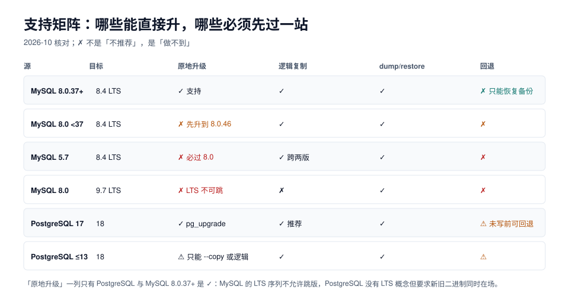

# 支持矩阵：哪些能升、哪些必须先过一站

升级方案的第一句话不是「我们打算怎么升」，而是**「我们能不能这么升」**。数据库的版本号不是连续的台阶，有些跳跃被官方明确禁止，有些跳跃技术上可行但没有回退路。

本页把「源 → 目标」的可达性、各版本的支持状态、以及三种迁移通道的硬性前置条件列成表，供评估阶段直接对照。



## 一、三种迁移通道，名字要先对齐

行业里的叫法很乱，先把四个词钉死（后文全部按这个用法）：

| 说法 | 搬的是什么 | 新版本何时启动 | 停写要求 |
| --- | --- | --- | --- |
| **原地升级**（in-place） | 物理文件 / 数据目录 | 升级过程中（旧版本退出） | 全程停写 |
| **逻辑复制**（logical replication / binlog 复制） | 行（INSERT/UPDATE/DELETE） | 提前启动，持续追平 | 只有切换瞬间 |
| **dump / restore** | SQL 文本 | 目标实例预先建好 | 导出 + 导入全程 |
| **pg_upgrade** | 数据文件（不重写页内容） | 升级过程中 | 全程停写，但比 dump 快得多 |

::: warning 「原地升级」在两家不是一回事
PostgreSQL 没有「原地把数据目录升上去」的能力——`pg_upgrade` 也是**建一个新集群、把文件搬过去**，只是搬的是文件而不是行。MySQL 的原地升级才是真的「同一份数据目录换二进制」，靠的是启动时自动执行的数据字典升级，并且**升级后不能降级**。
:::

## 二、MySQL：LTS 序列不可跳版

| 源 | 目标 | 原地升级 | 逻辑复制 | dump/restore | 官方结论 |
| --- | --- | --- | --- | --- | --- |
| 8.0.37+ | 8.4.x | ✓ | ✓ | ✓ | 三条路都支持 |
| 8.0 < 37 | 8.4.x | ✗ | ✓ | ✓ | 先补到 8.0.46，再升 8.4 |
| 5.7 | 8.4.x | ✗ | ✓（跨两版） | ✓ | 必须先到 8.0 |
| 8.0 | 9.x | ✗ | ✗ | ✓ | LTS 不可跳过 8.4 |
| 8.4.x | 8.0 | ✗ | ✓（回退用） | ✓ | **无原地降级**，只能导回 |

::: danger 8.4 没有原地降级，这是设计而非缺陷
`8.4` 引入了新的数据字典与内部文件格式，8.0 的二进制打不开 8.4 的数据目录。所以「升级失败就切回旧版本」这句话只在**两种情况下**成立：

1. 你用的是**复制升级**：旧主库原封不动，切回只是把流量切回去，代价是丢掉切换后写入的少量数据；
2. 你有**升级前的备份**，并且**演练过恢复**：代价是 RTO + 从备份点到现在全部数据。

用**原地升级**且没有备份，就没有回退这条路。升级单里写「可回退」而实际走的是原地升级，是最常见的自欺。
:::

版本支持状态（2026-10 核对）：

| 版本 | 状态 | 关键时间点 |
| --- | --- | --- |
| MySQL 5.7 | 已停止支持 | 2023-10-31 EOL（末版 5.7.44） |
| MySQL 8.0 | **已停止支持** | 2026-04-30 EOL（末版 8.0.46）；升级起步版本 |
| MySQL 8.4 LTS | 当前 LTS | Premier 至 2029-04，EOL 2032-04 |
| MySQL 9.x | innovation 系列 | 变化快，不建议作为生产目标 |
| MySQL 9.7 LTS | 新一代 LTS（2026-04 起） | 只能从 8.4 升上来，不能从 8.0 直达 |

判断自己属于哪一档，一条 SQL：

```sql
-- 源端执行：版本号 + 是否够 8.0.37 + 是否有 mysql_native_password 账号
select version() as server_version,
       (substring_index(version(), '.', 3) + 0) >= 8.037 as can_inplace_to_84,
       (select count(*) from mysql.user where plugin = 'mysql_native_password') as native_pwd_accounts;
```

## 三、PostgreSQL：没有 LTS，只有支持窗口

PostgreSQL 的版本策略是「每个大版本支持 5 年」，没有 LTS/innovation 之分，因此**不存在「不能跳版」的限制**——`pg_upgrade` 从 13 升到 18 在技术上是允许的（官方建议逐个大版本验证，但工具本身不阻止）。

| 源 | 目标 | pg_upgrade | 逻辑复制 | dump/restore | 备注 |
| --- | --- | --- | --- | --- | --- |
| 17.x | 18.x | ✓ 推荐 | ✓ | ✓ | 本专题 [PG 路径](PostgreSQL17To18/index.md) |
| 16.x | 18.x | ✓ | ✓ | ✓ | 跨两个大版本，扩展要逐个确认 |
| 14.x | 18.x | ⚠ 需旧二进制仍在 | ✓ | ✓ | **14 于 2026-11-12 停止修复**，优先处理 |
| ≤13 | 18.x | ⚠ 多数情况只能 `--copy` 或逻辑 | ✓ | ✓ | 旧版本太老时 `--link` 的文件布局可能不兼容 |

支持窗口（2026-10 核对）：

| 版本 | 首次发布 | 停止修复 | 现在该做什么 |
| --- | --- | --- | --- |
| 19 | RC1 2026-10-15，未 GA | — | **不要**作为生产目标；可以在预发验证兼容性 |
| 18 | 2025-09 | 约 2030-11 | 当前升级目标 |
| 17 | 2024-09 | 约 2029-11 | 常见起点 |
| 16 | 2023-09 | 约 2028-11 | 可作起点，跨两版 |
| 15 | 2022-10 | 约 2027-11 | 该排期了 |
| 14 | 2021-09 | **2026-11-12** | 一个月内必须动 |

## 四、PG 19 会改变本专题的两条结论

PG 19 还在 RC，但它的两个变化直接影响「升级要处理什么」：

| 变化 | 影响 | 现在该怎么准备 |
| --- | --- | --- |
| **sequence 值纳入逻辑复制** | 本文反复强调的「序列不复制」在 19 起不再是缺口 | 升级到 18 时仍要手工修序列；到 19 后这条判据可以降级为「仍要核对，但一般会自动同步」 |
| `standard_conforming_strings` 强制为 on | 用旧 `pg_dump`（关掉该参数）产出的 dump 无法导入 19 | dump 必须用**目标版本或更新**的 `pg_dump` 生成 |
| `max_locks_per_transaction` 默认 64 → 128，锁槽尺寸变化 | 原来按 64 调过的容量要重算 | 升级后按新单位重新核 `max_locks_per_transaction × max_connections` |
| `inet`/`cidr` 的默认索引 opclass 从 `btree_gist` 改为 GiST | `pg_upgrade` **会拒绝**带 `btree_gist` inet/cidr 索引的集群 | 提前把这些索引换成 GiST 或 btree |
| JIT 默认关闭 | 分析型大查询可能变慢 | 升级后跑一遍关键分析查询，必要时显式 `jit = on` |
| RADIUS 认证移除 | 用 RADIUS 的集群升级后连不上 | 迁到 LDAP/SCRAM |

::: tip 现在做 18，顺手把 19 的雷排掉
上表里有三条（inet/cidr 索引、`max_locks_per_transaction`、RADIUS）**在 18 上就能提前处理**。做 18 的窗口里把它们一起改掉，19 的升级就只剩「换二进制 + 验计划」。
:::

## 五、通道选择的四条判据

不要按「哪个快」选，按这四条：

| 判据 | 指向 |
| --- | --- |
| 数据量 < 100 GB 且窗口 ≥ 2 小时 | dump/restore：最简单，没有复制缺口 |
| 数据量 > 500 GB 或窗口 < 1 小时 | 逻辑复制：停写压到秒级 |
| 必须能回退，且没有可用备份 | 逻辑复制或复制升级：旧库保持完整 |
| 目标版本与源版本文件布局兼容、磁盘够 | `pg_upgrade --link`：分钟级完成 |

四条会互相冲突（既要秒级窗口又要能回退），这时**回退优先**：选复制升级，接受它带来的序列/DDL 缺口，用本专题 [逻辑复制迁移](LogicalMigration/index.md) 的方法逐个补齐。

## 六、本页判据

| 编号 | 判据 | 看什么现象 | 不满足时改哪里 |
| --- | --- | --- | --- |
| `UGV-A` | 源与目标版本的组合在支持矩阵里 | 升级单的版本行 | 查官方 upgrade 文档；不在表内就不要硬上 |
| `UGV-B` | MySQL 侧确认了源 ≥ 8.0.37（或已补到 8.0.46） | `select version()` 读数 | 先做一次 8.0 内的小版本升级 |
| `UGV-C` | 没有把 innovation 版当 LTS 目标 | 目标版本号 | 生产目标只用 LTS（8.4 / 9.7） |
| `UGV-D` | 明确了「是否有原地降级」 | 升级单回退节 | MySQL 8.4 一律写「无原地降级」 |
| `UGV-E` | 旧版本的支持窗口写进了排期 | 排期表有 EOL 日期 | PG 14 在 2026-11-12 停修，倒排时间 |
| `UGV-F` | PG 侧确认了旧二进制仍在可用位置 | `pg_upgrade --check` 能跑 | 旧版本包不能提前卸 |
| `UGV-G` | 若目标涉及 PG 19，兼容性清单已列 | 升级单有 19 专节 | 至少列 inet/cidr 索引、锁参数、字符串转义、RADIUS |
| `UGV-H` | 通道选择有书面理由，不是「一直这么干」 | 升级单的通道节 | 按第五节的四条判据重选 |

## 参考资料

- MySQL 8.4 Reference Manual: *Upgrade Paths*、*Changes in MySQL 8.4*、*MySQL 8.0 EOL*
- MySQL Shell: `util.checkForServerUpgrade`（`--target-version`、`--config-path`）
- PostgreSQL Documentation: *Versioning Policy*、*Supported Versions*
- PostgreSQL 19 Release Notes（RC1）：*Migration to Version 19* 的 incompatible changes 列表
- 本仓库：[Schema 演进中的 MySQL57 / MySQL84 版本路径](../../../DB/SchemaEvolution/index.md)（同版本内改表，与本文互补）
