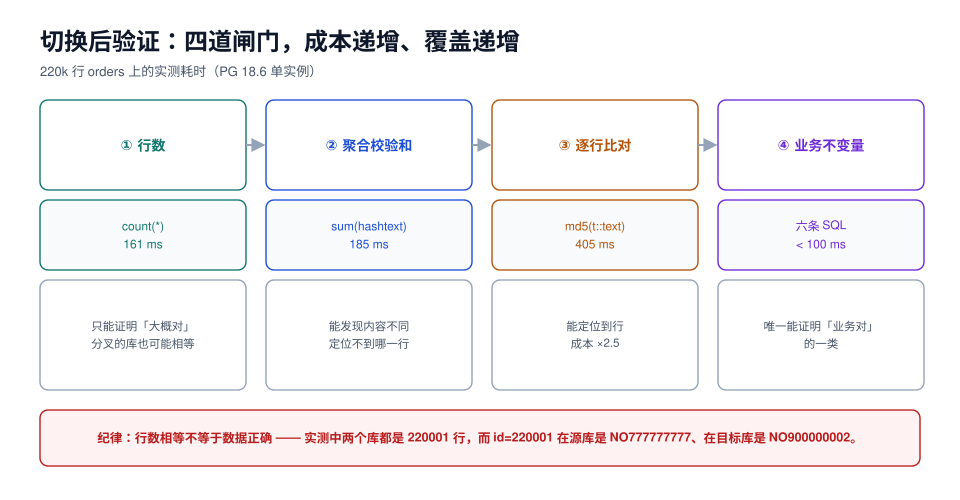

# 切换后验证：四道闸门

验证的目的不是「证明升级成功」，而是**「在放开写之前，用最低成本发现最可能出错的那几件事」**。这件事有一个残酷的前提：只比行数的验证会放过真实事故。

本页给四道闸门，从最便宜到最贵，每道都能在前一道通过之后才跑；以及一张「行数相等但数据不同」的实测反例。



## 一、闸门一：行数（最便宜，也最不可靠）

```sql
-- 目标端：核心表的行数（实测 161 ms，220k + 400k 行）
select (select count(*) from orders) as orders,
       (select count(*) from order_items) as items;
```

行数能发现的是「整表没搬过来」「复制彻底断了」这类粗错。它发现不了：

- 少了几行（差 1 行在 22 万行里几乎不可能被注意）；
- 主键冲突导致的行覆盖（数不变，内容变了）；
- 某几列的值错了。

## 二、闸门二：聚合校验和

```sql
-- 目标端：聚合校验和（实测 185 ms）
select count(*), sum(hashtext(order_no)::bigint) as h, sum(amount) as total
from orders;
```

在源库跑同一条，比对三个数。`sum(hashtext(...))` 对「行内容变化」敏感，对「行顺序」不敏感——正好符合需求。

| 手段 | 实测耗时（220k 行） | 能发现 | 不能发现 |
| --- | --- | --- | --- |
| `count(*)` | 161 ms | 整表缺失、复制全断 | 少几行、内容不同 |
| `sum(hashtext(col))` | 185 ms | 内容不同（整体） | 具体哪一行 |
| `md5(t::text)` 逐行 | 405 ms | 内容不同 + 可定位 | 成本最高 |

::: danger 行数相等不是一致性证据
本机实测的一对真实读数（源库与目标库）：

```text
-- 源库
select count(*) from orders;  -- 220001
select id, order_no from orders where id > 220000;
-- 220001 | NO777777777

-- 目标库
select count(*) from orders;  -- 220001   ← 完全相等
select id, order_no from orders where id > 220000;
-- 220001 | NO900000002
-- 220002 | NO900000009
```

两边都是 220001 行，而 `id = 220001` 指向两个**完全不同的订单**。原因是目标端序列没修，本地写入占用了 220001；源端复制过来的那一行也是 220001，撞了主键、永远没进来。

**只比行数的验收，会在这里给出「全绿」。**
:::

## 三、闸门三：序列与对象完整性

序列错位是切换后最典型的「第一批写入就报错」，必须在放开写之前查：

```sql
-- 目标端：每个序列都必须 ≥ 表内 max(id)（否则下一次写入会撞主键）
select 'orders' as t, (select last_value from orders_id_seq) as seq,
       (select coalesce(max(id),0) from orders) as max_id
union all
select 'order_items', (select last_value from order_items_id_seq),
       (select coalesce(max(id),0) from order_items);
-- 判定：seq >= max_id 才通过；is_called=false 时 seq 就是「下一个值」
```

对象完整性一并查掉：

```sql
-- 索引是否都有效（pg_upgrade / 并发建索引失败会留下 invalid）
select indexrelid::regclass from pg_index where not indisvalid;   -- 期望 0 行

-- 约束数量与升级前一致
select conrelid::regclass, count(*) from pg_constraint
where connamespace = 'public'::regnamespace group by 1 order by 1;

-- 扩展是否都在
select extname, extversion from pg_extension order by 1;
```

## 四、闸门四：业务不变量与计划回归

前三个闸门都在比「数据像不像」，最后一道问的是「业务对不对」。做法是把业务规则写成 SQL，返回空/0 才算通过。

以订单库为例（与 [EventOrderHub 需求](../../../../project/Complete/EventOrderHub/Requirements/index.md) 的六条不变量同源）：

```sql
-- ① 金额 = 明细之和
select o.id from orders o
join (select order_id, sum(qty*price) s from order_items group by 1) i on i.order_id = o.id
where o.amount <> i.s;

-- ② 没有孤儿明细
select i.id from order_items i left join orders o on o.id = i.order_id where o.id is null;

-- ③ 状态值在枚举内
select id, status from orders where status not in ('CREATED','PAID','RESERVED','SHIPPED','CLOSED','CANCELLED');

-- ④ 每个订单最多一条成功支付（示例：支付表存在时）
-- ⑤ 数量不为负
select id from order_items where qty <= 0;
```

四条都返回 0 行，才算「业务层面看起来对」。

计划回归用「同一条 SQL、两个库、对比计划」的方式做，不必追求全套基准测试：

```sql
-- 升级前后各存一份，比较的是「访问方式」而不是 cost
explain (analyze, buffers, format text)
select * from orders where user_id = 777 and status = 'PAID' order by created_at desc limit 20;
```

| 看什么 | 通过标准 | 不要看什么 |
| --- | --- | --- |
| 访问方式（Seq Scan / Index Scan） | 与升级前一致，或有合理解释 | `cost=` 的绝对值（统计信息刚重建，cost 不可比） |
| `Buffers: shared hit/read` | read 数量级一致 | 执行时间的绝对值（缓存冷热不同） |
| `rows removed by filter` | 不显著变大 | — |

::: tip 计划回归的最小可行做法
不必跑全量基准。挑 **5 条最核心的查询**（首页、下单、订单详情、列表分页、报表），升级前后各存一份 `EXPLAIN (ANALYZE, BUFFERS)` 输出，人工对比「访问方式」这一列。5 条里出现 1 条从 `Index Scan` 变成 `Seq Scan`，就值得查——通常是统计信息没重建，或某个索引没迁过来。
:::

## 五、观察期：切换后 24 小时盯五个数

| 指标 | 阈值 | 异常时的第一反应 |
| --- | --- | --- |
| 复制延迟（若旧库还在同步） | < 1 s | 查槽积压与网络 |
| 连接数 | < 池上限 × 0.8 | 查是否漏关连接 |
| 5xx / 写入失败率 | < 0.1% | 查序列、约束、认证 |
| 慢查询数（`pg_stat_statements`） | 与基线同量级 | 查计划回归 |
| 磁盘增长速率 | 与基线同量级 | 查 WAL 保留 / 槽 / 自动 vacuum |

## 六、验证结果怎么记录

一条一条记录，比一句「验证通过」有用得多：

| 闸门 | 命令 | 预期 | 实际 | 结论 |
| --- | --- | --- | --- | --- |
| 行数 | `count(*)` 双表 | 220001 / 400000 | 220001 / 400000 | ✅ |
| 校验和 | `sum(hashtext(order_no))` | 与源库一致 | 一致 | ✅ |
| 序列 | `last_value >= max(id)` | 全部满足 | orders 通过、items 通过 | ✅ |
| 不变量 | 四条 SQL | 全 0 行 | ② 返回 2 行 | ❌ 停止放开写 |

最后一行就是这套流程的价值：**它在业务写入之前拦住了孤儿明细。**

## 七、本页判据

| 编号 | 判据 | 看什么现象 | 不满足时改哪里 |
| --- | --- | --- | --- |
| `UGX-A` | 验证不止行数 | 验证清单有 ≥ 4 类 | 按四道闸门补 |
| `UGX-B` | 有跨库校验和比对 | 源/目标各一份聚合读数 | 加 `sum(hashtext(...))` |
| `UGX-C` | 每个序列都查了 `last_value >= max(id)` | 查询结果 | 补 `setval` |
| `UGX-D` | `pg_index` 无 invalid 索引 | 查询返回 0 行 | 重建索引 |
| `UGX-E` | 业务不变量写成 SQL 且全绿 | 四条查询输出 | 补规则；不许用「抽查几条」代替 |
| `UGX-F` | 核心查询的计划比对过 | 5 条 `EXPLAIN` 前后对照 | 补比对；差异逐条解释 |
| `UGX-G` | 统计信息已重建 | `pg_stat_user_tables.last_analyze` 非空 | `vacuumdb --analyze-in-stages` |
| `UGX-H` | 有 24 小时观察项与阈值 | 观测面板 | 补五个指标 |

## 参考资料

- PostgreSQL 18 Documentation: `EXPLAIN`（`ANALYZE` / `BUFFERS`）、`pg_index`、`pg_stat_user_tables`
- PostgreSQL 18 Documentation: *Routine Vacuuming*（统计信息与计划质量）
- MySQL 8.4 Reference Manual: `CHECKSUM TABLE`、`mysqlcheck --check-upgrade`
- 本仓库：[SQL 优化的执行计划读法](../../../DB/Relational/SQLOptimization/ExplainPlan/index.md)、[EventOrderHub 的六条不变量](../../../../project/Complete/EventOrderHub/Requirements/index.md)
