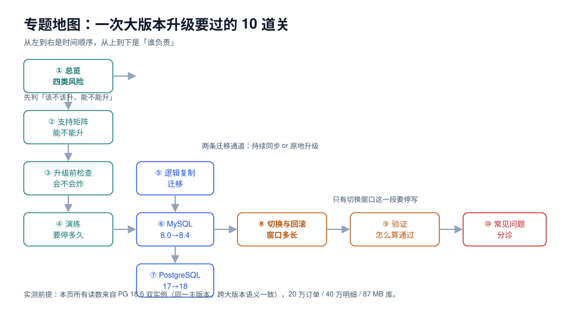

# 数据库大版本升级与切换

升级数据库的大版本，和「装个新版本试试」是两件完全不同的事：新版本没有读旧数据页的能力，所以要么把数据搬过去，要么让两个版本同时活着一段时间。搬数据的那条路要停写，两个版本并存的那条路要处理**行过去了、序列和 DDL 没过去**的一堆缺口。

本专题面向要在一个维护窗口内把生产库从 A 版本换到 B 版本的后端与 DBA：把「能不能升、要停多久、怎么切、切完怎么算通过、出问题怎么回」讲成上线前能算出来、切换时能照着念的五件事。

::: tip 一句话理解
大版本升级的难点不是「怎么装新版本」，而是**「哪一段时间必须停写」**——把这一段压到最短，其余的活都在业务运行时干完；而压到最短的前提是知道**哪些东西不跟着复制走**（序列、DDL、大对象、统计信息）。
:::

::: info 本专题与相邻专题的分工
- **备份怎么做、保留几份、RTO/RPO 怎么定** → [备份与容灾](../../Ops/BackupDR/index.md)：那里管「数据没了怎么找回来」，本专题管「怎么把数据搬到一个新版本上」，但升级前那次备份是**本专题的前置条件**，不是流程礼仪。
- **表结构怎么在线改** → [数据库变更与在线 Schema 演进](../../DB/SchemaEvolution/index.md)：那里管「同版本内改表」，本专题管「换版本」；两者的交集只有一处——**升级窗口里的 DDL 必须冻结**。
- **慢查询怎么治、执行计划怎么读** → [SQL 优化](../../DB/Relational/SQLOptimization/index.md)：升级后计划回归是本专题的验证项，但「为什么这个计划变差」去那页看。
- **连接池多大、连接怎么治理** → [连接治理](../../DB/Middleware/ConnectionGovernance/index.md)：切换瞬间的连接风暴是本专题的坑，池子怎么配去那页看。
- **多活单元、流量怎么切** → [多活架构的流量切换](../../Ops/MultiActive/TrafficSwitch/index.md)：那里切的是机房，本专题切的是**库**；顺序必须是「先摘写流量，再切库」，反过来就是双写。
- **变更怎么分级、窗口怎么批** → [变更管理与发布工程](../../Ops/ChangeManagement/index.md)：升级属于高危变更，走的是那套审批与冻结期，本专题只提供它的技术判据。
- **PostgreSQL 日常备份恢复** → [PostgreSQL 备份与恢复](../../DB/Relational/PostgreSQL/BackupRestore/index.md)：单机 `pg_dump` / PITR 的操作细节在那页，本专题只讲它们在升级里扮演的角色。
- **MySQL 的安装与参数** → [MySQL 概述](../../DB/Relational/MySQL/Overview/index.md)：版本差异的语法层去那里，本专题只讲「跨版本时哪些东西会变」。
- **周期 7 项目的技术选型与本地最小可跑集** → [EventOrderHub 技术基线](../../../project/Complete/EventOrderHub/TechBaseline/index.md)：项目侧把版本定到小版本，本专题讲怎么从旧版本走到那个版本。
:::

## 目录

- [总览：四类风险与五个阶段](Overview/index.md)
- [支持矩阵：哪些能升、哪些必须先过一站](SupportMatrix/index.md)
- [升级前检查：六道闸门](Precheck/index.md)
- [演练与时间估算：把「停多久」算出来](Rehearsal/index.md)
- [逻辑复制迁移：行过去了，序列没过去](LogicalMigration/index.md)
- [MySQL 8.0 → 8.4：三条路与三个断点](MySQL80To84/index.md)
- [PostgreSQL 17 → 18：pg_upgrade 在搬什么](PostgreSQL17To18/index.md)
- [切换窗口与回滚：0.78 秒里做了什么](Cutover/index.md)
- [切换后验证：四道闸门](Verify/index.md)
- [常见问题与分诊](FAQ/index.md)

## 专题地图

## 判据纪律

沿用全库写法：**每页 8 条，编号形如 `UGO-A`**，逐页前缀唯一，可被 `utils/audit` 下的判据类巡检机械核对。每条判据都要能回答三件事：**看什么现象、判成什么、不满足时改哪里**。

| 页 | 判据族 | 条数 | 这一族管什么 |
| --- | --- | --- | --- |
| 总览 | `UGO-A` ~ `UGO-H` | 8 | 风险分类、阶段卡点与升级单要件 |
| 支持矩阵 | `UGV-A` ~ `UGV-H` | 8 | 路径可达性、EOL 状态、不可跳版 |
| 升级前检查 | `UGC-A` ~ `UGC-H` | 8 | 对象清点、兼容性、参数认证、容量 |
| 演练与估算 | `UGD-A` ~ `UGD-H` | 8 | 三段耗时、读数留档、演练验收 |
| 逻辑复制 | `UGL-A` ~ `UGL-H` | 8 | 全量、追平、序列、DDL、槽 |
| MySQL 路径 | `UGM-A` ~ `UGM-H` | 8 | 认证插件、参数移除、复制术语 |
| PostgreSQL 路径 | `UGP-A` ~ `UGP-H` | 8 | pg_upgrade、扩展、统计信息 |
| 切换与回滚 | `UGT-A` ~ `UGT-H` | 8 | 停写顺序、删槽、回滚点 |
| 验证 | `UGX-A` ~ `UGX-H` | 8 | 行数、校验和、序列、计划 |
| 常见问题 | `UGQ-A` ~ `UGQ-H` | 8 | 症状分诊与窗口自查 |

合计 **10 族 80 条**。

## 事实与版本速览（2026-10 核对）

| 项 | 现状 | 对升级的影响 |
| --- | --- | --- |
| PostgreSQL 18 | 2025-09 发布，当前稳定线为 **18.6**（2026-08-13） | 本专题的「目标版本」基线：`pg_upgrade` 从 17 及更早升上来 |
| PostgreSQL 19 | **RC1 于 2026-10-15 发布**，正式版尚未 GA | 还不能作为生产目标；它的两个变化会改变本文的结论，见下文 |
| PostgreSQL 17 / 16 / 15 | 17.11 / 16.15 / 15.19（2026-08-13） | 都还在支持期；PG 14 将于 **2026-11-12** 停止修复 |
| MySQL 8.4 LTS | GA 2024-04，Premier 至 2029-04、EOL 2032-04（当前 8.4.11） | 8.0 的升级目标；LTS 序列**不可跳版** |
| MySQL 8.0 | **2026-04-30 已停止支持**（末版 8.0.46） | 升级起步版本；低于 8.0.37 要先补到 8.0.46 |
| MySQL 9.x / 9.7 LTS | 9.x 为 innovation；9.7 为 2026-04 起的 LTS | 8.0 不能直达 9.x，必须经 8.4 |

::: warning 关于「版本目录」这个决定
本库对**两代技术栈并存**的主题按版本建目录（`Spring5/` 与 `Spring6/`、`MySQL57/` 与 `MySQL84/` 在 [SchemaEvolution](../../DB/SchemaEvolution/index.md) 里）。本专题**不按版本建目录**，三条理由：

1. **它不是产品文档，是一条路径。** 「Spring 5 怎么写」和「Spring 6 怎么写」是两套可独立阅读的用法；「17 升 18」和「18 升 19」共享 90% 的步骤，差异集中在少数几处（认证、参数、扩展），拆成两套目录会立刻产生两份高度重复的正文。
2. **版本是这条路径的两端，不是章节。** 同一个操作（`pg_upgrade --link`）在「17→18」和「18→19」里是同一件事，差别只在两端的兼容性清单，而清单是表格形态，放表格比放目录更准确。
3. **旧内容不覆盖。** 版本相关的既有页面（`DB/SchemaEvolution/MySQL57`、`MySQL84`、`DB/Relational/PostgreSQL/*`）**一条都没有删改**，本专题只在需要时追加「与升级的关系」一节。

真正需要「两套并存」的地方只有一处例外：**两条不同数据库的原地升级路径**（MySQL 8.0→8.4、PostgreSQL 17→18）各自独立成页，因为它们的前置条件、失败形态和回退方式几乎不重叠。
:::

::: info 关于实测的诚实标注
本专题的读数分三档，页面里逐处标注：

1. **双实例实测（18.6 ↔ 18.6）**：停写窗口、全量与追平耗时、序列缺口、DDL 缺口、校验成本，全部来自 `docker run` 的两个 **PostgreSQL 18.6** 实例与 20 万订单 / 40 万明细 / 87 MB 的库。
2. **跨大版本实测（17.11 → 18.6）**：另起一个 `postgres:17` 实例复验了逻辑复制通道——初次同步 5 行全部到达、源端新增 1 行后目标端变成 6 行；同时确认目标端**根本没有对应的序列对象**（`relation "x1_id_seq" does not exist`），即序列缺口不是「值不同」而是「对象不存在」。
3. **文档结论（未实测）**：`pg_upgrade` 的二进制搬运、MySQL 8.0 → 8.4 的认证插件与参数移除、PG 19 的变化清单——按官方文档与 release notes 编写，页面内不写实测读数。

所有数字都可以复跑：`docker run` 两个实例，按页面里的 SQL 与命令顺序执行即可。
:::
