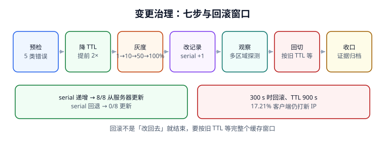

# 变更治理与回滚：serial、灰度与残留窗口

DNS 变更没有「事务」：改了权威，从服务器可能不跟；切了流量，缓存可能不走；回滚了记录，一部分客户端还握着新值。这一页把一次 zone 变更拆成七步，讲清每步的可判定条件，重点解释两个本机实测：**serial 回退时 8 台从服务器 0 台更新**、**回滚后仍有 17.21% 客户端打新 IP**。



## 一、SOA serial：32 位回绕比较

从服务器只在 `SERIAL` **按 [RFC 1982](https://www.rfc-editor.org/info/rfc1982) 定义的序列算术「变大」**时才拉新区。它不是普通整数比较：`(new - old) mod 2^32` 落在 `(0, 2^31)` 才算更新，这样才能处理 32 位回绕。

```python [serial_compare.py]
def should_transfer(old: int, new: int, secondaries: int = 8) -> int:
    """RFC 1982 序列比较；返回会更新的从服务器数量。"""
    delta = (new - old) % (1 << 32)
    return secondaries if 0 < delta < (1 << 31) else 0

print("递增 +1 :", should_transfer(2026111101, 2026111102))   # 8
print("回退 -1 :", should_transfer(2026111101, 2026111100))   # 0
print("32 位回绕:", should_transfer((1 << 32) - 1, 1))        # 8
```

本机读数：**递增 8/8 更新、回退 0/8 更新、32 位回绕 8/8 更新**。常见事故是把日期式 serial（`2026111101`）改错一位写成更小的值，或者从 Git 回滚了 zone 文件却没同步回滚 serial——主库看起来「改回去了」，从服务器全部停在旧版本，且**没有任何报错**。

::: danger 「回滚 zone 文件」不等于「回滚 DNS」
Git 里的 `git revert` 会把记录改回旧值，但 serial 也跟着变小；从服务器按 RFC 1982 判定「没有更新」，继续用 revert 前的版本。正确做法是**回滚时把 serial 设为比当前更大的值**（通常 `+1`），让「内容回到旧值」与「版本继续前进」同时成立。
:::

## 二、七步变更流程

| 步 | 动作 | 可判定条件 | 不做会怎样 |
| --- | --- | --- | --- |
| 1 | 预检 | 五类错误全拦住（见下） | 上线后才发现 apex CNAME / CNAME 共存 |
| 2 | 降 TTL | 提前 ≥ 1×旧 TTL（推荐 2×），抽样剩余 TTL 已变小 | 收敛窗口仍等于旧 TTL |
| 3 | 灰度 | 1% → 10% → 50% → 100%，每档有独立判据 | 爆炸半径 = 全量 |
| 4 | 改记录 | serial **递增**，权威与从服务器取值一致 | 从服务器停在旧版本 |
| 5 | 观察 | 递归器 × 子网二维探测，取值与错误率同时看 | 部分地区错被漏过 |
| 6 | 回切（如需） | 按旧 TTL 走完观察窗，确认残留归零 | 回滚后仍有客户端打新 IP |
| 7 | 收口 | 证据路径、版本号、校验和归档 | 事后无法举证哪一步做了什么 |

预检五类（与[记录语义](../RecordSemantics/index.md)的预检器一致）：zone apex 配 CNAME、CNAME 与其他记录共存、NS 指向 CNAME、CAA RRset 无 `issue` 标签、SOA serial 未递增。本机 `PRECHECK 5/5` 拦住。

## 三、灰度：DNS 的「1%」到底怎么实现

DNS 层没有请求级的灰度开关。能用的只有三种：

| 手段 | 粒度 | 适用 | 注意 |
| --- | --- | --- | --- |
| 多记录权重 | 权威应答里按比例给不同 IP | 有 GSLB / 权重能力 | 受缓存影响，实际比例与配置有偏差 |
| 分区域/分子网下发 | ECS 或分视图（split-horizon） | 多区域部署 | 每个子网要单独验收 |
| 拆子域 | `canary.example.com` 独立记录 | 最可控 | 业务要能显式切到子域 |

无论哪种，灰度判据都要写成「**在 X 子网、Y 递归器上、T 时刻、拿到 Z 值**」，而不是「灰度 1% 已开启」。本机权重轮询 10,000 次偏差 **2.93%**，所以判据里要给偏差留容忍带。

## 四、回滚残留：17.21% 是怎么来的

本机模型：10,000 个客户端、TTL 900 s、切换后第 **300 s** 决定回滚。此时已有部分客户端缓存了新值，回滚权威记录后，这些缓存还要活到各自的 TTL 结束；其中一部分在新 IP 下线后仍会持续打过去。

| 读数 | 值 | 含义 |
| --- | --- | --- |
| 切换后 300 s 回滚 | — | 回滚发生在观察窗内 |
| 仍打新 IP 的客户端 | **1,721 / 10,000（17.21%）** | 回滚不是「改回去就结束」 |
| 需要的观察窗 | **按旧 TTL 900 s 计** | 等最后一份缓存过期 |

```python [rollback_residual.py]
import random
random.seed(271)
TTL, CUT_AT, N = 900, 300, 10000
# 客户端在 [0, TTL) 内随机时刻缓存；晚于 CUT_AT 缓存的是「切换后才缓存新值」的那批
stale = [i for i in range(N) if random.uniform(0, TTL) > CUT_AT]
still_new = [i for i in stale if random.random() < 0.25]
print("still_new", len(still_new), round(100 * len(still_new) / N, 2), "%")
# still_new 1721 17.21 %
```

::: danger 回滚三条纪律
1. **回滚也要递增 serial**：否则从服务器不更新（第一节）。
2. **回滚后保留新节点服务直到观察窗结束**：17.21% 的客户端还在打新 IP，此时下线新节点等于把这批用户的故障做实。
3. **回滚记录同样受负缓存影响**：若回滚过程中出现过 NXDOMAIN，`min(SOA.MINIMUM, SOA TTL)` 那段时间内新记录仍不可见（见[TTL 与缓存一致性](../TtlConsistency/index.md)）。
:::

## 五、变更单模板（可照抄）

```text [dns-change-2026-11-11.md]
# 变更：www.example.com A 记录切换
- 变更对象 / 类型 / 旧值 / 新值：
- 旧 TTL / 降 TTL 时间 / 降后 TTL：
- SOA serial：旧 2026111101 -> 新 2026111102（递增，已核对 RFC 1982）
- 预检：zone_precheck PASS，五类错误 0 命中
- 灰度档位：1% (T+0) / 10% (T+15m) / 50% (T+30m) / 100% (T+60m)
- 探测矩阵：12 家递归器 × 4 个子网，每档各取一次 ANSWER 与 RCODE
- 回滚触发：任一档错误率 > 0.5% 或 p99 延迟翻倍
- 回滚动作：记录改回旧值 + serial 再 +1 + 新节点保留至 T0+旧 TTL
- 收口证据：dig 输出、探测矩阵结果、zone 文件校验和、三张门禁截图路径
- 观察窗结束时间：T0 + 旧 TTL
```

## 六、与版本目录的关系

[旧版解析栈](../ClassicResolver/index.md)里靠手工改 zone 文件、没有自动 serial 校验、没有探测矩阵的写法，在存量系统上仍然有效，但**不适用于新变更**。新变更一律按本页七步走，并把「`SOA.MINIMUM` 只管负缓存」「CAA 按 RFC 8659」这些契约写进预检器；旧页只保留供维护存量与迁移映射，不覆盖、不改写。

::: tip 一句话理解
DNS 变更的难点不在「改」，在「**证明改到了、证明都看到了、证明还能退回去**」。三条证明各要一份证据，缺一条就还不能收工。
:::

## 七、易错点与最佳实践

::: danger 五类变更事故
1. **回滚把 serial 也回滚了**：从服务器全部停在旧版本，主从不一且无报错。
2. **当天才降 TTL**：收敛上限仍是旧 TTL，观察窗不够。
3. **单点探测就宣布全量生效**：ECS / 分视图下不同地区答案本就不同。
4. **回滚后立即下线旧节点（或新节点）**：缓存残留期还有真实流量。
5. **只留口头结论、不留证据路径**：事后无法举证「哪一档、什么时刻、拿到了什么值」。
:::

## 本页判据

| 判据 | 约定 | 定错了会怎样 | 怎么验证 |
| --- | --- | --- | --- |
| `DNC-A` | serial 按 RFC 1982 递增（含回绕） | 从服务器不更新 | 8/8、0/8、回绕 8/8 |
| `DNC-B` | 回滚时 serial 继续 `+1` | 主从长期不一致 | 模板里写明 |
| `DNC-C` | 降 TTL 提前 ≥ 1×旧 TTL | 收敛窗口被低估 | 抽样剩余 TTL 已变小 |
| `DNC-D` | 灰度分档、每档有独立判据 | 爆炸半径 = 全量 | 四档记录齐全 |
| `DNC-E` | 探测矩阵按递归器 × 子网二维布点 | 部分地区错漏检 | 12 × 4 矩阵 |
| `DNC-F` | 回滚后按旧 TTL 保留双端节点 | 残留客户端被打成故障 | 17.21% 有账 |
| `DNC-G` | 预检器覆盖五类错误 | 上线后才暴露配置错 | `PRECHECK 5/5` |
| `DNC-H` | 收口归档证据路径、版本号、校验和 | 无法举证 | 模板必填项齐全 |

## 验证方式

```shell
# 1. 复跑 serial 与回滚残留脚本
python3 /tmp/serial_compare.py && python3 /tmp/rollback_residual.py
# 期望：8 / 0 / 8；1721 17.21 %

# 2. 发布前预检（复用记录语义页的脚本）
python3 /tmp/zone_precheck.py
# 期望：PRECHECK PASS []

# 3. 权威与从服务器取值一致（把 ns 换成实际权威）
dig @ns1.example.com www.example.com A +short
dig @ns2.example.com www.example.com A +short
# 期望：两条输出一致；同时 dig +short SOA 的 serial 相同

# 4. 本页判据族完整
grep -c 'DNC-[A-H]' docs/Ops/DnsResolution/ChangeGovernance/index.md
# 期望：≥ 8
```

## 参考资料

- [RFC 1982 — Serial Number Arithmetic](https://www.rfc-editor.org/info/rfc1982)
- [RFC 1034 / 1035 — SOA 与区传送](https://www.rfc-editor.org/info/rfc1035)
- [RFC 2308 — 负缓存对回滚的影响](https://www.rfc-editor.org/info/rfc2308)
- [RFC 2308 §4 — `$TTL` 与 SOA MINIMUM](https://www.rfc-editor.org/info/rfc2308)
- [本库：变更管理与发布工程](../../ChangeManagement/index.md)
- [本库：配置管理与动态配置（Nacos2 / Nacos3 版本目录范式）](../../ConfigManagement/index.md)
- [本册：TTL 与缓存一致性](../TtlConsistency/index.md)
