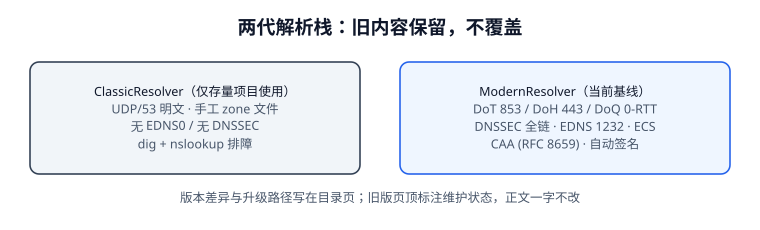

# 旧版解析栈（UDP/53 明文 + 手工 zone）

::: danger 版本状态：仅存量项目使用 · 已停止新增
本页描述的是**2010 年代至 DNS Flag Day 2020 之前**仍在广泛使用的传统解析栈配置写法。按 `AGENTS.md` 第 3 节「大版本管理」，此处**原样保留旧写法与旧口径，不改写、不与新版合并**；新项目一律使用[当前主线解析栈](../ModernResolver/index.md)。本页只用于：维护存量系统、读懂老 zone 文件、以及做迁移映射。
:::

传统栈一句话概括：**客户端与递归器之间走明文 UDP/53，权威靠手工维护 zone 文件，没有 EDNS(0)、没有 DNSSEC、没有加密传输**。它今天仍能工作，但它的很多「约定」被后来的 RFC 明确改掉了——读老文档时最容易把旧口径当现行规范。



## 一、旧栈的典型配置

```text [example.com.zone（传统写法，保留原样）]
; 注意：没有 $TTL 指令，缺省 TTL 依赖 SOA 的最后一个字段（旧口径）
example.com.    IN SOA  ns1.example.com. hostmaster.example.com. (
                2015030101  ; serial，手工按日期改
                3600        ; refresh
                600         ; retry
                604800      ; expire
                3600        ; minimum —— 旧实现把它当「默认 TTL」
)
example.com.        IN NS   ns1.example.com.
ns1.example.com.    IN A    192.0.2.53
example.com.        IN A    192.0.2.20
www.example.com.    IN A    192.0.2.20
mail.example.com.   IN A    192.0.2.25
example.com.        IN MX   10 mail.example.com.
```

```shell [旧栈排障命令]
# 明文查询，无 EDNS 声明，UDP 答复上限 512 字节
nslookup www.example.com 192.0.2.53
dig @192.0.2.53 www.example.com A

# 手工确认主从同步（没有自动化预检）
dig @ns2.example.com example.com SOA +short
# 期望：serial 与 ns1 一致；不一致就手工检查区传送
```

| 特征 | 旧栈取值 | 为什么当时合理 |
| --- | --- | --- |
| 传输 | UDP/53 明文，512 字节上限 | 响应小、网络简单、无隐私合规要求 |
| 默认 TTL | 靠 `SOA.MINIMUM` 兜底 | 早期实现把 MINIMUM 兼任三义（最小 TTL / 默认 TTL / 负缓存 TTL） |
| 签名 | 无 DNSSEC | 信任网络路径与递归器，部署成本高 |
| 加密 | 无 DoT / DoH / DoQ | 协议尚未标准化（RFC 7858 是 2016 年，9250 是 2022 年） |
| CAA | 无 | RFC 6844 到 2013 年才发布，且未强制 |
| 变更 | 手工改 serial + 手工比对主从 | 区数量少、变更频率低 |

## 二、三条已经被改掉的旧口径

::: warning 以下三条是「旧写法」，不是现行规范
1. **`SOA.MINIMUM` 当默认 TTL**：[RFC 2308](https://www.rfc-editor.org/info/rfc2308) 明确废止该含义，规定它现在**只用于负缓存 TTL**，并引入 `$TTL` 指令提供缺省 TTL。
2. **「512 字节够用」**：DNSSEC 签名响应、多条 AAAA、SVCB 参数都会超；[RFC 6891](https://www.rfc-editor.org/info/rfc6891) 的 EDNS(0) 与 [RFC 7766](https://www.rfc-editor.org/info/rfc7766) 的 TCP 必选改变了这一前提。
3. **CAA 沿 CNAME 链做 tree climbing**：RFC 6844 的旧算法效率极低且会误伤托管客户，[RFC 8659](https://www.rfc-editor.org/info/rfc8659)（2019）已废止 6844，改为只沿 FQDN 爬升。
:::

## 三、什么情况下还得读这一页

| 场景 | 该做什么 | 不该做什么 |
| --- | --- | --- |
| 接手一个 2015 年的内网 DNS | 先确认 zone 有没有 `$TTL`、serial 是不是手工 | 别直接照抄旧文件建新区 |
| 老系统迁移到托管 DNS | 按第四节映射表逐项对照 | 别把 `MINIMUM=3600` 当成「TTL 就是 3600」搬过去 |
| 线上出现「TTL 变成 0」的怪事 | 怀疑平台不再按旧口径兜底 | 别改 `MINIMUM` 去「修复」负缓存语义 |
| 排查只有 UDP/53 的防火墙 | 确认大答复是否被截断 | 别用「降 TTL」处理截断问题 |

## 四、迁移映射表（旧写法 → 当前写法）

| 旧写法 / 旧口径 | 当前写法 | 依据 | 本册章节 |
| --- | --- | --- | --- |
| 无 `$TTL`，靠 `SOA.MINIMUM` 兜底 | zone 首行加 `$TTL 300`，每条 RR 显式 TTL | RFC 2308 §4 | [记录语义](../RecordSemantics/index.md) |
| UDP/53、512 字节 | EDNS 缓冲区 1232、`TC=1` 切 TCP、放行 TCP/53 | DNS Flag Day 2020 / RFC 6891 / 7766 | [解析链](../ResolutionPath/index.md) |
| 无签名 | DS 在注册商登记、DNSKEY/RRSIG 自动签名与轮换 | RFC 4033~4035 | [信任链](../DnssecChain/index.md) |
| 明文查询 | 按需启用 DoT 853 / DoH 443 / DoQ，并显式选择 fail-open/closed | RFC 7858 / 8484 / 9250 | [加密传输](../EncryptedTransport/index.md) |
| 无 CAA | `CAA 0 issue "..."`（+ 可选 `issuewild` / `iodef`） | RFC 8659 | [记录语义](../RecordSemantics/index.md) |
| 手工改 serial、人工比对主从 | 流水线预检 + RFC 1982 递增 + 探测矩阵 | RFC 1982 | [变更治理](../ChangeGovernance/index.md) |
| 本机 `nslookup` 一次判定 | 12 家递归器 × 4 子网二维探测 | 本册实测 | [流量调度](../TrafficSteering/index.md) |

::: tip 迁移顺序建议
先加 `$TTL` 与显式 TTL（不改变解析结果、风险最低）→ 再放开 TCP/53 与 EDNS 1232 → 再上 CAA（只影响证书签发）→ 最后才动 DNSSEC 与加密传输（这两项会改变失败形态）。每一步都单独走一次[变更七步](../ChangeGovernance/index.md)，不要一次切完。
:::

## 五、存量系统巡检清单

接手一台还在跑旧栈的权威时，先花十分钟把下面六项跑一遍，再谈迁移。这些命令都只读，不改变任何配置。

| 巡检项 | 命令 | 期望 / 不达标的含义 |
| --- | --- | --- |
| zone 有没有 `$TTL` | `grep -c '^\$TTL' example.com.zone` | 0 说明仍靠 `SOA.MINIMUM` 兜底，迁移第一步必须先补 `$TTL` |
| serial 是否手工且递增 | `dig @ns1 example.com SOA +short` | 与 `ns2` 比对；不一致说明区传送或 serial 已出问题 |
| 主从记录是否一致 | `dig @ns2 example.com A +short` | 与 `ns1` 逐字相同；不同则先修同步，不要先改业务记录 |
| NS 是否有胶水 | `dig +trace example.com NS` | 能看到 ADDITIONAL 段的 A/AAAA；缺失时子域内 NS 会成环 |
| 大答复是否可用 | `dig +tcp @ns1 example.com ANY` | `NOERROR`；超时说明 TCP/53 被防火墙拦了 |
| 是否已有 CAA / DNSSEC | `dig +short CAA example.com` / `dig +dnssec example.com A` | 旧栈通常都为空；为空不代表「安全配置完成」，只是没有这两层 |

```shell
# 一条命令拿到存量权威的四个关键值（把 ns1 / example.com 换成实际值）
for t in SOA A NS CAA; do
  printf '%-4s ' "$t"
  dig +short "@ns1.example.com" example.com "$t" | head -1
done
# 期望：SOA 有 serial、A 有地址、NS 有名字；CAA 为空是旧栈常态，登记为迁移项
```

::: tip 巡检结果怎么用
把六项结果原样贴进迁移单，作为「迁移前基线」。迁移后逐项复跑同一组命令：新增的应该是 `$TTL`、CAA、RRSIG 与 TCP 可用性，**A / NS / SOA 的结构不应被改动**。任何一项「迁移前后都变了但没人安排过」，都要先停下查清，别带着未知差异继续下一步。
:::

## 六、保留纪律

本页不接受「顺手更新成新版写法」的修改。需要新增能力写进[当前主线解析栈](../ModernResolver/index.md)；需要补充迁移说明，只在本页第四节加一行映射。目录页与侧边栏同时保留本页入口，并在页顶保留状态标注——这是 `AGENTS.md` 第 3 节对旧版本目录的硬性要求。

## 本页判据

| 判据 | 约定 | 定错了会怎样 | 怎么验证 |
| --- | --- | --- | --- |
| `DNL-A` | 页顶标注「仅存量项目使用 · 已停止新增」 | 读者误当现行规范 | 状态容器存在 |
| `DNL-B` | 旧写法原样保留，不改写不合并 | 迁移时失去对照基线 | 本页 git diff 不含旧块改写 |
| `DNL-C` | 明确列出三条已被改掉的旧口径 | 把旧口径当现行规范 | `::: warning` 三条齐全 |
| `DNL-D` | 迁移映射表给出「依据 + 本册章节」 | 迁移无出处 | 七行映射齐全 |
| `DNL-E` | 迁移按风险从低到高分步 | 一次切完无法定位 | 四步顺序表 |
| `DNL-F` | 侧边栏保留旧版入口且可折叠 | 存量项目查不到 | 侧边栏有该叶子 |
| `DNL-G` | 目录页同时列出两版并说明差异 | 只有新版入口 | 目录页第五节 |
| `DNL-H` | 新能力不写进旧页 | 两版内容逐渐混同 | 本页无新增配置段 |

## 验证方式

```shell
# 1. 确认旧页状态标注与映射表都在
grep -c '仅存量项目使用' docs/Ops/DnsResolution/ClassicResolver/index.md
# 期望：≥ 1
grep -c 'RFC' docs/Ops/DnsResolution/ClassicResolver/index.md
# 期望：≥ 6

# 2. 确认两版入口同时挂在目录页
grep -E 'ClassicResolver|ModernResolver' docs/Ops/DnsResolution/index.md
# 期望：各至少 1 行

# 3. 本页判据族完整
grep -c 'DNL-[A-H]' docs/Ops/DnsResolution/ClassicResolver/index.md
# 期望：≥ 8
```

## 参考资料

- [RFC 2308 §4 — SOA MINIMUM 与 `$TTL` 的历史变更](https://www.rfc-editor.org/info/rfc2308)
- [RFC 6844 — 已被 RFC 8659 废止的 CAA 旧规范](https://www.rfc-editor.org/info/rfc6844)
- [RFC 1035 — 传统 zone 文件格式](https://www.rfc-editor.org/info/rfc1035)
- [DNS Flag Day 2020 — 512 字节假设的终结](https://www.dnsflagday.net/)
- [本册：当前主线解析栈](../ModernResolver/index.md)
- [本册目录页 · 版本目录说明](../index.md)
