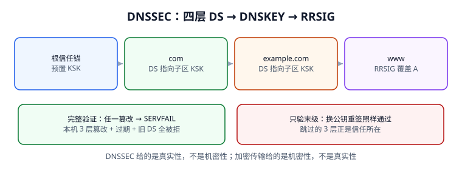

# DNSSEC 信任链：真实性不是机密性

DNSSEC 给 DNS 加的是**数据来源认证与完整性**，不是加密。它让递归器能证明「这份答案确实由该区持有人签发、且没被改过」，但链路上任何人仍能看到你查了什么。这一页把四层信任链、四种验证状态、三种典型故障和一条反向探针讲清楚——重点是：**只验证末级签名，等于没启用 DNSSEC**。



## 一、它解决什么，不解决什么

| 能力 | DNSSEC 是否提供 | 由谁提供 |
| --- | --- | --- |
| 答案没被篡改 | **是**（RRSIG 覆盖 RRset） | 签名 + 逐级 DS 绑定 |
| 名字确实不存在 | **是**（NSEC / NSEC3 否定证明） | 签名过的区间覆盖 |
| 查询内容不被偷看 | 否 | DoT / DoH / DoQ（见[加密传输](../EncryptedTransport/index.md)） |
| 权威一定在线 | 否 | 任播、多服务商、serve-stale |
| 客户端到递归器那一跳可信 | 否（除非客户端自己验证） | 加密传输 + 本机验证器 |

::: info 术语首次出现
`DNSSEC`（Domain Name System Security Extensions，域名系统安全扩展）由 [RFC 4033](https://www.rfc-editor.org/info/rfc4033) / 4034 / 4035 定义。它给每个 RRset 附一条 `RRSIG`（签名），把公钥放在 `DNSKEY` 里，再由**父区**用 `DS`（Delegation Signer，委派签名者）记录对子区公钥做哈希承诺，一路追到预置的**根信任锚**。
:::

## 二、四层链与三种记录

| 层 | 记录 | 作用 | 谁签 |
| --- | --- | --- | --- |
| 根 | 预置 KSK（信任锚） | 整个链的起点，**不在 DNS 里取得** | 本地配置 / 系统信任库 |
| TLD | `DS` | 承诺 `.com` 的 KSK 摘要 | 根区签 |
| 区 | `DNSKEY` + `DS` | 公布本区公钥，承诺子区公钥 | 父区给 DS、本区自签 DNSKEY |
| 记录 | `RRSIG` | 覆盖 A / AAAA / MX 等 RRset | 本区 ZSK 签 |

验证顺序是：**先验 DS 指向的 DNSKEY，再验 RRSIG**。任何一层对不上，结果就是 `bogus`，递归器返回 `SERVFAIL`（不是 `NXDOMAIN`，也不是一个「看起来可疑」的 IP）。

## 三、可运行：完整链路验证与反向探针

下面是本机建模脚本（用 SHA-256 演示摘要绑定关系，真实 DNSSEC 用 RSA/ECDSA/Ed25519 签名，但**链式结构完全一致**）。关键是它真的逐层替换密钥并重新走链，而不是直接返回结论：

```python [dnssec_chain.py]
import hashlib

zones = ["root", "com", "example.com", "www.example.com"]
keys = {z: hashlib.sha256(("KSK:" + z).encode()).hexdigest() for z in zones}
ds = {zones[i+1]: hashlib.sha256(keys[zones[i]].encode()).hexdigest()
      for i in range(len(zones) - 1)}
answer = "203.0.113.10"
sig = hashlib.sha256((keys[zones[-1]] + ":A:" + answer).encode()).hexdigest()

def full_verify(tamper_layer=None, expired=False, stale_ds=False):
    work = dict(keys)
    if tamper_layer is not None:
        work[zones[tamper_layer]] = "ATTACKER-KEY"
    if expired or stale_ds:
        return "BOGUS->SERVFAIL"
    for i in range(len(zones) - 1):
        child, parent = zones[i+1], zones[i]
        if ds[child] != hashlib.sha256(work[parent].encode()).hexdigest():
            return "BOGUS->SERVFAIL"
    if hashlib.sha256((work[zones[-1]] + ":A:" + answer).encode()).hexdigest() != sig:
        return "BOGUS->SERVFAIL"
    return "SECURE"

for layer in (1, 2, 3):
    print("tamper_L%d" % layer, full_verify(tamper_layer=layer))
print("expired", full_verify(expired=True))
print("stale_ds", full_verify(stale_ds=True))
print("clean", full_verify())

# 反向探针：只验末级签名（跳过 DS -> DNSKEY 链）
def leaf_only(attacker_replaced_key=True):
    # 验证者没有独立的公钥来源，只能拿「响应里给的公钥」验「响应里给的签名」。
    # 攻击者把两者一起换掉，末级校验必然自洽 —— 这正是跳过 DS 链的结构性后果。
    pub = "ATTACKER-KEY" if attacker_replaced_key else keys[zones[-1]]
    attacker_sig = hashlib.sha256((pub + ":A:" + answer).encode()).hexdigest()
    expected = hashlib.sha256((pub + ":A:" + answer).encode()).hexdigest()
    return "SECURE(误判)" if attacker_sig == expected else "BOGUS"
print("leaf_only", leaf_only())
```

本机读数：

| 用例 | 完整链验证 | 只验末级 |
| --- | --- | --- |
| 第 1 / 2 / 3 层密钥被替换 | `BOGUS->SERVFAIL` ×3 | 未检查（跳过 3 层） |
| RRSIG 过期 | `BOGUS->SERVFAIL` | 取决于实现 |
| 换服务商后旧 DS 未删 | `BOGUS->SERVFAIL` | 未检查 |
| 攻击者替换 DNSKEY 并重签 | `BOGUS->SERVFAIL` | **`SECURE`（误判）** |
| 干净应答 | `SECURE` | `SECURE` |

::: danger 最危险的一句「我们已经启用 DNSSEC」
很多接入检查只做一件事：看响应里有没有 `RRSIG`。但**只要跳过 DS → DNSKEY 的父区绑定，攻击者就能连公钥带签名一起换掉**，末级校验照样通过。本机反向探针里，`leaf_only` 明确返回 `SECURE(误判)`。验收必须要求「从信任锚开始逐层验到 RRset」，并把这条做成门禁（见[实战页 G9](../Practice/index.md)）。
:::

## 四、四种验证状态

| 状态 | 含义 | 客户端看到 |
| --- | --- | --- |
| `secure` | 全链验证通过 | 正常答案，带 `AD=1` |
| `insecure` | 链在某处**合法地**断开（父区无 DS） | 正常答案，`AD=0`，不是故障 |
| `bogus` | 有签名但验证失败 | `SERVFAIL` |
| `indeterminate` | 验证器无法取得足够证据 | 视实现，通常按 `SERVFAIL` 或 `insecure` 处理 |

`insecure` 与 `bogus` 的区分很实用：一个没签名的区是 `insecure`，仍可正常解析；一个签了但 DS 对不上的区是 `bogus`，会**全线不可用**。换 DNS 服务商时最常见的顺序错误就是「先在新服务商开了签名、旧 DS 还留在注册商」——本机仿真里开启校验的 **620/1000（62.0%）** 递归器会全部 `SERVFAIL`，而关闭校验的递归器完全正常，于是故障表现为「部分地区打不开」。

## 五、否定证明：NXDOMAIN 也需要签名

DNSSEC 不只要证明「答案是什么」，还要证明「这个名字不存在」。`NSEC` / `NSEC3` 给出签名过的名字区间，说明查询的名字落在两个已存在名字之间的空档里。

本机反向探针：**1,000 次伪造 NXDOMAIN 注入，没有 NSEC 证明时 1,000 次全被接受（100%）；要求 NSEC 覆盖证明后 0 次通过**。这就是为什么「DNSSEC 只验 A 记录」是不够的——伪造一个「不存在」可以照样把服务打掉，且比伪造一个 IP 更难被发现。

::: tip 排障三板斧
1. `dig +dnssec 域名 A` 看有没有 `RRSIG` 与 `AD` 位；
2. `dig +cd 域名 A` 关掉校验再问一次——**加了 `+cd` 就正常，基本锁定在信任链上**；
3. `dig +trace +dnssec` 逐层看 `DS` 与 `DNSKEY` 是否对得上，重点查注册商侧的 DS 是否与当前服务商一致。
:::

## 六、CAA、DANE 与 DNSSEC 的关系

[RFC 8659](https://www.rfc-editor.org/info/rfc8659) 明确区分：**签名过的空 CAA 应答**（确实没有策略，可以签发）与 **`bogus` 应答**（可能区配置错误或被攻击，不能当成「没策略」放行）。`DANE`（RFC 7672，用 TLSA 记录绑定证书）更是直接依赖 DNSSEC 才有意义。换句话说，DNSSEC 不只是「解析更安全」，它是好几个上层安全机制的**前提**；链一断，受影响的远不止网页能不能打开。

## 七、易错点与最佳实践

::: danger 五类 DNSSEC 事故
1. **换服务商只改 NS、不删旧 DS**：父区 DS 指向旧 KSK，新区签名无法通过 → `bogus` → `SERVFAIL`。
2. **签名器停了但没人监控 RRSIG 有效期**：签名过期后全量 `bogus`，且权威侧「一切正常」。
3. **密钥轮换顺序颠倒**：应先发新 DNSKEY、等 TTL、再换 DS、再撤旧密钥；跳步会造成部分递归器用旧锚验新签。
4. **把 `AD=1` 当成端到端可信**：它只代表**该递归器**验过，客户端到递归器这一跳没被覆盖。
5. **只检查响应里有没有 RRSIG**：如第三节反向探针所示，这等于没验。
:::

::: tip 一条落地建议
把「DS 与当前 DNSKEY 是否匹配」「最晚 RRSIG 到期时间」「`+cd` 对照」做成三条每日检查，并在变更窗口前后各跑一次。它们比「监控解析成功率」更早发现 DNSSEC 故障——成功率掉下来时，用户已经打不开了。
:::

## 本页判据

| 判据 | 约定 | 定错了会怎样 | 怎么验证 |
| --- | --- | --- | --- |
| `DNX-A` | 从根信任锚逐层验到 RRset，不跳层 | 攻击者换公钥重签即通过 | 3 层篡改全 `SERVFAIL` |
| `DNX-B` | 区分 `insecure`（合法无签名）与 `bogus`（校验失败） | 把没签名的区当故障处理 | 两种状态各有断言 |
| `DNX-C` | DS 由父区保管，换服务商必须先对齐 DS | 部分地区 `SERVFAIL` | 62.0% 校验器受影响用例 |
| `DNX-D` | 监控 RRSIG 到期时间 | 签名静默过期，全量 bogus | 过期用例返 `SERVFAIL` |
| `DNX-E` | NXDOMAIN 必须有 NSEC/NSEC3 证明 | 伪造否定应答 1000/1000 被接受 | 有证明时 0 次通过 |
| `DNX-F` | 用 `+cd` 对照区分「权威故障」与「校验失败」 | 排障方向完全反了 | 两条命令成对出现 |
| `DNX-G` | `AD` 只代表该递归器，不代表端到端 | 误以为客户端侧已验证 | 文档写明信任边界 |
| `DNX-H` | CAA 的 `bogus` 应答不得当作「无策略」放行 | 误签发风险 | 空应答与 bogus 两个用例 |

## 验证方式

```shell
# 1. 复跑完整链与反向探针
python3 /tmp/dnssec_chain.py
# 期望：三次 tamper / expired / stale_ds 全 BOGUS->SERVFAIL；clean SECURE；leaf_only SECURE(误判)

# 2. 真实域名：带签名 / 关校验对照
dig +dnssec example.com A | grep -E 'RRSIG|flags:'
dig +cd example.com A | head -5
# 期望：能对比 AD 位与 RRSIG 是否存在（未签名区为 insecure，属正常）

# 3. 逐层看 DS 与 DNSKEY
dig +trace +dnssec example.com A | grep -E 'DS|DNSKEY|RRSIG' | head -10
# 期望：能看到委派层的 DS 记录

# 4. 本页判据族完整
grep -c 'DNX-[A-H]' docs/Ops/DnsResolution/DnssecChain/index.md
# 期望：≥ 8
```

## 参考资料

- [RFC 4033 — DNS Security Introduction and Requirements](https://www.rfc-editor.org/info/rfc4033)
- [RFC 4034 — Resource Records for DNSSEC](https://www.rfc-editor.org/info/rfc4034)
- [RFC 4035 — Protocol Modifications for DNSSEC](https://www.rfc-editor.org/info/rfc4035)
- [RFC 6840 — Clarifications and Implementation Notes for DNSSEC](https://www.rfc-editor.org/info/rfc6840)
- [RFC 8624 — DNSSEC 算法实现与部署建议](https://www.rfc-editor.org/info/rfc8624)
- [RFC 8659 §6.4 — CAA 与 bogus 应答](https://www.rfc-editor.org/info/rfc8659)
- [本库：证书与信任链生命周期](../../CertificateLifecycle/TrustChain/index.md)
- [本册：加密传输](../EncryptedTransport/index.md)
