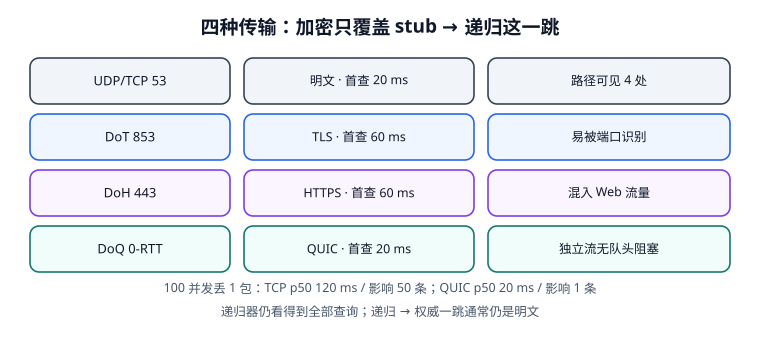

# 加密传输：DoT / DoH / DoQ 与那一跳的边界

给 DNS 套上 TLS 或 QUIC，能挡住路径上的偷看与篡改，但它**只保护客户端到递归器这一跳**。这一页讲三种协议的端口、握手成本、队头阻塞差异，以及企业网络里最容易被忽略的代价：浏览器自择 DoH 会绕过内网递归器与 split-horizon。先记住一句——**加密传输与 DNSSEC 是两件事，谁也替不了谁**。



## 一、三种协议对照

| 协议 | RFC | 端口 / 承载 | 首次查询（RTT=20 ms 模型） | 网络可辨识性 |
| --- | --- | --- | --- | --- |
| 明文 UDP/TCP 53 | RFC 1035 / 7766 | 53 / UDP、TCP | **20.0 ms** | 完全可见、可改 |
| DoT（DNS over TLS） | [RFC 7858](https://www.rfc-editor.org/info/rfc7858) | **853** / TCP + TLS | **60.0 ms**（3 RTT） | 端口固定，防火墙易识别、易阻断 |
| DoH（DNS over HTTPS） | [RFC 8484](https://www.rfc-editor.org/info/rfc8484) | **443** / HTTPS | **60.0 ms**（3 RTT） | 混入普通 Web 流量，难按端口策略管控 |
| DoQ（DNS over QUIC） | [RFC 9250](https://www.rfc-editor.org/info/rfc9250)（2022） | 443/UDP 上的 QUIC | **20.0 ms**（0-RTT 复用会话） | 单 QUIC 流，独立流无队头阻塞 |

DoT 与 DoH 都要先建 TCP、再做 TLS 握手，首查比明文多两个 RTT；DoQ 用 QUIC，会话票据复用时可以在第一个包里带上查询（0-RTT）。这些数字是按 RTT=20 ms 的本机建模值，**不是公网基准**，只用来说明量级与相对关系。

::: info 0-RTT 的代价
QUIC 的 0-RTT 数据在会话票据下发出，存在**重放**风险；DNS 查询本身幂等，风险可控，但不能把「0-RTT」当成「零成本」写进容量模型。会话票据过期、服务端重启、网络切换后都要退回 1-RTT。
:::

## 二、队头阻塞：100 并发丢 1 包

DoH 复用一条 TCP 连接时，一个丢包会阻塞该连接上后续所有响应（Head-of-Line Blocking）；DoQ 把每次解析放在独立 QUIC 流里，丢包只影响那一条流。本机仿真（100 并发、丢 1 包、重传 200 ms）：

| 指标 | DoH over TCP | DoQ |
| --- | --- | --- |
| p50 | **120.0 ms** | **20.0 ms** |
| p99 | **220.0 ms** | **20.0 ms** |
| 受影响的响应数 | **50** | **1** |

```python [hol_model.py]
import statistics
RTT, LOSS_PENALTY, N = 20.0, 200.0, 100
tcp = [RTT] * N
tcp[50:] = [RTT + LOSS_PENALTY] * 50   # 队头阻塞：丢包之后整队等待
quic = [RTT] * N
quic[50] = RTT + LOSS_PENALTY          # 只有那一条流等待
print("tcp p50/p99", statistics.median(tcp), sorted(tcp)[98],
      "quic p50/p99", statistics.median(quic), sorted(quic)[98])
# tcp p50/p99 120.0 220.0 quic p50/p99 20.0 20.0
```

这个差异在现代网页上一次加载要解析上百个名字时被放大：**它改变的不是单次查询延迟，而是尾部延迟的形状**。

## 三、隐私边界：加密只覆盖一跳

| 观察点 | 明文 DNS | 启用 DoT/DoH/DoQ |
| --- | --- | --- |
| 客户端局域网 / 本地网关 | 可见查询 | 不可见（但仍看到「连到了某递归器」） |
| ISP / 路径设备 | 可见、可改 | 不可见内容，可见目的地 |
| **递归解析器本身** | **可见 100% 查询** | **仍可见 100% 查询** |
| 递归器 → 权威 | 通常明文 | **通常仍是明文** |

所以「加密 DNS = 匿名」是错的：它把信任从「路径上所有人」收敛到「你选的那一个递归器」。选型时，**信任谁运营递归器比选哪个加密协议更重要**。本机模型里路径观察点从 4 处降到 2 处，但递归器侧的可见度保持 100%。

::: danger 企业网络里最容易翻车的一点
浏览器自带 DoH 会绕过操作系统配置的递归器。后果有三类：① 内网 **split-horizon** 名字（同一域名内外不同答案）突然解析到公网地址；② 基于 DNS 的安全审计、域名白名单、恶意域名拦截全部失效；③ 故障排障时「运维查到的答案」与「用户实际拿到的答案」不是同一个。正确做法是通过组策略/企业策略**显式下发** DoH 策略（使用企业递归器或明确禁用），而不是等出事再发现。
:::

## 四、降级攻击与 fail-open / fail-closed

加密 DNS 的部署有两种失败姿态：

| 姿态 | 行为 | 适用场景 | 风险 |
| --- | --- | --- | --- |
| fail-open | 加密解析器连不上就退回明文 53 | 通用客户端、可用性优先 | 攻击者只要阻断 853/443 就能把查询打回明文，且用户无感 |
| fail-closed | 连不上就报解析失败 | 有合规要求的内网 | 加密服务抖动 = 业务不可用 |

两者都合理，但**必须显式选择并写进配置**，不能靠客户端默认值。降级是否发生还要可观测：至少记录「本应加密却用了明文」的次数。

```text [systemd-resolved 配置片段（/etc/systemd/resolved.conf）]
[Resolve]
# 全局启用 DoT；fallback 决定是否 fail-open
DNS=1.1.1.1#cloudflare-dns.com
DNSOverTLS=yes
# opportunistic = 连不上可退回明文；no = 严格模式（fail-closed）
# 具体取值依所用解析器实现与版本，按本地 man 手册核对
```

::: tip 三条落地检查
1. 抓包确认「查询是否真的走了 853/443 而不是 53」——配置写了不等于生效；
2. 在策略里明确 fail-open 还是 fail-closed，并给降级次数做告警；
3. 内网 split-horizon 域名做一次「浏览器 DoH 开 / 关」对照测试，确认两边答案一致或差异被显式管理。
:::

## 五、与 DNSSEC 的分工

| 你想防的事 | 该用什么 |
| --- | --- |
| 路径上有人偷看我查了什么 | DoT / DoH / DoQ |
| 路径上有人把答案改掉 | **DNSSEC**（或本跳加密 + 信任递归器，但边界不同） |
| 权威给的答案本身被伪造 | DNSSEC |
| 递归器作恶 / 被入侵 | 两者都挡不住，需换信任对象 + 多源比对 |

一台支持 DoH 但不做 DNSSEC 校验的递归器，可以把被污染的权威答案**原封不动、加密地**交给你——链路是安全的，内容是错的。这正是[信任链](../DnssecChain/index.md)与本页必须分开读的原因。

## 六、易错点与最佳实践

::: danger 五个常见误判
1. **把 DoH 当成 DNSSEC**：机密性 ≠ 真实性，配了 DoH 仍需校验链。
2. **以为 443 端口就「过不了防火墙」**：能过防火墙，也可能绕过了企业安全策略；两者是同一件事的两面。
3. **忽略递归器 → 权威那一跳**：它通常仍明文，且不在客户端可控范围。
4. **只看首查延迟就选协议**：队头阻塞影响的是 p99 与并发场景，本机 TCP p50 120 ms 对 QUIC 20 ms。
5. **不开降级可观测性**：fail-open 被触发时业务「一切正常」，安全属性却悄悄没了。
:::

## 本页判据

| 判据 | 约定 | 定错了会怎样 | 怎么验证 |
| --- | --- | --- | --- |
| `DNE-A` | 明确加密只覆盖 stub → 递归这一跳 | 误以为端到端加密 | 信任边界图含 4 个观察点 |
| `DNE-B` | DoT 853 / DoH 443 / DoQ QUIC 端口与承载写清 | 防火墙规则配错端口 | 对照表可直接照抄 |
| `DNE-C` | 首查延迟按 RTT 建模，不写成公网基准 | 容量估算失真 | 标注为建模值 |
| `DNE-D` | 并发场景评估队头阻塞 | 只测单查询就上线 | 100 并发 p50 120 vs 20 ms |
| `DNE-E` | 企业环境显式下发 DoH 策略 | split-horizon 与审计失效 | 开/关对照用例 |
| `DNE-F` | 明确 fail-open 还是 fail-closed | 静默降级回明文 | 配置片段有注释 |
| `DNE-G` | 降级次数可观测、可告警 | 安全属性悄悄消失 | 有降级计数器 |
| `DNE-H` | 加密传输与 DNSSEC 分别验收 | 加密地把错误答案交给用户 | 两张门禁表各自独立 |

## 验证方式

```shell
# 1. 复跑队头阻塞模型
python3 /tmp/hol_model.py
# 期望：tcp p50/p99 120.0 220.0 quic p50/p99 20.0 20.0

# 2. 确认查询确实走了加密端口（把 853 换成实际解析器端口）
sudo tcpdump -ni any 'port 53 or port 853' -c 20
# 期望：只有 853 有 DNS 流量；若 53 仍有查询，说明发生降级

# 3. DoT 连通性
kdig -d @1.1.1.1 +tls-ca +tls-host=cloudflare-dns.com example.com A
# 期望：status: NOERROR，握手日志显示 TLS

# 4. 本页判据族完整
grep -c 'DNE-[A-H]' docs/Ops/DnsResolution/EncryptedTransport/index.md
# 期望：≥ 8
```

## 参考资料

- [RFC 7858 — Specification for DNS over Transport Layer Security (DoT)](https://www.rfc-editor.org/info/rfc7858)
- [RFC 8484 — DNS Queries over HTTPS (DoH)](https://www.rfc-editor.org/info/rfc8484)
- [RFC 9250 — DNS over Dedicated QUIC Connections](https://www.rfc-editor.org/info/rfc9250)
- [RFC 8310 — Usage Profiles for DNS over TLS and DNS over DTLS](https://www.rfc-editor.org/info/rfc8310)
- [RFC 7766 — DNS Transport over TCP](https://www.rfc-editor.org/info/rfc7766)
- [本库：网络基础 · TCP/IP](../../Network/TcpIp/index.md)
- [本册：DNSSEC 信任链](../DnssecChain/index.md)
