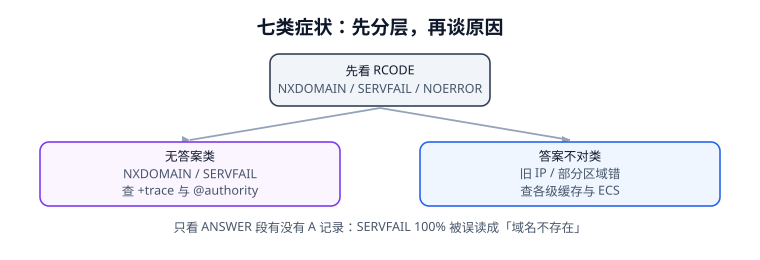

# 常见问题与症状分诊

DNS 故障最麻烦的地方是**症状少、原因多**：用户只说「打不开」，背后可能是负缓存、DS 残留、ECS 分片、防火墙拦了 TCP/53、或者浏览器自己走了 DoH。这一页给一套固定分诊顺序和十六问，目标是把「猜」变成「按层取值」。核心纪律只有一句：**先读 RCODE，再分层，最后才谈原因**。



## 一、先读 RCODE：四类「没结果」不是一回事

| RCODE | 名字 | ANSWER 段 | 该查哪一层 | 最常见的错判 |
| --- | --- | --- | --- | --- |
| 0 | NOERROR（有答案） | 有记录 | 值对不对、TTL 还剩多少 | 把旧值当成「没生效」 |
| 0 | NOERROR（空答案 / NODATA） | 空 | 是不是查错了 QTYPE / 只有 AAAA | 当成「域名不存在」 |
| 2 | SERVFAIL | 空 | 权威可达性、DS、RRSIG、递归器策略 | 当成「域名不存在」或「网络不通」 |
| 3 | NXDOMAIN | 空 + SOA | 名字是否真的没建、负缓存 | 忽略「先查后建」的负缓存 |

本机 1,000 个案例里有 180 个 `SERVFAIL`；若判定规则是「只看 ANSWER 段有没有 A 记录」，**180/180（100%）会被误读成「域名不存在」**。这不是危言耸听：很多健康检查脚本就是这么写的。

```shell
# 第一步永远是把 RCODE 与 flags 拿出来
dig example.com A | grep -E 'status:|flags:'
# 期望看到：status: NOERROR 或 SERVFAIL / NXDOMAIN；flags 里的 qr rd ra 等

# 关校验对照（区分「权威故障」与「DNSSEC 校验失败」）
dig +cd example.com A | grep 'status:'

# 逐级引荐（区分「哪一段 referral 断了」）
dig +trace example.com A | grep -E '^\.|com\.|example\.com\.'
```

## 二、七类症状的判定路径

| 症状 | 第一动作 | 第二动作 | 常见根因 |
| --- | --- | --- | --- |
| NXDOMAIN，但记录确实建了 | `dig @权威` 直问 | 对比 AUTHORITY 段 SOA 的 TTL | 负缓存（先查后建） |
| SERVFAIL，权威却健康 | `dig +cd` 对照 | 查注册商 DS 与当前 DNSKEY | DS 遗留 / RRSIG 过期 |
| 旧 IP，部分用户 | 抽样 12 家递归器 | 看剩余 TTL 与改动前 TTL | 缓存未过期 / 当天才降 TTL |
| 间歇超时 | `dig +bufsize=1232` | `dig +tcp` | 大答复分片被丢 / TCP 53 被拦 |
| 只有部分地区错 | `dig +subnet=...` 对照 | 查权威 ECS SCOPE | ECS 分片 / split-horizon |
| 只有 IPv6 错 | `dig AAAA` 单独查 | 查 AAAA 记录与胶水 | 漏配 AAAA / 双栈策略不一致 |
| 权威正常但递归错 | `dig +trace` | 换一家递归器对比 | 递归器缓存污染 / serve-stale |

## 三、`dig` 输出逐字段怎么读

```text
;; ->>HEADER<<- opcode: QUERY, status: NOERROR, id: 27100
;; flags: qr rd ra ad; QUERY: 1, ANSWER: 1, AUTHORITY: 0, ADDITIONAL: 1
;; OPT PSEUDOSECTION:
;; EDNS: version: 0, flags:; udp: 1232
;; QUESTION SECTION:
;example.com.                   IN      A
;; ANSWER SECTION:
example.com.            237     IN      A       203.0.113.20
;; Query time: 18 msec
;; SERVER: 192.0.2.53#53(192.0.2.53)
```

| 位置 | 读什么 | 读错会怎样 |
| --- | --- | --- |
| `status:` | RCODE | 把 SERVFAIL 当成没记录 |
| `flags:` 里的 `aa` | 是不是权威答复 | 把递归缓存当成权威值 |
| `flags:` 里的 `tc` | 是否被截断 | 漏掉「必须切 TCP」 |
| `flags:` 里的 `ad` | 该递归器是否验过签名 | 当成端到端可信 |
| `ANSWER` 第二列 | **剩余 TTL**（237） | 当成 zone 里配置的 TTL |
| `EDNS: udp:` | 协商的缓冲区 | 不知道大答复为何超时 |
| `SERVER:` | 实际问的是哪台 | 以为在问权威，其实在问递归器 |

## 四、十六问

1. **问：改完记录为什么立刻查还是旧的？** 答：递归器缓存了带旧 TTL 的条目，最长要等一个旧 TTL；提前降 TTL 才能缩短。
2. **问：把 TTL 改成 5 秒为什么还是慢？** 答：递归器可能把最小 TTL 钳到 30 s，有效值是 30。
3. **问：`dig` 有输出但业务连不上？** 答：还有 OS stub、JVM、浏览器缓存和已建立的连接池，它们不随 DNS 收敛。
4. **问：为什么只有一部分地区错？** 答：ECS 分片 / 分视图 / 递归器位置不同，单点探测没有代表性。
5. **问：`SERVFAIL` 和「网络不通」怎么分？** 答：`dig +cd` 能返回答案基本就是 DNSSEC 校验问题；`dig @权威` 也失败才查网络。
6. **问：换 DNS 服务商后部分用户全挂？** 答：注册商侧旧 DS 没删，开启校验的递归器判 `bogus`。
7. **问：新记录建好了为什么查不到？** 答：发布脚本先查过一次，NXDOMAIN 被负缓存 900 s。
8. **问：CNAME 能不能和 TXT 放一起？** 答：不能；证书验证常用 `_acme-challenge` 这个 owner，最容易撞。
9. **问：zone apex 能不能用 CNAME？** 答：不能，apex 必须有 SOA/NS；用 A/AAAA 或服务商的 ALIAS/ANAME。
10. **问：开了 DoH 还需要 DNSSEC 吗？** 答：需要，机密性不等于真实性。
11. **问：DoH 会不会绕过内网 DNS？** 答：会；企业要显式下发策略，否则 split-horizon 与审计失效。
12. **问：DNSSEC 大响应为什么偶发超时？** 答：UDP 分片被丢；按 DNS Flag Day 2020 用 1232 并确保 TCP/53 可用。
13. **问：回滚了为什么还有流量打新 IP？** 答：缓存残留；本机模型 17.21%，要按旧 TTL 保留双端节点。
14. **问：回滚 zone 文件后从服务器没变？** 答：serial 跟着变小了，按 RFC 1982 判定「没更新」；回滚时 serial 要继续 `+1`。
15. **问：ECS 打开后权威 QPS 涨了？** 答：缓存键按子网拆分，命中率从 92% 掉到 41%，容量要重算。
16. **问：怎么知道监控里的「解析成功率」是真的对？** 答：serve-stale 下成功率可以 100% 而答案是旧的，必须另设「答案正确率」指标。

## 五、分诊脚本：把第一步自动化

```python [triage_first_step.py]
def first_step(rcode: int, answer_count: int, cd_ok: bool = False) -> str:
    """只根据 RCODE / ANSWER 数量给出下一步，不猜原因。"""
    if rcode == 0 and answer_count > 0:
        return "有答案：核对值与剩余 TTL，再查客户端侧缓存"
    if rcode == 0:
        return "NODATA：核对 QTYPE，别当成域名不存在"
    if rcode == 2:
        return ("SERVFAIL：" + ("用 +cd 对照，查 DS/RRSIG" if cd_ok
                             else "先 dig @权威 与 +cd 做对照"))
    if rcode == 3:
        return "NXDOMAIN：查 AUTHORITY 段 SOA 的 TTL，排负缓存"
    if rcode == 5:
        return "REFUSED：查递归策略与 ACL"
    return "其他 RCODE：先看报文格式与 EDNS 选项"

for rc, n in [(0, 1), (0, 0), (2, 0), (3, 0), (5, 0)]:
    print(rc, n, "->", first_step(rc, n))
```

::: danger 分诊四条禁令
1. **不要一上来就降 TTL / 重启递归器**：对缺胶水、CNAME 成环、DS 残留毫无作用。
2. **不要用 `ping` 判断 DNS 是否正常**：它混了缓存、连接池、ICMP 策略三件事。
3. **不要只查一家公共 DNS**：它代表不了运营商、企业内网与其他区域。
4. **不要把 `SERVFAIL` 写进「域名不存在」告警**：两者修复方向完全相反。
:::

::: tip 一句话理解
DNS 排障不是「找出原因」，是**先把现象归到正确的层**：RCODE → 权威/递归/客户端 → TTL/缓存 → 信任链/传输。每层只做一两个动作，比一次改一堆配置有效得多。
:::

## 本页判据

| 判据 | 约定 | 定错了会怎样 | 怎么验证 |
| --- | --- | --- | --- |
| `DNQ-A` | 第一步读 RCODE，不读「有没有 A 记录」 | 180/180 SERVFAIL 被误读 | `first_step` 输出分层 |
| `DNQ-B` | 区分 NODATA（NOERROR 空 ANSWER）与 NXDOMAIN | 查错类型被当成没建记录 | 两类各有用例 |
| `DNQ-C` | `SERVFAIL` 用 `+cd` 与 `@权威` 做对照 | 校验失败被当成网络故障 | 两条命令成对 |
| `DNQ-D` | 「旧 IP」先抽样多家递归器再看剩余 TTL | 单点结论外推全网 | 12 家清单 |
| `DNQ-E` | 「部分地区错」按子网/ECS 对照 | 忽略分视图 | `+subnet` 对照 |
| `DNQ-F` | 大响应超时检查 EDNS 1232 与 TCP/53 | 分片被丢查不出 | `+bufsize` / `+tcp` |
| `DNQ-G` | 七类症状各有第一、第二动作 | 排障靠猜 | 分诊表七行 |
| `DNQ-H` | 分诊脚本可独立运行 | 规则只写在文档里 | `python3 /tmp/triage_first_step.py` |

## 验证方式

```shell
# 1. 复跑分诊脚本
python3 /tmp/triage_first_step.py
# 期望：5 行输出，0/1/0/0/0 组合各归一层

# 2. 四种 RCODE 的现场对照
for d in example.com does-not-exist.example.com; do dig "$d" A | grep 'status:'; done
dig +cd example.com A | grep 'status:'
# 期望：至少能看到 NOERROR 与 NXDOMAIN 两种 status

# 3. 确认 TCP/53 没被拦
dig +tcp @8.8.8.8 example.com DNSKEY | grep 'status:'
# 期望：status: NOERROR

# 4. 本页判据族完整
grep -c 'DNQ-[A-H]' docs/Ops/DnsResolution/FAQ/index.md
# 期望：≥ 8
```

## 参考资料

- [RFC 1035 §4.1.1 — 头部字段与 RCODE](https://www.rfc-editor.org/info/rfc1035)
- [RFC 6891 — EDNS(0) 与扩展 RCODE](https://www.rfc-editor.org/info/rfc6891)
- [RFC 2308 — 负缓存与 SOA TTL](https://www.rfc-editor.org/info/rfc2308)
- [RFC 4033 — bogus / insecure 术语](https://www.rfc-editor.org/info/rfc4033)
- [DNS Flag Day 2020 — TCP 与 1232 字节](https://www.dnsflagday.net/)
- [本库：网络基础 · 常见故障场景](../../Network/Dns/index.md)
- [本册：实战十条门禁](../Practice/index.md)
