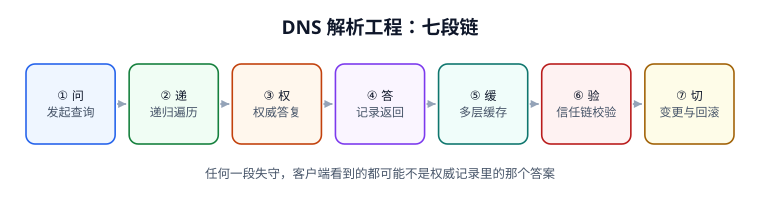

# 当前主线解析栈（DoT / DoH / DoQ + DNSSEC）

::: info 版本状态：当前主线 · 持续维护
本页是**新项目默认基线**，覆盖当前稳定协议与配置契约（RFC 7858 / 8484 / 9250 / 8659 / 4033~4035、DNS Flag Day 2020 的 1232 字节建议，2026-11-11 联网核对）。旧写法完整保留在[旧版解析栈](../ClassicResolver/index.md)，不覆盖、不合并。
:::

当前主线不是「把旧栈所有开关都打开」，而是先明确**每一层在解决什么问题**：EDNS/TCP 解决报文大小，DNSSEC 解决真实性，加密传输解决机密性，CAA 解决误签发，ECS 解决调度精度。它们各自有独立的失败形态与验收方式，混成一句「上全套安全 DNS」就会在出事时不知道该查哪一个。



## 一、当前基线表

| 层 | 当前取值 | 依据 | 不做的代价 |
| --- | --- | --- | --- |
| 报文 | EDNS(0) 缓冲区 **1232**，`TC=1` 切 TCP，放行 TCP/53 | RFC 6891 / 7766 / DNS Flag Day 2020 | DNSSEC 大响应被分片丢弃，偶发超时 |
| 真实性 | DS 在注册商登记，DNSKEY/RRSIG 自动签名与轮换 | RFC 4033 / 4034 / 4035 | 无法证明答案没被改；上层 DANE/CAA 失去前提 |
| 机密性 | DoT **853** / DoH **443** / DoQ（QUIC，0-RTT 复用） | RFC 7858 / 8484 / 9250 | 路径上可见、可改查询 |
| 证书授权 | `CAA 0 issue "..."`（+ `issuewild` / `iodef`） | RFC 8659（废止 6844）、RFC 8657 | 任一公共 CA 的验证缺陷都可能误签发 |
| 调度 | 需要时启用 ECS，检查 SOURCE/SCOPE，重算权威容量 | RFC 7871 | 按递归器位置调度，跨区访问 |
| 韧性 | serve-stale 显式启用，并区分成功率与正确率 | RFC 8767 | 权威抖动直接变成解析失败 |
| 变更 | `$TTL` + 显式 TTL、serial 按 RFC 1982 递增、流水线预检 | RFC 2308 / 1982 | 主从不一、收敛窗口算错 |

::: danger 别把「当前基线」理解成「全部必须同时上」
DNSSEC 与加密传输会**改变失败形态**：前者把「答错」变成 `SERVFAIL`，后者把「明文可用」变成「加密服务不可用」。没有配套监控、没有 `+cd` 对照手册、没有 fail-open/closed 决策就一起上，等于把可观测的旧问题换成不可观测的新问题。按[旧页的迁移顺序](../ClassicResolver/index.md)分步推进。
:::

## 二、四步升级路径（从存量栈迁移）

| 步 | 动作 | 可验证收尾 | 回滚条件 |
| --- | --- | --- | --- |
| 1 | zone 加 `$TTL`、每条 RR 显式 TTL；serial 递增并核对主从 | 12 家递归器返回剩余 TTL 与配置一致；`dig @ns1/@ns2 SOA` serial 相同 | 主从 serial 不一致即回退本次 zone 提交 |
| 2 | 开放 TCP/53、EDNS 1232；确认 `TC=1` 能切 | `dig +tcp` 与 `dig +bufsize=1232` 都返回 `NOERROR` | 大答复超时率上升即恢复原缓冲区 |
| 3 | 配置 CAA，再启用 DNSSEC 自动签名并登记 DS | `dig +dnssec` 见 RRSIG、`AD=1`；`dig +cd` 对照通过；DS 与 DNSKEY 匹配 | 任一开启校验的递归器 `SERVFAIL` 立即撤 DS（**先撤 DS 再停签名**） |
| 4 | 启用加密传输，显式选择 fail-open/closed 并下发企业策略 | 抓包确认只有 853/443；split-horizon 开关对照一致；降级计数器为 0 | 降级次数 > 0 或内网名字解析异常即回退策略 |

第 3 步的顺序是硬约束：**先在新服务商启用签名并确认 DNSKEY，再改注册商 DS**；反过来会立刻产生 `bogus`。撤除时顺序相反，先删旧 DS，再停旧签名。

## 三、一份可照抄的当前 zone 片段

```text [example.com.zone（当前写法）]
$TTL 300
example.com.    IN SOA  ns1.example.com. hostmaster.example.com. (
                2026111102  ; serial：每次变更 +1，回滚也 +1（RFC 1982）
                3600        ; refresh
                600         ; retry
                604800      ; expire
                60          ; minimum：现在只用于负缓存 TTL
)
example.com.        IN NS    ns1.example.com.
ns1.example.com.    IN A     203.0.113.53
example.com.        IN A     203.0.113.20
www.example.com.    IN CNAME example.com.
example.com.        IN MX    10 mail.example.com.
mail.example.com.   IN A     203.0.113.25
example.com.        IN CAA   0 issue "letsencrypt.org"
example.com.        IN CAA   0 issuewild "letsencrypt.org"
example.com.        IN CAA   0 iodef "mailto:dns-ops@example.com"
; DNSKEY / RRSIG / NSEC 由签名器自动生成，不手写进 zone
```

## 四、验证清单（每条都要有输出）

```shell
# 1. EDNS 与 TCP 回退
dig +bufsize=1232 example.com A | grep -E 'status:|EDNS'
dig +tcp example.com DNSKEY | grep 'status:'
# 期望：NOERROR；EDNS 行显示 udp: 1232

# 2. DNSSEC 全链
dig +dnssec example.com A | grep -E 'RRSIG|flags:'
dig +cd example.com A | grep 'status:'
dig +trace +dnssec example.com A | grep -E 'DS|DNSKEY' | head -5
# 期望：可见 RRSIG / AD；+cd 与不加 +cd 的 status 一致

# 3. CAA 与证书授权
dig +short CAA example.com
# 期望：至少一条 issue 记录

# 4. 加密传输确实生效（不是只看配置）
sudo tcpdump -ni any 'port 53 or port 853' -c 20
# 期望：只有 853 有 DNS 流量；53 上出现查询说明发生降级

# 5. ECS 分片（若启用）
dig +subnet=10.0.0.0/24 example.com A +short
dig +subnet=10.1.0.0/24 example.com A +short
# 期望：可返回不同地址，并检查 CLIENT-SUBNET 的 SCOPE

# 6. 变更门禁
python3 /tmp/dns_gate.py
# 期望：DNS 10 / 10 PASS / EXIT=0
```

## 五、与旧版的差异速查

| 维度 | 旧版解析栈 | 当前主线 |
| --- | --- | --- |
| 默认 TTL 来源 | `SOA.MINIMUM`（旧口径） | `$TTL` + 每条显式 TTL |
| 负缓存 | 实现不一，常被忽略 | `min(SOA.MINIMUM, SOA TTL)`，RFC 2308 |
| 大响应 | 512 字节 UDP，容易截断 | EDNS 1232 + TCP 回退 |
| 真实性 | 无 | DNSSEC 全链 + 自动签名轮换 |
| 机密性 | 明文 | DoT / DoH / DoQ + 显式降级策略 |
| 证书授权 | 无 | CAA（RFC 8659） |
| 调度 | 按递归器位置 | ECS（可选，含容量重算） |
| 变更 | 手工 serial + 人工比对 | 预检器 + RFC 1982 + 探测矩阵 + 证据归档 |

::: tip 一句话理解
当前主线不是「功能更多」，是**每一层的失败都能被独立观测与独立回滚**。如果一次升级让 `SERVFAIL` 变多却说不清是 DS、签名、端口还是缓存，那就还没到可以收工的程度。
:::

## 本页判据

| 判据 | 约定 | 定错了会怎样 | 怎么验证 |
| --- | --- | --- | --- |
| `DNM-A` | 页顶标注「当前主线 · 持续维护」 | 与旧版状态混淆 | 状态容器存在 |
| `DNM-B` | 基线表逐项给出取值与 RFC 依据 | 配置无出处 | 七行表齐全 |
| `DNM-C` | 升级按四步、每步有可验证收尾 | 一次切完无法定位 | 四步表含收尾与回滚条件 |
| `DNM-D` | DNSSEC 先签名后改 DS，撤除顺序相反 | 全量 bogus / SERVFAIL | 顺序写进第 3 步 |
| `DNM-E` | 加密传输显式选择 fail-open/closed | 静默降级回明文 | 配置与抓包双重验证 |
| `DNM-F` | zone 使用 `$TTL` 且每条 RR 显式 TTL | TTL 被平台钳制出意外值 | 片段首行 `$TTL 300` |
| `DNM-G` | 六组验证命令都有预期输出 | 「配了」不等于「生效」 | 验证清单六组 |
| `DNM-H` | 与旧版差异速查可追溯 | 迁移时漏项 | 八行差异表 |

## 验证方式

```shell
# 1. 本页六组验证命令逐条跑（见第四节）
# 期望：全部有输出，status 为 NOERROR 或符合预期的对照结果

# 2. 状态与差异表齐全
grep -c '当前主线 · 持续维护' docs/Ops/DnsResolution/ModernResolver/index.md
# 期望：≥ 1
grep -c 'RFC' docs/Ops/DnsResolution/ModernResolver/index.md
# 期望：≥ 8

# 3. 两版目录同时存在
ls -d docs/Ops/DnsResolution/ClassicResolver docs/Ops/DnsResolution/ModernResolver
# 期望：两行输出

# 4. 本页判据族完整
grep -c 'DNM-[A-H]' docs/Ops/DnsResolution/ModernResolver/index.md
# 期望：≥ 8
```

## 参考资料

- [RFC 6891 — EDNS(0)](https://www.rfc-editor.org/info/rfc6891) / [RFC 7766 — DNS over TCP](https://www.rfc-editor.org/info/rfc7766)
- [RFC 4033 / 4034 / 4035 — DNSSEC](https://www.rfc-editor.org/info/rfc4033)
- [RFC 7858 — DoT](https://www.rfc-editor.org/info/rfc7858) / [RFC 8484 — DoH](https://www.rfc-editor.org/info/rfc8484) / [RFC 9250 — DoQ](https://www.rfc-editor.org/info/rfc9250)
- [RFC 8659 — CAA](https://www.rfc-editor.org/info/rfc8659) / [RFC 8657 — CAA 扩展参数](https://www.rfc-editor.org/info/rfc8657)
- [RFC 7871 — ECS](https://www.rfc-editor.org/info/rfc7871) / [RFC 8767 — serve-stale](https://www.rfc-editor.org/info/rfc8767)
- [DNS Flag Day 2020 — 1232 字节建议](https://www.dnsflagday.net/)
- [本册：旧版解析栈](../ClassicResolver/index.md)
- [本册目录页 · 版本目录说明](../index.md)
