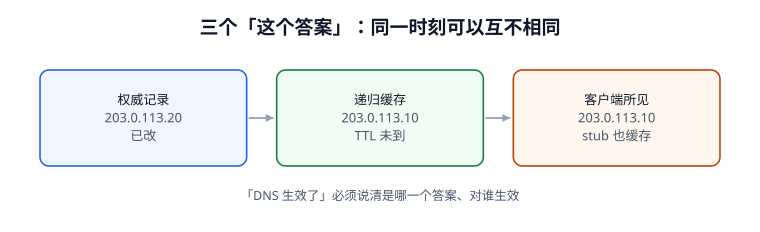

# 总览：四个角色与三种答案

一次「DNS 解析成功」至少涉及四个互相独立的角色，而每个角色手里的答案都可能不一样。这一页不教 `dig` 怎么用，而是把「谁有权回答、谁只是转述、谁又偷偷缓存了一份」这套判定语言固定下来，后面十一页都用它说话。



## 一、四个角色

| 角色 | 英文 | 手里有什么 | 对什么负责 | 不负责什么 |
| --- | --- | --- | --- | --- |
| 客户端解析器 | Stub resolver | 一次查询、一份本地缓存（OS / 浏览器 / JVM / 容器） | 把名字交给递归器；按 TTL 复用 | 不遍历根、不验证签名（除非显式启用） |
| 递归解析器 | Recursive resolver | 全量缓存、根提示、信任锚 | 代客户端走完 referral、缓存、必要时做 DNSSEC 校验 | 不拥有 zone 数据；答案可能过期 |
| 权威服务器 | Authoritative server | zone 文件 / API 里的记录、SOA、签名密钥 | 对自己区内的名字给出权威答复或否定证明 | 不管别人缓存了多久 |
| 区管理员 | Zone operator | serial、TTL 策略、DS 记录、CAA 策略 | 决定「改什么、什么时候改、怎么退」 | 不能强制任何缓存立刻失效 |

::: info 术语首次出现
DNS（Domain Name System，域名系统）是一个**分布式、分层、带缓存**的命名数据库。它的设计目标不是「随时一致」，而是「在分区故障下仍可回答」；理解这一点，才能理解为什么「改了没生效」在多数情况下不是故障，而是设计。
:::

四个角色里最容易混淆的是**递归器与权威**：`dig @8.8.8.8 example.com A` 拿到的是递归器*转述并缓存*的答案，`dig @ns1.example.com example.com A` 拿到的才是权威答复。两者不一致时，先别急着说「DNS 坏了」，要先说清「哪一层不一致」。

## 二、三种答案与「生效」的三种含义

| 说法 | 实际含义 | 怎么取到 | 常见误判 |
| --- | --- | --- | --- |
| 权威已经改了 | zone 里的值变了 | 直接 `@权威` 查询 | 当成「所有用户已经看到」 |
| 递归已经生效 | 某个递归器的缓存过期并重新取了值 | 对该递归器查 `ANSWER` 段的剩余 TTL | 用一家公共 DNS 代表全部 |
| 客户端已经生效 | 应用这一次连接用的是新值 | 看连接目标 IP / 应用日志 | 忽略 JVM、浏览器、sidecar 的独立缓存 |

一次变更里这三件事**按这个顺序发生，且间隔不确定**。本机 10,000 客户端仿真（TTL 3600 s）：变更后 p50 **1782.2 s**、p99 **3553.9 s**、最长 **3599.3 s** 才全部收敛，**49.46%** 的客户端在 1 小时内还在用旧值。

::: tip 写变更单时的一句话纪律
不要写「DNS 已生效」，要写「**权威记录于 T0 改为 X；抽样 12 家递归器在 T0+60 s 内返回 X；客户端最长收敛窗口按旧 TTL 3600 s 计，观察至 T0+3600 s**」。三句话各自可验证，合起来才是验收。
:::

## 三、判定语言：RCODE 与 flags

排障时第一件事是读**响应码**，不是读「有没有 IP」。RCODE（Response Code，响应码）写在报文头部低 4 位，扩展码在 EDNS 的 OPT 记录里。

| RCODE | 名字 | 含义 | 该往哪查 |
| --- | --- | --- | --- |
| 0 | NOERROR | 查询完成（ANSWER 可以为空，即 NODATA） | 看 ANSWER / AUTHORITY 段 |
| 1 | FORMERR | 报文格式不对 | 看 QNAME 编码、EDNS 选项 |
| 2 | SERVFAIL | 服务器侧失败（含 DNSSEC bogus） | 查权威可达性、DS、签名有效期 |
| 3 | NXDOMAIN | 这个名字不存在 | 看 SOA 与 NSEC/NSEC3 否定证明 |
| 4 | NOTIMP | 不支持该操作 / 类型 | 看 QTYPE 与服务端实现 |
| 5 | REFUSED | 策略拒绝（ACL、未授权递归） | 看递归策略与 ACL |
| 0 + 空 ANSWER | NODATA | 名字存在，但没有这个类型 | 别当成 NXDOMAIN |

头部 flags 里最该记住的四个：

| 位 | 名字 | 谁置位 | 读错会怎样 |
| --- | --- | --- | --- |
| `TC` | TrunCated | 权威：答复超过 EDNS 缓冲区 | 客户端必须改走 TCP；只放 UDP/53 的防火墙会让大答复静默失败 |
| `RD` | Recursion Desired | 客户端 | 发给权威时也带着 RD，容易误以为对方会代查 |
| `RA` | Recursion Available | 递归器 | 无 RA 的答复不是「查不到」，是「它不帮你查」 |
| `AD` | Authentic Data | 校验通过的递归器 | AD=1 只说明**该递归器**验过，客户端到递归器这一跳仍可能被改 |

`DO`（DNSSEC OK）在 OPT 记录里，`CD`（Checking Disabled）在头部；`dig +cd` 用来区分「DNSSEC 校验失败」与「权威真的答不出来」——加了 `+cd` 能返回答案，就基本锁定在信任链上。

## 四、一页纸的判定顺序

1. **先读 RCODE**：把 `SERVFAIL` / `NXDOMAIN` / `NODATA` / `NOERROR` 分开，四类修复动作完全不同。
2. **再问哪一层**：`dig +trace` 看 referral，`dig @权威` 看权威，`dig @递归` 看缓存。
3. **再看时间**：ANSWER 段剩余 TTL 决定「还要等多久」，改动前的旧 TTL 决定「最长等多久」。
4. **最后看可信度**：`+dnssec` 看 RRSIG、`+cd` 做对照，AD 位只作旁证。
5. 每一步都写成**可判定的句子**（「哪台、什么值、什么时刻」），不写「应该好了」。

::: danger 四个最常见的误判
1. **只看 ANSWER 段有没有 A 记录**：`SERVFAIL` 与 `NXDOMAIN` 的 ANSWER 段都为空，会被同一条规则判成「域名不存在」。本机 1,000 个案例、180 个 SERVFAIL，用这条规则误读 **180/180（100%）**；正确做法是先读 RCODE。
2. **把 `SERVFAIL` 当成「网络不通」**：DNSSEC 的 DS 遗留、RRSIG 过期都返回 SERVFAIL，且权威本身完全健康。换 DNS 服务商后若未删旧 DS，本机仿真里开启校验的 **620/1000（62.0%）** 递归器会全部 SERVFAIL。
3. **拿一台公共 DNS 的结果当全球结论**：`8.8.8.8` 生效不代表运营商递归器、企业内网递归器、客户端 stub 生效。
4. **以为改小 TTL 就立刻生效**：TTL 是**缓存条目创建时**带上的值，改小只对之后新写入的缓存有效；必须提前至少 `1×旧 TTL`（稳妥取 `2×`）降下来。
:::

## 五、最小可运行：读一条真实报文的头部

下面这段只依赖 Python 标准库，把 DNS 响应头与 QNAME 解出来，用来在排障时先拿到 RCODE 与 flags。完整脚本可复制后存为 `/tmp/dns_header.py` 运行。

```python [dns_header.py]
import struct

def parse_header(resp: bytes) -> dict:
    """解析 DNS 报文头（RFC 1035 §4.1.1），返回 id / flags / 四个计数 / RCODE。"""
    if len(resp) < 12:
        raise ValueError("报文短于 12 字节")
    tid, flags, qd, an, ns, ar = struct.unpack("!HHHHHH", resp[:12])
    return {
        "id": tid,
        "qr": bool(flags & 0x8000), "opcode": (flags >> 11) & 0xF,
        "aa": bool(flags & 0x0400), "tc": bool(flags & 0x0200),
        "rd": bool(flags & 0x0100), "ra": bool(flags & 0x0080),
        "ad": bool(flags & 0x0020), "cd": bool(flags & 0x0010),
        "rcode": flags & 0xF,
        "qdcount": qd, "ancount": an, "nscount": ns, "arcount": ar,
    }

def read_name(buf: bytes, off: int = 12) -> tuple[str, int]:
    """读 QNAME，处理压缩指针（0xC0 前缀）并防指针环。"""
    labels, pos, end, jumps, guard = [], off, None, 0, 0
    while True:
        guard += 1
        if guard > 128:
            raise ValueError("压缩指针成环")
        n = buf[pos]
        if n & 0xC0 == 0xC0:
            ptr = ((n & 0x3F) << 8) | buf[pos + 1]
            if jumps == 0:
                end = pos + 2
            jumps += 1
            pos = ptr
            continue
        if n == 0:
            if jumps == 0:
                end = pos + 1
            return ".".join(labels), end
        labels.append(buf[pos + 1:pos + 1 + n].decode("ascii"))
        pos += 1 + n

# 造一条最小 NOERROR 响应：question = www.example.com A
qname = b"\x03www\x07example\x03com\x00"
resp = struct.pack("!HHHHHH", 0x2710, 0x8180, 1, 1, 0, 0) + qname + \
       struct.pack("!HH", 1, 1)
h = parse_header(resp)
name, next_off = read_name(resp)
print("RCODE =", h["rcode"], "AA =", h["aa"], "TC =", h["tc"],
      "RD =", h["rd"], "RA =", h["ra"], "AD =", h["ad"], "CD =", h["cd"])
print("QNAME =", name, "next_off =", next_off, "ancount =", h["ancount"])
# 输出：
# RCODE = 0 AA = True TC = False RD = True RA = True AD = False CD = False
# QNAME = www.example.com next_off = 29 ancount = 1
```

::: tip 把这段代码用在什么地方
抓包拿到 UDP/53 的负载后，先跑这段拿 RCODE / flags，再决定是去查权威、查缓存还是查信任链。它比「看 dig 输出里有没有 IP」多一个维度，而这一个维度正好把 `SERVFAIL` 从「域名不存在」里分离出来。
:::

## 本页判据

| 判据 | 约定 | 定错了会怎样 | 怎么验证 |
| --- | --- | --- | --- |
| `DNO-A` | 「生效」必须指明是权威 / 递归 / 客户端哪一层 | 改完就宣布完成，一小时后仍有人打旧 IP | 变更单三句话齐全 |
| `DNO-B` | 排障第一步读 RCODE，不读「有没有 A 记录」 | SERVFAIL 被当成 NXDOMAIN | 1,000 案例误读率 0%（规则含 RCODE） |
| `DNO-C` | 区分 NOERROR 空 ANSWER（NODATA）与 NXDOMAIN | 把「没有 AAAA」当成「域名不存在」 | 两类响应各有用例 |
| `DNO-D` | 递归答案与权威答案必须分别取证 | 拿一台公共 DNS 代表全球 | 抽样 ≥ 12 家递归器 |
| `DNO-E` | `TC=1` 必须切 TCP，防火墙不能只放 UDP/53 | 大答复（含 DNSSEC）静默失败 | `dig +tcp` 与 `+bufsize=1232` 都通过 |
| `DNO-F` | `AD` 只代表该递归器验过，不代表端到端 | 把 AD=1 当成客户端侧可信 | 文档里写明信任边界 |
| `DNO-G` | 客户端侧独立缓存（JVM/浏览器/容器）列入收敛窗口 | 最长收敛时间被低估 | 清单里列出 ≥ 3 类缓存 |
| `DNO-H` | 每条结论都带「哪台、什么值、什么时刻」 | 结论不可复核 | 断言里含主机与时间 |

## 验证方式

```shell
# 1. 复跑本页脚本
python3 /tmp/dns_header.py
# 期望：RCODE = 0 / QNAME = www.example.com / next_off = 29

# 2. 对真实域名分别取权威与递归答案（把 example.com 换成自己的域名）
dig +short NS example.com
dig @8.8.8.8 example.com A
dig +dnssec example.com A | grep -E 'RRSIG|status'
# 期望：三条命令都有输出，且能看出 AA / AD 位差异（dig 头部 flags 行）

# 3. 检查本页判据族定义完整
grep -c 'DNO-[A-H]' docs/Ops/DnsResolution/Overview/index.md
# 期望：≥ 8
```

## 参考资料

- [RFC 1034 — Domain Names: Concepts and Facilities](https://www.rfc-editor.org/info/rfc1034)
- [RFC 1035 §4.1 — DNS 报文头与 RCODE](https://www.rfc-editor.org/info/rfc1035)
- [RFC 6891 — EDNS(0) 与扩展 RCODE](https://www.rfc-editor.org/info/rfc6891)
- [RFC 4033 — DNSSEC 安全状态术语](https://www.rfc-editor.org/info/rfc4033)
- [本库：DNS 解析与配置（基础用法）](../../Network/Dns/index.md)
- [本册目录页](../index.md)
