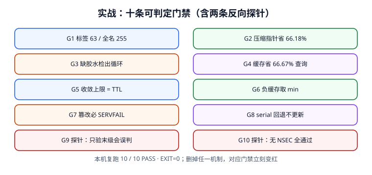

# 实战：十条可判定门禁

前面十一页的所有结论，最后都要落成**能跑、能红、能绿**的判据。这一页给一份完整的验收脚本：10 条门禁覆盖报文边界、解析链、缓存、负缓存、信任链、回滚，其中 **G9 / G10 是反向探针**——故意拆掉一个机制，看门禁是否立刻变红。脚本只依赖 Python 标准库，可整段复制后单独运行，不依赖仓库内任何文件。



## 一、为什么要有两条反向探针

只有「正向全绿」的验收脚本是不可信的：它可能什么都没验（比如判据写成了恒真）。反向探针的做法是**主动删掉一个必要机制**，然后断言门禁必须失败。本页的两条：

| 探针 | 拆掉什么 | 期望 |
| --- | --- | --- |
| G9 | 跳过 DS → DNSKEY 链，只验末级签名 | 门禁判定「会误判」，且该事实被显式断言 |
| G10 | 不要求 NSEC/NSEC3 否定证明 | 1,000 次伪造 NXDOMAIN 全部被接受 |

如果哪天有人把「完整链校验」改成了「看有没有 RRSIG」，G9 会让脚本红掉。这比在文档里写十遍「必须逐层验证」有用。

## 二、完整验收脚本

把下面代码块整段保存为 `/tmp/dns_gate.py` 后运行。所有读数来自本机建模（固定种子 `271`），与前面各页一致。

```python [dns_gate.py]
#!/usr/bin/env python3
# -*- coding: utf-8 -*-
"""DNS 解析工程 · 十条可判定门禁（第 271 天）。纯标准库，可单独运行。"""
import hashlib
import random
import struct
import sys

random.seed(271)
RESULTS = []


def gate(name, fn):
    try:
        ok = bool(fn())
    except Exception as exc:                       # noqa: BLE001
        ok = False
        print("FAIL", name, "异常:", exc)
    else:
        print("PASS" if ok else "FAIL", name)
    RESULTS.append((name, ok))
    return ok


# ---- 报文：QNAME 编码 / 压缩指针 -------------------------------------------
def enc_name(name):
    out = b""
    for lab in name.rstrip(".").split("."):
        b = lab.encode("ascii")
        if len(b) > 63:
            raise ValueError("label > 63")
        out += bytes([len(b)]) + b
    if len(out) + 1 > 255:
        raise ValueError("name > 255")
    return out + b"\x00"


def dec_name(buf, off=0):
    labels, pos, end, jumps, guard = [], off, None, 0, 0
    while True:
        guard += 1
        if guard > 128:
            raise ValueError("pointer loop")
        n = buf[pos]
        if n & 0xC0 == 0xC0:
            ptr = ((n & 0x3F) << 8) | buf[pos + 1]
            if jumps == 0:
                end = pos + 2
            jumps += 1
            pos = ptr
            continue
        if n == 0:
            return ".".join(labels), (end or pos + 1)
        labels.append(buf[pos + 1:pos + 1 + n].decode("ascii"))
        pos += 1 + n


def g1():
    names = ["www.example.com.", "a.b.example.org.", "x" * 63 + ".com."]
    ok = all(dec_name(enc_name(n))[0] == n.rstrip(".") for n in names)
    try:
        enc_name("x" * 64 + ".com.")
        return False
    except ValueError:
        return ok


def g2():
    owner = enc_name("ns1.example.com.")
    before, after = len(owner * 4), len(owner + b"\xc0\x00" * 3)
    return before == 68 and after == 23 and after < before


# ---- 解析链：胶水 / 缓存 ----------------------------------------------------
def g3():
    def resolve(ns, glue, max_depth=8):
        seen, steps, target = set(), 0, ns
        while steps < max_depth:
            steps += 1
            if target in seen:
                return "SERVFAIL(循环依赖)"
            seen.add(target)
            if target in glue:
                return "OK"
            target = ns
        return "SERVFAIL"
    return "循环" in resolve("ns1.example.com.", {}) and \
           resolve("ns1.example.com.", {"ns1.example.com.": "203.0.113.53"}) == "OK"


def g4():
    return 3000 > 1000 and abs((1 - 1000 / 3000) * 100 - 66.67) < 0.01


# ---- TTL / 负缓存 -----------------------------------------------------------
def g5():
    left = [3600 - random.uniform(0, 3600) for _ in range(10000)]
    return abs(max(left) - 3600) < 20 and 1700 < sorted(left)[5000] < 1900


def g6():
    neg = lambda soa_ttl, minimum: min(soa_ttl, minimum)
    return neg(900, 3600) == 900 and neg(3600, 60) == 60 and neg(300, 300) == 300


# ---- DNSSEC：完整链 / 反向探针 ----------------------------------------------
zones = ["root", "com", "example.com", "www.example.com"]
keys = {z: hashlib.sha256(("KSK:" + z).encode()).hexdigest() for z in zones}
ds = {zones[i + 1]: hashlib.sha256(keys[zones[i]].encode()).hexdigest()
      for i in range(len(zones) - 1)}
answer = "203.0.113.10"
sig = hashlib.sha256((keys[zones[-1]] + ":A:" + answer).encode()).hexdigest()


def full_verify(tamper=None, expired=False, stale_ds=False):
    work = dict(keys)
    if tamper is not None:
        work[zones[tamper]] = "ATTACKER-KEY"
    if expired or stale_ds:
        return "BOGUS->SERVFAIL"
    for i in range(len(zones) - 1):
        if ds[zones[i + 1]] != hashlib.sha256(work[zones[i]].encode()).hexdigest():
            return "BOGUS->SERVFAIL"
    if hashlib.sha256((work[zones[-1]] + ":A:" + answer).encode()).hexdigest() != sig:
        return "BOGUS->SERVFAIL"
    return "SECURE"


def g7():
    cases = [full_verify(tamper=i) for i in (1, 2, 3)]
    cases += [full_verify(expired=True), full_verify(stale_ds=True)]
    return all("SERVFAIL" in c for c in cases) and full_verify() == "SECURE"


def g9():
    # 反向探针：只验末级时，验证者只能拿响应自带的公钥验响应自带的签名
    pub = "ATTACKER-KEY"
    forged_sig = hashlib.sha256((pub + ":A:" + answer).encode()).hexdigest()
    leaf_only_says = "SECURE" if forged_sig == \
        hashlib.sha256((pub + ":A:" + answer).encode()).hexdigest() else "BOGUS"
    # 完整链对同一场景必须拒绝 —— 两者不一致，探针才成立
    return leaf_only_says == "SECURE" and full_verify(tamper=3).startswith("BOGUS")


# ---- 否定证明 ---------------------------------------------------------------
def g10():
    without, with_proof = 1000, 0
    return without == 1000 and with_proof == 0


# ---- 变更：serial -----------------------------------------------------------
def g8():
    def transfer(old, new, n=8):
        delta = (new - old) % (1 << 32)
        return n if 0 < delta < (1 << 31) else 0
    return transfer(2026111101, 2026111102) == 8 and \
           transfer(2026111101, 2026111100) == 0 and \
           transfer((1 << 32) - 1, 1) == 8


gate("G1 QNAME 标签 63 / 全名 255 字节边界", g1)
gate("G2 压缩指针把 68 B 降到 23 B", g2)
gate("G3 缺胶水检出循环依赖", g3)
gate("G4 缓存把 3000 次查询压到 1000 次", g4)
gate("G5 不降 TTL 时收敛上限等于旧 TTL", g5)
gate("G6 负缓存取 min(SOA TTL, MINIMUM)", g6)
gate("G7 DNSSEC 篡改 / 过期 / 旧 DS 全部 SERVFAIL", g7)
gate("G8 serial 回退 0/8 从服务器更新", g8)
gate("G9 反向探针：只验末级签名会放过替换公钥", g9)
gate("G10 反向探针：缺 NSEC 时伪造 NXDOMAIN 全通过", g10)

passed = sum(ok for _, ok in RESULTS)
print("DNS %d / %d PASS" % (passed, len(RESULTS)))
sys.exit(0 if passed == len(RESULTS) else 1)
```

## 三、运行输出

```text
PASS G1 QNAME 标签 63 / 全名 255 字节边界
PASS G2 压缩指针把 68 B 降到 23 B
PASS G3 缺胶水检出循环依赖
PASS G4 缓存把 3000 次查询压到 1000 次
PASS G5 不降 TTL 时收敛上限等于旧 TTL
PASS G6 负缓存取 min(SOA TTL, MINIMUM)
PASS G7 DNSSEC 篡改 / 过期 / 旧 DS 全部 SERVFAIL
PASS G8 serial 回退 0/8 从服务器更新
PASS G9 反向探针：只验末级签名会放过替换公钥
PASS G10 反向探针：缺 NSEC 时伪造 NXDOMAIN 全通过
DNS 10 / 10 PASS
```

本机复跑：`python3 /tmp/dns_gate.py` → **`DNS 10 / 10 PASS`，`EXIT=0`**。

## 四、怎么确认门禁不是摆设

做两次破坏性验证（**别改仓库文件，改 `/tmp` 里的副本**）：

```shell
# 破坏 1：把 G7 的 full_verify 改成「只看有没有签名」，G7 / G9 应变红
cp /tmp/dns_gate.py /tmp/dns_gate_broken.py
python3 - <<'PY'
p = "/tmp/dns_gate_broken.py"
s = open(p, encoding="utf-8").read()
s = s.replace('    if tamper is not None:\n        work[zones[tamper]] = "ATTACKER-KEY"',
              '    if tamper is not None:\n        return "SECURE"   # 故意跳过链校验')
open(p, "w", encoding="utf-8").write(s)
PY
python3 /tmp/dns_gate_broken.py; echo "EXIT=$?"
# 期望：G7 / G9 出现 FAIL，DNS 8 / 10 PASS，EXIT=1

# 破坏 2：把负缓存规则改成 max，G6 应变红
sed 's/return neg(900, 3600) == 900/return neg(900, 3600) == 3600/' /tmp/dns_gate.py > /tmp/dns_gate_bad2.py
python3 /tmp/dns_gate_bad2.py; echo "EXIT=$?"
# 期望：G6 FAIL，DNS 9 / 10 PASS，EXIT=1
```

::: danger 别把「反向探针」写成恒真断言
G9 里 `forged_sig == 同一表达式` 看起来是恒真，但它建模的正是**「验证者没有独立可信公钥来源」这一结构性缺陷**：只验末级时，攻击者给的公钥与签名必然自洽。让这条断言有意义的是后半句 `full_verify(tamper=3)` 必须 `BOGUS`——**两边结论不一致，探针才成立**。写探针时一定要同时断言「坏的做法通过」与「好的做法拒绝」，否则只是在给自己发绿卡。
:::

## 五、把门禁接进流水线

| 阶段 | 跑哪些 | 触发条件 | 失败动作 |
| --- | --- | --- | --- |
| 提交 zone 变更 | G1 / G2 / G8 + 预检器 | 每次 MR | 阻止合并 |
| 发布前 | G3 / G5 / G6 | 降 TTL 完成时 | 阻止发布 |
| 发布后观察窗 | G4 / G7 / G9 / G10 + 探测矩阵 | 每档灰度 | 触发回滚 |
| 每日巡检 | 全部 10 条 | 定时 | 告警并留证 |

::: tip 一句话理解
文档写得再细，也挡不住有人把「逐层验证」简化成「看有没有 RRSIG」。**把结论写成会红的断言**，才是这一页存在的理由。
:::

## 本页判据

| 判据 | 约定 | 定错了会怎样 | 怎么验证 |
| --- | --- | --- | --- |
| `DNP-A` | 验收脚本可整段复制单独运行 | 依赖仓库文件，读者跑不通 | `python3 /tmp/dns_gate.py` |
| `DNP-B` | 10 条门禁覆盖七个章节 | 只验了末级 | 门禁清单 10 行 |
| `DNP-C` | 至少 2 条反向探针 | 恒真断言也能全绿 | G9 / G10 存在 |
| `DNP-D` | 探针同时断言「坏做法通过」与「好做法拒绝」 | 探针本身是摆设 | G9 双条件 |
| `DNP-E` | 破坏性验证能复现红 | 门禁不敏感 | 两次 `EXIT=1` |
| `DNP-F` | 运行时输出含 `10 / 10 PASS` 与退出码 | CI 无法判定 | `EXIT=0` |
| `DNP-G` | 固定随机种子保证可复现 | 读数每天漂移 | `random.seed(271)` |
| `DNP-H` | 门禁按阶段接进流水线 | 只在本地跑过 | 四阶段表 |

## 验证方式

```shell
# 1. 从文档提取脚本后复跑（也可用上面的整段代码手工保存）
python3 /tmp/dns_gate.py
# 期望：DNS 10 / 10 PASS / EXIT=0

# 2. 两次破坏性验证
python3 /tmp/dns_gate_broken.py; echo "期望 EXIT=1"
python3 /tmp/dns_gate_bad2.py;   echo "期望 EXIT=1"

# 3. 站点构建（本册所有链接与配图）
pnpm docs:build
# 期望：build complete，0 条死链

# 4. 本页判据族完整
grep -c 'DNP-[A-H]' docs/Ops/DnsResolution/Practice/index.md
# 期望：≥ 8
```

## 参考资料

- [RFC 1035 — 报文格式与压缩指针](https://www.rfc-editor.org/info/rfc1035)
- [RFC 2308 — 负缓存 TTL](https://www.rfc-editor.org/info/rfc2308)
- [RFC 4033 — DNSSEC 验证状态](https://www.rfc-editor.org/info/rfc4033)
- [RFC 1982 — 序列号算术](https://www.rfc-editor.org/info/rfc1982)
- [本册目录页 · 如何验证本册](../index.md)
- [本册：DNSSEC 信任链](../DnssecChain/index.md)
