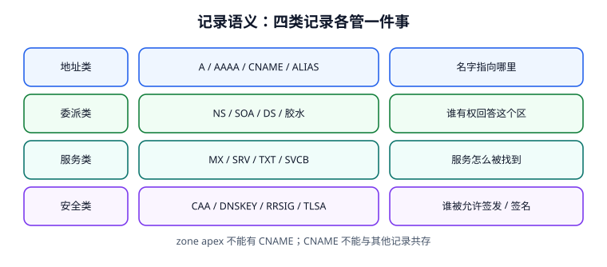

# 记录语义：类型、wire 格式与 CAA

「给域名加一条记录」听起来是一个动作，实际上是在一张有严格约束的表里插入一行：名字能多长、这个类型能不能和其他类型共存、父区要不要跟着改、证书机构会不会因此拒绝签发。这一页把记录类型按**职责**分成四类，讲清每条约束背后要防的是什么，最后给一份可以放进发布流水线的最小预检器。



## 一、四类记录，四种职责

| 类 | 常见类型 | 回答的问题 | 改动的影响面 |
| --- | --- | --- | --- |
| 地址类 | `A` / `AAAA` / `CNAME` / `ALIAS` / `ANAME` | 这个名字指向哪台机器 | 直接影响连接目标，受 TTL 约束 |
| 委派类 | `NS` / `SOA` / `DS` / 胶水 | 谁有权回答这个区、区怎么同步 | 改错会让整个区不可解析 |
| 服务类 | `MX` / `SRV` / `TXT` / `SVCB` / `HTTPS` | 某个服务在哪、怎么连 | 影响邮件、自动发现、协议协商 |
| 安全类 | `CAA` / `DNSKEY` / `RRSIG` / `TLSA` / `NSEC` | 谁能签发、答案有没有被改 | 校验失败返回 `SERVFAIL`，不是「查不到」 |

::: info RR 的 wire 结构
一条资源记录（Resource Record，RR）在报文里固定为 `NAME | TYPE(2B) | CLASS(2B) | TTL(4B) | RDLENGTH(2B) | RDATA`。**TTL 属于每条记录，不属于整个域名**；所以「这个域名的 TTL 是 300」严格说是不成立的，要说「这条 A 记录的 TTL 是 300」。
:::

## 二、地址类：CNAME 的两条硬约束

CNAME 的语义是「本名字的**所有** RRset 都请去目标名字取」，因此它天然和两条规则绑定：

1. **CNAME 不能与其他记录共存**（同一 owner 上不能同时有 A、TXT、MX 等）；
2. **zone apex（区顶，如 `example.com.`）不能有 CNAME**，因为 apex 必须有 `SOA` 与 `NS`，与规则 1 冲突。

各家 DNS 服务商提供的 `ALIAS` / `ANAME` / 扁平化 CNAME 不是标准 RR 类型，而是**权威侧在应答时把目标解析成 A/AAAA 再返回**的实现技巧。它绕开了 apex 限制，但也带来两个副作用：权威需要代替客户端做一次解析（可能跨区、可能超时），以及返回值受权威所在网络视角影响（与 ECS 的交互见[流量调度](../TrafficSteering/index.md)）。

```text [example.com.zone（正确 / 错误对照）]
; 正确：apex 直接给 A，www 用 CNAME
example.com.        300 IN A      203.0.113.20
www.example.com.    300 IN CNAME  example.com.

; 错误 1：apex 用 CNAME（与必需的 SOA/NS 冲突）
; example.com.      300 IN CNAME  lb.example.net.

; 错误 2：同一个 owner 上 CNAME 与 TXT 共存
; www.example.com.  300 IN CNAME  example.com.
; www.example.com.  300 IN TXT    "verify=abc123"

; 错误 3：NS / MX 指向 CNAME（RFC 2181 明确禁止）
; example.com.      300 IN MX  10 mail.example.com.   ; mail 是 CNAME
```

## 三、委派类：SOA 的五个字段

`SOA`（Start of Authority，起始授权机构）是每个区必须有的一条记录，也是负缓存与区同步的依据：

| 字段 | 作用 | 改错的后果 |
| --- | --- | --- |
| `MNAME` | 主权威名字 | 指向不可达主机，动态更新失败 |
| `RNAME` | 管理员邮箱（点代替 @） | 只影响联系，不影响解析 |
| `SERIAL` | 区版本号（32 位，按 RFC 1982 回绕比较） | 不递增 → 从服务器不更新（见[变更治理](../ChangeGovernance/index.md)） |
| `REFRESH` / `RETRY` / `EXPIRE` | 从服务器同步节奏与过期时间 | EXPIRE 到了仍同步不上，从服务器停止应答 |
| `MINIMUM` | **现在只用于负缓存 TTL** | 曾兼任「默认 TTL」，[RFC 2308](https://www.rfc-editor.org/info/rfc2308) 已废止该含义并引入 `$TTL` 指令 |

::: danger 别再用 SOA.MINIMUM 当默认 TTL
老教程会写「SOA 最后一个数字是默认 TTL」。按 RFC 2308，它现在的含义是**否定应答的缓存上限**；没有显式 TTL 的记录应由 zone 文件里的 `$TTL` 指令提供。旧 zone 文件里靠 MINIMUM 兜底 TTL 的写法，迁移到新权威平台后常出现「记录 TTL 变成 0 或被平台钳制」的怪事。这正是本册把旧写法单独放进[旧版解析栈](../ClassicResolver/index.md)的原因之一。
:::

## 四、服务类：MX、SRV、TXT、SVCB/HTTPS

| 类型 | RDATA 要点 | 常见坑 |
| --- | --- | --- |
| `MX` | 优先级 + 邮件主机名（必须是 A/AAAA 名字，不能是 CNAME） | 优先级数字越小越优先；写成 CNAME 时部分 MTA 直接退信 |
| `SRV` | 优先级 / 权重 / 端口 / 目标 | 目标不能是 CNAME；权重只在同优先级内生效 |
| `TXT` | 任意字符串，单串 ≤255 字节 | SPF 与验证串混放，超出长度被截断 |
| `SVCB` / `HTTPS` | 优先级 + 目标名 + `alpn` / `port` / `ipv4hint` 等参数 | 提示地址（hint）与真实 A 记录漂移，排障时容易看错层 |

## 五、安全类：CAA 与 DNSSEC 记录

`CAA`（Certification Authority Authorization，证书颁发机构授权，[RFC 8659](https://www.rfc-editor.org/info/rfc8659)，2019 年废止 RFC 6844）告诉公共 CA「只允许谁给我签证书」。它不加密、不参与解析，却是**误签发**这道风险上唯一由域名持有人自己设定的开关。

```text [example.com.zone（CAA 与否定策略）]
; 只允许 Let's Encrypt 签发普通证书
example.com.    IN CAA  0 issue "letsencrypt.org"
; 通配证书单独指定（有 issuewild 时它覆盖 issue 的通配语义）
example.com.    IN CAA  0 issuewild "letsencrypt.org"
; 违规签发报告地址
example.com.    IN CAA  0 iodef "mailto:dns-ops@example.com"
; 禁止任何 CA 签发（空值）
; example.com.  IN CAA  0 issue ";"
```

| 规则 | 内容 |
| --- | --- |
| tree climbing | CA 从请求的精确名字逐级向上找，**遇到第一个有 CAA RRset 的标签就停止**，不再往上 |
| `issue` 与 `issuewild` | `issue` 默认也覆盖通配请求；存在 `issuewild` 时通配只由它决定 |
| `flags` 的 128 位 | issuer-critical：CA 不认识该 property 时**必须拒绝签发**（不是忽略） |
| 与 DNSSEC 的关系 | CAA 查询的 `bogus` 应答不能当成「没有策略」放行；签名空应答与校验失败语义不同 |
| RFC 6844 → 8659 的差异 | 旧版要求沿 CNAME/DNAME 链再做一次 tree climbing，效率极低且会误伤托管客户；8659 只沿 FQDN 爬升，CNAME 交给 CA 的递归器处理 |

`DNSKEY` / `RRSIG` / `DS` / `NSEC` 属于签名体系，逐层怎么验在[信任链](../DnssecChain/index.md)展开。这里只记住一句：**CAA 是「谁能签」，DNSSEC 是「答案有没有被改」**，两者都失败时表现都是 `SERVFAIL`，但修复方向完全不同。

## 六、最小可运行：发布前的 zone 预检器

下面这段把本页三条硬约束 + CAA/serial 的两条策略检查写成可放进流水线的检查器。它只读 zone 文本，不依赖任何 DNS 库。

```python [zone_precheck.py]
from collections import defaultdict

def precheck(lines):
    """返回 (是否放行, 问题列表)。覆盖五类发布前常见错误。"""
    rr, problems = defaultdict(list), []
    for raw in lines:
        line = raw.split(";")[0].strip()
        if not line or line.startswith("$"):
            continue
        parts = line.split()
        owner, rtype = parts[0].rstrip(".").lower(), parts[2].upper()
        rr[owner].append(rtype)
    for owner, types in rr.items():
        if "CNAME" in types:
            if len(types) > 1:
                problems.append(f"CNAME 与其他记录共存: {owner} -> {types}")
            if owner in ("example.com", "@"):
                problems.append(f"zone apex 不能使用 CNAME: {owner}")
        if "NS" in types and "CNAME" in types:
            problems.append(f"NS 指向 CNAME: {owner}")
    all_text = "\n".join(lines)
    if "CAA" in all_text and "issue" not in all_text:
        problems.append("CAA RRset 存在但没有 issue/issuewild 标签")
    return (not problems), problems

zone = [
    "$TTL 300",
    "example.com.        300 IN SOA  ns1.example.com. hostmaster.example.com. ( 2026111101 3600 600 604800 60 )",
    "example.com.        300 IN NS   ns1.example.com.",
    "example.com.        300 IN A    203.0.113.20",
    "www.example.com.    300 IN CNAME example.com.",
    "example.com.        IN  CAA  0 issue \"letsencrypt.org\"",
]
ok, issues = precheck(zone)
print("PRECHECK", "PASS" if ok else "FAIL", issues)
# PRECHECK PASS []
```

## 七、易错点与最佳实践

::: danger 五类发布前必须拦住的错误
1. **zone apex 配 CNAME**：与必有 SOA/NS 冲突，部分平台会「接受但解析异常」，比直接报错更危险。
2. **CNAME 与其他记录共存**：证书验证用的 TXT 常和 CNAME 撞在同一个 `_acme-challenge` 名字上。
3. **NS / MX / SRV 的目标指向 CNAME**：RFC 2181 明确禁止，不同 MTA 表现不一致（有的退信、有的静默丢弃）。
4. **CAA RRset 只写 `iodef` 没有 `issue`**：策略存在但无授权项，容易让人误以为「没限制」。
5. **SOA serial 改了记录却没递增**：权威主库生效、从服务器全部停在旧版本（详见变更治理章）。
:::

::: tip 一句话理解
记录类型不是「格式清单」，而是**一组互斥与依赖约束**。发布流水线里加一个 40 行的文本预检器，比事后在文档里补一句「以后要注意」有效得多——把这类教训直接写进门禁，是本册一贯的做法。
:::

## 本页判据

| 判据 | 约定 | 定错了会怎样 | 怎么验证 |
| --- | --- | --- | --- |
| `DND-A` | TTL 属于单条 RR，不写成「域名的 TTL」 | 变更窗口按错对象估算 | 文档与配置逐条标 TTL |
| `DND-B` | CNAME 不得与任何其他 RRset 共存 | 部分记录被静默忽略 | 预检器命中该 owner |
| `DND-C` | zone apex 不使用 CNAME，改用 A/AAAA 或 ALIAS | 区整体解析异常 | 预检器命中 apex |
| `DND-D` | NS / MX / SRV 目标不得是 CNAME | 邮件/服务发现间歇失败 | 预检器显式检查 |
| `DND-E` | `$TTL` 提供默认 TTL，`SOA.MINIMUM` 只管负缓存 | TTL 被平台钳制成意外值 | zone 文件首行有 `$TTL` |
| `DND-F` | CAA 按 RFC 8659 判定，`issuewild` 优先于 `issue` 的通配语义 | 通配证书被错误放行或拒绝 | 两类请求各有用例 |
| `DND-G` | CAA flags 的 128 位按「不认识就拒绝」处理 | 未来扩展属性被忽略 | 策略表里有 critical 列 |
| `DND-H` | 发布前跑 zone 预检器，五类错误全部拦截 | 故障只能靠线上发现 | 本机 `PRECHECK PASS []` |

## 验证方式

```shell
# 1. 复跑预检器（正常 zone）
python3 /tmp/zone_precheck.py
# 期望：PRECHECK PASS []

# 2. 反向探针：把 apex 改成 CNAME，应被拦住
sed 's/^example.com.        300 IN A /example.com.        300 IN CNAME /' /tmp/zone_precheck.py > /tmp/zone_bad.py
python3 /tmp/zone_bad.py
# 期望：PRECHECK FAIL，问题列表含 "zone apex 不能使用 CNAME"

# 3. 真实查询 CAA 与 SOA
dig +short CAA example.com
dig +short SOA example.com
# 期望：CAA 输出含 issue 标签；SOA 输出 7 个字段

# 4. 本页判据族完整
grep -c 'DND-[A-H]' docs/Ops/DnsResolution/RecordSemantics/index.md
# 期望：≥ 8
```

## 参考资料

- [RFC 1035 §3.2 / §3.3 — RR 格式与标准类型](https://www.rfc-editor.org/info/rfc1035)
- [RFC 2181 — Clarifications to the DNS Specification（NS/MX 不得指向 CNAME）](https://www.rfc-editor.org/info/rfc2181)
- [RFC 2308 §4 — SOA MINIMUM 与 `$TTL`](https://www.rfc-editor.org/info/rfc2308)
- [RFC 8659 — CAA Resource Record（废止 RFC 6844）](https://www.rfc-editor.org/info/rfc8659)
- [RFC 8657 — CAA `accounturi` / `validationmethods` 参数](https://www.rfc-editor.org/info/rfc8657)
- [本库：证书与信任链生命周期](../../CertificateLifecycle/Issuance/index.md)
- [本册：DNSSEC 信任链](../DnssecChain/index.md)
