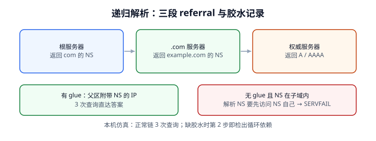

# 解析链：referral、胶水与 CNAME 预算

一次完整的域名解析不是「问一台服务器、拿一个 IP」，而是从根开始逐级**被引荐（referral）**，中间靠胶水记录打破循环依赖、靠 CNAME 链改写目标、靠压缩指针把报文压进缓冲区。这一页把这条链拆成能逐段测量的步骤，并给出每段失败时的确切形态。



## 一、递归与迭代不是一回事

| 维度 | 迭代查询（Iterative） | 递归查询（Recursive） |
| --- | --- | --- |
| 谁在跑 | 递归解析器代表客户端向各级权威发问 | 客户端把整件事委托给递归器 |
| 对方答什么 | 「我不知道，但你去问这几台」（referral，AUTHORITY 段给 NS） | 最终答案或明确的失败 |
| 报文标志 | `RD=0`，通常 `AA=0`，可能 `TC=1` | `RD=1`、`RA=1`，答复里带 `AA` 视来源而定 |
| 失败形态 | 拿到一批 NS 但都不可达 → `SERVFAIL` | 递归器自己超时 → 客户端只看到 `SERVFAIL` |
| 排障命令 | `dig +trace`（禁用递归，逐级引荐） | `dig @8.8.8.8`（让对方跑完全程） |

**客户端只做一次递归查询，递归器做多次迭代查询。** 所以「解析慢」要分清是「客户端到递归器慢」还是「递归器逐级引荐慢」——`dig +trace` 会把后者一段段摊开给你看。

```shell
# 逐级引荐：看根 -> TLD -> 权威三段各是谁
dig +trace www.example.com A

# 直接问权威：确认 zone 里到底是什么
dig @a.iana-servers.net www.example.com A +norecurse

# 看链路是否必须切 TCP（EDNS 缓冲区 1232，DNS Flag Day 2020 建议值）
dig +bufsize=1232 www.example.com A
dig +tcp www.example.com A
```

## 二、三段 referral：根、TLD、权威

| 段 | 被问的是谁 | 返回什么 | 关键字段 |
| --- | --- | --- | --- |
| 1 | 根服务器（13 组，a~m.root-servers.net） | `.com` 的 NS 列表 + 胶水 A/AAAA | AUTHORITY 段 NS、ADDITIONAL 段 A/AAAA |
| 2 | `.com` 权威 | `example.com` 的 NS 列表 + 胶水 | 同上，可能附带 DS（DNSSEC 时） |
| 3 | `example.com` 权威 | `www` 的 A / AAAA / CNAME | ANSWER 段、`AA=1` |

本机仿真：正常链固定 **3 次**迭代查询拿到答案；1,000 个域名首轮共 **3,000 次**查询，缓存生效后第二轮只需 **1,000 次**（省 **66.67%**）——这就是根与 TLD 没被查询量压垮的原因，也是「缓存不是优化而是架构前提」的量化证据。

::: info 根只有 13 组，不是 13 台
根区 NS 记录是 13 个**名字**（a~m），每个名字背后由任播（anycast）承载大量物理节点。写监控时按名字探测，不要以为只有 13 个 IP。
:::

## 三、胶水记录与循环依赖

胶水记录（glue record）是**父区**在返回子区 NS 名字时，顺手放在 ADDITIONAL 段里的那几条 A/AAAA。它解决的是一个纯逻辑死结：

```text [example.com.zone（父区视角的委派片段）]
; 子区委派：NS 名字落在子区自己里面
example.com.        IN NS   ns1.example.com.
example.com.        IN NS   ns2.example.com.

; 没有下面这两行 glue，解析 ns1.example.com. 又得先问 example.com. 的 NS
ns1.example.com.    IN A    203.0.113.53
ns2.example.com.    IN A    198.51.100.53
```

若 NS 名字**落在被委派的子域内**且父区没给 glue，递归器要解析 `ns1.example.com` 就必须先访问 `example.com` 的权威，而那台权威的地址正是它要解析的名字——形成循环。下面这段是本机用来检测该循环的最小实现：

```python [glue_check.py]
def resolve_with_delegations(ns_name: str, glue: dict, max_depth: int = 8):
    """按 referral 逐级解析；若 NS 名字落在子域内且无 glue，检出循环依赖。"""
    seen, steps = set(), 0
    target = ns_name
    while steps < max_depth:
        steps += 1
        if target in seen:
            return {"result": "SERVFAIL", "steps": steps,
                    "reason": "解析 NS 名字需要先访问该 NS 自己（缺 glue）"}
        seen.add(target)
        if target in glue:
            return {"result": "OK", "steps": steps, "ip": glue[target]}
        # 没有 glue：referral 又指回同一个待解析名字
        target = ns_name
    return {"result": "SERVFAIL", "steps": steps}

print(resolve_with_delegations("ns1.example.com.", {}))
# {'result': 'SERVFAIL', 'steps': 2, 'reason': '解析 NS 名字需要先访问该 NS 自己（缺 glue）'}
print(resolve_with_delegations(
    "ns1.example.com.", {"ns1.example.com.": "203.0.113.53"}))
# {'result': 'OK', 'steps': 1, 'ip': '203.0.113.53'}
```

::: danger 三种胶水相关的坑
1. **NS 指向子域内名字却忘了在注册商处登记 glue**：本站域名用自己的 `ns1.本站域名` 当权威，是这类事故最典型的形状；现象是部分地区 `SERVFAIL`，且「改 A 记录」完全无效。
2. **胶水 IP 与子区里真实的 A 记录不一致**：父区胶水只在引荐时用，一旦递归器缓存了子区的 A，就会以子区为准；两边长期漂移会出现「偶发连到旧机器」。
3. **换权威服务商时只改 NS、不删旧 glue**：注册商侧残留的旧胶水仍被部分递归器使用，切流看起来「切了一半」。
:::

## 四、wire 报文：QNAME、压缩指针与长度边界

RFC 1035 规定域名在报文里不是字符串，而是**长度前缀标签序列**：每个标签 1 字节长度（≤63）+ 内容，最后以 `0x00` 结束；整个名字的 wire 长度上限 **255 字节**。响应里重复出现的名字用**压缩指针**（`0xC0` + 偏移）引用前面的位置。

```python [qname_codec.py]
def enc_name(name: str) -> bytes:
    """把点分域名编码成 DNS wire 名字（RFC 1035 §3.1）。"""
    if name == ".":
        return b"\x00"
    out = b""
    for lab in name.rstrip(".").split("."):
        b = lab.encode("ascii")
        if len(b) > 63:
            raise ValueError("单个标签不能超过 63 字节")
        out += bytes([len(b)]) + b
    if len(out) + 1 > 255:
        raise ValueError("整个名字不能超过 255 字节")
    return out + b"\x00"

def dec_name(buf: bytes, off: int = 0) -> tuple[str, int]:
    """解码名字，支持压缩指针，并用 guard 防止指针成环。"""
    labels, pos, end, jumps, guard = [], off, None, 0, 0
    while True:
        guard += 1
        if guard > 128:
            raise ValueError("压缩指针成环")
        n = buf[pos]
        if n & 0xC0 == 0xC0:
            ptr = ((n & 0x3F) << 8) | buf[pos + 1]
            if jumps == 0:
                end = pos + 2
            jumps += 1
            pos = ptr
            continue
        if n == 0:
            return ".".join(labels), (end or pos + 1)
        labels.append(buf[pos + 1:pos + 1 + n].decode("ascii"))
        pos += 1 + n

owner = enc_name("ns1.example.com.")
print(len(owner), "bytes /", len(owner * 4), "bytes(未压缩) /",
      len(owner + b"\xc0\x00" * 3), "bytes(压缩)")
# 17 bytes / 68 bytes(未压缩) / 23 bytes(压缩)
```

本机读数：200 个随机域名编码→解码往返 **200/200** 正确；63 字节标签 **PASS**、64 字节标签 **REJECT**；同一 owner 出现 4 次时，压缩把 **68 B 降到 23 B（省 66.18%）**。DNSSEC 签名响应体积大，压缩与 EDNS 缓冲区是能否走 UDP 的关键。

## 五、CNAME 链与查询预算

CNAME（Canonical Name，规范名）不是「别名指向 IP」，而是「这个名字的所有记录请去问另一个名字」。每多一级 CNAME，递归器就得多走一轮查询；链上任何一环缺失，整条链失败。

| CNAME 级数 | 查询次数 | 本机仿真耗时 | 风险 |
| --- | --- | --- | --- |
| 1 | 2 | 0.84 ms | 正常（CDN 接入常见） |
| 2 | 3 | 1.26 ms | 可接受 |
| 4 | 5 | 2.10 ms | 排障开始变麻烦 |
| 8 | 9 | 3.78 ms | 每次变更都要查全链 |
| 16 | 17 | 7.14 ms | 超时与循环风险明显 |

循环 CNAME（`a → b → c → a`）靠**已访问集合**检出，本机在第 **3** 步判定成环并 `SERVFAIL`。

::: tip 一条实用上限
业务侧把 CNAME 链控制在 **2 级以内**，并且明确记录「每一级归谁维护」。CDN 场景下 `www → cdn 厂商 → 边缘节点` 已占两级，再加一层内部别名就到 3 级了——此时「解析慢」往往不是网络慢，是链长。
:::

## 六、EDNS(0)、1232 字节与 TC 切 TCP

原始 DNS 的 UDP 答复上限是 **512 字节**；[RFC 6891](https://www.rfc-editor.org/info/rfc6891) 的 EDNS(0) 通过 OPT 伪记录让客户端声明更大的缓冲区。[DNS Flag Day 2020](https://www.dnsflagday.net/) 基于 IPv6 最小 MTU 1280 减 48 字节头部，建议默认 **1232 字节**以避免 IP 分片；[RFC 7766](https://www.rfc-editor.org/info/rfc7766) 要求所有实现支持 TCP，且收到 `TC=1` 必须改走 TCP 重查。

| 现象 | 原因 | 验证命令 |
| --- | --- | --- |
| `dig` 偶发超时但小记录正常 | 大响应被分片丢弃 | `dig +bufsize=1232` |
| 开了 DNSSEC 后部分地区解析失败 | 防火墙只放 UDP/53 | `dig +tcp @权威 域名 DNSKEY` |
| `TC=1` 但客户端不重试 | 客户端实现不合规 | 抓包看是否出现 TCP/53 |

## 七、缓存把查询数压下来

前面那组读数值得再强调一次：1,000 个域名在冷缓存下需要 **3,000 次**迭代查询，缓存热了以后只要 **1,000 次**。缓存不是「顺手加的优化」，它是 DNS 能扩展到全球规模的前提；也正因如此，**任何绕过缓存的设计（TTL=0、每次回源）都会把根与 TLD 重新拉回瓶颈**。

::: danger 本页易错点小结
1. 把 `dig +trace` 的输出当成「客户端实际走的路径」——它是**你本机**当递归器跑的迭代链，真实客户端走的是递归器缓存。
2. 用 `dig @权威 +norecurse` 时忘了关 `RD`，误以为权威会代查。
3. 认为 CNAME 可以和其他记录共存（见[记录语义](../RecordSemantics/index.md)），或在 zone apex 配 CNAME。
4. 防火墙只放行 UDP/53，遇到 `TC=1` 的 DNSSEC 大答复时静默失败。
5. 解析失败就降 TTL、重启递归器——这些动作对「缺胶水」「CNAME 成环」毫无作用，先定位再动手。
:::

## 本页判据

| 判据 | 约定 | 定错了会怎样 | 怎么验证 |
| --- | --- | --- | --- |
| `DNR-A` | 客户端只发一次递归查询，迭代由递归器完成 | 延迟归因错到客户端链路 | `dig +trace` 能看到三段引荐 |
| `DNR-B` | NS 落在子域内时父区必须提供 glue | 循环依赖导致 SERVFAIL | 本机第 2 步检出成环 |
| `DNR-C` | QNAME 单标签 ≤ 63 字节、全名 ≤ 255 字节 | 报文被 FORMERR 拒绝 | 200/200 往返 + 64 字节被拒 |
| `DNR-D` | 解码器必须处理压缩指针并防成环 | 解析 DNSSEC 大响应时崩溃 | `guard > 128` 有断言 |
| `DNR-E` | CNAME 链 ≤ 2 级，且每级有归属人 | 排障与超时成本线性放大 | 链长清单可查 |
| `DNR-F` | 循环 CNAME 用已访问集合检出并 SERVFAIL | 无限查询打满递归器 | 3 步检出成环 |
| `DNR-G` | EDNS 缓冲区默认 1232，`TC=1` 必切 TCP | 大答复被分片丢弃 | `dig +tcp` 通过 |
| `DNR-H` | 冷/热缓存查询数分别记录 | 把缓存当可选优化 | 3,000 → 1,000（省 66.67%） |

## 验证方式

```shell
# 1. 复跑本页两段脚本
python3 /tmp/glue_check.py && python3 /tmp/qname_codec.py
# 期望：先 SERVFAIL(steps=2)，再 OK(steps=1)；17 / 68 / 23 三个字节数

# 2. 真实域名的三段引荐
dig +trace www.example.com A | grep -E '^\.|com\.|example\.com\.'
# 期望：能看到根、TLD、权威三段 NS

# 3. TCP 回退可用
dig +tcp @8.8.8.8 example.com DNSKEY | head -5
# 期望：有输出且 status: NOERROR

# 4. 本页判据族完整
grep -c 'DNR-[A-H]' docs/Ops/DnsResolution/ResolutionPath/index.md
# 期望：≥ 8
```

## 参考资料

- [RFC 1034 §4 — 委派与胶水记录](https://www.rfc-editor.org/info/rfc1034)
- [RFC 1035 §3.1 / §4.1.4 — 名字编码与压缩指针](https://www.rfc-editor.org/info/rfc1035)
- [RFC 6891 — EDNS(0)](https://www.rfc-editor.org/info/rfc6891)
- [RFC 7766 — DNS over TCP 必选](https://www.rfc-editor.org/info/rfc7766)
- [DNS Flag Day 2020 — 1232 字节建议](https://www.dnsflagday.net/)
- [本库：DNS 解析与配置](../../Network/Dns/index.md)
- [本册：记录语义](../RecordSemantics/index.md)
