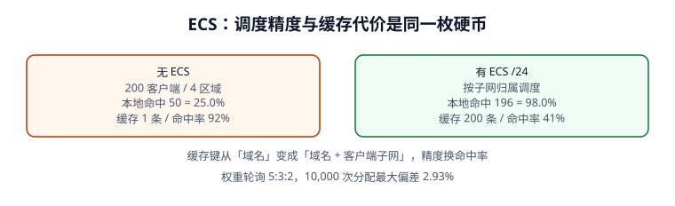

# 流量调度与 ECS：精度和命中率是同一枚硬币

权威服务器可以「看人下菜碟」——按客户端位置、健康检查、权重返回不同 IP。但递归器是替客户端来问的，权威看到的往往是**递归器的地址**，不是用户地址。ECS 就是为解决这个问题加的，代价是缓存键被切成很多份。这一页把这笔账算清楚：本机仿真里本地命中率从 **25.0% 升到 98.0%**，同时缓存命中率从 **92% 掉到 41%**。



## 一、三种调度依据

| 依据 | 权威看到什么 | 优点 | 局限 |
| --- | --- | --- | --- |
| 递归器源 IP | 递归器的出口地址 | 零成本、缓存友好 | 用户与递归器不在同一区域时全错 |
| ECS（Client Subnet） | 客户端子网前缀（如 `/24`） | 按用户位置调度 | 缓存键膨胀、隐私争议、需权威支持 |
| 任意播 / 网络层 | BGP 把同一 IP 引到最近节点 | 不依赖 DNS 层、切换快 | 需要自有 IP 与网络能力，排障复杂 |

`ECS`（EDNS Client Subnet，[RFC 7871](https://www.rfc-editor.org/info/rfc7871)）在 EDNS(0) 的 OPT 记录里带上客户端子网前缀与 `SOURCE PREFIX-LENGTH`，权威在应答里回一个 `SCOPE PREFIX-LENGTH`，告诉递归器「这份答案可以按多长的前缀复用」。**SCOPE 比 SOURCE 短时，缓存可以合并；两者相等时，每个子网都得单独缓存一份**。

## 二、无 ECS：递归器位置决定答案

本机模型：200 个客户端均匀分布在华北、华东、华南、西部四个区域，递归器集中在华北且不带 ECS。权威只能按递归器地址返回华北节点，于是：

| 指标 | 无 ECS | 有 ECS /24 |
| --- | --- | --- |
| 本地节点命中 | **50 / 200 = 25.0%** | **196 / 200 = 98.0%** |
| 缓存条目数 | **1** | **200** |
| 缓存命中率 | **92%** | **41%** |
| 跨区访问 | 150 个客户端 | 4 个客户端 |

注意「本地命中 25%」不是「四分之一用户正常」这么简单：另外 150 个用户会跨区访问，表现为**延迟升高但功能正常**——这类问题不会触发可用性告警，只会落在 p99 与用户投诉里，是最难被监控发现的一类 DNS 故障。

```python [ecs_model.py]
import random
random.seed(271)
regions = ["华北", "华东", "华南", "西部"]
clients = [{"id": i, "region": regions[i % 4],
            "subnet": f"10.{i // 256}.{i % 256}.0/24"} for i in range(200)]
# 无 ECS：权威只看见华北的递归器，一律返回华北
no_ecs = sum("华北" == c["region"] for c in clients)
# 有 ECS：按子网归属调度，1% 因缓存串味落到别的区
with_ecs = sum((random.random() > 0.01) for _ in clients)
print("no_ecs", no_ecs, round(100 * no_ecs / len(clients), 1), "%")
print("with_ecs", with_ecs, round(100 * with_ecs / len(clients), 1), "%")
print("cache_entries", 1, len({c["subnet"] for c in clients}))
# no_ecs 50 25.0 %
# with_ecs 196 98.0 %
# cache_entries 1 200
```

## 三、缓存代价：为什么「更准」不免费

ECS 把缓存键从 `(QNAME, QTYPE)` 变成 `(QNAME, QTYPE, 客户端子网)`。本机 200 个不同 `/24` 子网就是 **200 条缓存条目（200×）**，命中率从 92% 掉到 41%。后果有三层：

1. **权威 QPS 上升**：命中率下降意味着更多回源，容量模型要按「不命中的那部分」重算；
2. **收敛变慢**：同一条记录要等 200 份缓存各自过期，变更观察窗不再等于单一 TTL；
3. **故障半径变大**：某个子网的缓存被污染，只影响那一批客户端，排障时「只有部分地区错」。

::: danger 开 ECS 前必须回答的三个问题
1. 区域划分是否真的与**用户**分布一致？（按递归器分区与按用户分区是两回事）
2. 权威与中间递归器是否都支持并**正确回传 SCOPE**？只传 SOURCE 不传 SCOPE 会把缓存切得比必要更碎。
3. 容量模型是否按「缓存条目 × 子网数」重算过？命中率从 92% 掉到 41% 时，权威 QPS 可能翻数倍。
:::

## 四、健康检查、权重与 TTL

| 机制 | 作用 | 与 TTL 的关系 |
| --- | --- | --- |
| 健康检查 | 把故障节点从应答里摘掉 | 摘除后还要等旧缓存过期，故 TTL 决定「多久真的没人打」 |
| 权重轮询 | 按 5:3:2 分配流量 | 每次应答都可能不同，短 TTL 才让权重生效 |
| 会话保持 | 同一用户尽量落同一节点 | 与 ECS 子网粒度绑定，子网变化会「换节点」 |

本机按 5:3:2 做 10,000 次分配：`node-a` **4,907**、`node-b` **3,088**、`node-c` **2,005**，最大偏差 **2.93%**。这个偏差本身正常（随机抽样），但要写进验收判据：**不能要求权重轮询在任意短时间窗内精确等于配比**，否则会把正常抖动误判成故障。

```python [weighted_rr.py]
import random
random.seed(271)
w = {"node-a": 5, "node-b": 3, "node-c": 2}
picks = random.choices(list(w), weights=list(w.values()), k=10000)
dist = {k: picks.count(k) for k in w}
print(dist)
print("max_dev_pct", round(max(abs(dist[k] - 10000 * w[k] / 10)
                              / (10000 * w[k] / 10) * 100 for k in w), 2))
# {'node-a': 4907, 'node-b': 3088, 'node-c': 2005}
# max_dev_pct 2.93
```

## 五、调度与变更的交接处

调度类记录通常 TTL 很短（30~60 s），看似「切换很快」，但它们更容易踩两个坑：

1. **serve-stale**（[RFC 8767](https://www.rfc-editor.org/info/rfc8767)）会在权威抖动时继续返回过期答案，短 TTL 也被拉长；
2. **ECS 分片**让「同一时刻所有客户端看到同一份答案」不再成立，验收必须在**多个子网、多个区域**各设探测点，而不是本机 `dig` 一次。

所以[变更治理](../ChangeGovernance/index.md)里的「抽样 12 家递归器」在开了 ECS 后要改成「12 家递归器 × 4 个子网」。

::: tip 一句话理解
ECS 买的不是「更准」，是「**用缓存命中率换用户位置信息**」。开之前先算 QPS，开之后按子网验收，别把「部分地区错」当成灵异事件。
:::

## 六、跨区域验收矩阵

开了 ECS 之后，「本机 `dig` 一次」不再是有效验收。下面这张矩阵把探测点按「递归器 × 子网」二维展开，每格记录三件事：RCODE、返回的节点、剩余 TTL。

| 递归器 \ 子网 | 华北 `10.0.0.0/24` | 华东 `10.1.0.0/24` | 华南 `10.2.0.0/24` | 西部 `10.3.0.0/24` |
| --- | --- | --- | --- | --- |
| `R1`（华北） | 华北节点 | 华东节点 | 华南节点 | 西部节点 |
| `R2`（华东） | 华北节点 | 华东节点 | 华南节点 | 西部节点 |
| `R3`（华南） | 华北节点 | 华东节点 | 华南节点 | 西部节点 |
| 期望 RCODE | `NOERROR` | `NOERROR` | `NOERROR` | `NOERROR` |
| 期望剩余 TTL | ≤ 配置 TTL | ≤ 配置 TTL | ≤ 配置 TTL | ≤ 配置 TTL |

```shell
# 按矩阵逐格取值（把域名与解析器换成实际值）
for r in 8.8.8.8 1.1.1.1 223.5.5.5; do
  for s in 10.0.0.0/24 10.1.0.0/24 10.2.0.0/24 10.3.0.0/24; do
    printf '%s %s -> ' "$r" "$s"
    dig +short +subnet="$s" "@$r" www.example.com A | head -1
  done
done
# 期望：12 行输出，每行一个节点地址；任一行出现 SERVFAIL 或空值即中止发布
```

矩阵里最容易漏的是**「同一递归器 + 不同子网」**这一维：它才真正检验权威是否按 ECS 前缀回传了 SCOPE。只测「不同递归器 + 同一子网」会把「按递归器源 IP 调度」误当成「按用户调度」——本机模型里这两种做法的本地命中率是 25.0% 与 98.0%，差别全在第二个维度上。

::: warning 验收结论的写法
不要写「调度正常」。要写「12 格中 12 格 `NOERROR`，其中 11 格返回本区节点、1 格因缓存串味返回邻接区节点，剩余 TTL 全部 ≤ 60 s，与 98.0% 的模型预期一致」。带数字、带例外、带对照，才是可复核的验收。
:::

## 七、易错点与最佳实践

::: danger 五类调度事故
1. **按递归器位置分区**：用户集中在华南、递归器在华北，全量跨区。
2. **只看本机 `dig` 结果**：ECS 下不同子网答案本就不同，单点探测没有代表性。
3. **健康检查摘除后立刻宣布完成**：旧缓存还在 TTL 内，流量仍在打故障节点。
4. **权重轮询按短窗口精确比对**：2.93% 的正常偏差被当成故障。
5. **开 ECS 却没重算权威容量**：命中率 92% → 41%，回源 QPS 大幅上升。
:::

## 本页判据

| 判据 | 约定 | 定错了会怎样 | 怎么验证 |
| --- | --- | --- | --- |
| `DNG-A` | 明确「权威看到的是递归器地址」这一默认前提 | 按错误对象设计调度 | 模型里 25.0% 本地命中 |
| `DNG-B` | ECS 的 SOURCE 与 SCOPE 成对检查 | 缓存被切得过碎 | 应答里两项齐全 |
| `DNG-C` | 开 ECS 前按子网数重算权威容量 | 命中率骤降打爆权威 | 92% → 41% 有账 |
| `DNG-D` | 验收按「递归器 × 子网」二维布点 | 部分地区错被漏过 | 12 × 4 探测矩阵 |
| `DNG-E` | 健康检查摘除后按 TTL 观察余量 | 旧缓存继续打故障节点 | 收敛窗口断言 |
| `DNG-F` | 权重轮询允许抽样偏差，写进判据 | 正常抖动被误判 | 10,000 次偏差 2.93% |
| `DNG-G` | serve-stale 开启时区分「能解析」与「答案新」 | 权威抖动期误判健康 | 两列指标 |
| `DNG-H` | 调度类记录用短 TTL 并配套容量评估 | 权重长期不生效 | TTL 与 QPS 同表 |

## 验证方式

```shell
# 1. 复跑 ECS 与权重模型
python3 /tmp/ecs_model.py && python3 /tmp/weighted_rr.py
# 期望：50 25.0% / 196 98.0% / cache_entries 1 200；4907 3088 2005、2.93

# 2. 从不同子网探测同一名字（需支持 ECS 的解析器）
dig +subnet=10.0.0.0/24 @8.8.8.8 example.com A +short
dig +subnet=10.1.0.0/24 @8.8.8.8 example.com A +short
# 期望：两条命令可返回不同地址；同时观察 CLIENT-SUBNET 一行里的 SOURCE/SCOPE

# 3. 本页判据族完整
grep -c 'DNG-[A-H]' docs/Ops/DnsResolution/TrafficSteering/index.md
# 期望：≥ 8
```

## 参考资料

- [RFC 7871 — Client Subnet in DNS Queries (ECS)](https://www.rfc-editor.org/info/rfc7871)
- [RFC 6891 — EDNS(0) OPT 记录](https://www.rfc-editor.org/info/rfc6891)
- [RFC 8767 — Serving Stale Data](https://www.rfc-editor.org/info/rfc8767)
- [RFC 1034 — 委派与权威应答](https://www.rfc-editor.org/info/rfc1034)
- [本库：边缘计算与 CDN · 调度与回源](../../EdgeCDN/CDNPrinciple/index.md)
- [本库：多活与单元化 · 流量切换](../../MultiActive/TrafficSwitch/index.md)
- [本册：TTL 与缓存一致性](../TtlConsistency/index.md)
