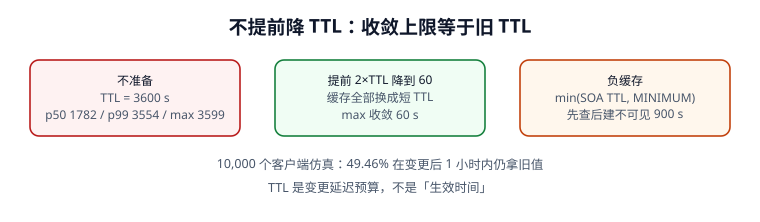

# TTL 与缓存一致性：收敛是道算术题

「改完 DNS 多久生效」不是玄学，是一道能算出来的题：**收敛上限 = 改动前那份缓存的 TTL**。这一页把多层缓存、负缓存、serve-stale 与 TTL 钳制拆成四条可计算的规则，并给出一组 10,000 客户端的本机仿真读数。读完应该能回答「为什么改了 5 分钟的 TTL，一小时后还有人打旧 IP」。



## 一、TTL 到底是什么

TTL（Time To Live，生存时间）是**每条资源记录**自带的 32 位秒数，含义是「缓存可以复用这份答复多久」。递归器把记录放进缓存时开始倒计时，每次从缓存回答要返回**剩余** TTL，而不是原值。

| 层 | 谁在缓存 | 是否遵守 DNS TTL | 典型默认值 |
| --- | --- | --- | --- |
| 递归解析器 | 运营商 / 公共 DNS | 遵守，但可能钳制上下限 | 按记录 TTL |
| 操作系统 stub | systemd-resolved、mDNSResponder | 通常遵守 | 按记录 TTL |
| 语言运行时 | JVM `networkaddress.cache.ttl` | **不一定**，可覆盖 DNS TTL | 部分实现默认缓存到进程结束 |
| 浏览器 / 应用 | Chrome 内置 DNS 缓存、连接池 | 自有策略 | 秒级到分钟级 |
| 连接池 / sidecar | 已建立的连接、Envoy 集群 | **与 DNS 无关** | 长连接可能永远不重解析 |

最后一行最容易被漏掉：**即使 DNS 层全部收敛，已经建立的连接仍指向旧 IP**。所以「收敛」在业务上的含义是「不会再有*新*连接打到旧地址」，不是「旧连接立刻消失」。

::: info 一个必须写进变更单的区分
「DNS 收敛」与「流量收敛」是两件事。前者由 TTL 决定，后者还要加上连接池空闲超时、长连接生命周期、客户端重试策略。把两者混为一谈，是切流后「监控显示还有 3% 旧流量」时最常见的误判。
:::

## 二、收敛仿真：10,000 个客户端

假设每个客户端在 `[0, TTL)` 内均匀随机地缓存了旧值，改动发生在 T0。客户端 i 还要等 `TTL - 已缓存时长` 才能拿到新值。下面这段是本机脚本的核心（固定种子 `271`）：

```python [ttl_convergence.py]
import random, statistics
random.seed(271)
TTL, N = 3600, 10000
left = [TTL - random.uniform(0, TTL) for _ in range(N)]
print("p50", round(statistics.median(left), 1),
      "p99", round(sorted(left)[int(0.99 * N)], 1),
      "max", round(max(left), 1))
print("over_1h_pct", round(100 * sum(x > 1800 for x in left) / N, 2))
# p50 1782.2 p99 3553.9 max 3599.3
# over_1h_pct 49.46
```

| 指标 | 不提前降 TTL | 提前 `2×旧 TTL` 把 TTL 降到 60 s |
| --- | --- | --- |
| p50 收敛 | **1782.2 s** | 30.0 s |
| p99 收敛 | **3553.9 s** | 59.4 s |
| 最长收敛 | **3599.3 s**（≈ 旧 TTL） | 60.0 s |
| 变更后 1 小时仍拿旧值 | **49.46%** | 0% |

关键结论：**降 TTL 必须在变更前做，且提前量 ≥ 1×旧 TTL（稳妥取 2×）**。原因很直白：改动时递归器里那些还带着旧 TTL 的缓存条目，只有等它们自己过期才会来取新值；此刻把 TTL 改成 60 只对「之后的查询」有效。

::: danger 「我改的是 60 秒，怎么会等一小时」
因为缓存条目上写的是**它创建时的 TTL**。T0 改记录时，某个递归器在 T0−30 s 刚缓存了 TTL 3600 的旧值，它会在接下来 3570 s 里一直返回旧值，且**完全不知道权威已经改了**。这不是 bug，是 DNS 无失效广播的设计。反过来说，任何声称「能强制全网立刻刷新」的方案都要追问它到底刷新了哪几层缓存。
:::

## 三、负缓存：NXDOMAIN 也会被记住

[RFC 2308](https://www.rfc-editor.org/info/rfc2308) 规定否定应答（NXDOMAIN / NODATA）也要缓存，TTL 取自权威应答 AUTHORITY 段里那条 SOA：`min(SOA.MINIMUM, SOA 记录自身的 TTL)`。RFC 还建议把上限限制在 1~3 小时，超过 1 天通常有害。

| SOA TTL | SOA.MINIMUM | 负缓存 TTL |
| --- | --- | --- |
| 900 | 3600 | **900** |
| 3600 | 60 | **60** |
| 300 | 300 | **300** |
| 86400 | 60 | **60** |

于是有了那个经典坑：**先查后建**。部署脚本为了「确认名字没被占用」先查了一次 `new.example.com`，递归器缓存了 NXDOMAIN（本机场景 **900 s**）；随后脚本创建 A 记录，却在接下来 15 分钟里一直查到「不存在」。修复不是「刷新缓存」（你刷不到别人的递归器），而是**别在发布前查询尚不存在的名字**，或者把该区的负缓存 TTL 提前调小。

```python [negative_cache.py]
def negative_ttl(soa_ttl: int, soa_minimum: int) -> int:
    """RFC 2308 §5：权威构造 SOA 时取 min(MINIMUM, SOA TTL)。"""
    return min(soa_ttl, soa_minimum)

print(negative_ttl(900, 3600))   # 900
print(negative_ttl(3600, 60))    # 60
```

::: tip 判断「记录不存在」时先问一句
是权威真的没有（NXDOMAIN），还是递归器缓存了一份旧的否定应答？用 `dig @权威` 直接问权威，再和 `dig @递归` 对比；两者不一致且 ANSWER 都为空时，先怀疑负缓存，别急着改 zone。
:::

## 四、TTL 钳制：你写的值未必是生效值

递归器可以自行对 TTL 设下限/上限。本机模型里配置 **TTL=5 s**，递归器最小 TTL 钳到 **30 s**，于是有效 TTL 变成 30 s，收敛窗口放大 **6 倍**。这类钳制不会在 `dig` 输出里给出说明，只能靠观察「剩余 TTL 不再下降/下降异常」推断。

| 场景 | 配置值 | 实际生效 | 影响 |
| --- | --- | --- | --- |
| 递归器最小 TTL | 5 s | 30 s | 快速切流失效 |
| 递归器最大 TTL | 86400 s | 可能被截到 86400 | 长 TTL 记录提前过期（影响小） |
| JVM `networkaddress.cache.ttl` | DNS TTL 300 s | 可为 -1（永不过期） | 进程不重启就一直用旧 IP |
| 连接池 | 与 DNS 无关 | 连接存活期间不重解析 | 旧连接持续打到已下线机器 |

## 五、serve-stale：权威挂了也要继续答

[RFC 8767](https://www.rfc-editor.org/info/rfc8767) 允许递归器在权威不可达时，用**已过期**的缓存记录在有限时间内继续应答。本机仿真：3 台权威全部不可达时，未启用 serve-stale 的递归器 **0/1000** 次应答，启用后 **1000/1000（100%）** 次给出（可能过期的）答案。

它把「权威故障」从「解析失败」换成「可能给旧答案」，通常是对的取舍——但这个取舍必须写进 SLO：**启用 serve-stale 后，「解析成功率」不再等于「答案正确率」**。变更窗口里若权威恰好抖动，过期答案可能让回滚看起来「没生效」。

::: danger 本页五个易错点
1. **把 TTL 当成「生效时间」**：它是收敛上限的**上界估计**，还要叠加客户端 stub、运行时与连接池。
2. **改动当天才降 TTL**：旧缓存仍带旧 TTL，等于没降。
3. **发布脚本先查不存在的名字**：负缓存让新记录在 900 s 内不可见。
4. **只看 `dig` 的 TTL 数字**：它可能是递归器钳制后的值，不是 zone 里写的值。
5. **启用 serve-stale 后仍用「解析成功率」当正确性指标**：权威挂掉时成功率 100%，答案却可能是错的。
:::

## 六、实战：把收敛窗口写进变更单

一次 TTL 3600 s 的 A 记录切换，可执行的收尾清单：

1. T−2 h：把 TTL 降到 60 s（提前量 ≥ 2×旧 TTL 时取 T−2 h 以上）；确认抽样递归器返回的剩余 TTL 已降到 60。
2. T−10 min：预检 zone（见[记录语义](../RecordSemantics/index.md)），确认 serial 会递增。
3. T0：改记录；分别在权威、12 家递归器、3 个区域探测点取值。
4. T0+60 s：断言所有递归器返回新值；若不一致，先查 serve-stale 与 ECS 缓存分片。
5. T0+3600 s：按旧 TTL 走完观察窗，确认没有旧连接/旧缓存残留后再把 TTL 调回常态。

::: tip 一句话理解
TTL 不是「多久生效」，是「**你愿意让一份旧答案最多活多久**」。所有收敛问题，最后都能归到「谁缓存了、什么时候缓存的、那条缓存上写了多少秒」。
:::

## 本页判据

| 判据 | 约定 | 定错了会怎样 | 怎么验证 |
| --- | --- | --- | --- |
| `DNT-A` | 收敛上限按改动前的旧 TTL 计算 | 观察窗太短就宣布完成 | 10,000 客户端 max 3599.3 s |
| `DNT-B` | 降 TTL 提前量 ≥ 1×旧 TTL（推荐 2×） | 降了等于没降 | 收敛 max 从 3600 → 60 s |
| `DNT-C` | 负缓存 TTL = `min(SOA.MINIMUM, SOA TTL)` | 先查后建长时间不可见 | 本机四组读数全对 |
| `DNT-D` | 发布脚本不查询尚不存在的名字 | NXDOMAIN 被缓存 900 s | 流水线无预查步骤 |
| `DNT-E` | 收敛清单包含 stub / 运行时 / 连接池 | DNS 绿但业务仍打旧 IP | 清单 ≥ 4 层 |
| `DNT-F` | 校验递归器是否钳制 TTL | TTL=5 实际 30，切流失效 | 抽样剩余 TTL 对照 |
| `DNT-G` | serve-stale 启用后区分成功率与正确率 | 权威故障时误判为健康 | SLO 里有两列指标 |
| `DNT-H` | 观察窗结束后才把 TTL 调回常态 | 回滚期仍留长 TTL 缓存 | 变更单第 5 步可执行 |

## 验证方式

```shell
# 1. 复跑收敛与负缓存脚本
python3 /tmp/ttl_convergence.py && python3 /tmp/negative_cache.py
# 期望：p50 1782.2 / p99 3553.9 / max 3599.3；900 与 60

# 2. 看同一记录在权威与递归两侧的剩余 TTL（连续两次）
dig @8.8.8.8 example.com A | grep -E '^example.com|^;; ANSWER'
dig @8.8.8.8 example.com A | grep -E '^example.com'
# 期望：第二次的 TTL 小于第一次（未钳制时）

# 3. 负缓存对照：查一个确定不存在的名字，看 AUTHORITY 段 SOA
dig does-not-exist.example.com A | grep -A3 'AUTHORITY SECTION'
# 期望：AUTHORITY 段出现 SOA 记录

# 4. 本页判据族完整
grep -c 'DNT-[A-H]' docs/Ops/DnsResolution/TtlConsistency/index.md
# 期望：≥ 8
```

## 参考资料

- [RFC 2308 — Negative Caching of DNS Queries（§5 负缓存 TTL）](https://www.rfc-editor.org/info/rfc2308)
- [RFC 2181 §8 — TTL 语义澄清](https://www.rfc-editor.org/info/rfc2181)
- [RFC 8767 — Serving Stale Data to Improve DNS Resilience](https://www.rfc-editor.org/info/rfc8767)
- [RFC 1035 §3.2.1 — TTL 字段](https://www.rfc-editor.org/info/rfc1035)
- [本库：网络基础 · 切换与灰度](../../Network/Dns/index.md)
- [本册：变更治理与回滚](../ChangeGovernance/index.md)
